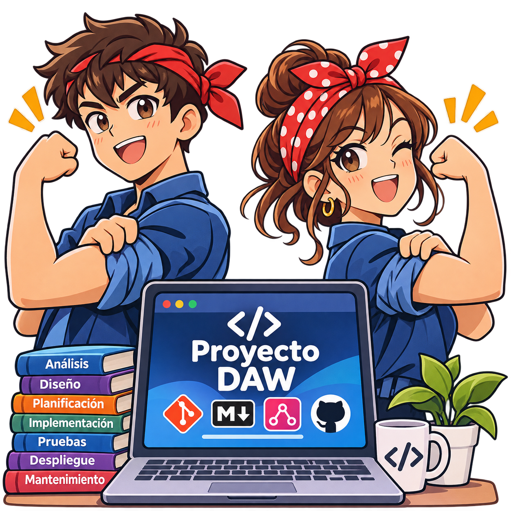
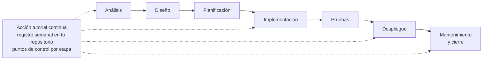
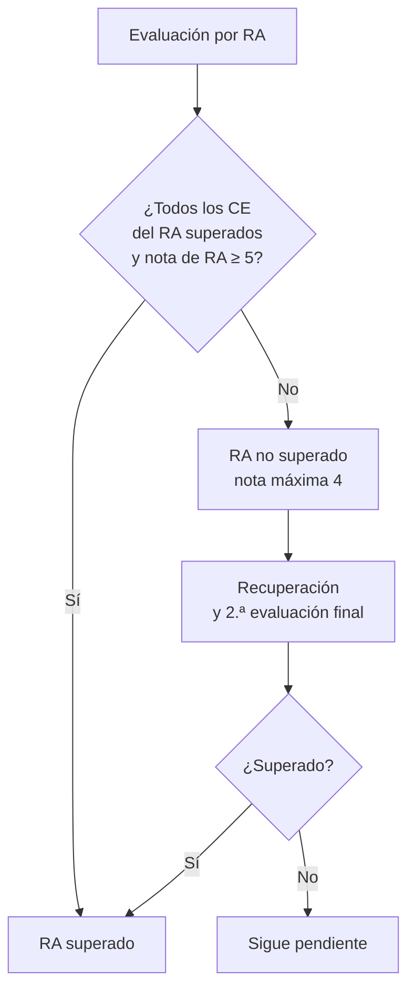

<div align="center">



# Proyecto intermodular de Desarrollo de Aplicaciones Web

**Tutoría y material del proyecto · 2.º de Desarrollo de Aplicaciones Web (DAW)**

CIFP Sectores Industriales y Servicios · Gijón (Asturias) · Curso 2026-27


</div>

---

> [!IMPORTANT]
> **¿Qué tengo que hacer ahora? → [Hito H1: hoja de ruta paso a paso](docs/hitos/H1.md)** (entrega el 26-nov). Cada paso te enlaza a lo que necesitas; el resto de este repositorio es material de consulta.

---

## Índice

1. [Qué es este repositorio](#qué-es-este-repositorio)
2. [Datos del módulo](#datos-del-módulo)
3. [Qué vas a aprender](#qué-vas-a-aprender)
4. [Cómo es el proyecto](#cómo-es-el-proyecto)
5. [Calendario](#calendario)
6. [Evaluación](#evaluación)
7. [Cómo trabajamos](#cómo-trabajamos)
8. [Estructura del repositorio](#estructura-del-repositorio)
9. [Requisitos](#requisitos)
10. [Normas de convivencia y autoría](#normas-de-convivencia-y-autoría)
11. [Licencia](#licencia)

> [!NOTE]
> Este repositorio está **en construcción**: el contenido se publica a medida que avanza el curso. Las fechas y el reparto de sesiones son **provisionales** hasta que se aprueben el calendario del curso 2026-27 y la programación del módulo.

---

## Qué es este repositorio

Aquí está el **material de apoyo del proyecto intermodular** del ciclo: guías, plantillas de entregable y rúbricas para que sepas qué se espera de cada etapa y cómo se evalúa.

El **objetivo principal** del proyecto de fin de ciclo es que tengas la **experiencia** de:

- **Desarrollar un proyecto real** que integre lo aprendido en el ciclo, recorriendo **todas las etapas del desarrollo de software**: análisis, diseño, planificación, implementación, pruebas, despliegue y mantenimiento.
- **Trabajar de manera profesional y con estándares actuales**: Git, ramas y Pull Request, documentación versionada, Kanban y decisiones justificadas.
- **Tener una evidencia de tu aprendizaje** (tu repositorio, tu documentación y tu memoria) para enseñarla cuando quieras incorporarte al mercado laboral.

Para ello cuentas con una **acción tutorial continua** durante todo el curso.

Todo el material está en **Markdown**, y los diagramas, en **Mermaid**, que GitHub dibuja directamente en la página.

---

## Datos del módulo

| | |
|---|---|
| **Módulo** | Proyecto intermodular de desarrollo de aplicaciones web (0616) |
| **Ciclo** | Técnico Superior en Desarrollo de Aplicaciones Web, 2.º curso (código 2VIFC303 en el centro) |
| **Familia profesional** | Informática y Comunicaciones |
| **Duración** | 25 h en 2.º (el módulo suma 50 h: 25 en 1.º y 25 en 2.º) · 5 ECTS. Este curso arrancamos el 6-nov con una sesión de inicio de 2 h (fuera de las horas de la programación), seguida de 18 sesiones presenciales y seguimiento a distancia |
| **Profesor** | Tever Díaz |

### Horario semanal

| Día | Horario | Duración |
|---|---|---|
| Jueves | 16:25 – 17:20 | 55 min |

Durante el periodo de formación en empresa (3 de marzo a 19 de mayo de 2027, fechas previstas) **no hay sesiones presenciales**: el seguimiento es a distancia en el aula virtual.

---

## Qué vas a aprender

El módulo se organiza en **4 resultados de aprendizaje (RA)** y **33 criterios de evaluación (CE)**. Al terminar, deberás ser capaz de:

| RA | Resultado de aprendizaje |
|---|---|
| **RA1** | Identificar necesidades del sector productivo, relacionándolas con proyectos tipo que las puedan satisfacer. |
| **RA2** | Diseñar proyectos relacionados con las competencias expresadas en el título, incluyendo y desarrollando las fases que lo componen. |
| **RA3** | Planificar la ejecución del proyecto, determinando el plan de intervención y la documentación asociada. |
| **RA4** | Definir los procedimientos para el seguimiento y control en la ejecución del proyecto, justificando la selección de variables e instrumentos empleados. |

El módulo trabaja la **gestión del proyecto** (análisis, diseño, planificación y control). El código de tu proyecto lo evalúan además los módulos de 2.º que lo trabajan (entorno cliente, entorno servidor, diseño de interfaces y despliegue).

---

## Cómo es el proyecto

- Es **individual**: cada persona tiene su propio proyecto.
- Eliges una **necesidad real del sector** y el profesor la aprueba con unos criterios mínimos: necesidad documentada, alcance abordable en el tiempo, que integre lo aprendido en varios módulos de 2.º y que no use datos personales reales.
- Recorres las etapas del desarrollo de software con un **punto de control del tutor en cada una**.
- Integra lo aprendido en los demás módulos del ciclo: en [docs/relacion-con-modulos.md](docs/relacion-con-modulos.md) está qué aporta cada uno y en qué fase lo usas.



---

## Calendario

Arrancamos el **6 de noviembre de 2026** con una sesión de **Inicio del proyecto de 2 horas** (bases de la documentación y de los repositorios) y seguimos con la documentación inicial. Fechas **provisionales** (jueves de 16:25 a 17:20). El detalle de cada fase y sesión está en [docs/fases-del-proyecto.md](docs/fases-del-proyecto.md), que es la **fuente única de fechas**.

| Hito | Fecha | Qué se entrega |
|---|---|---|
| **H1** | 26-nov-2026 | Anteproyecto (RA1) |
| **H2** | 21-ene-2027 | Diseño y planificación (RA2 y RA3) |
| **H3** | 7-may-2027 | Memoria final y plan de seguimiento (RA4) |

El diagrama de Gantt completo está en [docs/fases-del-proyecto.md](docs/fases-del-proyecto.md#vista-general).

Las fechas de las sesiones de evaluación (parciales y finales) y de la defensa dependen del calendario del centro y se te comunicarán.

---

## Evaluación

- Tres **entregables (hitos)**: **H1** anteproyecto (RA1), **H2** diseño y planificación (RA2 y RA3) y **H3** memoria final y plan de seguimiento (RA4).
- Una **defensa oral presencial** e individual, donde explicas y respondes sobre tu proyecto. Comprueba la comprensión y la autoría.
- Los **cuatro RA** se tienen que superar (todos sus criterios con 5 o más) para aprobar el módulo.
- La nota final es **única** y se pone al terminar 2.º curso; el módulo no se convalida.



Los criterios de calificación y los soportes de corrección se publican en el aula virtual y aquí, cuando estén aprobados, antes de cada entregable.

---

## Cómo trabajamos

> La **metodología de referencia** (ciclo de vida por fases + Kanban, GitHub Projects y documentación) está en [docs/metodologia.md](docs/metodologia.md).

- **Tutoría continua**: no solo los jueves; también entre sesiones y durante la formación en empresa, a través del aula virtual.
- **Cada semana** actualizas tu repositorio (commits pequeños y con sentido, mensajes convencionales) y dejas un **registro de tutoría**: horas dedicadas, acuerdos, avances, bloqueos y siguiente paso. Se lleva la **evolución del cumplimiento de los plazos y de la carga de trabajo** del proyecto para ayudarte a tiempo; qué se mira y para qué, en la [metodología](docs/metodologia.md#51-seguimiento-del-cumplimiento-de-los-plazos-y-de-la-carga-de-trabajo).
- **Tutoría colectiva e individual**: sesiones de grupo para presentar cada etapa y sesiones breves por persona.
- **Uso de IA**: permitido, pero **se declara** (herramienta, qué pediste, qué aceptaste o cambiaste). La IA no califica y la autoría se comprueba en la defensa.
- **Git desde el primer día**.

---

## Estructura del repositorio

```text
proyectosDAW/
├── README.md                ← estás aquí
├── LICENSE
├── plantilla-proyecto/      ← plantilla del repositorio de tu proyecto (docs, Issues y PR)
└── docs/                    ← guías para el alumnado → empieza por docs/README.md
    ├── README.md            ← índice: qué necesitas y dónde está
    ├── fases-del-proyecto.md  ← fases, sesiones e hitos (fuente única de fechas)
    ├── metodologia.md       ← metodología de referencia
    ├── relacion-con-modulos.md ← cómo se relaciona el proyecto con cada módulo del ciclo
    ├── realidadLaboral/     ← qué pide el mercado y cómo entra la IA
    ├── formacionComplementaria/ ← formación opcional y plantillas asociadas
    ├── guiaProyecto/        ← guía de cómo hacer los pasos del proyecto
    └── img/                 ← logo del proyecto
```

Tu proyecto **no** se sube a este repositorio: vive en tu propio repositorio, que creaste desde la plantilla en la sesión de inicio. Las carpetas aparecen según se publica el material.

---

## Requisitos

- **Git** y una cuenta de GitHub.
- Las herramientas de desarrollo de tu proyecto (las de los módulos de 2.º).
- Acceso al **aula virtual** del módulo.

Clonar el repositorio:

```bash
git clone https://github.com/profeFPInfor/proyectosDAW.git
cd proyectosDAW
```

Para actualizar el material cuando se publique algo nuevo:

```bash
git pull
```

---

## Normas de convivencia y autoría

- El proyecto es **individual**, salvo que el profesor indique lo contrario.
- Se pueden consultar documentación y recursos, pero **tienes que entender y poder explicar lo que entregas**.
- Si hay coincidencias difícilmente justificables entre entregas, se te puede pedir una **aclaración o revisión oral**.
- No incluyas **datos personales reales** ni información confidencial de una empresa sin su autorización escrita.
- Nunca subas contraseñas ni claves a ningún repositorio. Usa ficheros `*.example` con valores de mentira.

---

## Licencia

© 2026 **Tever Díaz**. Todos los derechos reservados.

Este material se facilita al alumnado del módulo para su **uso personal y educativo**. No puede copiarse, redistribuirse, publicarse ni usarse con fines comerciales sin autorización escrita de su autor. Tu proyecto es de tu autoría. Consulta el fichero [LICENSE](LICENSE) para los términos completos.
