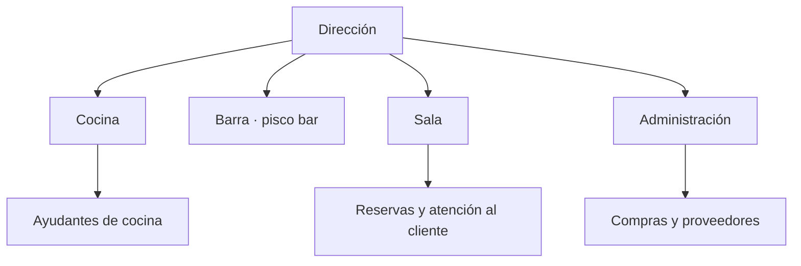

# 01 · Análisis y documentación inicial (RA1)

> **Plantilla.** Se entrega como **H1 el 26-nov-2026**. Cada apartado indica el criterio de evaluación (CE) que evidencia y qué se espera. Borra las notas en cursiva al rellenar.

## 1. Sector y empresas (CE 1a, 1b)

**Sector:** Restaurantes de comida peruana en España, con servicio en local y reserva de mesa.

**CNAE:** 56.11

| Empresa | Tamaño | Forma jurídica | Ámbito | Servicio | Fuente y fecha | Estado |
|---|---|---|---|---|---|---|
| Mi Huarique (Gijón) | 5 personas | S.L. | Local: una sede en Gijón | Casa cevichera y pisco bar; carta peruana; reserva online | [mi-huarique.com](https://mi-huarique.com) · 2026-11-26 | Leído |
| Qapaq (Tenerife) | 4 personas | S.L.U | Local: sur de Tenerife | Cocina peruana y mediterránea; menús degustación, infantil y vegetariano; reserva online | [qapaqtenerife.com](https://qapaqtenerife.com/) · 2026-11-26 | Leído |
| Entre Dos Mons (Palamós) | 5 personas | Sociedad Civil | Local: una sede en Palamós | Fusión peruana y catalana; menús y cheques regalo; reserva online | [entredosmons.es](https://entredosmons.es/) · 2026-11-26 | Leído |
| Inti de Oro (Madrid) | 11 a 50 personas | S.L. | Regional: cuatro sedes en Madrid | Cocina peruana; reserva online, a domicilio, menú degustación y terraza | [intideoro.com](https://intideoro.com/) · 2026-11-26 | Leído |
| Grupo Quispe (Madrid) | 11 a 50 personas | S.L. | Nacional: Madrid y una sede en Lisboa | Grupo de restaurantes peruanos y nikkei: Quispe, Ponja y Sillao | [grupoquispe.com/es/historia](https://www.grupoquispe.com/es/historia) · 2026-11-26 | Leído |

**Agrupación de las empresas:**

- **Restaurante peruano de una sola sede:** Mi Huarique, Qapaq, Entre Dos Mons.
- **Grupo con varias sedes:** Inti de Oro (cuatro en Madrid), Grupo Quispe (varias marcas en Madrid y Lisboa).

**Empresa tipo: Mi Huarique.** La elijo porque representa el caso más común de la tabla restaurante peruano de una sola sede y su web publica carta, bodega, cócteles y reserva, suficiente para describir sus departamentos.

*Organigrama y funciones: deducción mía a partir de lo que publica su web. La empresa no publica su estructura.*

- **Dirección:** decide carta, precios y horarios, y responde del negocio.
- **Cocina:** prepara los ceviches y los platos de carta (lomo saltado, ají de gallina, anticuchos).
- **Ayudantes de cocina:** preparan el género y apoyan en el servicio.
- **Barra · pisco bar:** prepara los cócteles de pisco (chilcano, pisquiri) y sirve la bodega.
- **Sala:** atiende a los clientes y organiza las mesas durante el servicio.
- **Reservas y atención al cliente:** gestiona las reservas por la web y por teléfono.

## 2. Necesidades y oportunidades (CE 1c, 1d)

**Criterio de orden:** cuántas de las cinco webs del apartado 1 ya ofrecen esa función. Cuantas más la ofrecen, más extendida está la necesidad. Aviso: una web enseña lo que el restaurante decidió vender, no necesariamente lo que le piden sus clientes.

1. **Reservar mesa sin llamar** (4 de 5): Mi Huarique, Qapaq, Entre Dos Mons e Inti de Oro.
2. **Consultar la carta actualizada** (4 de 5): las mismas cuatro.
3. **Leer la información en otro idioma** (2 de 5): Qapaq (inglés) y Entre Dos Mons (catalán, inglés y francés).
4. **Contratar menús para grupos y eventos** (2 de 5): Qapaq (cena de empresa) y Entre Dos Mons (menús y cheques regalo).

**Dato del sector:** Madrid tiene más de **300 restaurantes peruanos** (según el Ayuntamiento) y en toda España pasan de **600** (según el Ministerio de Relaciones Exteriores de Perú, presentado en Madrid Fusión). En Madrid solo la cocina italiana la supera, con **664** (datos de GastroRanking). Fuente: [El Confidencial, 2026-11-14](https://www.elconfidencial.com/gastronomia/2026-11-14/cocina-peruana-barrio-conquista-espana_4462564/), consultado el 2026-11-26 · `leído`.

**Valoración de la oportunidad:** Hay mercado y crece, pero algunas necesidades como reservar mesa sin llamar o consultar una carta actualizada no estan sin cubrir. Cuatro de cada cinco restaurantes de la tabla ya dejan reservar por internet y tienen una carta actualizada, así que no se inventa nada en ese aspecto, solo cubre una carencia concreta de un local que aún toma las reservas por teléfono y en papel. Por otro lado la parte de leer la información en otro idioma y poder contratar menús para grupos y eventos es algo que solo hacen 2 de las 5 empresas con lo que puedo ver que hay un pequeño margen en el que se puede innovar.

## 3. Tipo de proyecto elegido (CE 1e)

**Tres respuestas posibles al problema:**

| Opción | Qué es | Coste | Tiempo | Encaje con lo que sé | Encaje con los módulos de 2.º |
|---|---|---|---|---|---|
| **A. Aplicación web a medida** | Frontend + backend Java/Spring Boot + base de datos SQL; reservas para clientes y panel de gestión | 0 € de licencias (software libre); el coste es el tiempo | El del curso: varias semanas | Medio: HTML/CSS bien, JavaScript y backend | Alto: toca DWEC, DWES, DIW Y DAW |
| **B. Adaptar una herramienta existente (TheFork)** | Contratar la plataforma y configurar el restaurante | Unos 30 € al mes de suscripción, más 2-4 € por comensal que reserva desde la plataforma | Días: alta y configuración | Bajo: no se programa | Bajo: no encaja con ningún módulo |
| **C. Aplicación móvil nativa** | App para iOS y Android, instalada en el teléfono del cliente | 0 € de licencias; cuenta de desarrollador de pago (precio no comprobado) | Meses: aprender el entorno móvil, además del backend | Bajo: no he programado apps móviles | Medio: tocaría DWEC y DWES, pero no DAW ni DIW |

*Fuente del coste de TheFork: [ZUI Technology, 2026-09-19](https://www.zuitechnology.com/es/blog/comisiones-thefork), consultado el 2026-11-26 · `leído`.*

**Elijo A.** Es la única que ejercita los módulos de 2.º y la única que cumple lo que pide el dueño: que las reservas se guarden en la base de datos del restaurante y se gestionen con un CRUD propio. Descarto **B** porque resolvería la necesidad más rápido y con menos riesgo, pero no es un proyecto del ciclo: no hay nada que programar ni que defender como propio, y a la cuota mensual se le suma una comisión por cada comensal que llega de la plataforma. Descarto **C** porque obliga a aprender un entorno nuevo (Kotlin, Swift o un framework multiplataforma) dentro del mismo plazo y porque el dueño necesita gestionar las reservas desde un ordenador, no desde el móvil: acabaría haciendo también la web. Además, una app nativa no encaja con DAW ni con DIW.

## 4. Requisitos y restricciones (CE 1f)

*Características que debe cumplir el proyecto, redactadas de forma **verificable** (no «debe ser rápido», sino «responde en menos de 2 s»). Parte de lo que has encontrado en [`01b-sota.md`](01b-sota.md).*

> **Guía.** Numera los requisitos **funcionales** como **RF-01, RF-02…** (qué hace el sistema) y los **no funcionales** como **RNF-01…** (cómo lo hace: rendimiento, seguridad, usabilidad, disponibilidad, accesibilidad). Las **restricciones** (plazo, presupuesto, tecnología obligatoria, normativa) como **REST-01…**. Cada requisito debe tener **una medida o una prueba**. Si aún no sabes cómo lo probarás, escribe «pendiente» y complétalo antes de H3.

| ID | Requisito | Tipo (funcional / no funcional / restricción) | Cómo se verifica |
|---|---|---|---|
| RF-01 | [RELLENAR] | funcional | |
| RNF-01 | [RELLENAR] | no funcional | |
| REST-01 | [RELLENAR] | restricción | |

### Matriz de trazabilidad

*Une cada objetivo con sus requisitos, y estos con lo que los implementa y los comprueba. Se rellena por completo al final del proyecto; en H1 basta con **objetivo y requisito**.*

> **Guía.** Ejemplo ficticio: *OBJ-01 Gestionar citas → RF-02 Crear una cita → CU-03 → `POST /citas` → prueba P-07.* Cada RF y cada RNF de la tabla anterior debe aparecer aquí.

| Objetivo | Requisito | Caso de uso | Pantalla o endpoint | Prueba o indicador |
|---|---|---|---|---|
| OBJ-01 [RELLENAR] | RF-01 | | | pendiente |

## 5. Obligaciones fiscales, laborales y de prevención (CE 1g)

*Las obligaciones que aplican a tu proyecto, **con su norma** y sus condiciones.*

## 6. Ayudas y subvenciones (CE 1h)

*Al menos **una** ayuda real: fuente, requisitos y plazo.*

## 7. Guion de trabajo (CE 1i)

*Fases, hitos y responsables del proyecto. Puede enlazar al tablero de GitHub Projects.*

## 8. Glosario

*Una cosa, un nombre: define los términos del dominio y de tu proyecto, y anota los sinónimos que **no** vas a usar en ningún documento. Con **5 términos** basta; crece con el proyecto.*

| Término | Definición | Sinónimos que NO uso |
|---|---|---|
| [RELLENAR] | | |

---

## Criterios de evaluación de este documento (RA1, texto literal)

- **1a)** Se han clasificado las empresas del sector por sus características organizativas y el tipo de producto o servicio que ofrecen.
- **1b)** Se han caracterizado las empresas tipo indicando la estructura organizativa y las funciones de cada departamento.
- **1c)** Se han identificado las necesidades más demandadas a las empresas.
- **1d)** Se han valorado las oportunidades de negocio previsibles en el sector.
- **1e)** Se ha identificado el tipo de proyecto requerido para dar respuesta a las demandas previstas.
- **1f)** Se han determinado las características específicas requeridas al proyecto.
- **1g)** Se han determinado las obligaciones fiscales, laborales y de prevención de riesgos y sus condiciones de aplicación.
- **1h)** Se han identificado posibles ayudas o subvenciones para la incorporación de nuevas tecnologías de producción o de servicio que se proponen.
- **1i)** Se ha elaborado el guión de trabajo que se va a seguir para la elaboración del proyecto.
