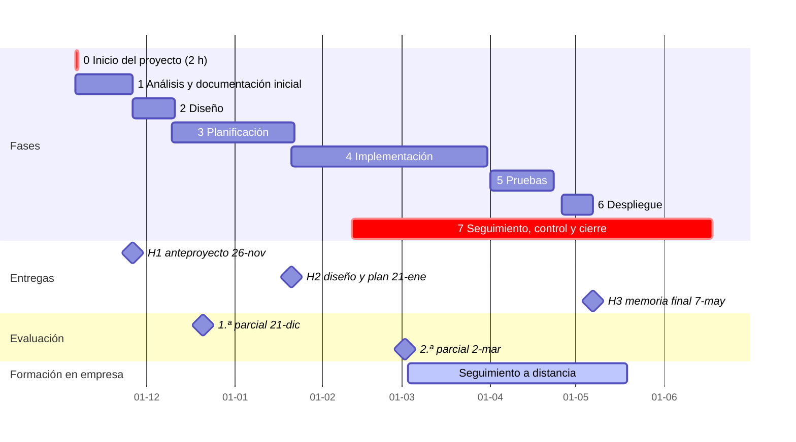

# Fases del proyecto

Qué vamos a trabajar y cuándo, de principio a fin. Sigue la [metodología](metodologia.md): **fases del ciclo de vida** con un punto de control del tutor al cerrar cada una y trabajo iterativo con Kanban dentro de cada fase.

> [!NOTE]
> **Arrancamos el 6-nov-2026** con la documentación inicial. Las fechas son **provisionales** hasta que se apruebe el calendario del centro. Las sesiones son los **jueves de 16:25 a 17:20** (55 min). Del 3-mar al 19-may no hay sesiones: es la formación en empresa.
>
> **El 6-nov, de 15:20 a 17:20, hubo una sesión especial de Inicio del proyecto** para dejar las bases de la documentación y de los repositorios de todos los proyectos (Fase 0). **Esas 2 horas no cuentan para las horas de la programación del módulo.**
>
> **Análisis y diseño se hacen sobre todo en casa:** en clase solo se dedican 2 sesiones a cada fase (≈ 2 h) para orientar, revisar y aprobar. **El trabajo se hace en casa.** La clase del jueves (1 sesión de 55 min) es de **briefing** (qué llevamos al día) y **dudas**; el resto de la ayuda se coordina **por correo** y la revisión se hace en el **Pull Request**. Canal y protocolo: [contacto y ayuda](guiaProyecto/contacto-y-ayuda.md).

## Vista general

## Las 8 fases (de la 0 a la 7)

### Fase 0 · Inicio del proyecto (6-nov, de 15:20 a 17:20)

Sesión de arranque para **sentar las bases** antes de empezar a analizar. No tiene calificación propia: deja la **línea base** que se comprueba al entregar H1. En la sesión se hacen dos cosas: **tu repositorio en GitHub** y **la documentación inicial**.

**1. Repositorio en GitHub (≈ 15:20 a 16:20)**

Cada alumno/a tiene **su propio repositorio**, en su cuenta, y el tutor **revisa el trabajo con su cuenta**: antes de integrar lo sensible (y tu primer PR) y, cada semana, el resto. Así el trabajo de tu proyecto se tutoriza paso a paso (ver [metodología](metodologia.md#42-bis-quién-revisa-qué-y-cuándo-tutoría-por-pull-request)).

1. Crea tu repositorio de proyecto (nombre: `proyecto-daw-<tu-apellido>`) a partir de la carpeta [`plantilla-proyecto/`](../plantilla-proyecto/) de este repositorio, que trae la estructura de la [metodología](metodologia.md#6-estructura-del-repositorio-de-tu-proyecto), las plantillas `docs/01-` a `04-`, las de Issue y Pull Request y el `CODEOWNERS`.
2. Añade el `.gitignore` y comprueba que no se sube ninguna clave ni dato personal. Usa el **correo `noreply` de GitHub** en tus commits, no tu correo personal.
3. **Invita al tutor como colaborador** (permiso de escritura) para que pueda revisar y aprobar.
4. Crea el tablero Kanban en GitHub Projects con las columnas acordadas y tu primer Issue.
5. Trabaja siempre en una **rama** (`docs/analisis-inicial`), haz commits con mensaje convencional y abre un **Pull Request** a `main`.
6. **El tutor revisa y aprueba (*Approve*) este primer Pull Request.** Una vez aprobado, lo integras tú en `main`. A partir de aquí, los cambios sensibles se marcan `necesita-tutor` y se aprueban antes de integrarlos; el resto se integra cuando se cumple la lista de comprobación y el tutor lo revisa después, en la revisión semanal.
7. Si tu repositorio lo permite, se activa la **protección de `main`** (exigir PR) y un fichero `CODEOWNERS` que pide la revisión del tutor solo en las rutas sensibles.

**2. Documentación inicial (≈ 16:20 a 17:20)**

En tu repositorio, en la misma rama y con tu primer PR:

- `docs/00-documentoInicio.md`: **documento de inicio del proyecto**: tus datos, nombre del proyecto, qué quieres hacer, qué necesidad resuelve, para quién, funcionalidades principales, tecnologías, módulos que integra, empresa y datos, riesgos y qué esperas aprender. El tutor lo aprueba el 12-nov.
- `README.md`: nombre del proyecto, una frase de qué problema resuelve y estado.
- `docs/01-analisis.md`: **esqueleto** con la idea del proyecto, la necesidad que cubre y las secciones de la plantilla de análisis (sector, requisitos, obligaciones, ayudas, guion de trabajo). En la sesión se rellena lo que se pueda; se completa hasta el 26-nov.
- `docs/registro-tutoria.md`: primera entrada (idea inicial, dudas, siguiente paso).
- `docs/declaracion-uso-ia.md`: creado, aunque esté vacío.

- **Entregable (en la propia sesión):** repositorio creado, tablero montado y un primer Pull Request **aprobado por el tutor e integrado en `main`**.
- **Se cierra cuando:** el tutor ve en pantalla que cada repositorio cumple la lista y lo anota en el registro de tutoría.
- **Después:** concretar el tema para el 12-nov (Fase 1).

### Fase 1 · Análisis y documentación inicial (6-nov a 26-nov) — **entrega H1**

- **Qué trabajamos:** la necesidad real del sector, quién la tiene, requisitos, obligaciones fiscales, laborales y de prevención, ayudas y guion de trabajo.
- **En clase (2 sesiones):** 12-nov y 19-nov. Presentación de propuestas, criterios de aprobación, plantilla y revisión. **El resto, en casa.**
- **Punto de partida:** el repositorio y el esqueleto de `docs/01-analisis.md` de la sesión de inicio (6-nov).
- **Entregable:** `docs/01-analisis.md` y una versión breve de `docs/01b-sota.md` (2-3 páginas: problema, soluciones existentes y hueco que cubre tu proyecto), entregados el **26-nov**. El resto del SOTA se completa en H2.
- **Congelación:** desde el **19-nov**, cada Pull Request espera la aprobación del tutor antes de integrarse. El PR de entrega se abre, recomendado, el **23-nov** y se integra como tarde el **25-nov**.
- **Hoja de ruta paso a paso:** [Hito H1](hitos/H1.md).
- **Criterios de evaluación:** RA1 (1a a 1i).
- **Se cierra cuando:** el tutor aprueba la propuesta y el análisis cumple los «Hecho cuando» de la [hoja de H1](hitos/H1.md).

### Fase 2 · Diseño (26-nov a 10-dic)

- **Qué trabajamos:** viabilidad técnica y alternativas, fases del proyecto, objetivos y alcance, recursos, presupuesto, financiación, arquitectura, datos e interfaz, y calidad a controlar.
- **En clase (2 sesiones):** 26-nov y 3-dic. **El resto, en casa.**
- **Entregable:** `docs/02-diseno.md` (avance sin nota; se califica dentro de H2). Revisión del tutor el 10-dic.
- **Criterios de evaluación:** RA2 (2a a 2i).
- **Se cierra cuando:** el tutor revisa el diseño y se puede planificar y empezar a implementar.

### Fase 3 · Planificación (10-dic a 21-ene) — **entrega H2**

- **Qué trabajamos:** cronograma y dependencias, recursos y logística, permisos y protección de datos, riesgos y su prevención, valoración económica y documentación de implementación.
- **En clase (3 sesiones):** 10-dic, 17-dic y 14-ene.
- **Entregable:** `docs/03-planificacion.md`, y con él H2 completo (diseño y plan), entregado el **21-ene**.
- **Criterios de evaluación:** RA3 (3a a 3h) y RA2.
- **Se cierra cuando:** el tutor revisa el plan. H2 entra en la 2.ª parcial (2-mar).

### Fase 4 · Implementación (21-ene a 31-mar)

- **Qué trabajamos:** desarrollar el producto en iteraciones cortas con el tablero, ramas, commits convencionales y Pull Request. Primera versión mínima funcional antes del 31-mar.
- **En clase (3 sesiones):** 21-ene, 28-ene y 4-feb. Briefing de avance y dudas sobre el repositorio; la implementación se hace en casa, con revisión por Pull Request y ayuda por correo (propuesta, a confirmar; ver [contacto y ayuda](guiaProyecto/contacto-y-ayuda.md)).
- **Después:** trabajo autónomo y los módulos de 2.º que lo evalúan (entorno cliente, servidor, interfaces); revisión semanal del tutor, también en la formación en empresa.
- **Se cierra cuando:** hay una versión mínima funcional en `main`.

### Fase 5 · Pruebas (1-abr a 23-abr)

- **Qué trabajamos:** plan de pruebas, verificación de los indicadores de calidad definidos en el diseño y corrección de fallos.
- **Sin sesiones:** seguimiento a distancia.
- **Se cierra cuando:** los indicadores de calidad se miden y los resultados quedan documentados.

### Fase 6 · Despliegue (26-abr a 7-may)

- **Qué trabajamos:** puesta en marcha en un entorno real o simulado y guía de despliegue.
- **Se cierra cuando:** la versión desplegada se puede probar y hay una guía.

### Fase 7 · Seguimiento, control y cierre (11-feb a 18-jun) — **entrega H3**

- **Qué trabajamos:** procedimiento de evaluación, indicadores de calidad, registro de incidencias y de cambios, evaluación por usuarios, pliego de condiciones, memoria final y defensa oral.
- **En clase:** 11-feb y 18-feb (seguimiento y control, RA4); 20-may y 27-may (defensa de la 1.ª evaluación final); 3, 10 y 17-jun (recuperación y 2.ª evaluación final).
- **Entregable:** `docs/04-seguimiento-y-control.md` y `docs/memoria.md`, entregados el **7-may** (**H3**).
- **Criterios de evaluación:** RA4 (4a a 4g) y la defensa de los cuatro RA.

## Sesión a sesión (jueves 16:25 a 17:20)

| N.º | Fecha | Fase | Qué hacemos |
|---|---|---|---|
| 0 | 6-nov, 15:20 a 17:20 | 0 Inicio | Repositorio en GitHub de cada proyecto y documentación inicial; primer PR aprobado por el tutor |
| 1 | 12-nov | 1 Análisis | Propuestas, criterios de aprobación y plantilla `01-analisis` |
| 2 | 19-nov | 1 Análisis | Revisión del avance: sector, necesidades, requisitos y obligaciones |
| 3 | 26-nov | 1 → 2 | **Entrega H1**; arranque del diseño: viabilidad, alcance y arquitectura |
| 4 | 3-dic | 2 Diseño | Datos, interfaz, presupuesto y calidad; revisión del diseño |
| 5 | 10-dic | 3 Planificación | Revisión del diseño (punto de control); cronograma y dependencias |
| 6 | 17-dic | 3 Planificación | Recursos, permisos y riesgos (1.ª parcial: 21-dic) |
| 7 | 14-ene | 3 Planificación | Valoración económica y documentación de implementación |
| 8 | 21-ene | 3 → 4 | **Entrega H2**; empieza la implementación (en casa, con revisión por PR) |
| 9 | 28-ene | 4 Implementación | Briefing de avance y dudas; implementación en casa |
| 10 | 4-feb | 4 Implementación | Briefing de avance y dudas; revisión del repositorio por PR |
| 11 | 11-feb | 7 Seguimiento | Evaluación de actividades, indicadores y evaluación por usuarios |
| 12 | 18-feb | 7 Seguimiento | Incidencias, cambios y pliego de condiciones |
| 13 | 25-feb | Reserva | Tutoría individual y acuerdo del plan para la formación en empresa |
| — | 3-mar a 19-may | Formación en empresa | Sin sesiones; implementación, pruebas y despliegue de forma autónoma; 70 min de seguimiento a distancia |
| 14 | 20-may | 7 Cierre | Defensas de la 1.ª evaluación final |
| 15 | 27-may | 7 Cierre | Defensas (continuación) |
| 16 | 3-jun | 7 Cierre | Recuperación |
| 17 | 10-jun | 7 Cierre | Recuperación |
| 18 | 17-jun | 7 Cierre | Recuperación y 2.ª evaluación final |

## Qué entregas en cada hito

| Hito | Fecha | Contenido | RA |
|---|---|---|---|
| **H1** | 26-nov | `docs/01-analisis.md` y `docs/01b-sota.md` (versión breve) | RA1 |
| **H2** | 21-ene | `docs/02-diseno.md` y `docs/03-planificacion.md` | RA2 y RA3 |
| **H3** | 7-may | `docs/04-seguimiento-y-control.md` y `docs/memoria.md` | RA4 |
| Defensa | 20 y 27-may | Presentación y preguntas, presencial e individual | RA1 a RA4 |

Cada hito se marca con una etiqueta en `main` (`h1`, `h2`, `h3`): es la versión que se evalúa.

## Horas

Hay **18 sesiones presenciales de los jueves (16,5 h)** y **70 min** de seguimiento a distancia: **17,67 h** de las 25 h nominales del módulo. La sesión de inicio del 6-nov (2 h) **no cuenta** para la programación. El resto es trabajo en casa y tutoría continua.

| Bloque | Sesiones | Horas |
|---|---|---|
| Análisis (en clase) | 2 | 1,83 |
| Diseño (en clase) | 2 | 1,83 |
| Planificación | 3 | 2,75 |
| Implementación guiada | 3 | 2,75 |
| Seguimiento y control + defensa (incluye 70 min a distancia) | 2 + 2 | 4,83 |
| Reserva antes de la formación en empresa | 1 | 0,92 |
| Recuperación | 3 | 2,75 |
| **Total** | **18 + 70 min** | **17,67** |

La sesión de inicio del 6-nov (2 h, de 15:20 a 17:20) queda fuera de este cómputo.
