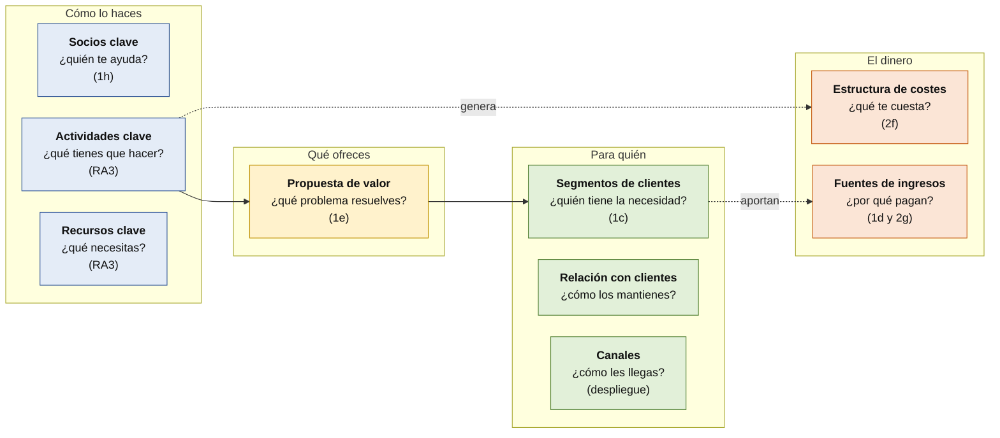

# Business Model Canvas (opcional)

El **Business Model Canvas** («lienzo de modelo de negocio») es una herramienta para describir, **en una sola página**, **cómo una empresa crea, entrega y obtiene valor**. Lo usan startups, consultoras y departamentos de producto, y encaja casi exactamente con lo que ya escribes en el análisis de tu proyecto. **Es opcional**: aquí tienes qué es, cómo aplicarlo y **cursos gratuitos** para aprenderlo.

> [!NOTE]
> **Borrador para revisar.** Confirma condiciones y plazos en la página oficial. Datos de noviembre de 2026. Las credenciales de estos cursos son **informales** (declaraciones de participación e insignias): **no son títulos**.

## Por qué te interesa

- Las empresas valoran que **entiendas el modelo de negocio** y puedas **traducir necesidades técnicas en soluciones**. Adecco lo llama «soft skill crítica». Mira [visión de negocio y análisis empresarial](negocio-y-producto.md).
- **Tu proyecto ya lo trabaja**: el análisis del sector, las oportunidades de negocio, los requisitos, el presupuesto y la financiación (RA1 y RA2). El Canvas es **una forma ordenada de presentarlo** y de **contarlo en la defensa**.
- Es **corto** (una página) y **gratuito**.

> [!NOTE]
> **Lo que no sabemos:** ningún estudio mide si saber usar el Canvas aumenta tus probabilidades de que te contraten. Es una herramienta **reconocida en el mundo empresarial**; su valor para ti es **pensar y explicar mejor tu proyecto**.

## Los nueve bloques

Entre paréntesis, **el criterio de tu proyecto** donde ya lo trabajas.

## Cómo aplicarlo a tu proyecto

| Bloque | Pregunta | Dónde lo escribes | Criterio |
|---|---|---|---|
| **Segmentos de clientes** | ¿Quién tiene la necesidad? ¿Qué empresa tipo? | `docs/01-analisis.md`: sector y empresas tipo | 1a, 1b, 1c |
| **Propuesta de valor** | ¿Qué problema resuelves y qué ganan? | `docs/01-analisis.md`: tipo de proyecto elegido y justificación | 1e |
| **Canales** | ¿Cómo llega el producto al cliente (web, aplicación, correo)? | `docs/02-diseno.md` y la guía de despliegue | 2 y despliegue |
| **Relación con clientes** | ¿Soporte, autoservicio, personalización? | Diseño y requisitos | 1f |
| **Fuentes de ingresos** | ¿Quién paga, qué y cuánto? (o **qué ahorra**, si es interno) | `docs/01-analisis.md` (oportunidades) y financiación | 1d, 2g |
| **Recursos clave** | ¿Qué personas, tecnología y datos necesitas? | `docs/03-planificacion.md` | RA3 |
| **Actividades clave** | ¿Qué hay que hacer para que funcione? | Planificación | RA3 |
| **Socios clave** | ¿Proveedores, servicios de nube, subvenciones? | `docs/01-analisis.md` (ayudas) | 1h |
| **Estructura de costes** | ¿Qué cuesta construirlo y mantenerlo? | `docs/02-diseno.md`: presupuesto | 2f |

**Si tu proyecto no es un negocio** (una herramienta interna, un servicio público, una asociación): sustituye «ingresos» por **qué ahorra o qué mejora** y «clientes» por **quién la usa**. El ejercicio sigue funcionando.

### Un ejemplo ficticio (para que veas el nivel de detalle)

> **Proyecto:** reservas en línea para pequeños talleres de oficios. *(Ejemplo inventado: no son datos reales.)*

| Bloque | Ejemplo |
|---|---|
| Segmentos de clientes | Talleres de menos de 10 personas que gestionan citas por teléfono |
| Propuesta de valor | Menos llamadas perdidas y una agenda siempre actualizada |
| Canales | Web responsive y avisos por correo |
| Relación con clientes | Autoservicio y soporte por correo |
| Fuentes de ingresos | Suscripción mensual por taller |
| Recursos clave | Backend en Java 21 con Spring Boot, base de datos y alojamiento |
| Actividades clave | Desarrollar, probar, desplegar y atender incidencias |
| Socios clave | Proveedor de nube y de correo |
| Estructura de costes | Alojamiento, dominio y tiempo de desarrollo |

## Seis pasos para hacerlo en una tarde

1. **Descarga el lienzo** (ver abajo) o usa la [plantilla en Markdown](plantilla-business-model-canvas.md).
2. **Empieza por la derecha**: *segmentos de clientes* y *propuesta de valor*. Si no sabes quién lo necesita, el resto no tiene sentido.
3. **Rellena los demás bloques** con **una frase cada uno**, con post-its o en papel.
4. **Comprueba la coherencia**: ¿los ingresos cubren los costes? ¿El valor encaja con el cliente?
5. **Valida con una persona real** (alguien de una empresa del sector, o de las prácticas).
6. **Pásalo a tu `docs/01-analisis.md`** y cita las fuentes de tus datos.

## Dónde aprenderlo gratis

| Recurso | Qué es | Coste | Qué hemos verificado |
|---|---|---|---|
| **Strategyzer: el lienzo** | El propio **Business Model Canvas**, de sus creadores | **Descarga gratuita** (PDF) | **Página oficial**: «free to download and to share with anyone on your team». Su licencia concreta **no figura en esa página** (un tercero habla de una licencia Creative Commons; no lo hemos comprobado). Strategyzer vende formación de pago |
| **OpenLearn: [*Business models in strategic management*](https://www.open.edu/openlearn/money-business/business-models-strategic-management/content-section-overview)** | Tipos de modelos de negocio y **construir un Canvas** | **Gratis**, **10 horas**, nivel intermedio | **Página oficial**. Declaración de participación gratuita |
| **OpenLearn: [*Entrepreneurship: from ideas to reality*](https://www.open.edu/openlearn/money-business/entrepreneurship-ideas-reality/content-section-overview)** | Crear un negocio de la idea a la acción. **El Canvas, en la sesión 3**; **financiación en la sesión 7** (inversión propia, deuda, subvenciones, *crowdfunding*, inversores) y tipos de empresa | **Gratis**, **24 horas** en 8 sesiones, nivel intermedio | **Página oficial**. Declaración de participación **y** **insignia digital** de la Open University al completarlo y aprobar los cuestionarios; la propia página dice que **la insignia no está acreditada por la universidad**; el curso tiene 24 puntos de desarrollo profesional (CPD) |
| **Coursera: *Business Model Canvas: A Tool for Entrepreneurs and Innovators*** (Kennesaw State University) | Curso para principiantes, unas 20 horas (2 semanas a 10 h) | **A comprobar** | **La página no confirma una opción gratuita**: describe un «curso completo sin certificado» solo en algunos cursos. Está en inglés |

**Un punto sin cubrir:** **no hemos encontrado un curso gratuito de Business Model Canvas en español que podamos verificar.**

### Opciones que hemos descartado

| Opción | Motivo |
|---|---|
| **Proyecto guiado de Coursera «Business Model Canvas y Business Case en Miro»** (español, 2 horas) | **No es gratuito**: está incluido en **Coursera Plus** (suscripción) y **no se puede auditar** |
| **Certiprof, *Business Model Canvas Essentials*** | Las páginas **se contradicen** (una en español lo marca como gratuito; otra en inglés muestra 50 USD) y **no hemos podido abrir la oficial** |
| **Cursos de agregadoras (Cursa y similares)** | Exigen instalar una aplicación para el certificado; contenido genérico |
| **Microcredencial de la Universitat Politècnica de València** (Canvas de triple capa) | **De pago** (282 € según el listado) |

## Cómo contarlo en la defensa o en una entrevista

En **dos minutos**:

1. **Para quién** es y **qué problema** tiene.
2. **Qué ofreces** y **por qué es mejor** que lo que ya existe.
3. **Cómo ganarías dinero** (o qué ahorraría).
4. **Qué te cuesta**.
5. **Qué dejaste fuera** y por qué.

## Avisos

- **Opcional.** El criterio de tu proyecto pide una «valoración razonada» y «requisitos verificables»; **no obliga a usar el Canvas**.
- **Escribe con precisión** en tu currículo: «**Declaración de participación de OpenLearn (The Open University)**», **no** «certificado de la universidad».
- **Cursos en inglés.** Es una oportunidad de practicarlo.
- **Cuentas externas:** usa tu **correo personal**.
- **No uses datos reales** de la empresa de prácticas ni de clientes en tus ejercicios.
- **No es un plan de negocio completo.** Resume ideas; **hay que validarlas** hablando con personas reales.

## Lo que no hemos podido comprobar

- **La licencia exacta** del lienzo de Strategyzer.
- **Si el curso de Coursera (Kennesaw State) ofrece una opción gratuita** actualmente.
- **El curso de edX de la Universidad de Delft** y la certificación de Certiprof.
- **Un curso gratuito en español.**
