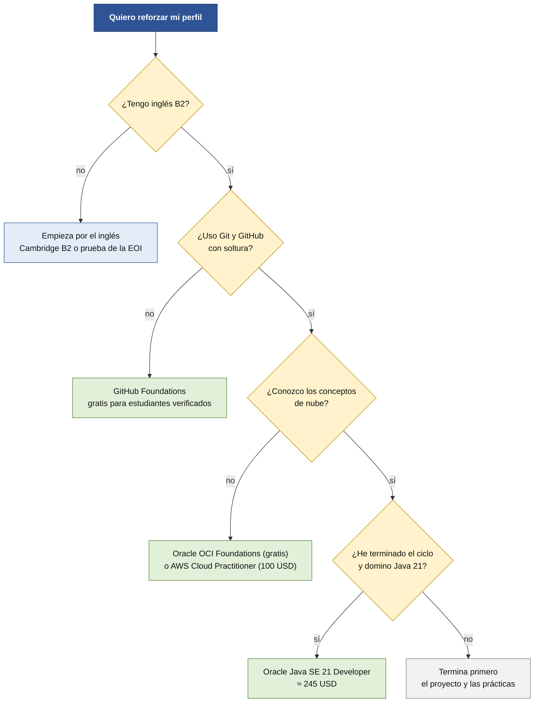

# Certificaciones: tres gratuitas y tres de pago

**Opcionales.** Elegidas porque cubren cosas que piden las ofertas o que suelen faltar a un recién titulado: **Git y trabajo en equipo, nube, inglés, Java y JavaScript**. Tu ciclo trabaja en **Java 21**.

> [!NOTE]
> **Borrador para revisar.** **Confirma precio, plazos y condiciones en la página oficial antes de pagar o registrarte.** Datos de noviembre de 2026. Cada ficha indica qué hemos podido comprobar y qué no.

## Resumen

| | Certificación | Coste | Para qué sirve | Cuándo (ver [itinerario](itinerario.md)) |
|---|---|---|---|---|
| **G1** | **GitHub Foundations** | **Gratis** si GitHub te verifica como estudiante | Git, GitHub y colaboración: lo que usas en el proyecto | Tras H2 |
| **G2** | **Oracle OCI Foundations** (y la de IA) | **Gratis** (examen) | Conceptos de **nube** y de IA | Tras H2 |
| **G3** | **freeCodeCamp** (examen supervisado) | **Gratis** | **JavaScript/TypeScript** y bases de datos | Cuando te vaya bien |
| **P1** | **AWS Cloud Practitioner** | **100 USD** | **Nube**, la competencia más pedida | Tras H2 o tras el ciclo |
| **P2** | **Cambridge B2 First** | **≈ 190-210 €** | **Inglés B2** | Tras el ciclo (prepara antes) |
| **P3** | **Oracle Java SE 21 Developer** | **≈ 245 USD** | **Java 21**, el lenguaje del ciclo | Tras el ciclo |

**Si dudas por dónde empezar:**

**Antes de elegir, lee esto:**

- **Ninguna oferta que leímos exigía una certificación.** Valen como **evidencia**, no como requisito.
- **No hay una certificación gratuita de uso de asistentes de IA compatible con Java.** La que existe (de Microsoft) exige C#.
- **Cuidado con «gratis».** Algunas webs siguen anunciando como gratuita la certificación de ciberseguridad de ISC2, que **dejó de serlo en mayo de 2026**.

## Gratuitas

### G1. GitHub Foundations

*Fuente oficial:* [blog de GitHub](https://github.blog/news-insights/company-news/students-start-building-your-skills-with-the-github-foundations-certification) (noviembre de 2024).

| | |
|---|---|
| **Qué demuestras** | Git (commits, ramas, *merges*), repositorios y productos de GitHub, colaboración, gestión de proyectos, Markdown |
| **Coste** | **Gratis para estudiantes verificados** por GitHub Education. En general cuesta 99 USD (cifra de terceros) |
| **Requisitos** | **13 años o más** y **estar matriculado en un programa que otorgue un título o diploma**, con **prueba de matrícula** |
| **Cómo se hace** | 1) Solicita **GitHub Education** y verifica tu estatus. 2) Registra el examen con el proveedor (PSI). 3) El **cupón se aplica solo al pagar** |
| **Plazo** | **60 días** desde el registro para presentarte; si no puedes, **cancela sin penalización** (si no cancelas, pierdes el cupón) |
| **Por qué te interesa** | Es el **flujo de tu proyecto**: repositorio propio, *issues*, tablero, *pull requests* |

> [!WARNING]
> **Dos avisos.** (1) **No hemos podido confirmar que tu centro cumpla los requisitos**; pruébalo tú. (2) Un hilo de Microsoft de enero de 2026 cuenta un caso en que el pago seguía mostrando importe pese a tener los beneficios. **El blog es de 2024: comprueba las condiciones actuales** y, si el importe no desaparece, **no pagues** y escribe a GitHub Education.

### G2. Oracle OCI Foundations Associate (y OCI AI Foundations)

*Fuente:* blog de Oracle University y webs de terceros. **No pudimos abrir la página oficial de registro.**

| | |
|---|---|
| **Qué demuestras** | Conceptos de nube (cómputo, red, seguridad, almacenamiento); la de IA, aprendizaje automático e IA generativa |
| **Coste** | Oracle indica que **los cursos y certificaciones de nivel *Foundations* son gratuitos**, incluida la de IA. Las promociones han caducado antes: **confírmalo** |
| **Examen** | Unas 40 preguntas, 60 minutos, 65 % para aprobar (**según terceros**; el código y la versión varían, confírmalos) |
| **Cómo se hace** | Crea una cuenta en la web de formación de Oracle, sigue el curso gratuito y registra el examen |
| **Por qué te interesa** | **Nube** es la competencia más pedida; **Java es de Oracle** |

> [!NOTE]
> **Honestidad:** en las ofertas aparecen más **AWS** y **Azure** que Oracle Cloud. Su valor es **aprender y demostrar el concepto de nube**, no la marca.

### G3. freeCodeCamp

*Fuente:* [anuncio oficial de freeCodeCamp](https://www.freecodecamp.org/news/freecodecamp-turns-10-major-curriculum-updates).

| | |
|---|---|
| **Qué demuestras** | Prácticas en JavaScript/TypeScript y bases de datos, con proyectos y un **examen supervisado** |
| **Coste** | «Completamente gratuitas» |
| ***Certified Full Stack Developer*** | Cientos de lecciones y laboratorios, un proyecto final revisado por la comunidad y un **examen de 90 preguntas** supervisado. Validez **3 años**, renovable gratis |
| **Estado** | El anuncio decía que saldría en Navidad de 2025. **No hemos confirmado que el examen esté abierto**; una reseña de terceros dice que la certificación de **JavaScript** ya está activa. **Comprueba cuál está disponible cuando vayas a hacerla** |
| **Por qué te interesa** | El **frontend** en JavaScript/TypeScript es lo que más piden las ofertas de fullstack (React o Angular con TypeScript) |

**Cuidado:** no es un título ni lo emite un fabricante. Parte del contenido repite lo que ya das en entorno cliente.

## De pago

### P1. AWS Certified Cloud Practitioner

*Fuente oficial:* [página de AWS](https://aws.amazon.com/certification/certified-cloud-practitioner/).

| | |
|---|---|
| **Coste** | **100 USD** (pueden sumarse impuestos y tipo de cambio) |
| **Examen** | **90 minutos, 65 preguntas** |
| **Validez** | **3 años** |
| **Requisitos** | Ninguno formal; está pensada para quien no tiene experiencia en nube |
| **Idiomas** | Incluye **español (España)** |
| **Extra** | **50 % de descuento** en otros exámenes de AWS tras aprobar cualquier certificación |
| **Por qué te interesa** | **Nube**: la competencia más pedida (7.020 ofertas en el estudio de Telefónica) y una brecha de las empresas asturianas |

### P2. Cambridge B2 First

*Fuente oficial:* [página de Cambridge English](https://www.cambridgeenglish.org/exams-and-tests/first/) (nivel y formato). Precios: fichas de matrícula de centros españoles.

| | |
|---|---|
| **Nivel** | **B2** del Marco Europeo |
| **Examen** | Cuatro partes, unas **3,5 horas**; en papel o en ordenador (es la misma titulación) |
| **Coste** | **190-210 €** según el centro (cada centro fija su tasa; algunos suman una tasa administrativa) |
| **Validez** | **La página no la indica.** Suele no caducar, pero no lo hemos verificado |
| **Dónde** | **No hemos localizado un centro en Asturias**: usa el buscador oficial de centros de Cambridge |
| **Por qué te interesa** | **La única exigencia explícita** en la oferta completa que leímos (Indra: inglés **B2**). El inglés aparece en otras ofertas |

**Alternativa pública:** el certificado B2 de la **Escuela Oficial de Idiomas** del Principado (pruebas de certificación). **No hemos encontrado la tasa de este curso para Asturias**; se publica en el BOPA y en la Consejería de Educación.

### P3. Oracle Certified Professional: Java SE 21 Developer (1Z0-830)

*Fuente:* webs de terceros. **No pudimos abrir la página oficial de Oracle.**

| | |
|---|---|
| **Coste** | **≈ 245 USD** (terceros) |
| **Examen** | Unas 50-60 preguntas; 90 o 120 minutos según la fuente; aprobado con el 68 % |
| **Requisitos** | Ninguno formal, pero exige **mucha soltura en Java** |
| **Validez** | Una fuente dice que no caduca; **sin confirmar** |
| **Por qué te interesa** | **Java con Spring Boot** domina el backend en las ofertas (6.320 ofertas con Java en el estudio de Telefónica; 1.347 en Tecnoempleo) y es **el lenguaje y la versión de tu ciclo** |

> [!WARNING]
> **Es la más difícil y la más cara del grupo.** Déjala para **después del ciclo**, con la base consolidada. Antes de pagar, **confirma en Oracle que el examen de Java 21 sigue abierto**. Existe también una versión de **Java 25** (1Z0-831), que algunas webs señalan como la más reciente; no está confirmada oficialmente.

## Preparación y reglas de los exámenes

- **Prepárate con el material oficial del fabricante** (suele haber cursos y exámenes de práctica gratuitos; confírmalo en cada web) y con lo que ya haces en el ciclo.
- **Los exámenes oficiales no son lugar para la IA.** Lee las reglas de cada uno: hacer trampa puede **invalidar la credencial**. Algunos exámenes son **supervisados** (cámara, pantalla, ratón).
- **Para estudiar sí puedes usar IA, pero bien**: pídele que te **explique y te pregunte**, no que te dé las respuestas. Los estudios muestran que delegar todo en la IA baja lo que aprendes. Mira [IA y aprendizaje](../realidadLaboral/ia-y-aprendizaje.md).
- **Datos y cuentas.** Usa tu **correo personal**. Comprueba la **edad mínima** de cada plataforma. **Nunca subas al repositorio códigos de cupón ni de examen.**

## Lo que no hemos podido comprobar

- Que **tu centro cumpla** los requisitos de GitHub Education, y que el canje funcione cuando lo solicites.
- Que el examen de **Oracle** (Foundations y Java 21) siga abierto y a qué precio.
- Qué certificación de **freeCodeCamp** está disponible cuando vayas a hacerla.
- **Validez** del Cambridge B2 First y de las certificaciones de Oracle.
- **Centros Cambridge en Asturias** y la **tasa de 2026** de la Escuela Oficial de Idiomas.
- **Cuánto tiempo necesitas** para prepararte: depende de ti.
- **Qué certificación valoran las empresas asturianas**: pregúntalo en las prácticas.
