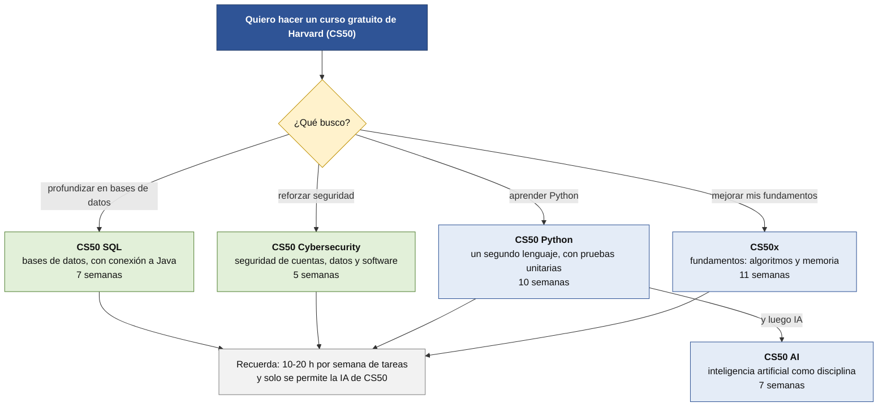

# Cursos gratuitos de Harvard (CS50)

Harvard ofrece cursos de programación **gratuitos y abiertos**, llamados **CS50**. **Son opcionales** y no sustituyen a nada de tu ciclo. **No hay ninguno de Java**, que es lo que das, pero **dos** pueden servirte.

> [!NOTE]
> **Borrador para revisar.** Datos de las páginas oficiales de CS50 (noviembre de 2026). El **precio del certificado de pago de edX no aparece en esas páginas**; las cifras que vimos (≈199 USD) son de terceros.

## Los dos que más te pueden servir

| Curso | Qué trabaja | Duración | Por qué |
|---|---|---|---|
| **CS50 SQL** | Consultas, normalización, uniones, vistas, **índices, optimización y escalado**; **SQL con Python y Java** | 7 semanas + proyecto | Profundiza en bases de datos y es **el único con conexión a Java** |
| **CS50 Cybersecurity** | Seguridad de **cuentas, datos, sistemas y software**; privacidad | 5 semanas + proyecto | La seguridad es una demanda creciente en las ofertas |

**Cómo elegir curso:**

## Otros, según lo que busques

| Curso | Para quién | Nota |
|---|---|---|
| **CS50x** | Quien quiera reforzar **fundamentos** (algoritmos, memoria) | 11 semanas. Usa C, Python, SQL y web, **no Java** |
| **CS50 Python** | Quien quiera un **segundo lenguaje** (Python, datos, IA) | 10 semanas, con **pruebas unitarias** en la semana 5. Python es el segundo en las ofertas de Tecnoempleo (1.190 frente a 1.347 de Java) |
| **CS50 AI** | Quien vaya hacia IA | 7 semanas; necesita CS50x o un año de Python. Es **IA como disciplina**, no programar con asistentes |
| **CS50 Web** | Normalmente no | Python, Django y React; tu ciclo ya cubre cliente y servidor |
| **Business, Lawyers, R, Scratch, 2D** | No encajan con un DAW | |

## Cómo funciona

- **Es gratis**, aunque no seas estudiante de Harvard. Para **entregar tareas y recibir corrección** necesitas una cuenta de **edX**.
- **Cada semana**: clases grabadas + tareas. **Corrección automática** de que funciona y del estilo.
- **Esfuerzo:** CS50 recomienda calcular **10-20 horas por semana** solo en las tareas (dato de CS50x; **no verificado** para los demás cursos).
- **Idioma:** las clases de CS50x están **dobladas al español y al portugués**; las tareas y la corrección son **en inglés**.

## El certificado: qué es y qué no es

| Credencial | Coste | Qué es |
|---|---|---|
| **Certificado CS50** | **Gratis** | Lo emite CS50. Necesitas **≥ 70 %** en todas las tareas obligatorias; **no hay examen final**. Se descarga con tu cuenta de GitHub |
| **Certificado verificado de edX** | **De pago** | Prueba de finalización emitida por edX |
| **Crédito de Harvard Extension** | De pago | Crédito transferible (no lo hemos revisado) |

> [!WARNING]
> **El certificado gratuito no es de Harvard.** La propia web de CS50 dice que sus certificados **no son ofertas académicas acreditadas** de Harvard ni de sus instituciones. En tu currículum escribe, por ejemplo, «CS50 SQL (curso abierto de Harvard, certificado de CS50)». **No escribas «certificado de Harvard»** a secas.

> [!NOTE]
> **Plazo:** la fecha límite actual para obtener el certificado de CS50x es el **30 de junio de 2027**. Para el resto de cursos no lo hemos verificado.

## La regla sobre la IA (muy importante)

**En CS50 solo puedes usar su propia IA** (el **CS50 Duck**, en cs50.ai y cs50.dev). **Está prohibido usar otras herramientas de IA** que sugieran o completen respuestas o líneas de código, y la política **menciona expresamente ChatGPT y Copilot**.

Esto **es distinto** de las reglas de tu proyecto, donde **la IA se permite y se declara**. Cada sitio tiene sus reglas y debes cumplir **las del sitio donde estás**.

- Usar IA no permitida en CS50 se trata **con severidad**: puede suponer una calificación insatisfactoria y **la baja del curso**.
- Si dudas, **no lo hagas** hasta tener aprobación por escrito de CS50. Tienen una cláusula de **arrepentimiento de 72 horas** si lo comunicas tú.

**Lo que se sabe del tutor Duck:** está diseñado para **no dar las respuestas ni el código**. Su responsable reconoce que **aun así entrega bloques de código hasta en una cuarta parte de los casos** y que hay que **desconfiar de lo que dice**. Conclusión práctica: aunque la herramienta esté pensada para ayudarte, **tú tienes que comprobar y entender** lo que te da.

## Cuándo hacerlo

**Después del ciclo** (junio en adelante) o, si ya vas muy sobrado, **tras la entrega H2** y siempre **sin tocar los plazos de H3 ni de las defensas**. Con 10-20 horas por semana, **no lo mezcles** con las semanas de cierre del proyecto. Mira el [itinerario](itinerario.md).

## Antes de empezar

- **Cuentas:** edX y, para el certificado, GitHub. Usa tu **correo personal**.
- **No lo anotes en tu proyecto como entregable**: es complementario. Sí puedes anotarlo en tu [registro de formación](plantilla-registro-formacion.md) y en tu portfolio.
- **Ninguna oferta que hemos leído pide CS50**: úsalo por lo que **aprendes**, no por el certificado.
