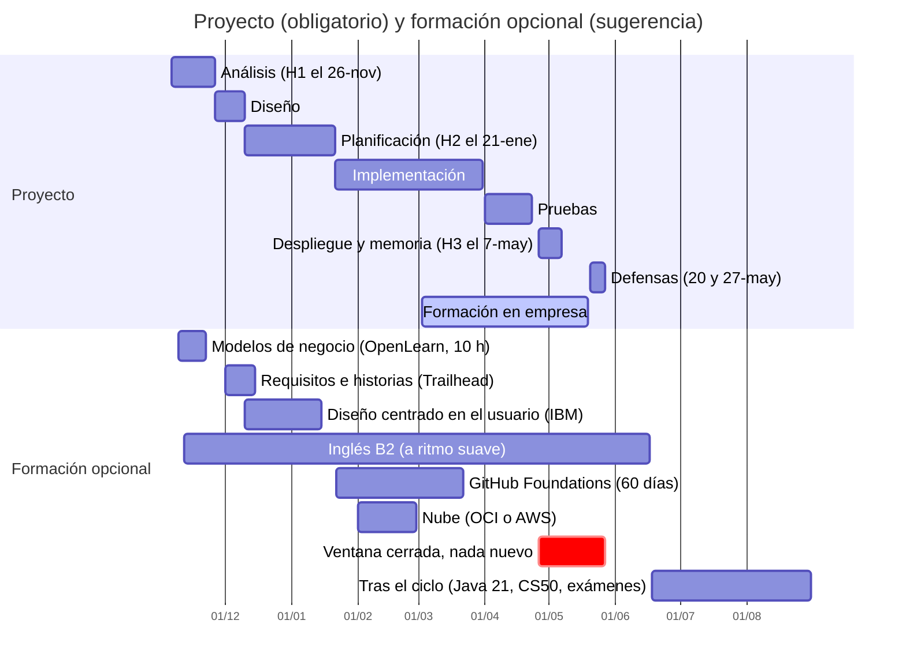

# Itinerario sugerido

**Es una sugerencia, no una obligación.** Coloca las formaciones opcionales donde **menos chocan con las entregas del proyecto**. Las fechas del proyecto son las de [fases-del-proyecto.md](../fases-del-proyecto.md) y son provisionales hasta que se apruebe el calendario del centro.

> [!NOTE]
> **Los tiempos de preparación no los conocemos.** Depende de tu base. Lo único que sí es oficial: CS50 calcula **10-20 horas semanales** de tareas (CS50x); el examen de GitHub Foundations debe presentarse en **60 días** desde el registro; el examen de AWS dura 90 minutos.

## Calendario

## Por momentos

### Hasta H2 (nov-ene): solo lo que alimenta tus entregas

Tienes **tres entregas en dos meses** (H1, avance de diseño y H2). **No empieces nada pesado.** Lo que sí puede ayudarte, porque **alimenta lo que ya tienes que escribir**:

- **Visión de negocio** ([guía](negocio-y-producto.md)): el curso de **modelos de negocio de OpenLearn (10 h)** y el [**Business Model Canvas**](business-model-canvas.md) (una tarde con la [plantilla](plantilla-business-model-canvas.md)) antes de redactar tu análisis (H1); **requisitos como historias de usuario** (≈ 35 min) y **design thinking** al diseñar. Son **opcionales** y **ligeros**.
- **Empieza a preparar el inglés** a ritmo suave (lectura, vídeos, series con subtítulos). Es lo que más tarda y lo que piden de forma explícita.
- **Pide tu cuenta de GitHub Education** si aún no la tienes, para poder usar el examen gratuito más adelante. Es solo un trámite.

### Tras H2 (finales de enero a febrero): el mejor momento para una certificación ligera

Empieza la implementación. Es la ventana más razonable **antes de la formación en empresa**:

- **GitHub Foundations** (gratis para estudiantes verificados). Lo usas cada semana en el proyecto, así que **ya sabes buena parte**. Recuerda: **60 días** desde el registro del examen.
- **Una de nube**: la gratuita de **Oracle OCI Foundations**, o **AWS Cloud Practitioner** si prefieres la de pago. Haz **una**, no las dos a la vez.

### Marzo a mayo (formación en empresa): solo lo ya empezado

Durante las prácticas **no empieces nada nuevo**. Tienes que implementar, probar y desplegar con seguimiento a distancia, y entregar **H3 el 7 de mayo**. Si ya preparabas inglés, sigue a ritmo suave.

### Del 26 de abril al 27 de mayo: nada nuevo

Despliegue, **H3 (7-may)** y **defensas (20 y 27-may)**. Es la parte en la que más hay que cuidar el proyecto. **Aplaza cualquier examen.**

### Después del ciclo (junio a agosto): lo exigente

Cuando acabes, con el ciclo cerrado:

- **Oracle Java SE 21 Developer** (examen exigente y caro; mejor con la base consolidada).
- **El examen de inglés** (Cambridge B2 o la Escuela Oficial de Idiomas), si lo has preparado.
- **CS50 SQL y CS50 Cybersecurity** (gratuitos). Ojo: la **fecha límite actual** del certificado de CS50x es el **30 de junio de 2027**; para el resto de cursos no la hemos verificado. Si no llegas, confirma si hay una edición nueva.

## Tres rutas según lo que busques

| Si quieres… | Ruta sugerida |
|---|---|
| **Lo mínimo útil** | Inglés + GitHub Foundations |
| **Reforzar el perfil backend en Java** | Lo mínimo + una de nube + Java SE 21 (tras el ciclo) + CS50 SQL |
| **Abrir la puerta a IA y datos** | Lo mínimo + CS50 Python → CS50 AI, y plantéate el curso oficial de IA y Big Data de FP |

## Si te falta tiempo

Quédate con **una**: **el inglés**. Es la única que aparece de forma explícita en una oferta completa que hemos leído, y la que más tarda en prepararse.
