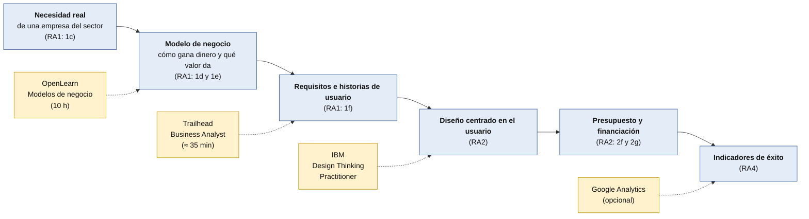

# Visión de negocio y análisis empresarial (opcional)

Entender **cómo gana dinero una empresa**, **qué necesita de verdad** y **cómo tu trabajo le aporta valor** es una de las cosas que piden las empresas además de programar. Aquí tienes **qué dicen los datos**, **qué ya haces en el ciclo** y **tres formaciones gratuitas** para reforzarlo. **Todo es opcional.**

> [!NOTE]
> **Borrador para revisar.** Confirma siempre condiciones y plazos en la página oficial. Datos de noviembre de 2026. Las credenciales de este documento son **informales** (declaraciones de participación e insignias): **no son títulos ni acreditaciones académicas**.

## 1. Qué dice la evidencia

| Fuente | Qué dice |
|---|---|
| **Adecco**, guía salarial TIC 2026 | «**Visión de negocio como soft skill crítica**: ya no basta con escribir código eficiente. El mercado demanda profesionales que **entiendan el modelo de negocio, identifiquen oportunidades de rentabilidad y puedan traducir necesidades técnicas en soluciones** con un impacto directo» |
| **Adecco** | En ventas de tecnología, los **junior mejor pagados** son los de **preventa técnica y consultoría de soluciones de IA**, donde «la capacidad de **traducir complejidad tecnológica en valor de negocio** se remunera claramente por encima» de otros perfiles |
| **Adecco** | Crece la presión sobre «perfiles senior, especialistas y **roles híbridos con visión de negocio**» |
| **Manfred**, guía salarial 2026 | El **fullstack «con un enfoque de producto y una fuerte integración de herramientas de IA»** se prevé como **el perfil más demandado y caro en 2026** |
| **BairesDev**, *Dev Barometer* | Los seniors dicen que los junior aportan **perspectiva fresca sobre UX y producto (62 %)** y **cuestionan supuestos (40 %)**. Y **el 70 %** pone en cabeza la **experiencia en proyectos reales** |
| **DigitalES** (vía prensa) | Las **competencias personales** son un criterio en el **41 %** de las ofertas (34 % en 2024). *Fiabilidad baja: no hemos leído el informe* |

**Cómo leerlo:**

- La evidencia es **sólida en lo que piden las empresas** y **más débil en cuánto pesa** al decidir. Casi todo viene de **consultoras y empresas de selección**, que describen lo que ven en el mercado. **Ningún estudio mide si saber de negocio aumenta tus probabilidades de que te contraten.**
- La idea de fondo es coherente con lo que vimos de la IA: **generar código es cada vez más fácil**, y **entender para qué sirve y qué problema resuelve** es lo que se diferencia.

## 2. Lo que ya haces en tu ciclo

Buena noticia: **el proyecto ya trabaja el análisis empresarial**, y es una de las partes que más distingue al título frente a un curso corto de programación.

| Dónde | Qué trabajas | Criterio |
|---|---|---|
| **Proyecto, RA1** (entrega H1, el 26-nov) | **Clasificar empresas del sector** por su producto o servicio y **caracterizar una empresa tipo** (organigrama y funciones) | 1a, 1b |
| | **Identificar las necesidades más demandadas** y **valorar las oportunidades de negocio** del sector, con datos | 1c, 1d |
| | **Elegir el tipo de proyecto** que responde a esas demandas y **justificarlo** | 1e |
| | **Requisitos y restricciones** del proyecto, redactados y verificables | 1f |
| | **Ayudas y subvenciones** | 1h |
| **Proyecto, RA2** (entrega H2, el 21-ene) | **Viabilidad técnica**, **presupuesto económico** y **necesidades de financiación** | 2b, 2f, 2g |
| **Itinerario personal II** | **Idea de emprendimiento validada** y **proyecto emprendedor** | RA4 y RA5 |
| **Digitalización aplicada** | **Proyecto de transformación digital de una empresa** | RA6 |

**Lo que suele faltar** no es el *qué*, sino **las herramientas con nombre** que usan las empresas para hacerlo bien: el **lienzo de modelo de negocio**, las **historias de usuario**, el **diseño centrado en el usuario** y las **métricas de éxito**. Para eso sirven las formaciones de abajo.

## 3. De la necesidad al producto

Azul: lo que ya haces en el proyecto. Amarillo: formación gratuita opcional que refuerza cada paso.

## 4. Las tres gratuitas principales

### 4.1 Modelos de negocio: *Business models in strategic management* (OpenLearn)

*Fuente oficial:* [página del curso en OpenLearn](https://www.open.edu/openlearn/money-business/business-models-strategic-management/content-section-overview) (The Open University).

| | |
|---|---|
| **Qué aprendes** | Distinguir y usar distintos **tipos de modelos de negocio**; **construir un modelo de negocio con el *Business Model Canvas***; y aplicar ese lienzo a tu **propio desarrollo profesional** |
| **Nivel y duración** | Intermedio; **10 horas** de estudio |
| **Coste** | **Gratis**. Puedes empezar sin registrarte; con una **cuenta gratuita** guardas el progreso y obtienes la credencial |
| **Credencial** | **Declaración de participación gratuita** (PDF). Para obtenerla hay que **leer todas las páginas y completar los cuestionarios** |
| **Idioma** | **Inglés** |
| **Valor formal** | **Ninguno** (no da créditos). Sirve para mostrar compromiso y conocimientos en el currículum o el portfolio |
| **Aviso del propio sitio** | La página que explica las declaraciones es de 2018 y avisa de que puede estar desactualizada |

**Cómo lo aplicas:** haz el **lienzo de tu proyecto** (una página) y úsalo en tu `docs/01-analisis.md` para los criterios **1d y 1e**. **Tiempo ideal: antes de redactar el análisis**, en las dos primeras semanas de noviembre.

**Guía propia del Canvas:** [Business Model Canvas](business-model-canvas.md) (los nueve bloques, cómo aplicarlo a tu proyecto, plantilla y más cursos).

**Y después, si te interesa:** el mismo sitio tiene [*Entrepreneurship: from ideas to reality*](https://www.open.edu/openlearn/money-business/entrepreneurship-ideas-reality/content-section-overview): **gratis, 24 horas en 8 sesiones**, con el Canvas en la sesión 3 y la **financiación** (inversión propia, deuda, subvenciones, *crowdfunding*) en la sesión 7. Da una declaración de participación y una **insignia digital** (la página aclara que no está acreditada por la universidad).

### 4.2 Análisis de negocio: *Cert Prep: Salesforce Business Analyst* (Trailhead)

*Fuente oficial:* [módulo en Trailhead](https://trailhead.salesforce.com/en/content/learn/modules/salesforce-business-analyst-certification-prep).

| | |
|---|---|
| **Qué aprendes** | El trabajo de un **analista de negocio**: **descubrimiento del cliente**, **colaboración con las partes interesadas**, **mapeo de procesos de negocio**, **requisitos**, **historias de usuario** y **aceptación por el usuario** |
| **Nivel y duración** | Intermedio; **unos 35 minutos** (cada módulo, unos 5) |
| **Coste** | Trailhead es **gratuito** (dato de terceros); **la página del módulo no muestra precio** |
| **Credencial** | **Insignia de Trailhead** (700 puntos) |
| **Idioma** | Inglés (no hemos comprobado si hay otros idiomas) |
| **Valor formal** | **Ninguno por sí sola.** La insignia **no es** la certificación de Salesforce, cuyo **examen es de pago** (precio no verificado) |

**Aviso importante:** es un módulo de **repaso** para un examen. Funciona mejor **tras una introducción**: Salesforce tiene un recorrido para empezar como analista de negocio (*dato de terceros*). **No te hace falta saber Salesforce.**

**Cómo lo aplicas:** escribe **tus requisitos como historias de usuario** («Como [persona], quiero [acción] para [beneficio]») y créalas como ***issues*** en tu tablero de GitHub. Sirve para el criterio **1f** y para tu planificación.

### 4.3 Diseño centrado en el usuario: *Enterprise Design Thinking Practitioner* (IBM)

*Fuente oficial:* [insignia en Credly (IBM)](https://www.credly.com/org/ibm/badge/enterprise-design-thinking-practitioner.1) y [preguntas frecuentes de IBM](https://www.ibm.com/training/enterprise-design-thinking/faq).

| | |
|---|---|
| **Qué aprendes** | **Design thinking** en la empresa: **colaboración, síntesis, investigación de usuarios, prototipado y narración** (*storytelling*). Habilidades asociadas: empatía, ideación, iteración, UX |
| **Nivel** | Fundamental |
| **Coste** | **Gratis** (la ficha de Credly indica «Cost Free») |
| **Cómo se obtiene** | **Completar el curso en línea** y **aprobar los cuestionarios con al menos un 80 %**. Hay que ser **usuario registrado de IBM SkillsBuild**; **adultos (18+) y estudiantes de secundaria tienen enlaces distintos** |
| **Credencial** | **Insignia digital de IBM** (a través de Credly) |
| **Duración** | **No consta una cifra** en la ficha |
| **Idioma** | No consta |

**Cómo lo aplicas:** en la **fase de diseño** (RA2), entrevista a **dos o tres usuarios reales**, haz un **prototipo** y **cuenta tu proyecto como una historia**: es un buen entrenamiento para la **defensa oral**.

**Avisos:** no hemos podido comprobar **la página de inscripción de IBM SkillsBuild** ni sus condiciones actuales; la ficha de Credly es la que indica que es gratuita.

## 5. Otras opciones gratuitas (a comprobar)

| Opción | Qué es | Estado |
|---|---|---|
| **Google Analytics (certificación de Skillshop)** | Medir el comportamiento de usuarios de una web y sus **métricas de negocio** (conversiones, uso). Útil para el **RA4** (indicadores) | Gratuita **según varias webs de terceros** (unas 50 preguntas, 75 minutos, 80 % para aprobar, **validez de 12 meses**). **No hemos abierto la página oficial de Google**: confírmalo |
| **Santander Open Academy** | Plataforma de cursos gratuitos con certificado del propio banco | Hay convocatorias con plazos; **no hemos confirmado un curso de modelos de negocio activo**. Mira la web |
| **MOOC de la EOI: iniciativa emprendedora** | Curso abierto sobre **Lean Startup y diseño de modelos de negocio** | Solo por terceros; **confirma en eoi.es** si sigue abierto y si el certificado es gratuito |
| **Recursos asturianos de emprendimiento** | **Valnalón** (educación emprendedora, con el *Taller de Empresarios* para FP) y **Clinic Joven Emprend@** (formación gratuita de Asturias Emprend@, cofinanciada por el Principado) | Por terceros y memorias antiguas; **pregunta en tu centro o consulta directamente**. Tiene valor local: **son las redes de las empresas asturianas** |

## 6. Cómo elegir

| Si quieres… | Haz esto |
|---|---|
| **Entender cómo gana dinero una empresa** | OpenLearn: modelos de negocio |
| **Ordenar tu proyecto en un lienzo de una página** | [Business Model Canvas](business-model-canvas.md) y su [plantilla](plantilla-business-model-canvas.md) |
| **Convertir una necesidad en requisitos claros** | Trailhead: Business Analyst |
| **Diseñar pensando en las personas que lo van a usar** | IBM: design thinking |
| **Medir si tu producto funciona** | Google Analytics |
| **Conectar con el ecosistema asturiano** | Valnalón y Asturias Emprend@ |

**Si solo haces una:** la de **OpenLearn**. Está pensada justo para **modelos de negocio** y encaja con lo que ya escribes en tu análisis.

## 7. Cómo usarlo en una entrevista

La habilidad de negocio se demuestra **hablando**. Prepara respuestas a:

- **«¿Para quién es tu proyecto y cómo ganaría dinero (o ahorraría costes)?»**: tu lienzo de modelo de negocio.
- **«¿Qué problema resuelve y cómo lo sabes?»**: tus entrevistas con usuarios y las historias de usuario.
- **«¿Cómo sabrías que funciona?»**: tus indicadores.
- **«¿Qué dejaste fuera y por qué?»**: tus decisiones de alcance y presupuesto.

Tu **análisis del sector, tu presupuesto y tus riesgos** (RA1 a RA3) ya son el material: solo hay que **saber contarlo**.

## 8. Avisos

- **Son credenciales informales.** Escribe en tu currículo «**Declaración de participación de OpenLearn (The Open University)**» o «**Insignia de IBM**», **no «certificado de la universidad»**. Mira la [plantilla de registro](plantilla-registro-formacion.md).
- **Están en inglés.** Es una ventaja si quieres practicarlo.
- **Cuentas externas.** Usa tu **correo personal**. IBM distingue entre **adultos (18+)** y **estudiantes de secundaria**.
- **No pongas datos reales** de la empresa de prácticas ni de clientes en tus ejercicios.
- **Opcional:** si te quita tiempo de las entregas, **aplázalo**. Mira el [itinerario](itinerario.md).

## 9. Lo que no hemos podido comprobar

- **La página de inscripción de IBM SkillsBuild**, su duración y sus condiciones actuales.
- **Que Trailhead no requiera ningún pago** para esta insignia (la página del módulo no muestra precio).
- **La página oficial de Google** para la certificación de Analytics.
- **Qué ofertas activas hay en Santander Open Academy, la EOI y los programas asturianos.**
- **Cuánto pesa la visión de negocio al contratar a un junior en Asturias**: no hay datos. Pregúntalo en las prácticas.
