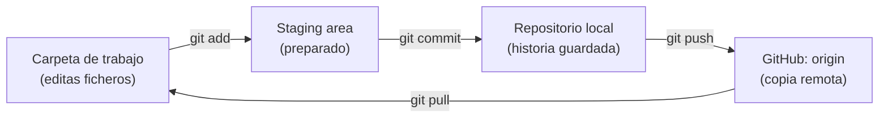
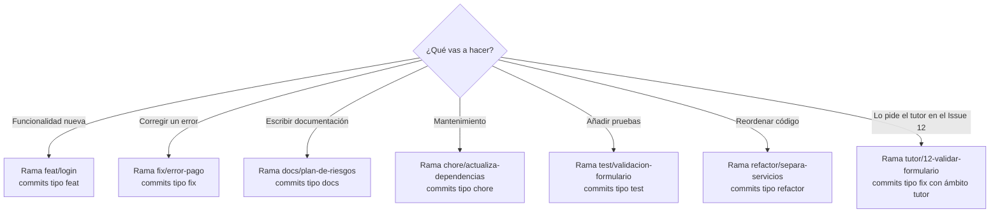
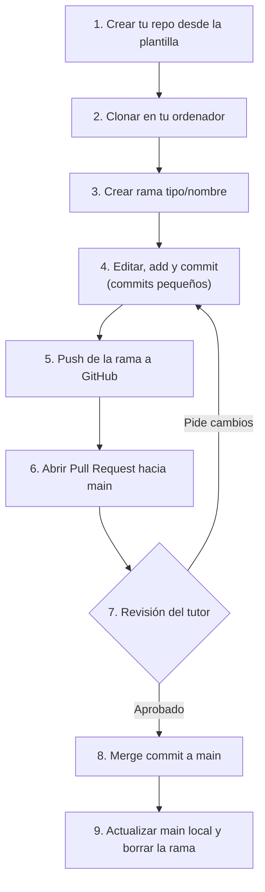
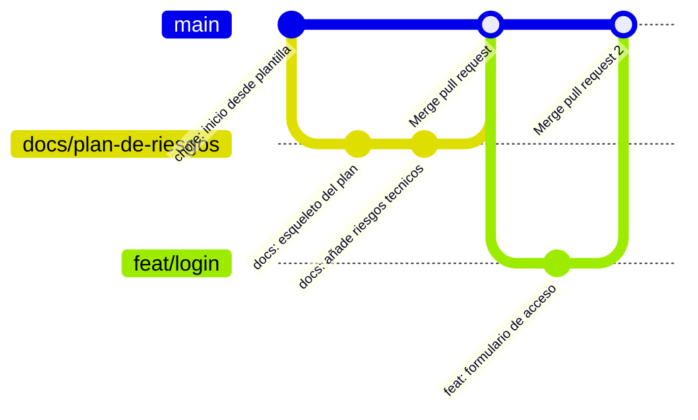
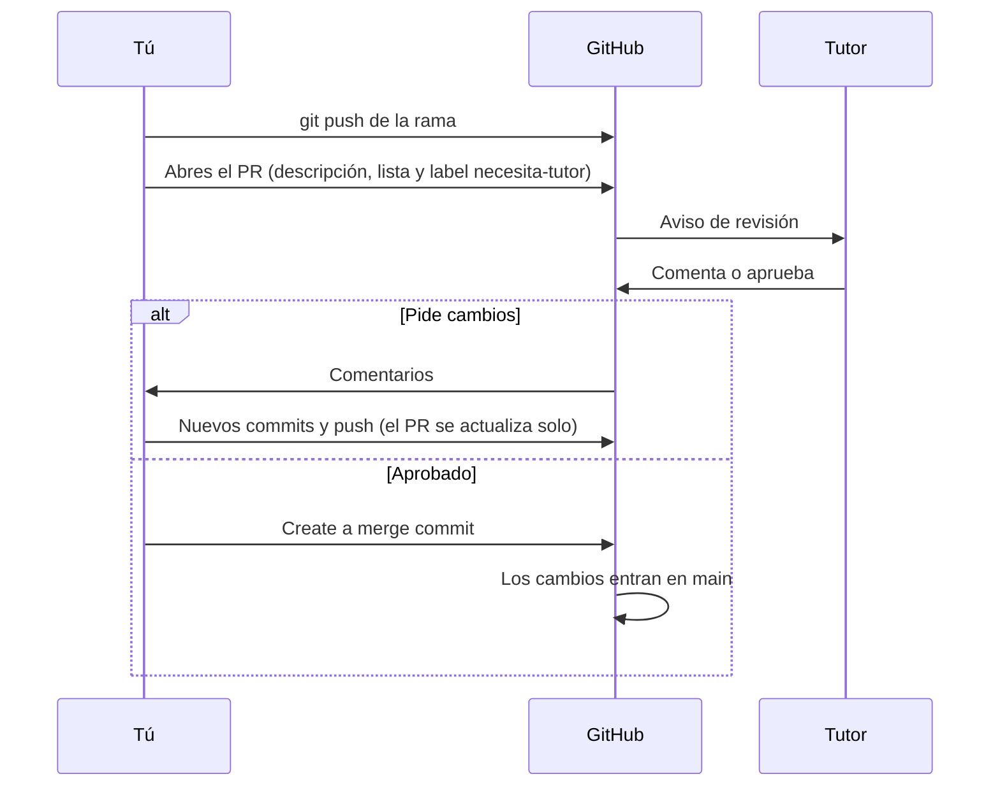
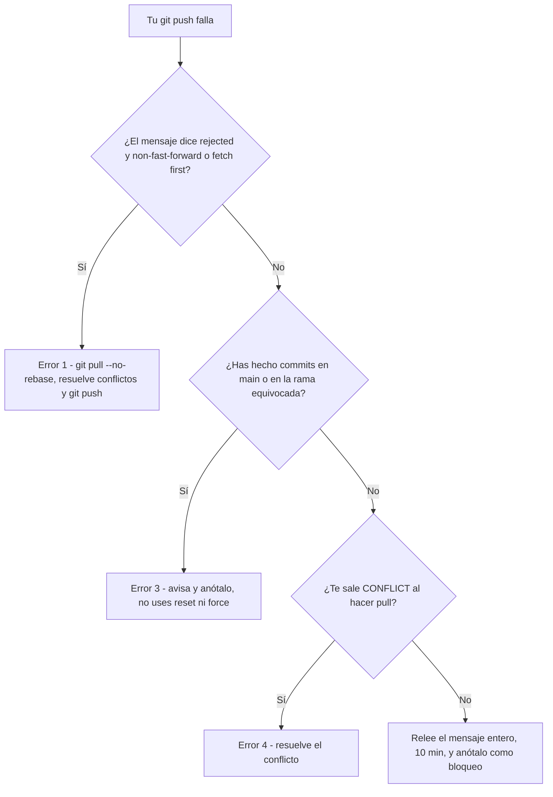
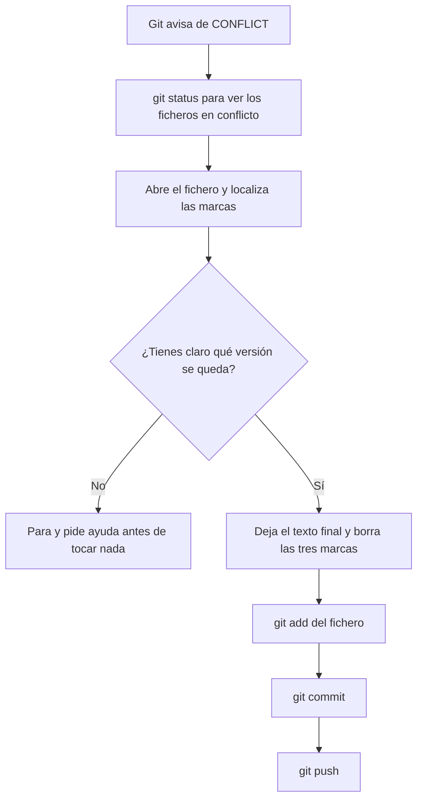

# 01 · Git y GitHub: versionar tu proyecto y hacer tu primer Pull Request

**Fase:** 0, inicio del proyecto: dejar listos tu cuenta y tu repositorio (un *hito* es una entrega con fecha; calendario en [`fases-del-proyecto.md`](../../fases-del-proyecto.md)) · **Tiempo:** ≈ 2 h repartidas en 2 semanas (1-1,5 h por semana; estimación **propuesta**, no medida con alumnado).

| | Lees (🟢 Esencial) | Haces (tarea de abajo) | Tiempo |
|---|---|---|---|
| **Semana 1** | «En 5 minutos», «Lo imprescindible», sección 4 y Pasos 0a a 5 de la sección 5.4 | Tarea 1 a 4: autenticación, identidad, clonar y primer commit | ≈ 1-1,5 h |
| **Semana 2** | Pasos 6 a 9 de la sección 5.4 y «Errores frecuentes» 1 y 4 | Tarea 5 y 6: `push` y abrir el PR; [Cómo pedir ayuda](../contacto-y-ayuda.md) si lo necesitas | ≈ 1 h |

El resto (secciones 1-3, 5.1-5.3, glosario, errores 2, 3 y 5, tarea 7) es el 🔵 **Al día**: léelo cuando quieras.

> Esta guía explica **cómo se trabaja en este proyecto**. Las reglas salen de [`docs/metodologia.md` §4.2](../../metodologia.md); aquí no se cambian, se explican. La revisión del tutor (vías A y B) está en [`§4.2 bis`](../../metodologia.md). Si necesitas ayuda mientras la sigues: [Cómo pedir ayuda](../contacto-y-ayuda.md).

## En 5 minutos

- **Git** es un programa en tu ordenador que guarda la **historia** de tu proyecto: cada cambio importante queda anotado (un *commit*) y puedes volver atrás.
- **GitHub** es un servicio web donde se **publica** esa historia, se revisa y se colabora. Git y GitHub **no son lo mismo**.
- Nunca trabajas directamente en `main`. Cada cambio va en una **rama** con nombre `<tipo>/<kebab-case>` (p. ej. `docs/plan-de-riesgos`; *kebab-case* = minúsculas con las palabras unidas por guiones, como un pincho de kebab), con commits tipo `docs: añade el plan de riesgos`.
- Tu trabajo llega a `main` (la rama principal) con un **Pull Request** (PR: una petición en GitHub para que revisen tus cambios antes de unirlos; ver glosario). Tu **primer PR lo revisa el tutor antes de integrarlo** (esto se llama **vía A**: revisión *antes* de integrar; la vía B es revisión *después*).
- Nunca se reescribe la historia: **sin `force push`**. El tutor mira tu historial para ver cómo avanzas.

## Lo imprescindible (esta semana)

1. Tener Git instalado, cuenta de GitHub y el correo `noreply` configurado en Git.
2. **Autenticarte en GitHub** (Paso 0c) antes del primer `clone` o `push`.
3. Crear tu repositorio **desde la plantilla** y clonarlo.
4. Hacer el ciclo: **rama → cambio → `add` → `commit` → `push` → PR**.
5. Reconocer los errores 1 y 4 de «Errores frecuentes» (los demás, cuando te salgan).

> Cada paso lleva una línea **Comprobar:** con un comando que solo *lee* y lo que debes ver. Si no coincide, no sigas: ve a «Si te atascas».

## 1. Qué problema resuelve el versionado

Sin versionado acabas con `memoria_final.docx`, `memoria_final_v2.docx`, `memoria_final_ahora_si.docx`, sin saber qué cambió ni cómo volver atrás.

Un **sistema de control de versiones** (Git es el más usado) resuelve cuatro cosas:

1. **Historia:** cada cambio queda guardado con fecha, autoría y un mensaje que explica el porqué.
2. **Vuelta atrás:** si algo se rompe, ves qué cambió y lo corriges.
3. **Trabajo en paralelo:** pruebas una idea en una *rama* sin romper la versión buena.
4. **Evidencia:** en este módulo tu historial es la prueba de que el trabajo es tuyo y de cómo evolucionó.

### Git frente a GitHub

| | **Git** | **GitHub** |
|---|---|---|
| Qué es | Programa de línea de comandos | Servicio web (plataforma) |
| Dónde vive | En tu ordenador | En internet |
| Qué hace | Guarda la historia de tu proyecto | Aloja copias, PR, Issues, revisión |
| ¿Sin el otro? | Funciona sin GitHub | No tiene sentido sin Git |

Piensa en Git como el **cuaderno** donde apuntas cada cambio, y en GitHub como la **carpeta compartida en la nube** donde el tutor lo puede leer.

## 2. Cómo se trabaja: las tres zonas

En tu carpeta de proyecto hay tres sitios por los que pasa un cambio:



- Editas ficheros (carpeta de trabajo).
- `git add` elige **qué cambios** entran en el siguiente commit (staging).
- `git commit` guarda una **foto** con un mensaje.
- `git push` sube tus commits a GitHub.

**Cómo leerlo:** sigue las flechas de izquierda a derecha: un cambio nace en tu carpeta, pasa a staging con `add`, se guarda con `commit` y se publica con `push`. `pull` hace el camino de vuelta.

## 3. Estándares para ramas y commits

> **Para saber más (opcional).** La tabla siguiente y la sección de SemVer son contexto: **no hacen falta para el hito**. Si tienes prisa, salta a «Qué usamos nosotros».

| Modelo | Idea | Ramas | Para quién encaja | Estado de la fuente |
|---|---|---|---|---|
| **GitHub Flow** | Una rama por cambio, PR, revisión, merge a la rama principal, borrar la rama | `main` + ramas cortas | Equipos pequeños, entrega continua | **verificado** |
| **Git Flow** | Ramas fijas `develop`, `release`, `hotfix` además de `main` | Muchas, de larga vida | Productos con versiones y lanzamientos planificados | no leído |
| **Trunk-based** | Todos integran casi a diario en una única rama, con cambios muy pequeños | Muy pocas, muy cortas | Equipos con buena automatización de pruebas | no leído |

**Qué usamos nosotros: una variante de GitHub Flow.** *(Decisión del proyecto, `docs/metodologia.md` §4.2.)* Motivos: eres una persona sola con un tutor (no necesitas `develop` ni `release`) y una rama por cambio + PR da el **historial revisable** que pide el seguimiento semanal.

Lo que añade nuestra variante: `main` contiene **solo la versión entregable** y se marca con una **etiqueta de Git, o *tag*** en cada hito (`h1`, `h2`, `h3`). Cuidado: en GitHub hay otra cosa que también se traduce como «etiqueta»: la ***label*** (p. ej. `necesita-tutor`), una pegatina de color que se pone a un PR o Issue. En esta guía: **tag** = marca fija sobre un commit; **label** = pegatina de GitHub. Los tags de hito se ponen al llegar a cada hito: **ahora no tienes que crear ninguno**. El tutor te explicará los tags de hito cuando toque.

### Cómo nombramos las ramas

Formato: `<tipo>/<kebab-case>` (minúsculas, palabras separadas por guion, sin tildes ni espacios).

| Tipo | Úsalo para | Ejemplo ficticio |
|---|---|---|
| `feat/` | Funcionalidad nueva | `feat/login` |
| `fix/` | Corregir un error | `fix/error-pago` |
| `docs/` | Documentación | `docs/plan-de-riesgos` |
| `chore/` | Tareas de mantenimiento | `chore/actualiza-dependencias` |
| `test/` | Pruebas | `test/validacion-formulario` |
| `refactor/` | Reordenar código sin cambiar lo que hace | `refactor/separa-servicios` |
| `tutor/<n>-…` | Corrección que **pide el tutor** en el Issue número `n` | `tutor/12-validar-formulario` |

Reglas prácticas: nombre corto y descriptivo, **una rama = un cambio**, nada de `prueba`, `cosas` o `nueva2`.

Este diagrama ayuda a elegir el tipo: según lo que vas a hacer, te dice la rama y el tipo de commit que le corresponden (nombres ficticios).



**Cómo leerlo:** empieza en la pregunta de arriba y sigue la flecha que describe tu trabajo. El primer trozo de la rama (antes de `/`) coincide con el tipo de tus commits; en el caso del tutor, la rama lleva `tutor/` y el número del Issue, y el commit usa el tipo que toque con ámbito `tutor` (mira la tabla de commits de abajo).

### Cómo escribimos los commits: Conventional Commits

**Conventional Commits 1.0.0** es una especificación (estándar) para mensajes de commit. Formato:

```text
<tipo>[ámbito opcional]: <descripción>

[cuerpo opcional]
[pie opcional]
```

El *ámbito* es una palabra entre paréntesis que indica la parte afectada. Según la especificación, `feat` se usa cuando el commit añade una funcionalidad y `fix` cuando corrige un error. Nosotros usamos `feat`, `fix`, `docs`, `chore`, `test` y `refactor`. *(La especificación oficial solo fija `feat` y `fix`; los demás tipos son convención del proyecto.)*

| Mensaje | ¿Bien? | Por qué |
|---|---|---|
| `docs: añade el plan de riesgos` | Sí | Tipo + descripción corta en imperativo |
| `fix(tutor): valida el formulario vacío` | Sí | Ámbito `tutor` para correcciones del tutor |
| `cambios` | No | No dice qué ni por qué |
| `Feat: Login!!!` | No | Tipo en mayúscula, sin descripción útil |

### Versionado semántico (SemVer)

**No lo usamos.** Es una convención para numerar versiones (`1.4.2`) pensada para librerías que otros instalan. Aquí marcamos hitos con *tags* `h1`, `h2`, `h3`. Más adelante, consulta semver.org (estado en «Para saber más»).

## 4. Las reglas de este proyecto (resumen de §4.2)

1. `main` solo contiene la versión **entregable**. Nunca commit directo en `main`.
2. Ramas `<tipo>/<kebab-case>`; las del tutor, `tutor/<n>-descripcion`.
3. Commits en formato Conventional Commits.
4. **Sin `force push` y sin borrar commits.** Al integrar un PR eliges **«Create a merge commit»** (une la rama con un commit de unión y deja tus commits tal cual), no «Squash and merge» (aplasta todos tus commits en uno solo y pierdes el detalle). Así se conservan tus commits uno a uno.
5. Todo cambio llega a `main` por **Pull Request** con esta lista:
   - ✔ definición de hecho cumplida (la lista de criterios del Issue de la tarea que dice cuándo está terminada)
   - ✔ documentación actualizada
   - ✔ sin claves ni datos personales
   - ✔ pruebas pasan
6. En cada hito se crea un *tag* (`h1`, `h2`, `h3`) en `main`.
7. Usa el correo **`noreply`** de GitHub en tus commits.
8. **Tu primer PR** va por la **vía A** (revisión del tutor *antes* de integrar; la vía B es revisión *después*, ver [`§4.2 bis`](../../metodologia.md)): marca la *label* `necesita-tutor` y **no lo integres hasta que el tutor lo apruebe** (máximo 48 horas lectivas).

## 5. El flujo completo

### 5.1. Vista general



**Cómo leerlo:** sigue los números. Si el tutor pide cambios, vuelves al paso 4 y el PR se actualiza solo.

### 5.2. Cómo queda la historia (`gitGraph`)



**Cómo leerlo:** cada línea es una rama y cada punto un commit; el tiempo avanza hacia la derecha. Las ramas salen de `main` y vuelven con un *merge*. Fíjate: los commits de la rama **siguen visibles** después del merge. Eso es lo que pedimos con «merge commit».

### 5.3. El Pull Request por dentro



**Cómo leerlo:** el tiempo baja. Cada flecha es una acción entre dos participantes. El bloque `alt` son dos caminos posibles: o el tutor pide cambios y vuelves a subir, o aprueba y se integra.

### 5.4. Paso a paso con comandos

Ejemplo ficticio: usuaria `ana-ejemplo`, repositorio `proyecto-demo`.

**Paso 0a · Tener Git instalado (una sola vez).** Instálalo desde la [página oficial de descargas](https://git-scm.com/downloads) (hay instalador para Windows, macOS y Linux; en Linux también sirve el gestor de paquetes de tu distribución).

```bash
git --version
```

**¿Qué terminal?** Es la ventana donde escribes comandos. En **Windows**, el instalador de Git incluye **Git Bash**; úsala (o PowerShell si ya la manejas) y busca «Git Bash» en el menú Inicio. En **macOS**, abre la app *Terminal*. En **Linux**, la terminal de tu distribución. Los comandos de esta guía son iguales en todas; si algo difiere en tu sistema, la fuente es la [documentación oficial de Git](https://git-scm.com/downloads).

**Comprobar:** responde con algo como `git version 2.x.x`. Si dice «command not found» o «no se reconoce», cierra y abre la terminal; si sigue igual, la instalación no terminó.

**Paso 0b · Identidad (una sola vez).** Pon tu nombre y el correo `noreply` de GitHub. Lo ves en GitHub en *Settings → Emails*, con «Keep my email addresses private» activado. Formato: `ID+USUARIO@users.noreply.github.com`.

```bash
git config --global user.name "Ana Ejemplo"
git config --global user.email "123456+ana-ejemplo@users.noreply.github.com"
```

**Comprobar:** `git config --global user.email` debe mostrar el correo `noreply`.

**Paso 0c · Autenticarte en GitHub (una sola vez por ordenador).** *HTTPS* es hablar con GitHub por dirección web y *CLI*, un programa de línea de comandos. Para subir cambios (`push`) o clonar un repo privado, GitHub necesita saber quién eres. **La contraseña de tu cuenta ya no vale para Git**: la documentación de GitHub dice que la autenticación por contraseña para Git se ha retirado.

GitHub admite varios métodos (GitHub CLI, Git Credential Manager, token personal, SSH). **Aquí usamos uno solo, el más corto: GitHub CLI con HTTPS.**

1. Instala GitHub CLI desde [cli.github.com](https://cli.github.com/) (el comando se llama `gh`).
2. Ejecuta:

```bash
gh auth login
```

3. Responde a las preguntas: cuenta **GitHub.com**; protocolo **HTTPS**; cuando pregunte si autenticar Git con tus credenciales de GitHub, **Yes**; método **Login with a web browser**. Copia el código de un solo uso que te muestra, pulsa Intro, pégalo en la página que se abre en el navegador y autoriza.

**Comprobar:** `gh auth status` debe decir que has iniciado sesión en `github.com` con tu usuario (el texto exacto puede variar según la versión).

**Si falla:**

| Qué ves | Qué significa | Qué hacer |
|---|---|---|
| `gh: command not found` | `gh` no está instalado o la terminal no lo encuentra | Repite la instalación y abre una terminal nueva |
| Al hacer `push` te pide *usuario y contraseña*, o dice `Authentication failed` / `403` | Git no tiene credenciales válidas | Repite `gh auth login`; si Git sigue pidiendo contraseña, escribe un **token personal** en lugar de la contraseña (ver la nota de abajo) |
| `Repository not found` en un repo que sí existe | Estás en otra cuenta, o no tienes acceso | Mira `gh auth status` y `git remote -v` |

> [!NOTE]
> Un **token personal** (*personal access token*) es una contraseña larga que generas tú en GitHub (pasos oficiales: [Managing your personal access tokens](https://docs.github.com/en/authentication/keeping-your-account-and-data-secure/managing-your-personal-access-tokens), sección «Creating a personal access token (classic)») y que sustituye a la contraseña de tu cuenta. **No lo pegues en el chat de una IA ni en un correo, ni lo guardes en un fichero del repo ni en un commit** (ver [04 · Claves y datos personales](04-claves-y-datos-personales.md)). Alternativas oficiales, por si no puedes usar `gh`: Git Credential Manager (incluido en Git para Windows) o claves SSH (*SSH* = otro modo de conexión con claves en lugar de contraseña). Si ninguna te funciona, consulta [Cómo pedir ayuda](../contacto-y-ayuda.md).

**Paso 1 · Crear tu repo desde la plantilla.** (Este paso es para tu repo de **proyecto**; para el repo de **práctica** ver la tarea, que también explica cómo crearlo a mano.) La plantilla del proyecto está en [`plantilla-proyecto/`](../../../plantilla-proyecto/) y el tutor te dirá desde qué repositorio crearla. En su página pulsa **Use this template → Create a new repository**, elige tu cuenta como propietaria, pon nombre y **Create repository from template**. A diferencia de un *fork* (copia de un repo ajeno en tu cuenta; ver glosario), empieza con un solo commit y es un proyecto nuevo tuyo.

**Comprobar:** en el navegador ves tu repo, con tu usuario como propietario y un solo commit.

**Paso 2 · Clonar.** *Clonar* es copiar el repo de GitHub a tu ordenador. La URL sale en tu repo, botón verde **Code**, pestaña **HTTPS**; cópiala.

```bash
git clone https://github.com/ana-ejemplo/proyecto-demo.git
cd proyecto-demo
git status
git remote -v
```

**Comprobar:** `git status` dice `nothing to commit, working tree clean` y `git remote -v` muestra `origin` con la URL de tu repo, en `(fetch)` y `(push)`.

**Paso 3 · Crear la rama.**

```bash
git switch -c docs/anade-readme
```

**Comprobar:** `git branch --show-current` muestra `docs/anade-readme`.

**Paso 4 · Editar y commitear.** Abre `README.md` con cualquier editor de texto, añade al final una línea (por ejemplo, `Proyecto de práctica de Git.`) y guarda. Después revisa:

```bash
git status                   # el fichero sale en «Changes not staged for commit»
git add README.md            # lo prepara (staging)
git status                   # ahora sale en «Changes to be committed»
git commit -m "docs: añade descripción al README"
```

**Comprobar:** Git responde `[docs/anade-readme abc1234] docs: añade descripción al README` y `1 file changed`; además `git log --oneline` muestra tu commit arriba del todo.

**Paso 5 · Push.** La primera vez Git no conoce la rama en GitHub:

```bash
git push -u origin docs/anade-readme
```

`-u` (`--set-upstream`) enlaza tu rama con su copia en GitHub (*upstream*), así que luego basta `git push`. Si pide credenciales, vuelve al **Paso 0c**.

**Comprobar:** `git status -sb` empieza por `## docs/anade-readme...origin/docs/anade-readme`; en GitHub aparece el aviso «Compare & pull request».

**Paso 6 · Abrir el PR.** En GitHub, pulsa **Compare & pull request**. Base: `main`; compare: tu rama. Título en formato convencional, descripción de qué y por qué, copia la lista de comprobación (está en la sección 4, regla 5) y añade la *label* `necesita-tutor` (en tu primer PR; si no existe, ver «Crear la label» en la tarea). **Avisa al tutor** con el enlace del PR por correo, siguiendo [Cómo pedir ayuda](../contacto-y-ayuda.md); el tutor tiene que tener acceso a tu repo (en tu repo de proyecto lo invitas como colaborador, ver [`§4.2 bis`](../../metodologia.md); en *Settings → Collaborators*).

**Comprobar:** el PR sale en la pestaña *Pull requests* con la label puesta. Por terminal, solo lectura: `git log --oneline` muestra los mismos commits que el PR.

**Paso 7 · Revisión.** Si el tutor pide cambios, **no abras otro PR**: haz nuevos commits en la misma rama y `git push`. El PR se actualiza solo.

**Comprobar:** `git log --oneline` muestra el commit nuevo y el PR en GitHub lista los dos commits.

**Paso 8 · Merge.** Cuando el tutor apruebe, pulsa el desplegable del botón verde y elige **Create a merge commit** (no «Squash and merge»).

**Comprobar:** el PR aparece como *Merged* en GitHub.

**Paso 9 · Limpiar y actualizar.**

```bash
git switch main
git pull --no-rebase              # trae el merge a tu main local
git branch -d docs/anade-readme   # borra la rama local ya integrada
```

**Comprobar:** `git branch` ya no lista `docs/anade-readme` y `git log --oneline` muestra arriba el *Merge pull request*.

> [!NOTE]
> **Si `git pull` pide elegir cómo reconciliar** (mensaje `You have divergent branches and need to specify how to reconcile them`), significa que tu rama y la de GitHub tienen cada una commits que la otra no tiene. En este proyecto la respuesta es siempre **merge, nunca rebase** (`rebase` reescribe la historia y no se usa, ver [`§4.2`](../../metodologia.md)): ejecuta `git pull --no-rebase`. La documentación de Git dice que `--no-rebase` equivale a hacer un *merge*. Si salen conflictos, ver el Error 4.

## 6. Glosario de términos

| Término | Qué significa | Ejemplo |
|---|---|---|
| **Repository (repo)** | Carpeta de proyecto con toda su historia | `proyecto-demo` |
| **Clone** | Copia completa de un repo remoto en tu ordenador | `git clone <url>` |
| **Fork** | Copia de un repo ajeno en tu cuenta de GitHub para contribuir. **No lo usamos**: partimos de plantilla | Botón *Fork* |
| **Template** | Repo que sirve de punto de partida para uno nuevo | *Use this template* |
| **Branch (rama)** | Línea de trabajo independiente | `docs/anade-readme` |
| **Commit** | Foto guardada de los cambios con un mensaje | `docs: añade descripción al README` |
| **Staging area** | Zona donde preparas qué entra en el próximo commit | `git add README.md` |
| **Working tree** | Los ficheros tal como están ahora en tu carpeta | Lo que ves en el editor |
| **Upstream / tip** | *Upstream* es la rama remota con la que está enlazada la tuya; *tip* es su último commit. Los verás en los `hint:` | `origin/docs/anade-readme` |
| **HEAD** | Puntero a «dónde estás ahora» (normalmente, la punta de tu rama) | `git log` marca `HEAD -> docs/anade-readme` |
| **Remote / origin** | Repo remoto enlazado; `origin` es el nombre por defecto del que clonaste | `git remote -v` |
| **Push** | Sube tus commits al remoto | `git push` |
| **Fetch** | Descarga novedades del remoto **sin** tocar tu trabajo | `git fetch` |
| **Pull** | `fetch` + integrar en tu rama actual | `git pull` |
| **Merge** | Unir el trabajo de una rama en otra | Lo hace GitHub al aprobar el PR |
| **Fast-forward** | Merge sin commit extra: Git solo avanza el puntero de tu rama hasta el último commit del remoto, porque tu rama no tiene nada que el remoto no tenga. Si cada lado tiene commits propios, no se puede y Git rechaza el `push` (*non-fast-forward*) | `Fast-forward` en la salida |
| **Merge conflict** | Dos cambios tocan la misma línea y Git no sabe cuál elegir | Marcas `<<<<<<<`, `=======`, `>>>>>>>` |
| **Pull Request (PR)** | Petición de integrar tu rama en otra, con revisión | PR #3 «docs: añade README» |
| **Issue** | Ficha de tarea, error o corrección en GitHub | Issue #12 |
| **Tag (etiqueta de Git)** | Nombre fijo para un commit concreto; marca los hitos | `h1` |
| **Label (etiqueta de GitHub)** | Pegatina de color que se pone a un PR o Issue para clasificarlo. **No es un tag** | `necesita-tutor` |
| **Squash and merge** | Forma de integrar un PR aplastando todos sus commits en uno. **No se usa** | Opción del botón de merge |
| **HTTPS / SSH** | Dos modos de conectarte a GitHub: por dirección web (con `gh` o token) o con claves SSH. Aquí, HTTPS | `https://github.com/...` |
| **CLI** | Programa que se usa escribiendo comandos | `gh`, `git` |
| **Token personal** | Contraseña larga que generas en GitHub para Git. **No se comparte** | — |
| **Kebab-case** | Minúsculas con guiones entre palabras | `plan-de-riesgos` |
| **Vía A / vía B** | Revisión del tutor *antes* (A) o *después* (B) de integrar | Primer PR: vía A |
| **`.gitignore`** | Lista de ficheros que Git ignora (claves, `node_modules`…) | Línea `.env` |
| **Rebase** | Reescribir y recolocar commits. **Existe, pero aquí NO se usa**: reescribe la historia | — |
| **Force push** | Subir imponiendo, pisando la historia remota. **Prohibido en el proyecto** | `git push --force` |

## 7. Comandos mínimos

| Comando | Qué hace | Cómo ver que salió bien |
|---|---|---|
| `git status` | Muestra el estado: rama, cambios, qué está preparado | Ves la rama esperada y los ficheros que tocaste |
| `git switch -c <rama>` | Crea una rama y te pasa a ella | `Cambiado a nueva rama '<rama>'` |
| `git switch <rama>` | Cambia de rama | `git branch --show-current` muestra la rama |
| `git add <fichero>` | Prepara un fichero para el commit | `git status` lo pasa a «Changes to be committed» |
| `git commit -m "<msg>"` | Guarda los cambios preparados | `[rama abc1234] msg` y `N file changed` |
| `git log --oneline` | Lista los commits, uno por línea | Tu commit sale arriba del todo |
| `git push -u origin <rama>` | Sube la rama (primera vez) | `branch '<rama>' set up to track 'origin/<rama>'` |
| `git push` | Sube commits nuevos de una rama ya enlazada | Sin `rejected` ni `error` |
| `git fetch` | Descarga novedades sin mezclarlas | No cambia tus ficheros |
| `git pull --no-rebase` | Descarga y mezcla (merge) en la rama actual; en este proyecto siempre con `--no-rebase` | `Already up to date.` o un resumen de cambios |
| `git diff` | Muestra cambios aún sin preparar | Líneas con `+` y `-` |
| `git remote -v` | Muestra a qué remoto apuntas | `origin ... (fetch)` y `(push)` |

Los mensajes pueden salirte en español o en inglés; aquí van en inglés, como los verás al buscar ayuda. **Evita** `git push --force`, `git reset --hard` y `git rebase` mientras no te lo indique el tutor.

## Errores frecuentes

Textos comprobados en Git 2.53.0; las líneas `hint:` pueden cambiar entre versiones.

Hay 4 errores principales (y unos «otros»). Antes de leer cada caso, este árbol te orienta: dice a qué error de abajo corresponde tu situación.



**Cómo leerlo:** responde las preguntas de arriba abajo; la primera que contestes «Sí» te lleva al error que debes mirar. En ningún camino aparece `git push --force`: está prohibido.

### 1. `rejected ... (non-fast-forward)` o `(fetch first)`

```text
 ! [rejected]        docs/anade-readme -> docs/anade-readme (non-fast-forward)
error: failed to push some refs to '...'
hint: Updates were rejected because the tip of your current branch is behind
hint: its remote counterpart. If you want to integrate the remote changes,
hint: use 'git pull' before pushing again.
```

- **Qué significa:** GitHub tiene commits que tú no tienes, así que tu rama no puede simplemente «avanzar» hasta el final (*fast-forward*, ver glosario): hay trabajo en los dos lados. Git se niega a pisarlo. La documentación oficial lo describe como «not a fast-forward and you did not force the update».
- **Qué hacer:** `git pull --no-rebase` (si pide elegir entre merge y rebase, elige **merge**: ver la nota del Paso 9), resuelve conflictos si salen y vuelve a `git push`.
- **Qué NO hacer:** `git push --force`. Está prohibido en el proyecto.
- Con `(fetch first)` el mensaje dice «the remote contains work that you do not have locally»: la solución es la misma.

### 2. `detached HEAD`

Aparece si haces `git checkout <commit>` o `git checkout HEAD~1`:

```text
You are in 'detached HEAD' state. You can look around, make experimental changes
and commit them, and you can discard any commits you make in this state without
impacting any branches by switching back to a branch.
```

- **Qué significa:** `HEAD` apunta a un commit suelto, no a una rama. Lo que commitees aquí se puede perder.
- **Si solo mirabas:** `git switch main` (o tu rama) y sigues.
- **Si ya hiciste commits:** crea una rama ahora mismo con `git switch -c <nombre-de-rama>`. La documentación oficial de `git checkout` lo recoge.

### 3. Trabajé en la rama equivocada (por ejemplo, en `main`)

- **Antes de hacer commit:** `git switch -c docs/mi-cambio` crea la rama **llevándose tus cambios sin commitear**. Después haces `add` y `commit` ahí.
- **Si ya hiciste commit en `main` y no has hecho push:** no resuelvas esto solo. Anota la situación en `docs/registro-tutoria.md` y pregunta. Las soluciones habituales (`git reset`) pueden destruir trabajo si se usan mal.
- **Si ya hiciste push a `main`:** avisa al tutor. No uses `--force`.

### 4. Conflicto de fusión

```text
Auto-merging index.html
CONFLICT (content): Merge conflict in index.html
Automatic merge failed; fix conflicts and then commit the result.
```

Abre el fichero, decide qué versión se queda, **borra las tres marcas** (`<<<<<<<`, `=======`, `>>>>>>>`), y luego `git add <fichero>` y `git commit` (Git propone un mensaje: acéptalo; si se abre un editor, guarda y cierra; en Vim, `:wq` e Intro). En el apunte del libro Pro Git: lo de arriba de `=======` es tu rama actual (`HEAD`), lo de abajo es la rama que traes. Si dudas, pide ayuda **antes** de tocar nada.

Estos son los pasos en orden, para que no te pierdas con el fichero abierto.



**Cómo leerlo:** sigue las flechas de arriba abajo. Si en la pregunta no lo tienes claro, el camino sale del flujo: pedir ayuda es una salida válida.

### 5. Otros

- `nothing to commit, working tree clean` al hacer `commit`: no has cambiado nada o no guardaste el fichero.
- Commit que sale con correo personal: repasa el Paso 0b. Para el repositorio actual, `git config user.email "<noreply>"` y vuelve a comprobar con `git config user.email`.
- Has subido una clave o un dato personal: **no lo borres tú a mano**. Avisa al tutor ya (procedimiento de fuga en la guía 04).

## Si te atascas

1. **10 minutos:** relee el mensaje de error entero (las líneas `hint:` suelen decir qué hacer) y prueba `git status`.
2. **Anótalo** como bloqueo en `docs/registro-tutoria.md` de tu repo de proyecto (el repo de práctica no lo lleva; ver la tarea).
3. **Pregunta bien** por correo, con estas cosas: qué intentaste (comando exacto), qué esperabas, qué pasó (pega el mensaje literal, sin datos personales) y qué ya probaste. Dirección, asunto y ejemplo en [Cómo pedir ayuda](../contacto-y-ayuda.md).
4. No arregles un error de Git con `--force` ni borrando la carpeta.

## Autoevaluación

1. ¿Cuál es la diferencia entre Git y GitHub?
2. Escribe un nombre de rama y un mensaje de commit correctos para añadir el plan de pruebas a la documentación.
3. ¿Por qué no se hace `force push` ni «Squash and merge» en este proyecto?
4. ¿Qué te dice Git con `rejected ... (non-fast-forward)` y qué haces?
5. ¿Qué tiene de especial tu primer PR?

<details>
<summary>Respuestas</summary>

1. Git es el programa local que guarda la historia; GitHub es el servicio web donde se publica, se revisa y se colabora.
2. Por ejemplo, rama `docs/plan-de-pruebas` y commit `docs: añade el plan de pruebas`.
3. Porque el tutor revisa tu historial semanal y debe contar cómo has avanzado; esas dos acciones esconden o borran commits.
4. Que GitHub tiene commits que no tienes. Haces `git pull --no-rebase` (merge, sin rebase), resuelves conflictos si los hay y vuelves a `git push`.
5. Va por la vía A: label `necesita-tutor`, y no se integra hasta que el tutor lo apruebe.

</details>

## Tarea y checklist

### Tarea: Haz tu primer Pull Request en un repositorio de práctica
**Fase:** 0  ·  **Tiempo estimado:** 1 h si no te atascas (ruta 🟢: pasos 1 a 6, en dos semanas; el 7 es 🔵)  ·  **Entrega:** primera sesión de tutoría
**Objetivo:** tener un PR abierto, con commit convencional, en un repositorio de práctica.
**Antes de empezar:** cuenta de GitHub, Git instalado (`git --version` responde con una versión; si no, Paso 0a), tu autenticación hecha (Paso 0c) y haber leído esta guía.

> Repositorio de **práctica**, no el de tu proyecto. Usa tus datos solo en tu cuenta; **no pegues tu nombre real en el repositorio**. Tienes dos formas de tenerlo:
>
> - **A · Desde la plantilla** (la más corta): sigue el Paso 1 con la [plantilla](../../../plantilla-proyecto/) que indique el tutor y ponle de nombre `practica-git`.
> - **B · A mano, desde cero:** en GitHub, botón **+** (arriba a la derecha) → **New repository**. Nombre: `practica-git`. Marca **Add a README file** (así tiene un primer commit y se puede clonar). En **visibilidad** elige **Private** (solo lo ven quienes inviten; es lo recomendado) o **Public** (lo ve cualquiera: no pongas nada tuyo, solo ficticio). Pulsa **Create repository**. La URL para clonar sale en el botón verde **Code → HTTPS** (acaba en `.git`). *(Los nombres de los botones pueden variar con el idioma de tu cuenta.)*
>
> **Crear la label `necesita-tutor`.** Un repo creado a mano **no la trae**, y la plantilla del proyecto solo la nombra en su plantilla de PR (`plantilla-proyecto/.github/pull_request_template.md`); GitHub no copia las labels al crear un repo desde una plantilla. Si al abrir el PR no te sale en *Labels*, créala. **Camino rápido:** la plantilla trae el script [`.github/crear-labels.sh`](../../../plantilla-proyecto/.github/crear-labels.sh), que crea las 17 labels del curso en tu repo del proyecto (necesita `gh`, ver Paso 0c; ejecútalo con `bash .github/crear-labels.sh` desde la carpeta de tu repo; aún sin probar en equipos del alumnado). **A mano:** pestaña **Issues** o **Pull requests** → **Labels** → **New label** → nombre `necesita-tutor` → **Create label**. Luego ponla en el PR desde *Labels* (columna derecha del PR).
>
> - **Acceso del tutor:** en el repo de práctica, *Settings → Collaborators → Add people*, invita al tutor. Su usuario de GitHub te lo envía el tutor en un **correo inicial**; si aún no lo tienes, sigue con los pasos y lo invitas después (canal de ayuda: [Cómo pedir ayuda](../contacto-y-ayuda.md)). Después **avísale** con el enlace del PR, como ahí se explica.
> - **Registro de tutoría:** el repo de práctica **no tiene** `docs/registro-tutoria.md` (es el de **tu repo de proyecto**; plantilla en [`registro-tutoria.md`](../../../plantilla-proyecto/docs/registro-tutoria.md)). Hasta entonces, anota la evidencia en un comentario del PR.
> - **Uso de IA:** `docs/declaracion-uso-ia.md` está en tu repo de **proyecto**. En el de práctica, si has usado IA, dilo en un comentario del PR (qué le pediste y qué aceptaste).

### Pasos
- [ ] 1. Autentícate en GitHub (Paso 0c de la guía) — *hecho cuando:* `gh auth status` indica que has iniciado sesión — *evidencia:* copia de esa salida (sin tokens)
- [ ] 2. Configura `user.name` y `user.email` con el correo `noreply` (Paso 0b) — *hecho cuando:* `git config --global user.email` muestra una dirección `...@users.noreply.github.com` — *evidencia:* copia de esa salida, que pegarás en el comentario del PR al abrirlo (paso 6) o en tu registro de tutoría
- [ ] 3. Clona `practica-git` (con la URL de **tu** cuenta, la del botón *Code*) y crea la rama `docs/mi-primera-nota` — *hecho cuando:* `git branch --show-current` muestra `docs/mi-primera-nota` — *evidencia:* copia de esa salida
- [ ] 4. Crea la carpeta `docs/` (si no existe) y dentro `docs/nota.md` con un título y dos frases ficticias; prepáralo con `git add docs/nota.md` y haz el commit `docs: añade mi primera nota` — *hecho cuando:* `git log --oneline` muestra el commit arriba — *evidencia:* captura o copia de `git log --oneline`
- [ ] 5. Sube la rama con `git push -u origin docs/mi-primera-nota` — *hecho cuando:* la rama aparece en GitHub — *evidencia:* enlace a la rama
- [ ] 6. Abre un PR hacia `main` con título convencional, descripción y la lista de comprobación — *hecho cuando:* el PR sale en la pestaña *Pull requests* con la lista copiada — *evidencia:* enlace al PR
- [ ] 7. 🔵 Responde a un comentario del tutor haciendo un segundo commit en la misma rama y otro `git push` — *hecho cuando:* el PR muestra dos commits y no se creó otro PR — *evidencia:* el mismo enlace al PR

*(Paso 7: si el tutor aún no ha comentado, añade tú un segundo commit con una mejora de la nota, después del 6.)*

### Progreso
Cuenta tus casillas marcadas: la ruta 🟢 son las 6 primeras; la 7 es 🔵.

### Antes de entregar
- [ ] Sin claves ni datos personales
- [ ] Uso de IA declarado (en `docs/declaracion-uso-ia.md` si es tu repo de proyecto; en el de práctica, en un comentario del PR)
- [ ] Horas anotadas en el `docs/registro-tutoria.md` de tu repo de proyecto (o, en el de práctica, en un comentario del PR)
- [ ] Tutor invitado al repo y avisado del PR
- [ ] PR abierto con la lista de comprobación de `docs/metodologia.md`

### Si me atasco
Lo he intentado 10 min · lo anoto como bloqueo en `docs/registro-tutoria.md` · pregunto por correo con: qué intenté, qué esperaba, qué pasó (ver [Cómo pedir ayuda](../contacto-y-ayuda.md)).

## Para saber más

Fuentes consultadas el **2026-11-07**; las marcadas 2026-11-08 se añadieron después. 

| Fuente | URL | Estado |
|---|---|---|
| Conventional Commits 1.0.0 | https://www.conventionalcommits.org/en/v1.0.0/ | verificado |
| GitHub Flow (docs de GitHub) | https://docs.github.com/en/get-started/using-github/github-flow | verificado |
| Git: `git push` (rejected, `--set-upstream`) | https://git-scm.com/docs/git-push | verificado |
| Git: `git checkout` (detached HEAD) | https://git-scm.com/docs/git-checkout | verificado para el concepto; el texto exacto del aviso en inglés **no verificado** (no figura en esa página; en una prueba local con Git 2.53.0 salió en español, aunque aquí se muestra en inglés porque es lo que verás al buscar ayuda) |
| Pro Git: ramas y fusión (conflictos) | https://git-scm.com/book/en/v2/Git-Branching-Basic-Branching-and-Merging | verificado |
| Pro Git: registrar cambios (`status`, `commit`) | https://git-scm.com/book/en/v2/Git-Basics-Recording-Changes-to-the-Repository | verificado |
| Pro Git: trabajar con remotos | https://git-scm.com/book/en/v2/Git-Basics-Working-with-Remotes | verificado |
| GitHub: crear un repo desde plantilla | https://docs.github.com/en/repositories/creating-and-managing-repositories/creating-a-repository-from-a-template | verificado |
| GitHub: métodos de merge | https://docs.github.com/en/pull-requests/collaborating-with-pull-requests/incorporating-changes-from-a-pull-request/about-pull-request-merges | verificado (en la documentación el botón se describe como «Merge commit»; el nombre exacto «Create a merge commit» lo usa el proyecto y no lo he visto en la página) |
| GitHub: correo de commit y `noreply` | https://docs.github.com/en/account-and-profile/reference/email-addresses-reference | verificado |
| Git: `git pull` (`--no-rebase`, `--ff-only`, `--rebase`) | https://git-scm.com/docs/git-pull | verificado (2026-11-08); el texto del aviso `divergent branches` **no figura** en esa página |
| GitHub: guardar credenciales en Git (GitHub CLI y Git Credential Manager) | https://docs.github.com/en/get-started/git-basics/caching-your-github-credentials-in-git | verificado (2026-11-08) |
| GitHub: métodos de autenticación desde Git | https://docs.github.com/en/get-started/git-basics/set-up-git | verificado (2026-11-08): lista GitHub CLI, HTTPS y SSH; no detalla pasos |
| GitHub: repositorios remotos (contraseña retirada, token) | https://docs.github.com/en/get-started/git-basics/about-remote-repositories | verificado (2026-11-08) |
| GitHub CLI: `gh auth login` | https://cli.github.com/manual/gh_auth_login | verificado (2026-11-08); `gh auth status` solo se menciona allí, su salida exacta **no verificada** |
| Git: descargas e instalación | https://git-scm.com/downloads | declarado: la página redirige y no se han leído instrucciones concretas; el detalle de cada instalador **no verificado** |
| GitHub: gestionar tokens personales | https://docs.github.com/en/authentication/keeping-your-account-and-data-secure/managing-your-personal-access-tokens | verificado (2026-11-08) solo el título y las secciones de creación (clásico y de grano fino); los pasos no se han leído en detalle |
| Avisos movidos del cuerpo | — | **no verificado**: quién crea los tags de hito (lo explica el tutor); los rótulos de botones de GitHub al crear un repo; el script `crear-labels.sh` en equipos del alumnado |
| Git Flow, trunk-based, SemVer (semver.org) | — | no leído: no se afirma nada sobre su contenido |

## Capítulos vecinos

- Índice de la guía: [`../README.md`](../README.md)
- Siguiente: [02 · Documentar con Markdown y Mermaid](02-documentar-markdown-mermaid.md)
- Reglas del proyecto: [`docs/metodologia.md`](../../metodologia.md)
- Ayuda: [Cómo pedir ayuda](../contacto-y-ayuda.md)
