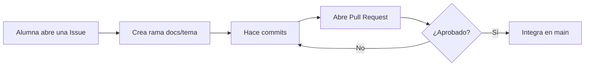
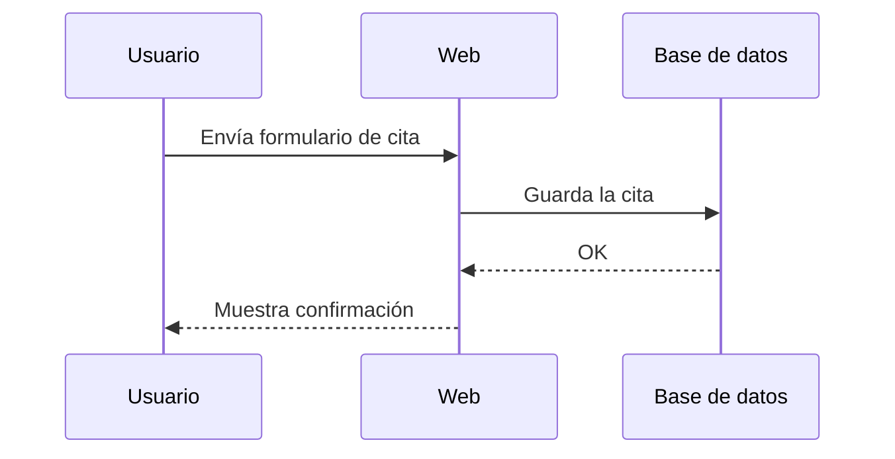
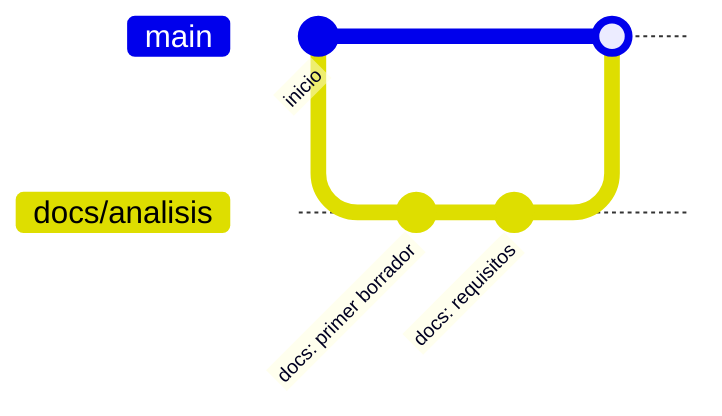
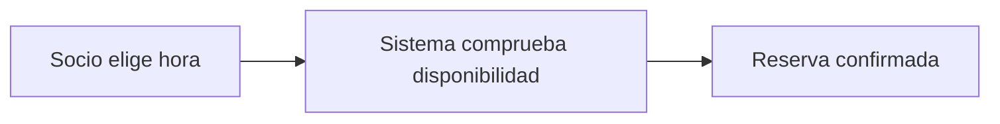
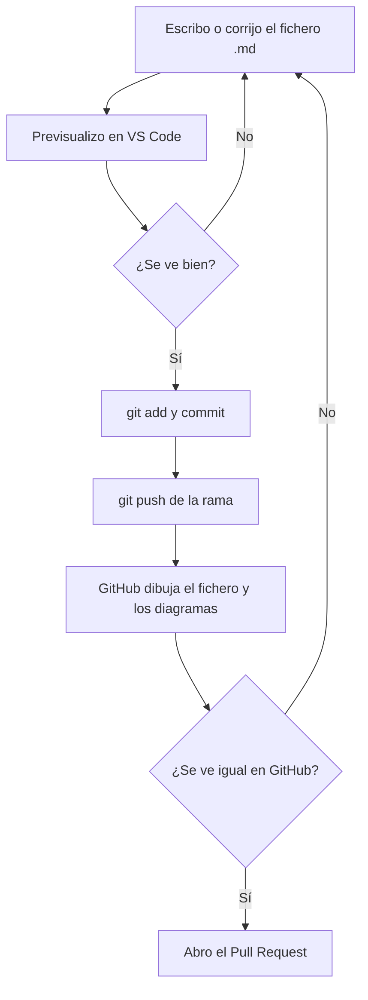

# 02 · Documentar un proyecto con Markdown y Mermaid

**Tiempo estimado:** 25 min de lectura + 45 min de tarea (ruta Esencial 🟢: 55 min en total; estimaciones propias, sin medir) · **Fase:** [0-1](glosario.md#fase) (arranque)

> **Antes de leer:** tener hecho el [capítulo 01](01-git-y-github.md) (Git instalado y autenticado, sabes abrir un Pull Request) · términos dudosos en el [glosario](glosario.md). Dos que verás aquí: un [Pull Request](glosario.md#pull-request-pr) es la petición de integrar tu rama en `main`; una [Issue](glosario.md#issue) es la ficha de una tarea o un error.

Anterior: [01 · Git y GitHub](01-git-y-github.md) · Siguiente: [03 · Documentar en inglés y español](03-documentar-en-ingles-y-espanol.md)

## En 5 minutos

- Documentar es escribir **por qué y cómo** funciona tu proyecto, para que otra persona (o tú dentro de tres meses) lo entienda sin preguntarte.
- La documentación del proyecto se escribe en [**Markdown**](glosario.md#markdown) (texto plano con símbolos sencillos como `#` y `-`). Es un fichero `.md` que GitHub muestra con formato.
- Los diagramas se escriben en [**Mermaid**](glosario.md#mermaid): texto dentro de un bloque de código que GitHub dibuja solo. No se suben capturas de diagramas.
- Previsualizas en local (VS Code) y en GitHub antes de pedir revisión.

## Lo imprescindible (para esta semana)

1. Saber escribir títulos, listas, enlaces, bloques de código y tablas en Markdown.
2. Saber hacer un diagrama simple (`flowchart`) y comprobar que se ve.
3. Saber dónde va cada cosa en tu repositorio ([`README.md`](glosario.md#readme), `docs/`).

**Ruta Esencial 🟢:** lee «En 5 minutos», «Lo imprescindible», §2, §3.1-3.5, §4.1, §5 y §6, y haz los pasos 🟢 de la tarea (≈ 55 min en total). Lo marcado 🟡 es ampliable: puedes saltarlo esta semana.

---

## 1. Por qué documentar 🟡

Ampliable: puedes saltarla esta semana.

Sin documentación, tras dos meses no recuerdas por qué elegiste esa base de datos ni cómo se arranca. Documentar sirve para **tu yo del futuro**, para el **relevo** (quien llega nuevo arranca en horas, no en semanas), para la **revisión** (quien revisa tu [Pull Request](glosario.md#pull-request-pr) entiende qué cambió y por qué), para el **mantenimiento** y para la **evaluación**: el tutor comprueba lo que has hecho por lo que está escrito ([`docs/metodologia.md`](../../metodologia.md), §3).

Documentar **no es un extra al final**: es parte de cada fase. Escribe poco, pero a tiempo y verdadero. *Opinión razonada, no norma:* una documentación corta y al día vale más que una larga y desfasada; si ya no es cierta, corrígela o bórrala.

## 2. Convenciones del proyecto (propuesta del curso)

Lo siguiente sale de [`docs/metodologia.md`](../../metodologia.md), §2 y §6:

- La documentación se redacta con **plantillas propias en Markdown**, con diagramas en **Mermaid**. **No se usan capturas de diagramas.** (El marco ISO y el modelo C4 están en «Para saber más».)
- Estructura del repositorio de tu proyecto (resumen):

```text
tu-proyecto/
├── README.md              ← qué es, cómo se ejecuta y estado
├── docs/
│   ├── 00-documentoInicio.md
│   ├── 01-analisis.md  ...  04-seguimiento-y-control.md
│   ├── registro-tutoria.md
│   ├── declaracion-uso-ia.md
│   └── decisiones/
├── src/
└── tests/
```

Las plantillas ya escritas están en [`plantilla-proyecto/docs/`](../../../plantilla-proyecto/docs/). Si a tu repo le faltan, copia las que necesites (paso 1 de la tarea) y rellena los apartados marcados con `[RELLENAR]`.

## 3. Markdown desde cero

**Markdown** es una forma de escribir texto con marcas simples. Un programa (GitHub, VS Code) las convierte en títulos, listas, etc. El fichero sigue siendo texto: se puede abrir con cualquier editor y Git muestra bien sus cambios.

### Glosario local

| Término | Qué significa | Ejemplo |
|---|---|---|
| Markdown | Lenguaje de marcas ligero para dar formato a texto plano. | `# Título` |
| `.md` | Extensión de los ficheros Markdown. | `README.md` |
| Bloque de código | Texto mostrado tal cual, sin formato, entre tres acentos graves. | ver §3.4 |
| Mermaid | Lenguaje de texto para describir diagramas. | `flowchart LR` |
| Renderizar | Convertir el texto en su resultado visual. | GitHub dibuja el diagrama |
| Callout (alerta) | Cuadro destacado de GitHub (`NOTE`, `TIP`...). | `> [!NOTE]` |
| Previsualizar | Ver el resultado antes de subirlo. | Vista previa de VS Code |

### 3.1 Títulos y párrafos

```markdown
# Título del documento
## Sección
### Subsección

Un párrafo es texto seguido. Deja una línea vacía para separar párrafos.
**negrita**, *cursiva*, `código en línea`.
```

Un `#` por nivel, y un espacio después. Usa un solo `#` por documento.

### 3.2 Listas

```markdown
- Elemento
- Otro elemento
  - Sub-elemento (sangría de 2 espacios)

1. Primer paso
2. Segundo paso
```

### 3.3 Enlaces y rutas relativas

```markdown
[Texto del enlace](https://docs.github.com)
[Documento de inicio](docs/00-documentoInicio.md)
[Volver al README](../README.md)
```

Para enlazar ficheros **de tu propio repositorio** usa [rutas relativas](glosario.md#ruta-relativa): siguen funcionando si cambias de rama o de dueño del repositorio. La ruta se cuenta **desde la carpeta del fichero donde escribes el enlace**:

- Desde `README.md` (raíz del repo) a `docs/00-documentoInicio.md`: `docs/00-documentoInicio.md` (bajas a `docs/`).
- Desde un fichero dentro de `docs/` al `README.md` de la raíz: `../README.md` (`../` sube una carpeta).

### 3.4 Bloques de código

Tres acentos graves (`` ` ``), y opcionalmente el nombre del lenguaje. En teclado español, el acento grave es la tecla a la derecha de la P: púlsala y luego espacio (convención del curso, no verificado en todos los sistemas):

````markdown
```bash
git status
```
````

### 3.5 Tablas

```markdown
| ID | Requisito | Cómo se verifica |
|---|---|---|
| RF-01 | Crear una cita | Prueba manual P-01 |
```

### 3.6 Listas de tareas 🟡

Ampliable: puedes saltarla esta semana.

```markdown
- [ ] Pendiente
- [x] Hecho
```

GitHub las muestra como casillas. Las usamos en las checklists de tarea.

### 3.7 Citas y callouts de GitHub 🟡

Ampliable: puedes saltarla esta semana.

Una cita empieza por `>`. GitHub añade cinco alertas (`NOTE`, `TIP`, `IMPORTANT`, `WARNING`, `CAUTION`), p. ej. `> [!NOTE]` y debajo, en otra línea con `>`, el texto. Solo se ven así en GitHub; úsalas poco y no pongas una dentro de otra (propuesta del curso).

## 4. Mermaid desde cero

**Mermaid** te deja describir un diagrama con texto. Lo escribes en un bloque de código con la etiqueta `mermaid` y GitHub lo dibuja. Según la documentación oficial, GitHub renderiza Mermaid en ficheros Markdown, Issues, Pull Requests, Discussions y wikis (consultado el 2026-11-07, `verificado`; ver «Para saber más»).

Frente a una captura: se edita como texto, Git muestra qué cambió y no queda desfasado.

### 4.1 Flowchart (diagrama de flujo)



Claves: `LR` = izquierda a derecha (`TD` = arriba a abajo). `A["texto"]` es un nodo; `{"texto"}` es una decisión; `-->` es una flecha. **Pon el texto entre comillas** si lleva paréntesis o signos.

**Cómo leerlo:** empieza en la alumna que abre una Issue y sigue las flechas hasta el Pull Request; si no lo aprueban, vuelve a «Hace commits».

### 4.2 Diagrama de secuencia 🟡

Ampliable: puedes saltarla esta semana.



Sirve para ver **quién habla con quién y en qué orden**. `->>` es una llamada; `-->>` es una respuesta. `participant U as Usuario` crea el participante `U` y le pone el nombre visible «Usuario».

**Cómo leerlo:** de arriba abajo, cada flecha es un mensaje: el usuario envía el formulario, la web guarda en la base de datos y devuelve la confirmación.

### 4.3 gitGraph (ramas y commits) 🟡

Ampliable: puedes saltarla esta semana.



Claves: `branch X` crea la rama X; `checkout X` te cambia a ella (los commits siguientes van a X); `merge X` integra X en la rama donde estás (aquí, `main`).

**Cómo leerlo:** una línea es `main` y otra la rama `docs/analisis`, con dos commits; al final la rama vuelve a `main` (el merge).

### 4.4 Otros tipos 🟡

Ampliable: puedes saltarla esta semana. Mermaid también dibuja clases, estados, entidad-relación, Gantt o mapas mentales (lista en su documentación, consultada el 2026-11-07); aquí solo necesitas `flowchart`.

> [!IMPORTANT]
> Si te equivocas en una palabra clave, el diagrama puede no dibujarse. Si GitHub muestra un error, revisa la primera línea, las comillas y las flechas.

## 5. Ejemplo ficticio trabajado

Proyecto de ejemplo: `proyecto-demo`, una web para reservar pistas de pádel. Su `README.md` mínimo:

````markdown
# proyecto-demo

Web para reservar pistas de pádel de un club (proyecto ficticio de ejemplo).

## Estado

- [x] Análisis inicial
- [ ] Diseño de la base de datos

## Cómo se ejecuta

```bash
npm install
npm start
```

## Flujo principal



## Documentación

- [Análisis](docs/01-analisis.md)
````

Fíjate: dice qué es, cómo se arranca, en qué estado está y dónde seguir leyendo. Nada más.

## 6. Cómo previsualizar

| Opción | Cómo | Cuándo |
|---|---|---|
| **VS Code** | Abre el `.md` y pulsa `Ctrl+Shift+V` (vista previa). Los diagramas Mermaid y los callouts de GitHub pueden no verse ahí; si no se ven, no significa que esté mal: comprueba en GitHub. | Mientras escribes. |
| **Mermaid Live Editor** | [mermaid.live](https://mermaid.live): pegas el código del diagrama y lo ves. | Para depurar un diagrama. |
| **GitHub** | Haz `git push` de tu rama y abre el fichero (o el PR) en la web. **Es la prueba definitiva**: lo que se ve ahí es lo que verá el tutor. | Antes de pedir revisión. |

Este diagrama muestra el ciclo de trabajo con un documento: se escribe, se previsualiza dos veces (en local y en GitHub) y solo entonces se pide revisión.



**Cómo leerlo:** hay dos comprobaciones. Si fallan, vuelves a editar; si pasan las dos, abres el PR. Si el diagrama no se ve en VS Code puede ser solo la vista previa; en GitHub debe verse.

## Errores frecuentes

- Olvidar la línea vacía antes de una lista o tabla: no se renderiza.
- Cerrar mal los acentos graves (tres, ```) y que medio documento quede «dentro del código».
- Etiquetas de Mermaid con paréntesis o `:` sin comillas.
- Subir una captura en lugar del código Mermaid.
- Rutas absolutas de tu ordenador (`C:\...`) en vez de relativas.

## Si te atascas

1. Prueba **10 minutos**: aísla el problema (copia solo el diagrama a mermaid.live; quita la mitad del documento).
2. Anótalo como bloqueo, con las horas, en `docs/registro-tutoria.md`.
3. Si sigues bloqueado/a, escribe al tutor con qué querías, qué escribiste (pega el texto), qué esperabas y qué viste: [contacto y ayuda](../contacto-y-ayuda.md).

## Autoevaluación

1. Estás en `docs/01-analisis.md` y quieres enlazar el `README.md` de la raíz: ¿qué ruta escribes?
2. ¿Cómo escribes un enlace a otro fichero del repositorio y desde dónde se cuenta la ruta?
3. ¿Con qué etiqueta marcas un bloque para que GitHub lo dibuje como diagrama?
4. ¿Por qué preferimos Mermaid a una captura de pantalla?
5. ¿Dónde está la prueba definitiva de que un diagrama se ve bien?

**Respuestas:** (1) `../README.md`, porque `docs/` está una carpeta por debajo de la raíz. (2) `[texto](ruta/relativa.md)`, contada desde la carpeta del fichero donde escribes el enlace. (3) `mermaid`, tras los tres acentos graves de apertura. (4) Se edita como texto, Git muestra los cambios y no se desfasa en una imagen. (5) En GitHub, en la rama o PR subido.

## Tarea y checklist

### Tarea: Crear el README y un diagrama de flujo de tu proyecto
**Fase:** [0-1](glosario.md#fase)  ·  **Tiempo estimado:** 45 min de tarea (ruta 🟢: ≈ 40 min; el paso 🔵 puede esperar a la semana siguiente)  ·  **Entrega:** según indique el tutor
**Objetivo:** tener un `README.md` con formato y un diagrama Mermaid que se ve en GitHub.
**Antes de empezar:** [01 · Git y GitHub](01-git-y-github.md) (rama, commit, push y PR).
**Repositorio:** el de **tu proyecto** (creado desde la [plantilla](glosario.md#plantilla-del-proyecto)). Si aún no lo tienes, usa tu [repo de práctica](glosario.md#repo-de-práctica-frente-a-repo-del-proyecto) de la guía 01.

### Pasos
- [ ] 0. 🟢 **Prepara tu rama** (guía 01, Pasos 2 y 3): `git switch main`, `git pull`, `git switch -c docs/readme` — *hecho cuando:* estás en esa rama — *evidencia:* nombre de rama en el PR — **Comprobar:** `git branch --show-current` muestra `docs/readme`.
- [ ] 1. 🟢 Ten el fichero `docs/00-documentoInicio.md` en tu repo: si lo copiaste de la plantilla el 6-nov, ya está (salta al paso 2). Si falta: abre [`plantilla-proyecto/docs/00-documentoInicio.md` en el repo del curso](https://github.com/profeFPInfor/proyectosDAW/blob/main/plantilla-proyecto/docs/00-documentoInicio.md), pulsa **Raw** y copia el contenido; en tu carpeta local, **ya en tu rama** (paso 0), crea con tu editor el fichero `docs/00-documentoInicio.md` (si no existe la carpeta `docs/`, créala) y pega el contenido — *hecho cuando:* existe `docs/00-documentoInicio.md` en tu carpeta, dentro de tu rama — *evidencia:* el fichero en el PR (lo subirás en el paso 7) — **Comprobar:** `ls docs/00-documentoInicio.md` lo lista y `git status` lo muestra como fichero nuevo. *(Opción 🟡: clonar el repo del curso en otra carpeta y copiar los ficheros que falten.)*
- [ ] 2. 🟢 En `README.md` (créalo si no existe) escribe título, una frase de qué es y una lista de estado — *hecho cuando:* la vista previa los muestra — *evidencia:* `README.md` en el PR — **Comprobar:** `git status` lista `README.md` (modificado o nuevo) y la vista previa enseña título y lista.
- [ ] 3. 🟢 Añade una tabla de 3 filas (p. ej. 3 funcionalidades previstas) — *hecho cuando:* se ve como tabla — *evidencia:* `README.md` — **Comprobar:** cabecera y 3 filas, no barras `|` sueltas.
- [ ] 4. 🟢 Añade un `flowchart` de 4 nodos con el flujo principal — *hecho cuando:* GitHub lo dibuja (tras el paso 7) — *evidencia:* enlace al fichero en tu rama — **Comprobar:** en GitHub sale dibujado, no como texto (antes puedes probarlo en mermaid.live).
- [ ] 5. 🟢 En `README.md`, enlaza `docs/00-documentoInicio.md` con ruta relativa — *hecho cuando:* el enlace abre el fichero — *evidencia:* clic comprobado en GitHub — **Comprobar:** el clic en GitHub no da 404.
- [ ] 6. 🔵 Al final de `docs/00-documentoInicio.md` añade `[Volver al README](../README.md)` — *hecho cuando:* abre el README — *evidencia:* clic comprobado en GitHub — **Comprobar:** el clic en GitHub no da 404.
- [ ] 7. 🟢 **Commit y push** (guía 01, Pasos 4 y 5): `git add README.md docs/`, `git commit -m "docs: añade README con tabla y diagrama"`, `git push -u origin docs/readme` — *hecho cuando:* la rama está en GitHub — *evidencia:* enlace a la rama — **Comprobar:** la rama aparece en GitHub.
- [ ] 8. 🟢 **Abre el PR** (guía 01, Paso 6) hacia `main` con la lista de [`pull_request_template.md`](../../../plantilla-proyecto/.github/pull_request_template.md) (si no aparece sola, cópiala). Primer PR: [vía A](glosario.md#vía-a-y-vía-b), label `necesita-tutor` — *hecho cuando:* PR abierto con la lista — *evidencia:* URL del PR — **Comprobar:** la URL abre y la lista está en la descripción.

### Progreso
Llevo **0 de 9** pasos (0 a 8; 8 son 🟢). Cambia el número al marcar casillas.

### Antes de entregar
- [ ] Sin claves ni datos personales (repasa lo que subes con `git diff`; ver [04 · Claves y datos personales](04-claves-y-datos-personales.md))
- [ ] Si usaste IA, anótalo en `docs/declaracion-uso-ia.md` (fecha, herramienta, qué pediste, qué aceptaste o cambiaste, dónde); ejemplo de fila: `2026-11-12 | asistente de IA | explicar una tabla | cambié columnas | README.md`
- [ ] Horas anotadas en `docs/registro-tutoria.md`
- [ ] PR abierto con la lista de comprobación (paso 8)

### Si me atasco
10 min intentado · anotado en `registro-tutoria.md` · [contacto y ayuda](../contacto-y-ayuda.md)

## Para saber más

| Fuente | URL | Consultada | Estado |
|---|---|---|---|
| GitHub Docs: Creating diagrams (Mermaid se renderiza en Markdown, Issues, PR, Discussions y wikis; `info` muestra la versión) | https://docs.github.com/en/get-started/writing-on-github/working-with-advanced-formatting/creating-diagrams | 2026-11-07 | verificado |
| GitHub Docs: Basic writing and formatting syntax (títulos, listas, enlaces, código, tareas, alertas) | https://docs.github.com/en/get-started/writing-on-github/getting-started-with-writing-and-formatting-on-github/basic-writing-and-formatting-syntax | 2026-11-07 | verificado |
| Mermaid: referencia de sintaxis y tipos de diagrama | https://mermaid.js.org/intro/syntax-reference.html | 2026-11-07 | verificado |
| Mermaid Live Editor | https://mermaid.live | 2026-11-07 | declarado (lo cita la documentación de Mermaid; sin probar en este curso) |
| Extensión de VS Code para previsualizar Mermaid | — | — | no verificado: no se nombra ninguna; usa GitHub como prueba |
| ISO/IEC/IEEE 12207 y modelo C4 🟡 | [`docs/metodologia.md`](../../metodologia.md), §2; [glosario: C4](glosario.md#c4) | 2026-11-07 | verificado en la metodología: ISO solo como referencia, sin cumplimiento formal; C4 no se pide para H1 |

Navegación: [01 · Git y GitHub](01-git-y-github.md) · [03 · Documentar en inglés y español](03-documentar-en-ingles-y-espanol.md)
