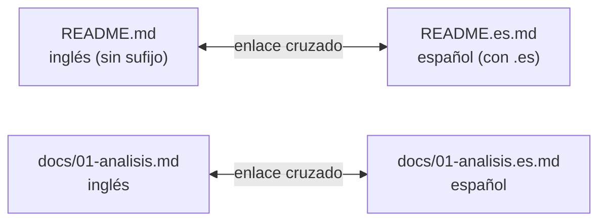
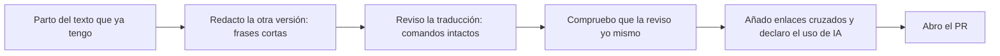

# 03 · Documentar en inglés y en español

**Tiempo estimado:** 25 min de lectura + 40 min de tarea (ruta Esencial 🟢: 45 min en total) · **Fase:** [0-1 (arranque)](../../fases-del-proyecto.md) · Los tiempos son estimaciones propias, sin medir (propuesta).

Anterior: [02 · Markdown y Mermaid](02-documentar-markdown-mermaid.md) · Siguiente: [04 · Claves y datos personales](04-claves-y-datos-personales.md)

> **Antes de leer:** tener hecho el [capítulo 01](01-git-y-github.md) (Git instalado y autenticado, sabes abrir un Pull Request) · términos dudosos en el [glosario](glosario.md).

> [!IMPORTANT]
> **Estado actual frente a objetivo.**
> - **Estado actual (verificable en el repositorio):** la documentación del curso (`docs/`, `plantilla-proyecto/`) está **escrita en español**. Todavía no existe una versión en inglés.
> - **Objetivo:** que tu proyecto tenga documentación en **inglés y en español**. El esquema de este capítulo es una **convención de trabajo (propuesta)** del curso, no una norma ni un estándar. Puede cambiar.
> - **Cuándo aplica (propuesta):** la tarea de este capítulo solo se hace cuando el tutor lo indique (por correo o en el [briefing](glosario.md#briefing)). Si no te ha dicho nada, lee el capítulo y espera. Si responde «no aplica», anótalo en tu [registro de tutoría](glosario.md#registro-de-tutoría) y pasa al capítulo 04.

## En 5 minutos

- En programación vas a leer mucho inglés: documentación oficial, mensajes de error, issues, código de otras personas. Escribir en inglés tu documentación te prepara para eso.
- Propuesta: el [README](glosario.md#readme) **sin sufijo** (`README.md`) va en **inglés** y el del español lleva `.es` (`README.es.md`), con un enlace de uno a otro.
- Se traduce el texto explicativo. **No se traduce** código, rutas, comandos, nombres de ficheros ni mensajes de error literales.
- Puedes usar IA para traducir, pero **revisas tú** y **lo declaras** en `docs/declaracion-uso-ia.md` de tu proyecto (viene en la [plantilla](../../../plantilla-proyecto/docs/declaracion-uso-ia.md); [glosario](glosario.md#declaración-de-uso-de-ia)).

## Lo imprescindible (para esta semana)

1. Saber qué parte del trabajo es "estado actual" (español) y cuál es "objetivo" (bilingüe).
2. Conocer la convención de nombres `X.md` / `X.es.md`.
3. Saber qué no se traduce nunca.

**Ruta Esencial 🟢:** lee «En 5 minutos», «Lo imprescindible», las secciones 2, 3 y 6 y haz los pasos 0-3 y 5-7 de la tarea (≈ 45 min). El resto (🟡) es ampliable.

---

## 1. Por qué documentar en inglés 🟡

*Ampliable: puedes saltarla esta semana.* Son razones razonadas, no datos (no se citan porcentajes sin fuente verificada):

- **Fuentes y comunidad:** la documentación oficial (GitHub, Mermaid), los foros, los issues y los mensajes de error suelen estar en inglés.
- **Código abierto y empleo:** se suele pedir inglés al contribuir a proyectos abiertos y muchos equipos lo usan (apreciación; los datos de mercado están en `docs/realidadLaboral/`).
- **Ejercicio:** escribir inglés sencillo te obliga a ser claro.

> [!NOTE]
> Documentar en inglés **no significa** dejar de documentar en español. El español sigue siendo la lengua de aula y de evaluación; el inglés se suma.

## 2. Esquema bilingüe propuesto (convención de trabajo, propuesta)

### Términos 🟡

*Ampliable.* **Sufijo de idioma:** código antes de `.md` (`.es`). **Enlace cruzado:** enlace de una versión a la otra. **i18n:** abreviatura de «internacionalización».

### Reglas propuestas

1. El fichero **sin sufijo** (`README.md`) está en **inglés**.
2. Su traducción al español lleva `.es` antes de la extensión: `README.es.md`.
3. Cada versión empieza con una línea que enlaza a la otra.
4. Se aplica a los documentos del proyecto que lee alguien externo: `README`, y los de `docs/` que el tutor indique. Los ficheros de gestión interna (registro de tutoría, horas) pueden quedarse en español; confírmalo con el tutor.
5. Si las dos versiones difieren, hay que actualizar la desfasada. **Una cosa, un significado.** 🟡

**Qué se escribe primero:** el nombre del fichero no dice cuál fue el original. En el flujo general, el español puede ser el original y el inglés su traducción, o al revés. En la tarea de abajo el español ya existe (tu README actual) y el inglés se redacta a partir de él.

Ejemplo de primera línea de cada versión (el enlace cruzado):

```markdown
<!-- README.md -->
**English** · [Español](README.es.md)

<!-- README.es.md -->
[English](README.md) · **Español**
```

```text
tu-proyecto/
├── README.md              ← English (base)
├── README.es.md           ← Español (traducción)
└── docs/
    ├── 01-analisis.md     ← English
    └── 01-analisis.es.md  ← Español
```

El mismo esquema en forma de diagrama: cada fichero en inglés tiene una pareja en español y los dos se enlazan entre sí.



**Cómo leerlo:** la flecha de doble punta significa que cada versión enlaza a la otra. El fichero sin sufijo es el inglés; el que lleva `.es` antes de `.md` es el español.

> [!NOTE]
> GitHub muestra automáticamente el fichero `README.md` en la portada del repositorio. Asume que **no** elige el README según el idioma del navegador (estado en «Para saber más"): por eso el enlace cruzado es necesario.

Este diagrama muestra el orden de trabajo para tener las dos versiones listas, partiendo del texto que ya tienes. Al final se abre el [Pull Request (PR)](glosario.md#pull-request-pr).



**Cómo leerlo:** de izquierda a derecha, un paso tras otro. La revisión (pasos 3 y 4) la haces tú aunque hayas usado IA, y el uso de IA se declara antes de abrir el PR.

## 3. Qué se traduce y qué no

| Se traduce | NO se traduce |
|---|---|
| Títulos y párrafos explicativos | Código fuente y nombres de variables/funciones |
| Descripciones de requisitos y casos de uso | Comandos (`git status`, `npm start`) |
| Texto de tablas y listas | Rutas y nombres de ficheros (`src/index.js`) |
| Comentarios de ayuda para personas | Mensajes de error copiados literalmente (se citan tal cual y luego se explican) |
| Pies de diagrama y leyendas | Nombres de ramas y mensajes de commit (siguen la convención [Conventional Commits](glosario.md#conventional-commits-y-ámbito); ver `docs/metodologia.md` §4.2) |

Los diagramas Mermaid: traduce las etiquetas en la versión `.es.md` y deja intacta la sintaxis (`flowchart`, `-->`).

## 4. Glosario técnico EN ↔ ES 🟡

*Ampliable: consúltalo solo si dudas de un término.*

| Inglés | Español | Nota |
|---|---|---|
| repository (repo) | repositorio | |
| branch | rama | |
| commit | commit / confirmación | En español se usa "commit" tal cual. |
| pull request (PR) | solicitud de incorporación / Pull Request | En el curso: "Pull Request". |
| issue | incidencia / Issue | En el curso: "Issue". |
| requirement | requisito | |
| acceptance criteria | criterios de aceptación | |
| bug | error / fallo | |
| deploy | desplegar | |
| framework | framework / marco de trabajo | |
| backend / frontend | parte servidora / parte cliente | Se usan también tal cual. |
| review | revisión | |
| merge | fusionar / integrar | |
| stakeholder | parte interesada | |
| roadmap | hoja de ruta | |

Si dudas, usa el término que ya use la documentación oficial de la herramienta, y **sé constante**: no alternes "rama" y "branch" en el mismo texto sin motivo.

## 5. Consejos para escribir inglés sencillo 🟡

*Ampliable: puedes saltarla esta semana.* Frases cortas (una idea cada una); verbos concretos en imperativo (*Run*, *Open*); sin modismos; el mismo término siempre (*user*, no *customer* a mitad); voz activa; listas y tablas en vez de párrafos largos.

Ejemplo ficticio. Mejorable: *In order to be able to run the application it is necessary that the dependencies are installed beforehand.* Mejor: *Install the dependencies. Then run the app.*

## 6. La IA como ayuda de traducción

Puedes pedir a una herramienta de IA que traduzca o mejore un texto. Reglas:

1. **Revisa siempre** el resultado: términos técnicos, comandos, números y nombres propios. Una traducción que "suena bien" puede ser incorrecta.
2. **Comprueba que no cambió** código, rutas o comandos.
3. **Nunca pegues** claves ni datos personales en la herramienta (ver `docs/metodologia.md` §7).
4. **Decláralo** en `docs/declaracion-uso-ia.md` de tu proyecto: qué herramienta, qué pediste, qué aceptaste o cambiaste.
5. La autoría se comprueba en la [defensa oral](glosario.md#defensa-oral) (la presentación final de tu proyecto): debes poder explicar lo que has escrito, en el idioma que sea.
6. La IA no califica; la nota es del profesor.

## Errores frecuentes

- Traducir comandos o rutas ("`git estado`" no existe).
- Dejar una versión desfasada o copiar una traducción automática sin leerla.
- Olvidar declarar el uso de IA.

## Si te atascas

1. Prueba **10 minutos**: escribe la idea en español con frases cortas y luego pásala al inglés palabra a palabra.
2. Pregunta bien: *qué quería decir, qué escribí, qué me suena raro*.
3. Anótalo como bloqueo y las horas en `docs/registro-tutoria.md` ([registro de tutoría](glosario.md#registro-de-tutoría)).
4. **Pide ayuda por correo:** si tras 10 minutos sigues bloqueado/a, escribe al tutor con la consulta ya preparada (qué intentaste, qué esperaba, qué pasó). Cómo hacerlo, en [contacto y ayuda](../contacto-y-ayuda.md).

## Autoevaluación

1. ¿Qué idioma tiene hoy la documentación del curso y cuál es el objetivo?
2. ¿Cómo se llama la versión en español de `README.md` según la propuesta?
3. Di tres cosas que no se traducen.
4. Nombra cuatro cosas que haces siempre al usar IA para traducir.
5. ¿Por qué hay que añadir un enlace cruzado entre versiones?

**Respuestas:** (1) Hoy: español; objetivo: inglés y español. (2) `README.es.md`. (3) Código, comandos, rutas (también mensajes de error literales). (4) Revisar el resultado, comprobar que no cambió código, rutas ni comandos, no pegar claves ni datos personales y declarar el uso. (5) Para que quien llegue a una versión encuentre la otra sin depender de cómo se muestre el repositorio.

## Tarea y checklist

### Tarea: Crear la versión inglesa del README de tu proyecto
**Fase:** 0-1 · **Tiempo estimado:** 40 min (ruta Esencial 🟢: 30 min con los pasos 🟢) · **Entrega:** cuando el tutor lo indique
**Cuándo aplica (propuesta):** solo si el tutor lo indica; si responde «no aplica», anótalo en tu registro de tutoría y sigue con el capítulo 04.
**Objetivo:** tener `README.md` en inglés y `README.es.md` en español, enlazados.
**Dónde:** en el **repo de tu proyecto** (no en el de práctica). Si aún no tienes README, parte del de la [plantilla](../../../plantilla-proyecto/README.md).
**Antes de empezar:** [01 · Git y GitHub](01-git-y-github.md) y [02 · Markdown y Mermaid](02-documentar-markdown-mermaid.md).

### Pasos
Cada paso: 🟢 esencial, 🔵 al día (si no hay tiempo, hazlo la semana siguiente).

- [ ] 0. 🟢 **Prepara tu rama** (guía 01, Pasos 2 y 3): `git switch main`, `git pull`, `git switch -c docs/readme-bilingue`.
  - *Hecho cuando:* estás en la rama nueva.
  - **Comprobar:** `git branch --show-current` muestra `docs/readme-bilingue`.
- [ ] 1. 🟢 **Renombra tu README actual** (que está en español) con Git: `git mv README.md README.es.md`.
  - *Hecho cuando:* `README.es.md` existe y su contenido es el de tu README anterior.
  - **Comprobar:** `git status` muestra `renamed: README.md -> README.es.md`.
- [ ] 2. 🟢 **Redacta `README.md` en inglés** a partir de `README.es.md` (título, qué es, cómo se ejecuta), con frases cortas (sección 5). Si usas una traducción automática, léela y corrígela.
  - *Hecho cuando:* cada frase tiene una idea y los comandos son los de la versión en español.
  - **Comprobar:** `ls` muestra `README.md` y, al abrirlo, está en inglés.
- [ ] 3. 🟢 **Añade el enlace cruzado** como primera línea de cada fichero (ejemplo de la sección 2).
  - *Hecho cuando:* los dos enlaces funcionan.
  - **Comprobar:** en GitHub (tras el paso 6), el enlace de cada fichero te lleva al otro, sin 404.
- [ ] 4. 🔵 **Compara comandos y rutas** de las dos versiones, lado a lado.
  - *Hecho cuando:* no cambia ningún comando ni ruta.
  - **Comprobar:** explícalo en 2 frases en tu PR (qué comparaste y qué encontraste).
- [ ] 5. 🟢 **Si usaste IA, anótalo** en `docs/declaracion-uso-ia.md` de tu proyecto ([plantilla](../../../plantilla-proyecto/docs/declaracion-uso-ia.md)). Una fila por uso, con las columnas Fecha · Herramienta · Qué pedí · Qué acepté o cambié · Dónde. Ejemplo ficticio:

  | Fecha | Herramienta | Qué pedí | Qué acepté o cambié | Dónde (fichero o PR) |
  |---|---|---|---|---|
  | 2026-11-12 | Asistente de IA | «Traduce al inglés este párrafo del README» | Cambié dos frases y dejé el comando tal cual | `README.md` |

  - *Hecho cuando:* hay una fila nueva por cada uso.
  - **Comprobar:** `git status` muestra `docs/declaracion-uso-ia.md` modificado.
- [ ] 6. 🟢 **Commit y push** (guía 01, Pasos 4 y 5): `git add README.md README.es.md docs/declaracion-uso-ia.md`, `git commit -m "docs: README en inglés y español"`, `git push -u origin docs/readme-bilingue`.
  - *Hecho cuando:* el commit sigue [Conventional Commits](glosario.md#conventional-commits-y-ámbito).
  - **Comprobar:** la rama aparece en GitHub.
- [ ] 7. 🟢 **Abre el PR** (guía 01, Paso 6), rellena la [lista de comprobación del PR](../../../plantilla-proyecto/.github/pull_request_template.md) y, si es tu primer PR, [vía A](glosario.md#vía-a-y-vía-b) (label `necesita-tutor`).
  - *Hecho cuando:* el PR está abierto con la lista rellenada.
  - **Comprobar:** la URL del PR abre y la lista aparece en la descripción.

### Progreso
Marca cada paso al terminarlo. Llevo ___ de 8 pasos (0-7). Me falta el paso: ___.

### Antes de entregar
- [ ] Sin claves ni datos personales
- [ ] Uso de IA declarado en `docs/declaracion-uso-ia.md`
- [ ] Horas anotadas en `docs/registro-tutoria.md`
- [ ] PR abierto con la lista de comprobación de `docs/metodologia.md`

### Si me atasco
Lo he intentado 10 min · lo anoto como bloqueo en `registro-tutoria.md` · pregunto con: qué intenté, qué esperaba, qué pasó. · cómo escribir al tutor: [contacto y ayuda](../contacto-y-ayuda.md)

## Para saber más

| Fuente | URL | Consultada | Estado |
|---|---|---|---|
| [GitHub Docs: Basic writing and formatting syntax](https://docs.github.com/en/get-started/writing-on-github/getting-started-with-writing-and-formatting-on-github/basic-writing-and-formatting-syntax) (rutas relativas en enlaces) | ver enlace | 2026-11-07 | verificado |
| Metodología del curso (§4.2 commits, §7 uso de IA) | [`docs/metodologia.md`](../../metodologia.md) | 2026-11-07 | verificado |
| Plantilla de declaración de IA | [`plantilla-proyecto/docs/declaracion-uso-ia.md`](../../../plantilla-proyecto/docs/declaracion-uso-ia.md) | 2026-11-07 | verificado (existe; contenido no revisado a fondo) |
| Convención `*.es.md` y comportamiento de GitHub según idioma del navegador (no se ha comprobado que GitHub elija el README por idioma) | — | — | no verificado: es propuesta del curso |

Navegación: [02 · Markdown y Mermaid](02-documentar-markdown-mermaid.md) · [04 · Claves y datos personales](04-claves-y-datos-personales.md)
