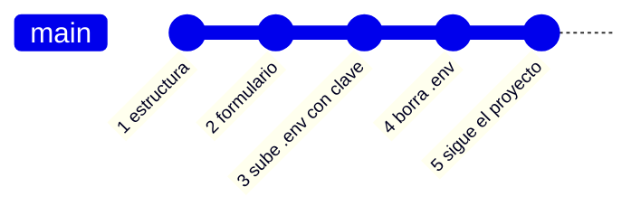
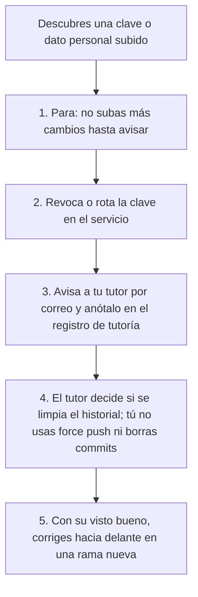
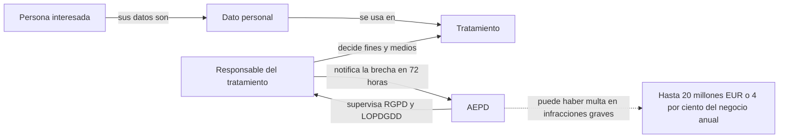
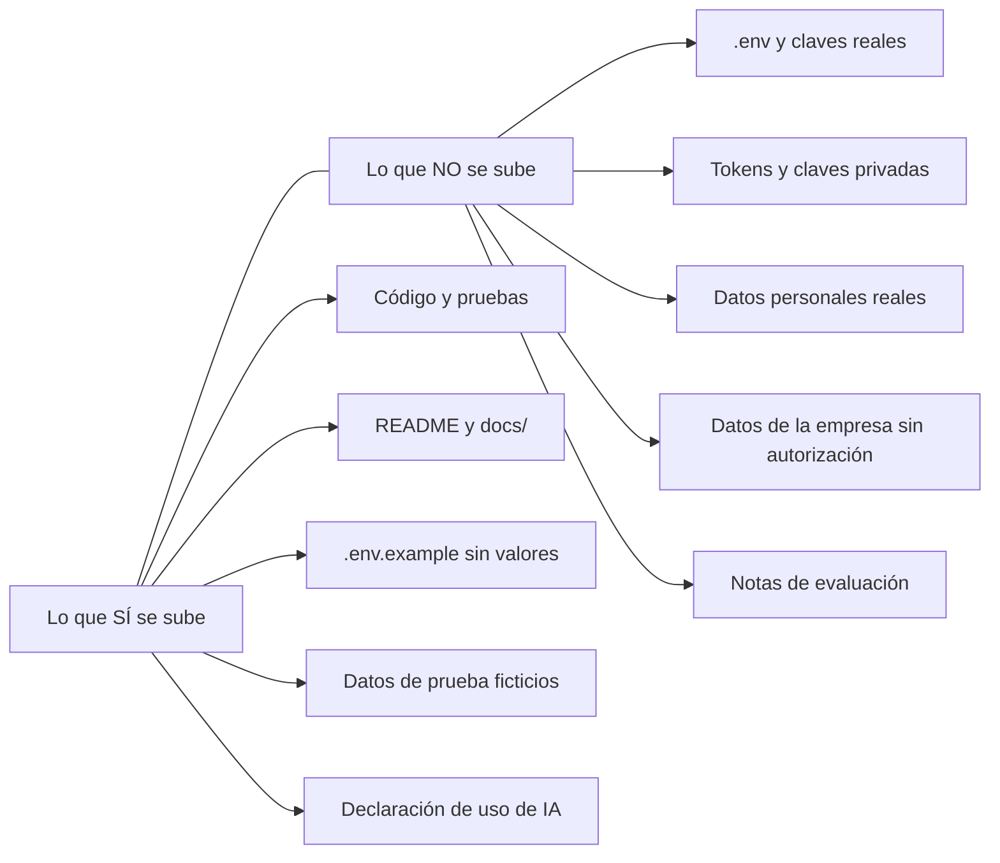
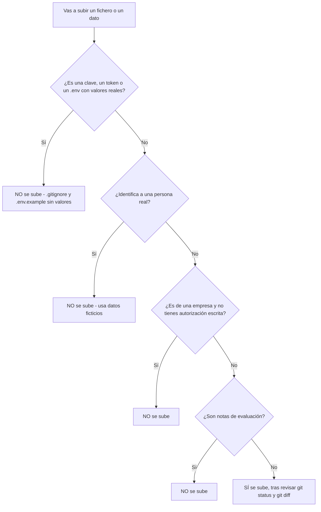

# 04 · Claves y datos personales: qué no se sube nunca a Git

**Tiempo estimado:** 30 min de lectura + 30 min de tarea (ruta Esencial 🟢: ≈ 30 min en total si tu repo ya tiene `.gitignore`) · **Fase:** 0-1 (inicio y análisis, ver [fases](../../fases-del-proyecto.md)). Son estimaciones propias, sin medir con alumnado real.

> **Antes de leer:** tener hecho el [capítulo 01](01-git-y-github.md) (Git instalado y autenticado, sabes abrir un Pull Request) · términos dudosos en el [glosario](glosario.md).

> Capítulo anterior: [03 · Documentar en inglés y español](03-documentar-en-ingles-y-espanol.md) · Siguiente: [05 · Etapas de desarrollo](05-etapas-de-desarrollo.md)

> [!IMPORTANT]
> Esto **no es asesoramiento jurídico**. Es una explicación sencilla para que sepas por qué existen las reglas del proyecto. Para cualquier caso real, lee la fuente oficial (enlaces al final) y habla con tu tutor.

## En 5 minutos

- Una **clave** (contraseña, token, API key) es como la llave de tu casa. Si la subes a un repositorio, cualquiera que lo vea puede usarla.
- Git **guarda todo el historial**. Si subes una clave y luego borras el fichero, la clave **sigue en los commits anteriores**.
- Hay programas automáticos (bots) que buscan claves en repositorios públicos. No hace falta que alguien te busque a ti.
- Un **dato personal** es cualquier información que identifique a una persona (nombre, correo, teléfono, DNI...). La ley europea ([RGPD](glosario.md#rgpd)) y la española ([LOPDGDD](glosario.md#lopdgdd)) lo regulan.
- En este proyecto: **datos de prueba ficticios**, correo `noreply` de GitHub y nada de datos reales de empresas o clientes sin autorización escrita.
- Si se te escapa algo: **para, revoca la clave** en el servicio y **avisa al tutor por correo** (ver [contacto y ayuda](../contacto-y-ayuda.md)). No improvises con el historial.

## Lo imprescindible para esta semana

**Ruta Esencial 🟢:** «En 5 minutos», «Lo imprescindible», secciones 2 y 3 y pasos 0-4 y 7-8 de la tarea (≈ 30 min). Lo 🔵 puede esperar a la semana siguiente.

1. Comprueba que tu repositorio tiene un `.gitignore` que excluye `.env` (la [plantilla](../../../plantilla-proyecto/.gitignore) ya lo trae).
2. Usa el [correo `noreply`](glosario.md#correo-noreply) de GitHub en tus commits (`ID+USUARIO@users.noreply.github.com`, en GitHub → *Settings → Emails*; cómo ponerlo en Git: [capítulo 01, paso 0b](01-git-y-github.md)). Si `git log -1 --format=%ae` muestra tu correo personal, cámbialo con `git config user.email` (los commits ya hechos no cambian) y anótalo en tu registro de tutoría.
3. Antes de cada [commit](glosario.md#commit), mira qué subes (`git status` y `git diff`). Pregúntate: ¿hay aquí una clave o un dato de una persona real?
4. No pegues claves ni datos personales en un chat de IA.

## Glosario local

| Término | Qué significa | Ejemplo |
|---|---|---|
| Clave / secreto | Texto que da acceso a algo: contraseña, token, API key | `API_KEY=abc123-ejemplo` |
| Token | Clave temporal o con permisos concretos que genera un servicio | Token de acceso personal de GitHub |
| Fichero [`.env`](glosario.md#env) | Fichero local donde guardas claves como variables | `DB_PASSWORD=...` |
| Variable de entorno | Valor que el sistema le pasa al programa sin escribirlo en el código | `process.env.API_KEY` (así se lee en JavaScript/Node) |
| [`.gitignore`](glosario.md#gitignore) | Lista de ficheros que Git debe ignorar y no subir | `.env` |
| [`.env.example`](glosario.md#envexample) | Copia **sin valores reales** que sí se sube, para que se sepa qué variables hacen falta | `API_KEY=` |
| Historial | Todos los commits anteriores, que Git conserva | `git log` |
| [Push](glosario.md#push) | Subir tus commits a GitHub | `git push` |
| Revocar / rotar | Anular una clave y crear otra nueva | Borrar el token en GitHub y generar otro |
| Dato personal | Información sobre una persona identificada o identificable | Nombre + correo |
| Responsable del tratamiento | Quien decide para qué y cómo se usan los datos personales | Una empresa que guarda datos de sus clientes |
| Tratamiento | Cualquier operación con datos: recoger, guardar, consultar, borrar... | Guardar un correo en una base de datos |
| Minimización | Usar solo los datos necesarios para el fin | No pedir el DNI si solo hace falta un nombre de usuario |
| [AEPD](glosario.md#aepd) | Agencia Española de Protección de Datos, autoridad de control en España | Se explica en la sección 5 |

## 1. Por qué el historial de Git es permanente

Git no guarda «la última versión» de tus ficheros. Guarda **una foto de cada commit**. Si en el commit 3 subes una clave y en el commit 4 la borras, el commit 3 **sigue existiendo** y cualquiera con acceso al repositorio puede verlo con `git log` o en la web de GitHub.



**Cómo leerlo:** cada punto es un commit, de izquierda a derecha en el tiempo. Borrar el fichero crea el commit 4, pero el 3 sigue en la línea.

En el commit 4 la clave ya no aparece en los ficheros actuales, pero **el commit 3 la contiene**. Por eso borrar el fichero **no arregla nada**: la clave hay que **anularla** en el servicio.

Hay más razones por las que es grave:

- **Repositorios públicos.** En este proyecto tu repositorio puede ser público (si lo es, lo verá cualquiera, también un empleador).
- **Bots.** El [*secret scanning*](glosario.md#secret-scanning) de GitHub busca credenciales en todo el historial y en repositorios públicos funciona de forma automática (fuente y estado en «Para saber más»). Quien quiera hacer mal uso de claves expuestas puede usar herramientas parecidas. **Que no te vea nadie no es una defensa.**
- **Copias.** Si alguien clona o hace un [*fork*](glosario.md#fork) (copia en su cuenta) de tu repositorio, esa copia ya no la controlas tú.

## 2. Qué es una «clave» en la práctica

| Tipo | Ejemplo ficticio | ¿Se sube? |
|---|---|---|
| Contraseña de base de datos | `DB_PASSWORD=contraseña-demo` | No |
| API key de un servicio | `MAPS_API_KEY=clave-demo-0000` | No |
| Token de acceso | `GITHUB_TOKEN=token-demo` | No |
| Clave privada SSH | fichero `id_ed25519` | No |
| Fichero `.env` con todo lo anterior | `.env` | No |
| Plantilla de variables sin valores | `.env.example` | **Sí** |

### Cómo evitarlo

1. **`.gitignore`**: si no tienes uno, créalo en la raíz de tu repo con el contenido del ejemplo de abajo; añade `.env` y cualquier fichero de claves **antes** del primer commit. Si un fichero ya se subió, añadirlo después a `.gitignore` **no lo quita** del historial.
2. **Variables de entorno**: el código lee la clave del entorno, no la lleva escrita.
3. **`.env.example`**: sube una plantilla con los nombres de las variables y sin valores.
4. **Mínimo permiso**: crea claves con los permisos justos y, si puedes, con caducidad.
5. **No las pegues en chats de IA** ni en capturas de pantalla (lo dice la metodología, §7 de `docs/metodologia.md`).

Ejemplo ficticio, en tu proyecto `proyecto-demo`:

```text
# .gitignore
.env
*.pem
```

```text
# .env.example   (SÍ se sube; no lleva valores reales)
DB_HOST=
DB_USER=
DB_PASSWORD=
```

```text
# .env   (NO se sube; solo existe en tu ordenador)
DB_HOST=localhost
DB_USER=usuario_demo
DB_PASSWORD=contraseña-demo
```

Comprobación rápida: `git status` no debe mostrar `.env`. Si lo muestra como pendiente de añadir, `.gitignore` no está funcionando.

## 3. Qué hacer si se te escapa una clave

Es **convención del proyecto** ([`publicacion-y-privacidad.md`](../../../plantilla-proyecto/docs/publicacion-y-privacidad.md) §3 y [`metodologia.md`](../../metodologia.md) §4.2) y coincide con la guía de GitHub (en «Para saber más»).



**Cómo leerlo:** son cinco pasos en orden, de arriba abajo, sin ramas. Lo urgente es parar y anular la clave; lo del historial no lo decides tú.

1. **Para:** no subas más cambios hasta haber avisado.
2. **Revoca o rota la clave** en el servicio al que pertenece (el panel de tu base de datos, de tu servidor de correo, o en GitHub *Settings → Developer settings → Tokens*). Es lo único que protege de verdad: una vez revocada, la clave ya no sirve para acceder.
3. **Avisa al tutor por correo** cuanto antes (cómo, en [contacto y ayuda](../contacto-y-ayuda.md)). No pasa nada por avisar; lo grave es callarlo.
4. **No uses [`force push`](glosario.md#force-push)** ni reescribas la historia. La metodología del proyecto lo prohíbe (§4.2) porque el seguimiento se hace sobre tu historial.
5. **El borrado del historial lo decide el tutor.** Reescribir la historia cambia los identificadores de commit, puede romper Pull Requests y **no elimina** las copias que ya existan en clones, *forks* o cachés.
6. Si el dato personal es de otra persona, el tutor valorará también si hay que comunicarlo. No lo decides tú.

## 4. Qué es un dato personal

Según el RGPD (art. 4.1, texto en español de EUR-Lex): «toda información sobre una persona física identificada o identificable». Una persona es identificable si se la puede identificar directa o indirectamente, por ejemplo por un nombre, un número de identificación, datos de localización o un identificador en línea.

Ejemplos: nombre y apellidos, correo, teléfono, DNI, dirección, matrícula, IP, foto donde se reconozca a alguien.

Ojo: **una lista de «usuarios de ejemplo» copiada de una empresa real es una lista de datos personales reales**, aunque tú la llames «datos de prueba».

## 5. La normativa: RGPD y LOPDGDD (explicada sencilla) 🟡

*Ampliable: puedes saltarla esta semana.* Ninguna tarea la usa. Estado de verificación de cada fuente: «Para saber más».

### 5.1. Las dos normas

| Norma | Qué es | Fuente |
|---|---|---|
| **Reglamento (UE) 2016/679** (RGPD) | Reglamento europeo de 27 de abril de 2016 sobre protección de las personas físicas en el tratamiento de datos personales. Se aplica directamente en toda la UE. | [EUR-Lex](https://eur-lex.europa.eu/legal-content/ES/TXT/?uri=CELEX:32016R0679) |
| **Ley Orgánica 3/2018** (LOPDGDD) | Ley española de 5 de diciembre de 2018 de Protección de Datos Personales y garantía de los derechos digitales. BOE n.º 294, de 6 de diciembre de 2018; en vigor desde el 7 de diciembre. | [BOE](https://www.boe.es/buscar/act.php?id=BOE-A-2018-16673) |

Según su artículo 1, la LOPDGDD tiene dos objetivos: **adaptar el ordenamiento español al RGPD y completarlo**, y **garantizar los derechos digitales** de la ciudadanía (art. 18.4 de la Constitución).

En llano: el RGPD pone las reglas comunes de la UE; la LOPDGDD las concreta en España.



**Cómo leerlo:** la persona interesada es de quien son los datos. El responsable decide cómo se tratan; la AEPD supervisa que cumpla y recibe sus avisos de brecha. La línea de puntos indica una consecuencia posible, no automática.

### 5.2. Conceptos y consecuencias

- Los conceptos básicos (dato personal, tratamiento, responsable, minimización) están en el glosario local de arriba; vienen del RGPD, arts. 4.1, 4.2, 4.7 y 5.1.c. Los menores de más de 14 años pueden dar su consentimiento en España; por debajo, lo da quien tenga la patria potestad o tutela (LOPDGDD, art. 7).
- Multas: el RGPD permite hasta **20 000 000 EUR** o, en una empresa, el **4 % del volumen de negocio anual global** (la cuantía mayor) para las infracciones más graves (art. 83.5). Para otras, el art. 83.4 fija un máximo menor.
- **Brecha de seguridad** (por ejemplo, datos personales expuestos): el responsable debe notificarla a la autoridad de control «sin dilación indebida y, de ser posible, a más tardar 72 horas» después de saberlo, salvo que sea improbable que suponga un riesgo (art. 33.1).
- Más allá de multas: daño a las personas afectadas, pérdida de confianza y, en tu caso, una mala evaluación del proyecto. La fecha de aplicación del RGPD (art. 99) no se afirma aquí: consúltala en EUR-Lex.

### 5.3. La AEPD

Según el art. 44 de la LOPDGDD, la [AEPD](glosario.md#aepd) es «una autoridad administrativa independiente de ámbito estatal», con personalidad jurídica propia y plena independencia de los poderes públicos. Según el art. 47, le corresponde **supervisar la aplicación de la ley orgánica y del RGPD** (funciones del art. 57 y potestades del art. 58 del RGPD; la lista completa, en EUR-Lex). El art. 51.1 del RGPD exige que cada Estado miembro tenga una o varias autoridades así. En su [página principal](https://www.aepd.es/) se ve que recibe notificaciones de brechas, publica guías y mantiene un canal prioritario para pedir la retirada de contenido sensible publicado en internet.

## 6. Cómo se aplica a tu proyecto

Esto sale del [documento de inicio](../../../plantilla-proyecto/docs/00-documentoInicio.md) (§9), de [`publicacion-y-privacidad.md`](../../../plantilla-proyecto/docs/publicacion-y-privacidad.md) y de [`metodologia.md`](../../metodologia.md) (§4.2, §7). Son **reglas del proyecto**, no la ley.

- **Datos de prueba ficticios.** En el documento de inicio, §9, el proyecto «debe ser que no» use datos personales reales: «usa datos de ejemplo».
- **Correo `noreply` de GitHub** en tus commits, no tu correo personal (cómo, en «Lo imprescindible»).
- **Empresas y clientes.** Si tu proyecto parte de una empresa (por ejemplo, de tus prácticas), necesitas su **autorización escrita** para usar información suya. Se plantea como un encargo simulado. Sin autorización, no publiques su nombre ni sus datos.
- **Nunca** claves ni datos personales en herramientas de IA (metodología §7).
- Lista de comprobación del Pull Request: «sin claves ni datos personales».
- Qué ficheros son públicos o privados: ver [`publicacion-y-privacidad.md`](../../../plantilla-proyecto/docs/publicacion-y-privacidad.md) §1.
- **Notas de evaluación:** las calificaciones y valoraciones que el tutor hace de tu trabajo. Son datos personales tuyos, se guardan fuera de tu repositorio y nunca se suben.

### Mapa: qué sí y qué no se sube



**Cómo leerlo:** a la izquierda, lo que sí va a Git; a la derecha, lo que nunca.

Cuando dudes con un fichero concreto, este árbol convierte el mapa en preguntas que haces en orden (son reglas del proyecto, no la ley).



**Cómo leerlo:** cualquier «Sí» te lleva a un «NO se sube»; solo si contestas «No» a las cuatro preguntas llegas a «SÍ se sube». Si tienes dudas en alguna pregunta, trátala como «Sí» y consulta al tutor.

| Elemento | ¿Se sube? | Qué haces en su lugar |
|---|---|---|
| `.env` con tus claves | No | `.gitignore` y `.env.example` |
| Lista de clientes reales de una empresa | No | Inventa 5 clientes ficticios |
| Captura con tu correo personal visible | No | Recorta o tapa la captura |
| Datos de prueba claramente inventados (`ana-ejemplo@example.com`) | Sí | — |
| Tu documento `declaracion-uso-ia.md` | Sí | — |
| Una clave «temporal» que ya has revocado | No | Aun así, no la dejes en el código ni en el historial |

## 7. Ejemplo trabajado

Ana (ficticia, `ana-ejemplo`) tiene su proyecto `proyecto-demo` con un formulario que envía correos (por SMTP, el protocolo de envío de correo). Escribe en `config.js`:

```text
const smtpPassword = "contraseña-demo-1234";
```

Hace commit y push. Al día siguiente se da cuenta.

1. **Para:** no sube más cambios hasta avisar.
2. **Revoca:** cambia la contraseña en el servicio de correo (ya no vale la antigua).
3. **Avisa:** escribe un correo al tutor y lo anota en `docs/registro-tutoria.md`.
4. **Historial:** no hace `force push`. Espera a lo que decida el tutor.
5. **Corrige hacia delante** (con el visto bueno del tutor): en una rama nueva, cambia el código para leer `process.env.SMTP_PASSWORD`, añade `.env` a `.gitignore` y un `.env.example`.

## 8. Ejercicio: detecta los secretos

Este fichero es **ficticio** (ninguna clave es real). Léelo y apunta en una lista **qué líneas no deberían subirse**.

```text
# config-demo.txt  (fichero ficticio)
1  APP_NAME=tienda-demo
2  DB_HOST=localhost
3  DB_PASSWORD=contraseña-demo-1234
4  API_KEY=clave-demo-0000-ficticia
5  ADMIN_EMAIL=ana-ejemplo@example.com
6  CONTACT_PHONE=100000000
7  CLIENTE_REAL=Nombre-Ejemplo Apellido-Ejemplo, calle Falsa 123
8  PUERTO=3000
9  GITHUB_TOKEN=token-demo-no-real
10 MODO=desarrollo
```

Las respuestas están al final, tras la autoevaluación. Piensa antes de mirarlas.

## Errores frecuentes

- «Lo borro y ya está.» No: queda en el historial. Hay que revocar la clave.
- Añadir `.env` a `.gitignore` **después** de subirlo: no lo quita del historial.
- Poner la clave «solo un momento» en el código para probar.
- Usar el correo personal en los commits.
- Pegar una clave o datos de un cliente en un chat de IA «para que me ayude a depurar».
- Hacer `force push` para «arreglarlo» sin avisar.
- Subir una captura con datos visibles de la empresa de prácticas.
- Creer que un repositorio privado es seguro por serlo: lo ven todas las personas con acceso y puede hacerse público o copiarse más adelante.

## Si te atascas

1. Prueba 10 minutos: `git status`, `git log --stat` y mira si el fichero sospechoso aparece.
2. Pregunta bien: qué hiciste, qué esperabas, qué ha pasado, qué comando ejecutaste. **Sin pegar la clave.**
3. Anótalo como bloqueo en el `docs/registro-tutoria.md` de tu repo de proyecto.
4. Si la clave ya está subida, no esperes al [briefing](glosario.md#briefing) del jueves: **avisa ya por correo**.
5. **Pide ayuda por correo:** si tras 10 minutos sigues bloqueado/a, escribe al tutor con la consulta ya preparada (qué intentaste, qué esperaba, qué pasó). Cómo hacerlo, en [contacto y ayuda](../contacto-y-ayuda.md).

## Autoevaluación

1. Si borras un fichero con una clave en el siguiente commit, ¿sigue la clave en el repositorio?
2. ¿Qué haces, y en qué orden, si subes una clave por error?
3. ¿Qué diferencia hay entre `.env` y `.env.example`?
4. Indica dos ejemplos de dato personal.
5. ¿Qué es la AEPD?

**Respuestas**

1. Sí, sigue en los commits anteriores del historial.
2. Parar (no subir más cambios), revocar o rotar la clave en el servicio y avisar al tutor, en ese orden. Lo que de verdad protege es revocar.
3. `.env` tiene valores reales y no se sube; `.env.example` solo tiene los nombres de variables y sí se sube.
4. Por ejemplo, un nombre con apellidos, un correo, un teléfono o un DNI.
5. La autoridad administrativa independiente española que supervisa la aplicación de la LOPDGDD y del RGPD (LOPDGDD, arts. 44 y 47).

**Ejercicio de la sección 8:** no deben subirse las líneas 3, 4, 7 y 9 (claves y datos de un cliente real). Las líneas 5 y 6 **sí se pueden subir**, porque son claramente ficticias (`example.com`, teléfono de prueba); si fueran de una persona real, no. Las líneas 1, 2, 8 y 10 son configuración normal.

## Tarea y checklist

### Tarea: Revisar tu repositorio para que no tenga claves ni datos personales
**Fase:** 0-1  ·  **Tiempo estimado:** 30 min (ruta Esencial 🟢: pasos 0-4 y 7-8)  ·  **Entrega:** antes de la siguiente sesión del jueves
**Objetivo:** tener un repositorio preparado para no subir claves ni datos personales por error.
**Antes de empezar:** [01 · Git y GitHub](01-git-y-github.md). Trabajas en el **repo de tu proyecto** (creado desde la plantilla), no en el de práctica; si falta un fichero de `docs/`, cópialo de la [plantilla](../../../plantilla-proyecto/docs/).

### Pasos (🟢 = esencial · 🔵 = al día)
- [ ] 0. 🟢 **Prepara tu rama** (guía 01, pasos 2 y 3): `git switch main`, `git pull`, `git switch -c docs/claves-y-datos` — *hecho cuando:* trabajas en una rama nueva — *evidencia:* la rama en GitHub tras el push — **Comprobar:** `git branch --show-current` muestra `docs/claves-y-datos`.
- [ ] 1. 🟢 Abre `.gitignore` (en la raíz del repo; si no existe, créalo con el ejemplo de la sección 2) y comprueba que incluye `.env` — *hecho cuando:* ves la línea `.env` en el fichero — *evidencia:* `.gitignore` en tu rama — **Comprobar:** `git check-ignore .env` imprime `.env`.
- [ ] 2. 🟢 Crea `.env.example` con nombres de variables sin valores — *hecho cuando:* el fichero está en el repositorio sin ningún valor real — *evidencia:* `.env.example` en el PR — **Comprobar:** `ls -a` muestra `.env.example` y, al abrirlo, cada línea es `NOMBRE=` sin valor.
- [ ] 3. 🟢 Comprueba tu correo de commits — *hecho cuando:* `git log -1 --format=%ae` muestra un correo `noreply` de GitHub (si no, mira «Lo imprescindible», punto 2) — *evidencia:* escribe en `docs/registro-tutoria.md` «correo noreply: sí» (sin pegar el correo) — **Comprobar:** el correo que muestra el comando contiene `noreply`.
- [ ] 4. 🟢 Busca palabras sospechosas con este comando de **solo lectura**, en la raíz del repo: `git grep -n -i -I --untracked -E "password|token|api[_-]?key|secret"` (fichero y línea de cada coincidencia; también vale la búsqueda en todos los ficheros de tu editor). Por cada resultado: si es solo texto o un nombre de variable sin valor (`DB_PASSWORD=`), nada; si hay un **valor real** sin subir, pásalo a tu `.env`; si ya está en un commit subido, ve a la sección 3 y avisa al tutor. 🔵 Historial básico: `git log --all -i -G"password|token|api[_-]?key|secret" --oneline` lista commits que tocaron esas palabras (saldrá ruido de textos); ante un commit dudoso, no lo «arregles»: avisa al tutor sin pegar la clave — *hecho cuando:* has revisado todos los resultados y no queda ninguna clave real — *evidencia:* una línea en `docs/registro-tutoria.md` con lo encontrado (sin copiar la clave) — **Comprobar:** explícalo en 2 frases en tu PR (qué buscaste y qué encontraste).
- [ ] 5. 🔵 Resuelve el ejercicio de la sección 8 y corrígelo con las respuestas — *hecho cuando:* tu lista de líneas no subibles coincide con las respuestas y, en las que dudabas, has anotado una frase de por qué — *evidencia:* tu lista en `docs/registro-tutoria.md` — **Comprobar:** si tu lista no coincide, relee la explicación de esa línea.
- [ ] 6. 🔵 Revisa `docs/00-documentoInicio.md` §9 (viene de la [plantilla](../../../plantilla-proyecto/docs/00-documentoInicio.md); si no está en tu repo, cópiala a `docs/`) — *hecho cuando:* tienes contestadas las preguntas de empresa y datos personales — *evidencia:* §9 rellenada — **Comprobar:** al abrirla, la §9 no tiene preguntas sin responder.
- [ ] 7. 🟢 **Commit y push** (guía 01, pasos 4 y 5): `git add .gitignore .env.example docs/`, `git commit -m "docs: revisión de claves y datos personales"`, `git push -u origin docs/claves-y-datos` — *hecho cuando:* tu rama está en GitHub — **Comprobar:** la rama `docs/claves-y-datos` aparece en GitHub.
- [ ] 8. 🟢 **Abre el PR** (guía 01, paso 6) con la [lista de comprobación del PR](../../../plantilla-proyecto/.github/pull_request_template.md). Tu primer PR va por la [vía A](glosario.md#vía-a-y-vía-b) (label `necesita-tutor`) — *hecho cuando:* el PR está abierto — **Comprobar:** el PR aparece en la pestaña *Pull requests* de tu repo.

Si usaste IA, anótalo en `docs/declaracion-uso-ia.md` (fecha, herramienta, qué pediste, qué aceptaste o cambiaste, dónde); ejemplo de fila: `2026-11-12 · asistente de IA · expliqué qué es un .gitignore · acepté la explicación · paso 1`.

### Progreso
Llevo **0 de 9** pasos (0-8). Me falta: el paso 0.

### Antes de entregar
- [ ] Sin claves ni datos personales
- [ ] Uso de IA declarado en `docs/declaracion-uso-ia.md`
- [ ] Horas anotadas en `docs/registro-tutoria.md`
- [ ] PR abierto con la lista de comprobación de `docs/metodologia.md`

### Si me atasco
Lo he intentado 10 min · lo anoto como bloqueo en `docs/registro-tutoria.md` · pregunto con: qué intenté, qué esperaba, qué pasó. · cómo escribir al tutor: [contacto y ayuda](../contacto-y-ayuda.md)

## Para saber más

Consultadas el 2026-11-07. `verificado` = texto oficial leído; `no leído` = no se pudo leer. La sección 5 afirma solo lo verificado o lo marcado aquí.

| Fuente | Estado |
|---|---|
| [RGPD, Reglamento (UE) 2016/679 (EUR-Lex, ES)](https://eur-lex.europa.eu/legal-content/ES/TXT/?uri=CELEX:32016R0679) | `verificado` en arts. 4.1, 4.2, 4.7, 51.1, 83.5; arts. 5.1.c y 33.1 comprobados solo en la [versión inglesa](https://eur-lex.europa.eu/legal-content/EN/TXT/HTML/?uri=CELEX:32016R0679); arts. 83.4, 99, 57 y 58 `no leído` |
| [LOPDGDD, Ley Orgánica 3/2018 (BOE)](https://www.boe.es/buscar/act.php?id=BOE-A-2018-16673) | `verificado` (título, publicación, arts. 1, 7, 44, 47) |
| [AEPD, portada](https://www.aepd.es/) | `verificado` solo lo visible en portada; subpáginas `no leído` (error del servidor) |
| [GitHub: eliminar datos sensibles](https://docs.github.com/en/authentication/keeping-your-account-and-data-secure/removing-sensitive-data-from-a-repository) | `verificado` (revocar invalida la clave; reescribir historia cambia commits y no elimina copias) |
| [GitHub: secret scanning](https://docs.github.com/en/code-security/secret-scanning/introduction/about-secret-scanning) | `verificado` (todo el historial y ramas; automático en repos públicos) |
| Reglas del proyecto: [`metodologia.md`](../../metodologia.md), [`publicacion-y-privacidad.md`](../../../plantilla-proyecto/docs/publicacion-y-privacidad.md), [`00-documentoInicio.md`](../../../plantilla-proyecto/docs/00-documentoInicio.md) | `verificado` (leídos) |
| Comandos del paso 4 (`git grep`, `git log -G`) | `verificado` ejecutándolos en un repo local con Git 2.53 |
