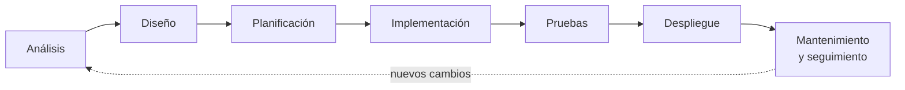
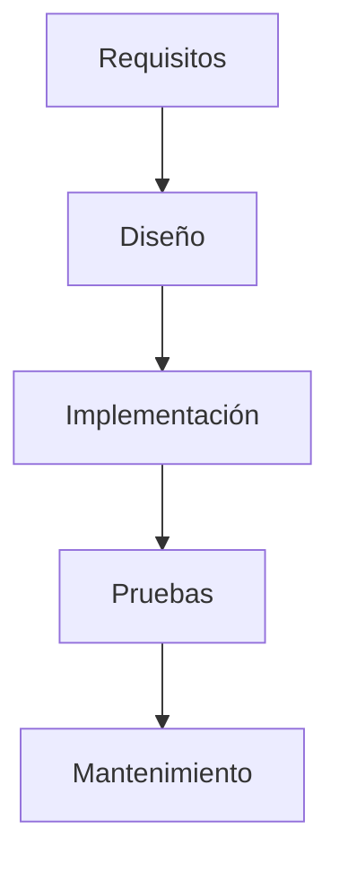
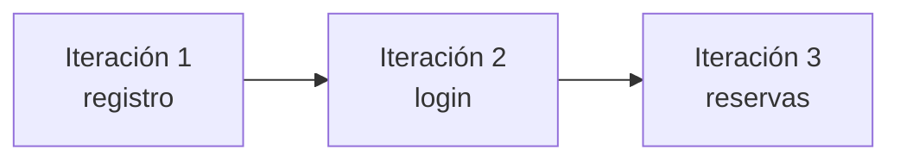
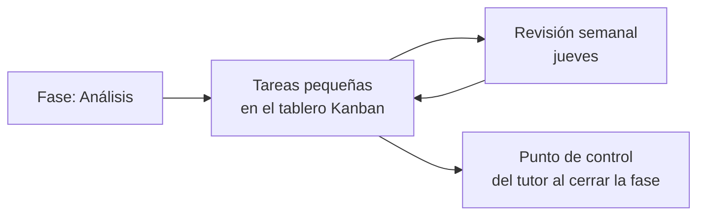
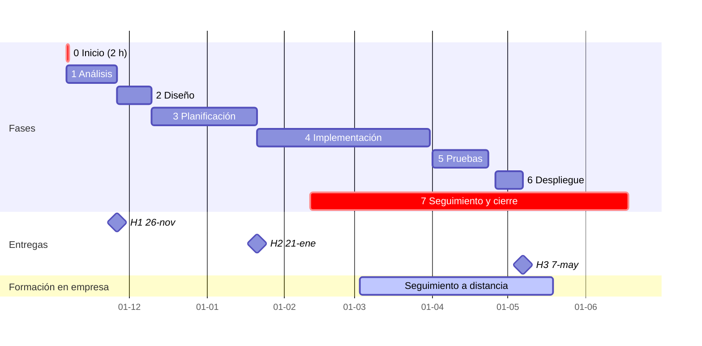
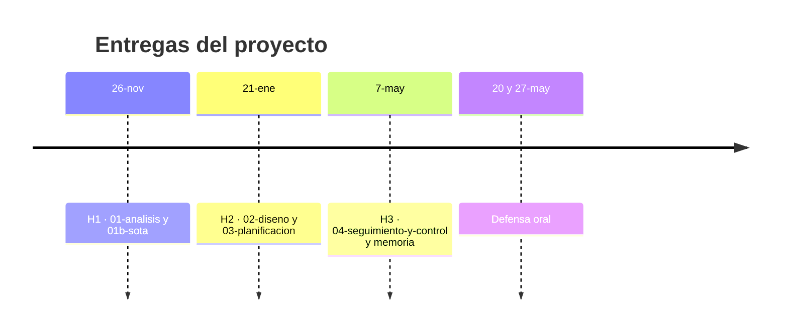
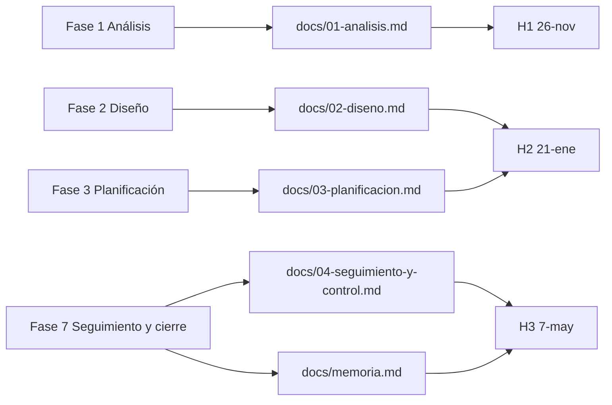

# 05 · Etapas del desarrollo de software y fases de tu proyecto

**Tiempo estimado:** 35 min de lectura + 70 min de tarea (ruta Esencial 🟢: 75 min en total) · **Fase:** 1 (análisis; el capítulo sirve también para situar la fase 0) · Estimaciones propias (propuesta, sin medir).

> **Antes de leer:** tener hecho el [capítulo 01](01-git-y-github.md) (Git instalado, sabes abrir un [Pull Request](glosario.md#pull-request-pr)) · términos dudosos en el [glosario](glosario.md).

> Capítulo anterior: [04 · Claves y datos personales](04-claves-y-datos-personales.md) · Siguiente: [06 · Requisitos verificables](06-requisitos-verificables.md)

## En 5 minutos

- Hacer software no es «ponerse a programar». Se hace por **etapas** (7, en general): entender qué hace falta, diseñar, planificar, construir, probar, poner en marcha y mantener.
- Hay varias formas de ordenar esas etapas (**modelos de ciclo de vida**): en cascada, iterativo/incremental y ágil.
- Tu proyecto usa una **metodología híbrida**: **8 fases** del curso (de la 0 a la 7) con entregas fijas (H1, H2, H3) y, dentro de cada fase, trabajo en tareas pequeñas con un tablero **Kanban**.
- Solo las fases 1, 2, 3 y 7 producen un documento numerado (`docs/01-analisis.md` a `docs/04-seguimiento-y-control.md`); las fases 0, 4, 5 y 6 producen la documentación inicial, el código, los resultados de pruebas y la versión desplegada.
- Las fechas son **provisionales** hasta que se apruebe el calendario del centro. La referencia es siempre [`fases-del-proyecto.md`](../../fases-del-proyecto.md).

## Lo imprescindible para esta semana

1. Sabes decir en qué fase estás ahora: **Fase 1, Análisis** (hasta la entrega H1 del 26-nov, fecha provisional). *Lo compruebas en el paso 1 de la tarea.*
2. Sabes qué documentos entregas en H1: `docs/01-analisis.md` y `docs/01b-sota.md` (versión breve). *Paso 2 de la tarea.*
3. Sabes que «análisis» va **antes** de «implementar»: no se empieza a programar sin saber qué problema se resuelve.

**Ruta Esencial 🟢:** lee «En 5 minutos», «Lo imprescindible», las secciones 1 y 4 (hasta el calendario) y haz los pasos 0-3, 6 y 7 de la tarea (≈ 75 min). Las secciones 🟡 son ampliables. Para la tarea no hace falta leer `metodologia.md`, solo `fases-del-proyecto.md`.

## Glosario local

| Término | Qué significa | Ejemplo |
|---|---|---|
| Ciclo de vida | Todas las etapas por las que pasa un software, de la idea a la retirada | De «idea de tienda online» a «versión 1.0 en producción» |
| Etapa | Cada una de las 7 partes **generales** del desarrollo de software (sección 1) | Análisis, diseño... |
| [Fase](glosario.md#fase) | Cada una de las 8 partes de **este curso** (de la 0 a la 7, sección 4); casi todas coinciden con una etapa | Fase 1 · Análisis |
| Requisito | Algo que el software debe hacer o cumplir | «El usuario puede registrarse con un correo» |
| Entregable | Documento o producto que entregas al cerrar una fase | `docs/01-analisis.md` |
| [Hito](glosario.md#hito-h1-h2-h3) | Fecha de entrega fija | H1: 26-nov |
| Iteración | Una vuelta corta de trabajo que produce algo usable | Hacer solo el registro de usuarios |
| Incremento | Lo que se añade al producto en cada iteración | Un login que funciona |
| [Kanban](glosario.md#tablero-kanban) | Tablero con columnas que muestra el estado de las tareas | Backlog → Por hacer → En curso → En revisión → Hecho |
| Despliegue | Poner la aplicación en un entorno donde se pueda usar | Subirla a un servidor |
| Mantenimiento | Corregir errores y mejorar una vez puesta en marcha | Arreglar un fallo detectado por un usuario |

## 1. Las etapas del desarrollo de software

Casi todos los proyectos pasan por las mismas etapas, aunque cambie el nombre o el orden. Esta lista es **la nuestra** (convención del proyecto, [`metodologia.md`](../../metodologia.md) §3); otras fuentes usan otros nombres. **Etapa** es el concepto general (7); **fase** es cómo las ordena este curso (8, con la fase 0 de arranque). La última columna dice qué fase del curso corresponde a cada etapa.

| Etapa | Pregunta que contesta | Ejemplo ficticio (`proyecto-demo`: una tienda de bicicletas) | Fase del curso |
|---|---|---|---|
| **Análisis de requisitos** | ¿Qué problema hay y qué debe hacer el software? | «El taller quiere que los clientes reserven cita en línea» | 1 |
| **Diseño** | ¿Cómo lo vamos a construir? | Pantallas, base de datos, arquitectura | 2 |
| **Planificación** | ¿Cuándo, con qué recursos, qué riesgos? | Calendario, horas, qué puede fallar | 3 |
| **Implementación** | Construirlo | Programar el formulario de reserva | 4 |
| **Pruebas** | ¿Funciona como se pidió? | Probar que no se puede reservar dos veces la misma hora | 5 |
| **Despliegue** | Ponerlo en marcha | Publicarlo en un servidor | 6 |
| **Mantenimiento y seguimiento** | ¿Sigue funcionando y mejorando? | Registrar incidencias, atender cambios | 7 (la fase 0, Inicio, es solo el arranque) |

La flecha de puntos significa que el trabajo no termina: lo aprendido al mantener genera nuevos requisitos.

## 2. Modelos de ciclo de vida 🟡

*Ampliable: puedes saltarla esta semana.* Un **modelo de ciclo de vida** es una forma de ordenar esas etapas. Tres, en lenguaje sencillo.

### Cascada

Cada etapa se hace **una vez, en orden**, y no se pasa a la siguiente hasta cerrar la anterior. Es claro y fácil de documentar, pero cambiar de idea tarde cuesta mucho.

**Cómo leerlo:** de arriba abajo, sin volver atrás. Está simplificado: omite Planificación y Despliegue.

### Iterativo e incremental

Se repite un ciclo corto (diseñar, construir, probar) y en cada vuelta se añade una parte del producto. Se ve antes si algo falla.

**Cómo leerlo:** cada caja es una vuelta corta (diseñar, construir, probar) que añade una parte; el diagrama solo dibuja la secuencia de vueltas.

### Ágil

Es una familia de formas de trabajar, centrada en entregar valor pronto y adaptarse al cambio. El *Manifiesto Ágil* (2001) valora más a las personas y su colaboración, el software funcionando, la colaboración con el cliente y la respuesta ante el cambio que, respectivamente, los procesos, la documentación extensiva, la negociación contractual y seguir un plan.

Scrum es un marco ágil que organiza el trabajo en *sprints* de duración fija de un mes o menos. **En este proyecto no usamos sprints formales ni roles de Scrum** ([`metodologia.md`](../../metodologia.md) §1 y §8).

### Comparación rápida

| Modelo | Cambios a mitad | Documentación | Cuándo encaja |
|---|---|---|---|
| Cascada | Costosos | Mucha, al principio | Requisitos muy estables |
| Iterativo/incremental | Posibles | Media | Se aprende construyendo |
| Ágil | Esperados | La justa | Requisitos que cambian |

Estas descripciones son una simplificación didáctica; el estado de las fuentes está en «Para saber más».

## 3. Nuestra metodología: híbrida (fases + Kanban)

Es la de [`metodologia.md`](../../metodologia.md) (§1).

- Las **fases del ciclo de vida** ordenan el proyecto y los entregables, con un **punto de control del tutor** al cerrar cada una.
- **Kanban + ritmo semanal** dentro de cada fase: tareas pequeñas, visibles, **máximo 2 en curso**.
- Elementos de Scrum adaptados: *backlog* (la lista de tareas pendientes, la primera columna del tablero), [historias de usuario](glosario.md#historia-de-usuario) y [definición de hecho](glosario.md#definición-de-hecho), **sin sprints ni roles**.
- 🟡 *Ampliable:* como marco de referencia general se toma **ISO/IEC/IEEE 12207** (procesos del ciclo de vida del software, **solo como referencia**, sin exigir cumplimiento; correspondencia didáctica, metodología §2).

**Cómo leerlo:** dentro de una fase trabajas tareas pequeñas del tablero y las repasas cada jueves (briefing y dudas); al cerrar la fase, el tutor hace un punto de control.

## 4. Las 8 fases de tu proyecto (de la 0 a la 7)

> [!NOTE]
> Las fechas son **provisionales**. Si cambian, manda [`fases-del-proyecto.md`](../../fases-del-proyecto.md). Aquí no se cambia ninguna fecha ni regla.

| Fase | Fechas (provisionales) | Qué haces | Documento que produces |
|---|---|---|---|
| **0 · Inicio** | 6-nov (sesión especial de 2 h) | Repositorio en GitHub, tablero, primer PR, documentación inicial | `docs/00-documentoInicio.md`, `README.md`, esqueleto de `01-analisis.md` |
| **1 · Análisis** | 6-nov a 26-nov | Necesidad del sector, requisitos, obligaciones, ayudas, guion | `docs/01-analisis.md` y `docs/01b-sota.md` breve (**H1**, 26-nov) |
| **2 · Diseño** | 26-nov a 10-dic | Viabilidad, alcance, recursos, presupuesto, arquitectura, datos, interfaz, calidad | `docs/02-diseno.md` |
| **3 · Planificación** | 10-dic a 21-ene | Cronograma, recursos, permisos y protección de datos, riesgos, valoración económica | `docs/03-planificacion.md` (con el diseño: **H2**, 21-ene) |
| **4 · Implementación** | 21-ene a 31-mar | Desarrollo en iteraciones cortas con tablero ([Issues](glosario.md#issue)), [ramas](glosario.md#rama) y [PR](glosario.md#pull-request-pr) | Código en `main` (versión mínima funcional) |
| **5 · Pruebas** | 1-abr a 23-abr | Plan de pruebas, medir indicadores de calidad, corregir | Resultados de pruebas documentados |
| **6 · Despliegue** | 26-abr a 7-may | Puesta en marcha real o simulada y guía de despliegue | Versión desplegada y guía |
| **7 · Seguimiento, control y cierre** | 11-feb a 18-jun | Indicadores, incidencias, cambios, evaluación por usuarios, memoria, defensa oral | `docs/04-seguimiento-y-control.md` y `docs/memoria.md` (**H3**, 7-may) |

La fase 7 se solapa con las anteriores porque el seguimiento y el control corren mientras implementas y pruebas.

> [!NOTE]
> **Del 3-mar al 19-may no hay sesiones: es la formación en empresa.** Ahí caen casi enteras las fases 4, 5 y 6 y H3 (7-may). Consta: trabajo autónomo (implementación, pruebas, despliegue), 70 min de seguimiento a distancia, revisión semanal del tutor y revisión por PR, tutoría individual el 25-feb para acordar el plan, y [vía A](glosario.md#vía-a-y-vía-b) en los 7 días previos a H3. **No consta** qué entregas intermedias se piden ni cuándo son esos 70 min: pregúntalo al tutor por correo ([cómo hacerlo](../contacto-y-ayuda.md)) antes del 25-feb.

### Calendario

**Cómo leerlo:** cada barra es una fase, con las fechas de la tabla (la fase 0 dura 2 h, pero se dibuja como 1 día para verse). Las barras rojas (`crit`) resaltan las fases 0 y 7, que no siguen el orden normal (sesión especial y solapada). Los rombos son H1, H2 y H3; la barra final, la formación en empresa sin sesiones.

### Entregas

| Hito | Fecha | Contenido |
|---|---|---|
| **H1** | 26-nov | `docs/01-analisis.md` y `docs/01b-sota.md` (versión breve) |
| **H2** | 21-ene | `docs/02-diseno.md` y `docs/03-planificacion.md` |
| **H3** | 7-may | `docs/04-seguimiento-y-control.md` y `docs/memoria.md` |

Este diagrama muestra de qué fase sale cada documento y a qué entrega va (fechas provisionales). No repite el calendario: solo une fases, documentos y hitos.

**Cómo leerlo:** sigue cada fila de izquierda a derecha: fase, documento, entrega. En H2 llegan dos documentos a la vez. Las fases 0, 4, 5 y 6 producen otras cosas (documentación inicial, código, resultados de pruebas, versión desplegada y su guía), como indica la tabla de arriba.

Cada hito se marca con un **tag de Git** en `main` (`h1`, `h2`, `h3`): es la versión que se evalúa. No lo confundas con una **label** de GitHub (una pegatina de color en un Issue o PR, como `fase:analisis`): [diferencia](glosario.md#tag-de-git-frente-a-label-de-github). En los 7 días anteriores a un hito, todos los Pull Request pasan por revisión previa del tutor ([vía A](glosario.md#vía-a-y-vía-b)).

## 5. Cómo encajan los módulos 🟡

🟡 *Ampliable.* Implementación, pruebas y despliegue se **controlan** en este módulo (0616, Proyecto) y se **evalúan** en los módulos de 2.º que los trabajan. En `docs/00-documentoInicio.md` marcas cuáles usarás (al menos tres de 0612, 0613, 0614, 0615); detalle en [`relacion-con-modulos.md`](../../relacion-con-modulos.md).

## 6. Ejemplo trabajado

Ana (ficticia) quiere hacer `proyecto-demo`, una agenda de citas para un taller de bicicletas.

- **Fase 1:** entrevista (simulada) al taller, escribe 5 requisitos y un guion de trabajo en `01-analisis.md`.
- **Fase 2:** decide pantallas y una base de datos con tres tablas.
- **Fase 3:** estima tareas (con las labels de horas `est:2h`, `est:4h`), apunta riesgos y calendario.
- **Fase 4:** crea Issues en el tablero, trabaja en ramas y abre PR.
- **Fase 5:** prueba que no se pueden reservar dos citas a la misma hora.
- **Fase 6:** publica la versión y escribe cómo se instala.
- **Fase 7:** anota incidencias y cambios, y prepara la memoria.

## Errores frecuentes

- Empezar a programar sin haber cerrado el análisis.
- Pensar que las fases no se solapan: el seguimiento (fase 7) corre durante todo el proceso.
- Creer que Kanban sustituye a las fases: se combinan.
- Memorizar fechas de este capítulo en vez de mirar [`fases-del-proyecto.md`](../../fases-del-proyecto.md), que es la fuente.
- Confundir «iteración» con «sprint» de Scrum: aquí no hay sprints formales.

## Si te atascas

1. Prueba 10 minutos: busca en [`fases-del-proyecto.md`](../../fases-del-proyecto.md) la fase en la que estás.
2. Pregunta bien: en qué fase crees estar, qué documento no tienes claro, qué has leído ya.
3. Anótalo como bloqueo en el `docs/registro-tutoria.md` de tu repo del proyecto.
4. **Pide ayuda por correo:** si tras 10 minutos sigues bloqueado/a, escribe al tutor con la consulta ya preparada (qué intentaste, qué esperaba, qué pasó). Cómo hacerlo, en [contacto y ayuda](../contacto-y-ayuda.md).

## Autoevaluación

1. ¿Cuántas fases tiene el proyecto y cuál es la primera?
2. ¿Qué documento se entrega en H1 y en qué fecha?
3. ¿Cuál es la diferencia principal entre cascada e iterativo?
4. ¿Qué dos elementos se combinan en nuestra metodología híbrida?
5. ¿Qué fase se solapa con las demás y por qué? (Extra: ¿en qué se diferencian etapa y fase?)

**Respuestas**

1. Ocho (de la 0 a la 7); la primera es la 0, Inicio.
2. `docs/01-analisis.md` y `docs/01b-sota.md` (versión breve), el 26-nov (fecha provisional).
3. En cascada cada etapa se hace una vez y en orden; en iterativo se repite un ciclo corto añadiendo partes.
4. Fases del ciclo de vida (con entregables y puntos de control) y Kanban con revisión semanal.
5. La 7 (seguimiento, control y cierre), porque las incidencias y los cambios se registran mientras implementas y pruebas. Extra: etapa es el concepto general (7); fase, cada parte de este curso (8, de la 0 a la 7).

## Tarea y checklist

### Tarea: Situar tu proyecto en las fases
**Fase:** 1  ·  **Tiempo estimado:** 70 min (ruta Esencial 🟢: pasos 0-3, 6 y 7, ≈ 50 min; los 🟡 se hacen otra semana)  ·  **Entrega:** antes de la siguiente sesión del jueves
**Objetivo:** tener escrito, para tu proyecto, en qué fase estás, las fechas de entrega y qué harás en cada fase.
**Antes de empezar:** capítulo [01](01-git-y-github.md) y glosario leídos, y fase 0 hecha (repo, tablero y primer PR). Trabajas en el **repo de tu proyecto**, no en el de práctica. Si falta la fase 0, avisa al tutor.

### Pasos
- [ ] 0. 🟢 **Prepara tu rama** (guía 01, Pasos 2 y 3): `git switch main`, `git pull`, `git switch -c docs/situar-fases` — *hecho cuando:* estás en esa rama — **Comprobar:** `git branch --show-current` muestra `docs/situar-fases`.
- [ ] 1. 🟢 Abre [`fases-del-proyecto.md`](../../fases-del-proyecto.md), localiza la fase actual y escribe una línea en `docs/registro-tutoria.md` — *hecho cuando:* la línea dice en qué fase estás — **Comprobar:** `grep -n "Fase" docs/registro-tutoria.md` la muestra y coincide con la tabla de `fases-del-proyecto.md`.
- [ ] 2. 🟢 Anota las fechas provisionales de H1, H2 y H3 en tu `README.md` — *hecho cuando:* las tres fechas están en el README — **Comprobar:** `grep -n "H1\|H2\|H3" README.md` las muestra y coinciden con las de `fases-del-proyecto.md`.
- [ ] 3. 🟢 En `docs/00-documentoInicio.md` (si falta, cópialo de `plantilla-proyecto/docs/`) añade una sección «Mis fases» con una frase por cada fase (1 a 7) sobre qué harás en tu proyecto, cada una empezando por «- Fase N:» — *hecho cuando:* hay 7 frases — **Comprobar:** `grep -c "^- Fase" docs/00-documentoInicio.md` devuelve 7.
- [ ] 4. 🟡 Crea las labels del curso con [`plantilla-proyecto/.github/crear-labels.sh`](../../../plantilla-proyecto/.github/crear-labels.sh) (necesita `gh`; ver [guía 01](01-git-y-github.md): label frente a tag) y 3 Issues con una label de fase (`fase:analisis`…) — *hecho cuando:* hay 3 Issues con label de fase — **Comprobar:** la pestaña Issues de GitHub los lista con su label.
- [ ] 5. 🟡 Mueve esos Issues a «Por hacer» en el tablero, con **2 o menos** en «En curso» — **Comprobar:** en el tablero, la columna «En curso» tiene 2 o menos.
- [ ] 6. 🟢 **Commit y push** (guía 01, Pasos 4 y 5): `git add README.md docs/registro-tutoria.md docs/00-documentoInicio.md`, `git commit -m "docs: sitúa mi proyecto en las fases"`, `git push -u origin docs/situar-fases` — **Comprobar:** la rama aparece en GitHub.
- [ ] 7. 🟢 **Abre el PR** (guía 01, Paso 6) con la lista de [`pull_request_template.md`](../../../plantilla-proyecto/.github/pull_request_template.md). No es tu primer PR: va por vía B (sin `necesita-tutor`), salvo que falten menos de 7 días para un hito ([vía A](glosario.md#vía-a-y-vía-b)) — **Comprobar:** el PR sale en la pestaña *Pull requests*.

Si usaste IA, anótalo en `docs/declaracion-uso-ia.md` (fecha, herramienta, qué pediste, qué aceptaste o cambiaste, dónde); ejemplo de fila: «2026-11-12 · asistente · ordenar 7 frases · cambié dos · `00-documentoInicio.md`».

### Progreso
Cuenta tú los pasos hechos (de 8, del 0 al 7) y apunta cuál te falta.

### Antes de entregar
- [ ] Sin claves ni datos personales
- [ ] Uso de IA declarado
- [ ] Horas anotadas en `docs/registro-tutoria.md`
- [ ] PR abierto con su lista de comprobación

### Si me atasco
Lo he intentado 10 min · lo anoto como bloqueo en `docs/registro-tutoria.md` · pregunto con: qué intenté, qué esperaba, qué pasó. · cómo escribir al tutor: [contacto y ayuda](../contacto-y-ayuda.md)

## Para saber más

Fecha de consulta: 2026-11-07. Estados de verificación como en el [glosario](glosario.md#verificado--declarado--no-leído).

| Fuente | Enlace | Estado |
|---|---|---|
| [Manifiesto Ágil](https://agilemanifesto.org/iso/es/manifesto.html) (versión en español) | enlace | `verificado` |
| [Guía de Scrum (2020)](https://scrumguides.org/scrum-guide.html) | enlace | `verificado` (definición y sprints) |
| [ISO/IEC/IEEE 12207](https://www.iso.org/standard/81754.html) | enlace | `no leído` (acceso denegado, 403); citado solo como lo declara la metodología (`declarado`) |
| Cascada: origen histórico | — | `no leído`; no se atribuye a ninguna fuente concreta |
| [Fases y fechas del proyecto](../../fases-del-proyecto.md) | repo | `verificado` (leído) |
| [Metodología](../../metodologia.md) | repo | `verificado` (leído) |
