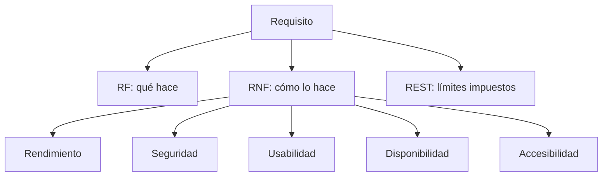
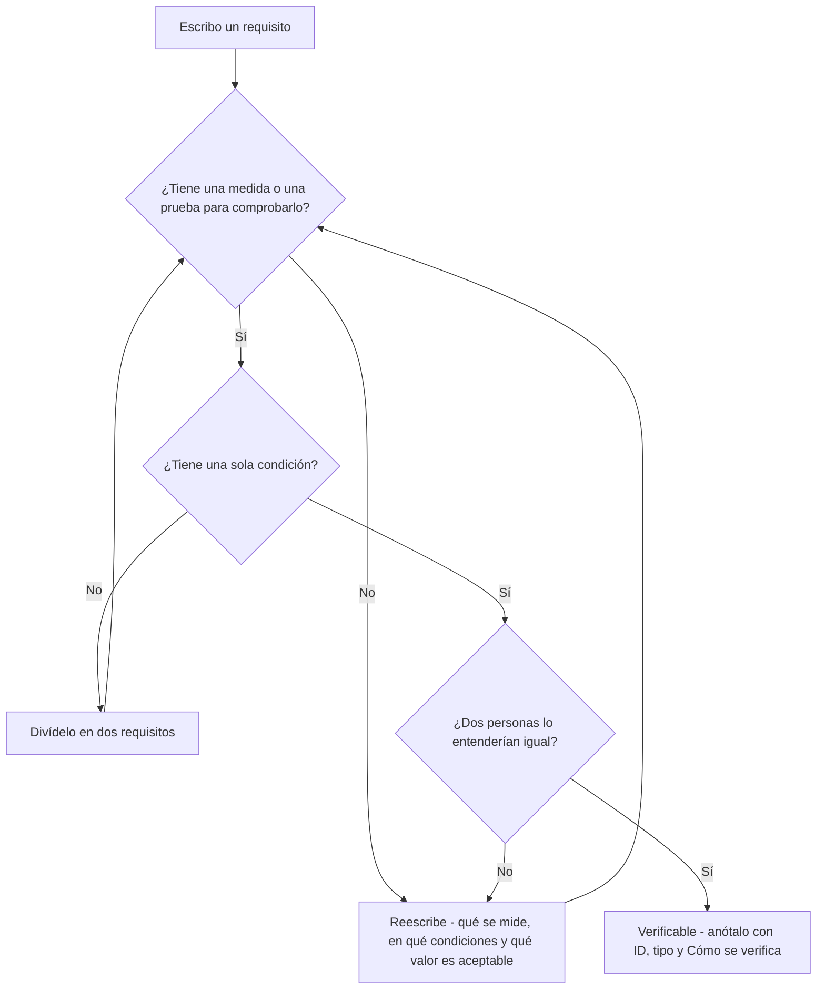
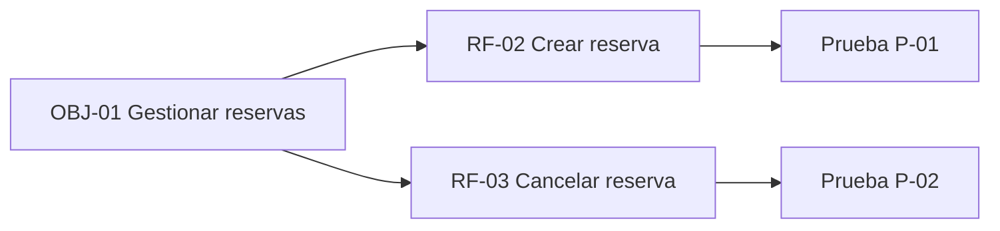
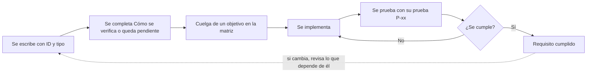

# 06 · Requisitos verificables

**Tiempo estimado:** 25 min de lectura (20 en la ruta Esencial 🟢) + tarea: 60 min (🟢) y 45 min (🔵) · **Ruta Esencial 🟢: 80 min en total** · **Fase:** [1](glosario.md#fase) (análisis; entrega [H1](glosario.md#hito-h1-h2-h3)). Los tiempos son estimaciones propias (propuesta, sin medir).

> **Antes de leer:** tener hecho el [capítulo 01](01-git-y-github.md) (Git instalado y autenticado, sabes abrir un Pull Request) · términos dudosos en el [glosario](glosario.md).

Anterior: [05 · Etapas de desarrollo](05-etapas-de-desarrollo.md) · Siguiente: [07 · IA y LLM](07-ia-y-llm.md)

## En 5 minutos

- Un **requisito** dice qué tiene que cumplir tu proyecto. Es **verificable** si puedes comprobar, con una medida o una prueba, si se cumple o no.
- «Debe ser rápido» no vale: cada persona entiende algo distinto y nadie puede decir si se cumple. «Responde en menos de 2 s» sí.
- Hay tres tipos: **RF** (funcional: qué hace), **RNF** (no funcional: cómo lo hace) y **REST** (restricción: límites que te vienen dados; aquí significa «restricción», no «API REST», ver [glosario](glosario.md#rf--rnf--rest)).
- Cada requisito lleva un identificador y «Cómo se verifica»: así se enlaza objetivo → requisito → prueba (trazabilidad).
- Lo evalúa el criterio **1f** de **RA1** ([glosario](glosario.md#ra-ce-y-cómo-leer-ra1--1f)) y va en el apartado 4 de tu `docs/01-analisis.md` (viene de la [plantilla](../../../plantilla-proyecto/docs/01-analisis.md)).

## Lo imprescindible (para esta semana)

1. Distinguir RF, RNF y REST.
2. Reescribir un requisito vago con una medida o prueba.
3. Rellenar la tabla del §4 de `01-analisis.md` con identificador, tipo y «cómo se verifica».

**Ruta Esencial 🟢:** lee «En 5 minutos», «Lo imprescindible», las secciones 2 a 5 y la 7, y haz los pasos 0-7 de la tarea (≈ 80 min). Los pasos 🔵 son la Semana 2.

---

## 1. Por qué importa 🟡

*Ampliable: puedes saltarla esta semana.* Sin una medida acordada («va lenta», «no, va bien»), nadie tiene razón. Los requisitos verificables fijan qué es «terminado», permiten planificar pruebas y dejan que el tutor evalúe contra lo que tú escribiste.

## 2. Qué es un requisito

### Glosario local

| Término | Qué significa | Ejemplo ficticio |
|---|---|---|
| Requisito | Condición o capacidad que el proyecto debe cumplir. | «El socio puede cancelar una reserva.» |
| RF (funcional) | Qué hace el sistema. | RF-02 Crear una reserva. |
| RNF (no funcional) | Cómo lo hace: rendimiento, seguridad, usabilidad, disponibilidad, accesibilidad. | RNF-01 Carga en menos de 2 s. |
| REST (restricción) | Límite impuesto: plazo, presupuesto, tecnología obligatoria, normativa. | REST-01 Hosting solo con plan gratuito. |
| Verificable | Se puede comprobar con una medida o prueba. | «Sin errores en 20 reservas seguidas.» |
| Criterio de aceptación | Condición concreta que debe darse para dar el requisito por cumplido. | Dado/Cuando/Entonces (§4) |
| Trazabilidad | Poder seguir el hilo desde el objetivo hasta la prueba. | OBJ-01 → RF-02 → P-07 |

Esta nomenclatura (RF-01, RNF-01, REST-01) es la de `plantilla-proyecto/docs/01-analisis.md` §4: es **convención del curso**.

Este diagrama muestra los tres tipos de requisito y los cinco grupos de RNF.



**Cómo leerlo:** de arriba abajo; cada requisito es de un tipo, y los RNF se reparten en cinco familias (rendimiento, seguridad, usabilidad, disponibilidad, accesibilidad).

## 3. Por qué «debe ser rápido» no vale

Pregúntate sobre cada requisito: **¿cómo sabré que se cumple?** Si no sabes responder, no es verificable.

Palabras de alarma: *rápido, fácil, intuitivo, moderno, seguro, eficiente, amigable, mucho, pocos, etc., adecuado*.

Este árbol es la pregunta de arriba convertida en pasos: te dice si tu requisito está listo o qué arreglar.



**Cómo leerlo:** empieza arriba y responde las tres preguntas en orden. Cada «No» te manda a arreglar el texto y a preguntar de nuevo; terminas cuando las tres son «Sí».

### Cómo arreglarlo

Añade **qué se mide, en qué condiciones y qué valor es aceptable**:

| Mal escrito | Qué falla | Bien escrito |
|---|---|---|
| «La web debe ser rápida.» | «Rápida» no se mide. | **RNF-01.** La página de reservas carga en menos de 2 s con conexión de 10 Mbps, medido con las herramientas de desarrollo del navegador. |
| «Debe ser fácil de usar.» | «Fácil» es opinión. | **RNF-02.** Una persona nueva completa una reserva en menos de 3 min sin ayuda, en una prueba con 3 personas. |
| «Debe ser segura.» | Demasiado general. | **RNF-03.** Las contraseñas se guardan cifradas con un algoritmo de [hash](glosario.md#hash-y-sal) y nunca aparecen en texto plano en la base de datos. |
| «Gestionar reservas.» | Qué significa gestionar. | **RF-02.** El socio puede crear una reserva eligiendo pista, fecha y hora. **RF-03.** El socio puede cancelarla hasta 2 h antes. |
| «Usar una tecnología moderna.» | Vaga. | **REST-01.** El servidor (la parte que corre fuera del navegador) usa Node.js, exigido por el tutor. |

> [!NOTE]
> Los valores de arriba (2 s, 3 min, 10 Mbps) son **ejemplos ficticios**. Los de tu proyecto salen de lo que necesite tu proyecto y de las fuentes que hayas encontrado en [`01b-sota.md`](../../../plantilla-proyecto/docs/01b-sota.md) (el [SOTA](glosario.md#sota), «estado del arte»: qué existe ya para tu problema; ver [cap. 08](08-sota-y-fuentes.md)); justifícalos.

Una regla práctica: **una frase, una condición, una verificación**. Si el requisito lleva «y», probablemente son dos.

## 4. Criterios de aceptación: Dado / Cuando / Entonces

Para los RF es muy útil el formato **Dado / Cuando / Entonces** (conocido como estilo *Given / When / Then*; es una **convención de la comunidad**, no una norma):

- **Dado** una situación de partida,
- **Cuando** ocurre una acción,
- **Entonces** se observa un resultado.

Ejemplo completo en el §7. Escribe al menos un caso «feliz» y uno «de fallo».

## 5. Trazabilidad: objetivo → requisito → prueba

La **matriz de trazabilidad** (en `01-analisis.md` §4, bajo la tabla de requisitos) une cada objetivo con sus requisitos y estos con lo que los implementa y comprueba. Para [H1](glosario.md#hito-h1-h2-h3) basta con **objetivo y requisito**; se completa al final.

Este diagrama muestra la idea con un objetivo y dos requisitos.



**Cómo leerlo:** cada flecha dice «se concreta en»: el objetivo en requisitos, y cada requisito en la prueba que lo comprueba.

Este otro sigue la vida de un requisito, desde que lo escribes hasta que se cumple (o cambia).



**Cómo leerlo:** de izquierda a derecha hasta la prueba; si falla, vuelves a implementar. La línea de puntos recuerda que un cambio en un requisito obliga a revisar su matriz y sus pruebas.

Un requisito sin objetivo quizá sobra; un objetivo sin requisitos, falta algo. Un requisito sin prueba aún no es verificable: escribe «pendiente» y complétalo antes de H3.

## 6. Plantilla, evaluación y fechas

- **Plantilla:** `docs/01-analisis.md`, apartado 4: tabla ID · Requisito · Tipo · Cómo se verifica, y debajo la matriz.
- **Criterio 1f:** «Se han determinado las características específicas requeridas al proyecto.» (texto literal de la plantilla).
- **Fechas** (provisionales, ver [hitos](glosario.md#hito-h1-h2-h3)): en **H1 (26-nov)** entregas el análisis con estos requisitos; **H3 (7-may)** es la entrega final. Un REST de plazo suele apuntar a H3. Calendario: [`fases-del-proyecto.md`](../../fases-del-proyecto.md).

## 7. Ejemplo trabajado (ficticio)

Proyecto `proyecto-demo`: reservas de pistas de pádel. Objetivo: «Los socios reservan sin llamar por teléfono.»

**Tabla de requisitos (§4):**

| ID | Requisito | Tipo | Cómo se verifica |
|---|---|---|---|
| RF-01 | El socio inicia sesión con correo y contraseña. | funcional | Prueba P-01: login correcto e incorrecto. |
| RF-02 | El socio crea una reserva eligiendo pista, fecha y hora. | funcional | P-02, ver criterio CA-RF-02. |
| RNF-01 | La página de reservas carga en menos de 2 s (red de 10 Mbps, es decir, una conexión normal de casa). | no funcional | Medición con las herramientas del navegador, 5 repeticiones. |
| RNF-02 | La interfaz saca ≥ 90 en «Accesibilidad» en [Lighthouse](glosario.md#lighthouse). | no funcional | Informe de Lighthouse (F12 en Chrome, pestaña Lighthouse) enlazado o pegado en el PR. |
| REST-01 | Hosting solo con plan gratuito. | restricción | Revisión del plan contratado. |

**Matriz de trazabilidad (en H1: objetivo y requisito):**

| Objetivo | Requisito | Caso de uso | Pantalla o endpoint | Prueba o indicador |
|---|---|---|---|---|
| OBJ-01 Reservar sin llamar | RF-01 | | | pendiente |
| OBJ-01 Reservar sin llamar | RF-02 | | | P-02 |

**Criterio de aceptación CA-RF-02** (bajo la matriz):

```text
Dado un socio con sesión iniciada y la pista 3 libre a las 18:00,
Cuando reserva la pista 3 a las 18:00,
Entonces la reserva aparece en «Mis reservas» y la pista 3 figura ocupada.

Dado la pista 3 ya reservada a las 18:00,
Cuando otro socio intenta reservarla,
Entonces ve el aviso «pista ocupada» y no se crea la reserva.
```

## Errores frecuentes

- Mezclar tipos: escribir «El sistema debe ser seguro» como RF. La seguridad es un RNF y necesita su propia medida.
- Describir la solución, no la necesidad («usar un botón verde»).
- Valores inventados sin justificar (¿por qué 2 s?).
- Requisitos sin «Cómo se verifica» y sin plan para completarlo.
- Un requisito con dos condiciones («rápido y seguro»).
- Olvidar las restricciones (plazo, normativa).

## Si te atascas

Prueba **10 minutos** (escribe el requisito y anota «¿cómo lo comprobaría mañana?»); después, anota el bloqueo en `docs/registro-tutoria.md` y escribe al tutor como explica [contacto y ayuda](../contacto-y-ayuda.md).

## Ejercicio de reescritura

Reescribe cada frase como requisito verificable (RF, RNF o REST; con medida o prueba):

1. «La aplicación debe ser muy segura.»
2. «Los usuarios deben poder gestionar sus tareas.»
3. «Tiene que funcionar en cualquier móvil.»
4. «Debe estar terminada pronto.» (piensa en la entrega final)

*Pista:* pregunta «¿qué, cuánto, en qué condiciones, cómo se comprueba?». Hay varias respuestas válidas; compara con las propuestas al final. Si la tuya difiere, no está mal: pásala por el árbol de §3 (¿medida o prueba? ¿una condición? ¿se entiende igual?); si lo cumple, vale.

## Autoevaluación

1. ¿Qué diferencia hay entre un RF y un RNF?
2. ¿Por qué «debe ser rápido» no es verificable?
3. ¿Qué significa Dado/Cuando/Entonces?
4. ¿Qué une la matriz de trazabilidad?
5. ¿Qué criterio de RA1 evidencian los requisitos?

**Respuestas:** (1) RF = qué hace; RNF = cómo lo hace (rendimiento, seguridad...). (2) Sin medida ni prueba, no se puede decir si se cumple. (3) Situación de partida, acción y resultado esperado. (4) Objetivos con requisitos, y estos con implementación y pruebas. (5) El 1f, del RA1.

**Propuestas de reescritura (ficticias, a modo de ejemplo):** (1) Dos RNF, uno por condición: «Las contraseñas se guardan como hash; verificable inspeccionando la base de datos» y «La sesión caduca a los 30 min de inactividad; verificable probando una sesión inactiva». (2) RF: «El usuario puede crear, editar y borrar una tarea; verificable con tres pruebas, una por acción.» (3) RNF: «La interfaz se ve sin desbordar horizontalmente en anchos de 360, 390 y 412 px; comprobado en las herramientas de desarrollo del navegador.» (4) REST: «La versión final se entrega antes del hito H3; verificable en el calendario del curso.»

## Tarea y checklist

### Tarea: Escribir los requisitos verificables de tu proyecto
**Fase:** 1  ·  **Tiempo estimado:** Semana 1 (🟢) 60 min · Semana 2 (🔵) 45 min  ·  **Entrega:** según indique el tutor (antes de [H1](glosario.md#hito-h1-h2-h3), 26-nov, provisional)
**Objetivo:** tener la tabla de `01-analisis.md` §4 con requisitos que se pueden comprobar: 4 en la ruta 🟢, 6 con la 🔵.
**Repositorio:** el **repo de tu proyecto** (no el de práctica).
**Antes de empezar:** [02 · Markdown y Mermaid](02-documentar-markdown-mermaid.md) y tu documento de inicio, `docs/00-documentoInicio.md`. Viene en la plantilla; si tu repo no lo tiene, cópialo desde [`plantilla-proyecto/docs/00-documentoInicio.md`](../../../plantilla-proyecto/docs/00-documentoInicio.md) (igual con [`01-analisis.md`](../../../plantilla-proyecto/docs/01-analisis.md)).

### Pasos
- [ ] 0. 🟢 **Prepara tu rama** (guía 01, Pasos 2 y 3): `git switch main`, `git pull`, `git switch -c docs/requisitos` — *hecho cuando:* estás en esa rama — **Comprobar:** `git branch --show-current` muestra `docs/requisitos`.
- [ ] 1. 🟢 **Objetivos (2).** Sácalos de tu documento de inicio (§3 «Qué quiero hacer» y §6 «Funcionalidades»). Escríbelos en la matriz de `docs/01-analisis.md` §4 (columna «Objetivo»), con este formato — *hecho cuando:* cada uno tiene identificador OBJ-01, OBJ-02 — **Comprobar:** `grep -n "OBJ-0" docs/01-analisis.md` muestra al menos 2 líneas.

  ```text
  | Objetivo | Requisito | Caso de uso | Pantalla o endpoint | Prueba o indicador |
  |---|---|---|---|---|
  | OBJ-01 Reservar sin llamar | RF-01 | | | pendiente |
  ```
- [ ] 2. 🟢 **2 RF** (qué hace) en la tabla §4 — *hecho cuando:* cada uno es una frase con una sola condición y aparece en la matriz bajo su objetivo — **Comprobar:** `grep -c "RF-0" docs/01-analisis.md` da 4 o más (tabla y matriz).
- [ ] 3. 🟢 **1 RNF** con medida y condiciones — *hecho cuando:* lleva un número con unidad y cómo se mide — **Comprobar:** la fila RNF-01 tiene un número con unidad (p. ej. «2 s») y cómo se mide.
- [ ] 4. 🟢 **1 REST** (plazo, tecnología o normativa) — *hecho cuando:* cita su origen — **Comprobar:** la fila REST-01 dice de dónde viene.
- [ ] 5. 🟢 **«Cómo se verifica» y un criterio Dado/Cuando/Entonces.** Rellena la columna de los 4 requisitos. El criterio va **bajo la matriz**, en un apartado «Criterios de aceptación» que añades tú (la plantilla no lo trae; propuesta), con el formato del §7 y nombre CA-RF-xx; en «Cómo se verifica» de ese RF escribe «ver CA-RF-xx» — *hecho cuando:* ningún requisito queda vacío (o dice «pendiente») y el RF tiene 2 casos, uno feliz y uno de fallo — **Comprobar:** `grep -c "^Entonces" docs/01-analisis.md` da 2 o más, y recorre la columna «Cómo se verifica»: ninguna celda vacía.
- [ ] 6. 🟢 **Commit y push** (guía 01, Pasos 4 y 5): `git add docs/01-analisis.md`, `git commit -m "docs: añade requisitos verificables"`, `git push -u origin docs/requisitos` — *hecho cuando:* la rama está en GitHub — **Comprobar:** la rama aparece en GitHub.
- [ ] 7. 🟢 **Abre el [PR](glosario.md#pull-request-pr)** (guía 01, Paso 6) con la [lista de comprobación](../../../plantilla-proyecto/.github/pull_request_template.md) copiada en la descripción. Primer PR: vía A (label `necesita-tutor`) — *hecho cuando:* el PR está abierto con la lista — **Comprobar:** el PR aparece en *Pull requests* y la lista está en la descripción.
- [ ] 8. 🔵 **Semana 2: completa hasta 6.** Añade 1 RF y 1 RNF más, con sus «Cómo se verifica», y repite `git add`, `git commit`, `git push` en la misma rama (no abras otro PR) — *hecho cuando:* la tabla tiene 3 RF, 2 RNF y 1 REST — **Comprobar:** el PR muestra un segundo commit y la tabla tiene 6 filas.

**Uso de IA:** si usaste IA, anótalo en `docs/declaracion-uso-ia.md` (fecha, herramienta, qué pediste, qué aceptaste o cambiaste, dónde); ejemplo: `2026-11-12 · asistente de IA · ejemplos de RNF de carga · cambié 3 s por 2 s · docs/01-analisis.md`.

### Progreso
Llevo **0 de 8** pasos. Me falta: el paso 0.

### Antes de entregar
- [ ] Sin claves ni datos personales
- [ ] Uso de IA en `docs/declaracion-uso-ia.md` y horas en `docs/registro-tutoria.md`
- [ ] PR abierto con su lista de comprobación

### Si me atasco
Lo he intentado 10 min · lo anoto como bloqueo en `registro-tutoria.md` · pregunto con: qué intenté, qué esperaba, qué pasó. · cómo escribir al tutor: [contacto y ayuda](../contacto-y-ayuda.md)

## Para saber más

| Fuente | Enlace | Consultada | Estado |
|---|---|---|---|
| Plantilla `01-analisis.md` §4 y criterios RA1 (texto literal 1f) | [`plantilla-proyecto/docs/01-analisis.md`](../../../plantilla-proyecto/docs/01-analisis.md) | 2026-11-07 | verificado |
| ISO/IEC/IEEE 29148:2018 (ficha del catálogo ISO) | [Ficha en iso.org](https://www.iso.org/standard/72089.html) | 2026-11-07 | no leído (acceso denegado, 403) |
| Resumen de la norma 29148:2018 (alcance, sustituye a IEEE 830) | [Plantillas en ReqView](https://www.reqview.com/doc/iso-iec-ieee-29148-templates/) | 2026-11-07 | declarado (aparece en resultados de búsqueda; no abierto) |
| Metodología del curso, §2 | [`docs/metodologia.md`](../../metodologia.md) | 2026-11-07 | verificado |
| Estilo Given/When/Then | — | — | no verificado: se describe como convención de la comunidad; busca «Given When Then» en una fuente que puedas citar |

**Fuente reconocida.** La norma ISO/IEC/IEEE 29148:2018 trata la ingeniería de requisitos y, según resúmenes de terceros, sustituye a la IEEE 830-1998 (`declarado`: la página oficial dio error 403 y el texto es de pago). El curso **no exige** cumplirla.

Navegación: [05 · Etapas de desarrollo](05-etapas-de-desarrollo.md) · [07 · IA y LLM](07-ia-y-llm.md)
