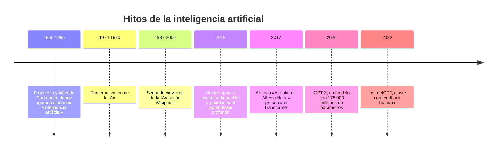
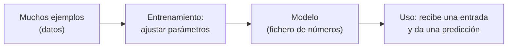
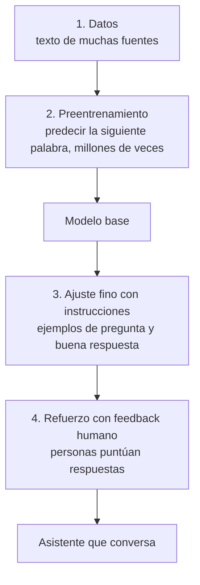
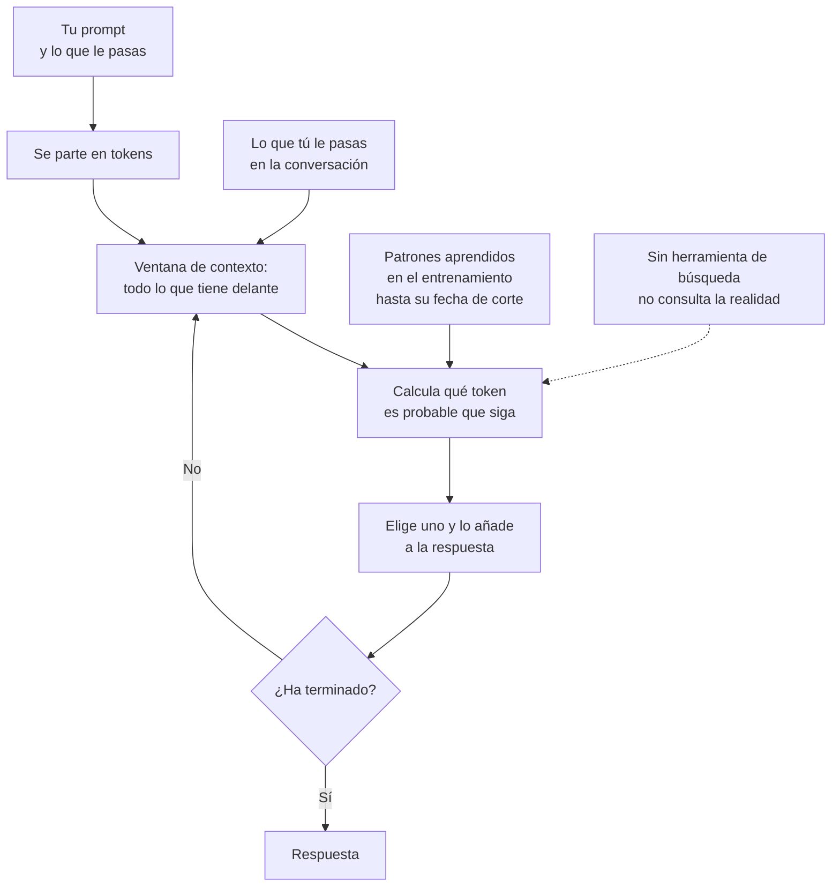
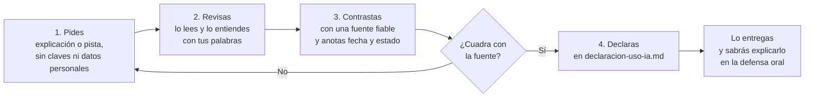

# 07 · Desarrollo asistido con IA: qué es y cómo usarlo para aprender

**Tiempo estimado:** 25 min de lectura + 30 min de tarea (ruta Esencial 🟢: ≈ 40 min en total; estimaciones propias, sin medir) · **Fase:** [0-1](glosario.md#fase) (hasta [H1](glosario.md#hito-h1-h2-h3), 26-nov-2026)

← Anterior: [06 · Requisitos verificables](06-requisitos-verificables.md) · Siguiente: [08 · SOTA y fuentes](08-sota-y-fuentes.md)

> **Antes de leer:** tener hecho el [capítulo 01](01-git-y-github.md) (Git instalado y autenticado, sabes abrir un Pull Request) · términos dudosos en el [glosario](glosario.md).

## En 5 minutos

- Un **LLM** (modelo de lenguaje grande) es un programa que, dado un texto, **predice qué texto es el más probable que venga después**. No consulta una base de datos de verdades ni «entiende» como una persona.
- Por eso puede escribir código y explicaciones muy convincentes **y equivocarse con total seguridad**. A eso se le llama **alucinación**.
- Usar IA para programar se llama **desarrollo asistido por IA**. Ahorra tiempo, pero si la usas para saltarte el aprendizaje, en la [**defensa oral**](glosario.md#defensa-oral) (donde explicas y defiendes tu proyecto) no sabrás explicar lo que entregas.
- En este proyecto **se permite, se declara y se contrasta**. La IA no califica.
- La herramienta que usaremos es **OpenCode**, un agente de programación que se maneja desde la terminal.

## Lo imprescindible (para esta semana)

1. Puedes usar IA, pero **la declaras** en `docs/declaracion-uso-ia.md` de tu repositorio.
2. **Nunca** le envíes claves y contraseñas (incluidos los [tokens de acceso o claves de API](glosario.md#token-de-acceso--clave-de-api)) ni datos personales (tuyos, de compañeros o de terceros).
3. **Nada de lo que te diga es verdad hasta que lo compruebas** en una fuente fiable (guía [08](08-sota-y-fuentes.md)).
4. Tú decides qué aceptas. Si no sabes explicarlo con tus palabras, no lo entregues.
5. La autoría se comprueba en la defensa oral (convención del proyecto, `docs/metodologia.md` §7).

**Ruta Esencial 🟢:** lee «En 5 minutos», «Lo imprescindible», las secciones 3, 4 y 6 y el ejemplo trabajado, y haz los pasos 0-3 y 5-8 de la tarea (≈ 40 min). El paso 4 (🔵) y las secciones 🟡 se dejan para la semana siguiente si no hay tiempo.

> [!NOTE]
> **Qué es norma, qué es estándar, qué es nuestra convención.** Las reglas de uso de IA de este proyecto son **convención nuestra**, escritas en [`docs/metodologia.md` §7](../../metodologia.md). No son una ley. Lo que se explica de cómo funcionan los LLM es conocimiento técnico con fuentes al final.

---

## 1. Un poco de historia de la IA 🟡

*Ampliable: puedes saltarla esta semana.* No empezó con ChatGPT. Esta línea del tiempo recoge solo hitos comprobados en una fuente (ver «Para saber más»; **primaria** = origen directo, **secundaria** = alguien lo cuenta, [glosario](glosario.md#fuente-primaria--secundaria--oficial)).

**Cómo leerlo:** de arriba abajo es el orden cronológico; cada línea es un año (o periodo) y un hito. Los «inviernos» son periodos, no un momento.

- **1956, Dartmouth.** En 1955 se propuso un taller de verano en el Dartmouth College (Estados Unidos) y se usó por primera vez el término *inteligencia artificial*.
- **Inviernos de la IA.** Épocas de grandes expectativas, resultados que no llegaron y recortes de inversión. Wikipedia los sitúa hacia 1974-1980 y 1987-2000 (fechas discutidas: **fuente secundaria**).
- **2012, AlexNet.** Una red neuronal profunda ganó el concurso de imágenes ImageNet con un margen grande; popularizó el **aprendizaje profundo**.
- **2017, Transformer.** Artículo científico que propone una arquitectura basada solo en **atención** (mecanismo que decide qué partes del texto pesan más al predecir). Es la base de los LLM actuales.
- **2020, GPT-3.** Modelo con 175.000 millones de **parámetros** (números internos, ver sección 2) que resolvía tareas con solo unos pocos ejemplos dentro del propio prompt.
- **2022, InstructGPT.** Mejora de un modelo con **feedback humano** para que siga instrucciones: por eso «contesta» en vez de solo continuar texto.

> [!WARNING]
> Es una selección para situarte, no «la historia».

## 2. Machine learning: aprender de ejemplos en vez de seguir reglas 🟡

*Ampliable: puedes saltarla esta semana.*

En programación clásica **tú escribes las reglas**: `si la edad >= 18, entonces mayor de edad`.

En **aprendizaje automático** (*machine learning*) haces lo contrario: das **muchos ejemplos** y el sistema **ajusta por sí mismo** una especie de fórmula interna para acertar. Esa fórmula guardada se llama **modelo**. Los números que se ajustan se llaman **parámetros** (no son los de una función de programación; [glosario](glosario.md#parámetros-de-un-modelo)).

**Cómo leerlo:** de izquierda a derecha: con ejemplos se entrena, el entrenamiento produce un modelo y después el modelo se usa para predecir con datos nuevos.

Ejemplo ficticio: quieres un programa que diga si un correo es spam. En vez de escribir reglas, enseñas 100.000 correos marcados «spam» o «no spam». El entrenamiento ajusta el modelo. Después, ante un correo nuevo, el modelo da una probabilidad.

### Cómo se entrena un LLM: del modelo base al asistente

Simplificado y sin matemáticas, en cuatro etapas:

**Cómo leerlo:** de arriba abajo: las etapas 1 y 2 dan un modelo base que solo continúa texto; las etapas 3 y 4 lo convierten en un asistente que conversa.

1. **Datos.** Se reúne una cantidad enorme de texto (y, en algunos modelos, código e imágenes). Qué entra exactamente depende de cada empresa y muchas veces **no es público**.
2. **Preentrenamiento.** El modelo ve un fragmento de texto, intenta predecir lo siguiente y se corrige. Lo repite una cantidad gigantesca de veces. Resultado: el **modelo base**. Sabe continuar textos, pero no está pensado para obedecer instrucciones.
3. **Ajuste fino (*fine-tuning*) con instrucciones.** Se le muestran miles de ejemplos escritos por personas del tipo «petición → buena respuesta» para que aprenda a responder a lo que le piden.
4. **Aprendizaje por refuerzo con feedback humano (RLHF).** Personas comparan varias respuestas del modelo y marcan cuáles prefieren. El modelo se ajusta para producir respuestas más parecidas a las preferidas. Esto se describe en el artículo de InstructGPT (marzo de 2022).

Idea clave: **el modelo no «tiene» una enciclopedia; tiene números ajustados que reflejan patrones de los textos con los que se entrenó**. Y esos textos tienen una fecha de corte: no sabe lo que pasó después.

## 3. Qué es un LLM y cómo se trabaja con él

Un **LLM** (*Large Language Model*, modelo de lenguaje grande) es un modelo entrenado para predecir texto (la sección 2 cuenta cómo, y puedes saltártela).

### Glosario local

| Término | Qué significa | Ejemplo |
|---|---|---|
| **Token** (del modelo) | Trozo de texto que el modelo procesa (una palabra, parte de una palabra o un signo). **No es el token de acceso** o clave de API ([glosario](glosario.md#token-de-un-modelo-de-ia)). | «programación» puede dividirse en 2-3 tokens. Cada modelo parte el texto a su manera. |
| **Ventana de contexto** | Todo el texto que el modelo puede «tener delante» a la vez: tu conversación, los ficheros que le das y su respuesta. | Si la conversación es muy larga, lo más antiguo puede perderse o resumirse. |
| **Prompt** | El texto que le envías: instrucciones, contexto y petición. | «Explícame qué hace este método Java, en 5 líneas.» |
| **Temperatura** | Ajuste que controla cuánto «arriesga» al elegir la siguiente palabra: baja da respuestas más repetibles; alta, más variadas. | Con temperatura alta, la misma pregunta puede dar respuestas distintas. |
| **Alucinación** | Respuesta que suena bien pero es falsa o inventada. | Un método que no existe en una biblioteca, o un enlace que no abre nada. |
| **Cuota** | Límite de uso (por tokens, mensajes o tiempo) que pone el servicio. | «Has llegado al límite de hoy.» |
| **Modelo** | El programa entrenado (el «cerebro»). | Cada empresa tiene varios, con distinto tamaño y precio. |

### Cómo «funciona» al contestarte

El LLM recibe tu prompt, calcula qué token es probable que siga, lo elige, y repite hasta terminar. Sabiéndolo se entienden sus límites:

- **No «sabe», predice.** Si lo más probable suena a una respuesta correcta, la dará. Si no hay datos, puede inventar algo plausible en vez de decir «no lo sé».
- **No tiene acceso garantizado a la realidad.** Si no tiene una herramienta de búsqueda activada, solo usa lo que aprendió en el entrenamiento y lo que tú le pasas.
- **Datos desactualizados.** Su conocimiento termina en una fecha de corte. Versiones, precios y leyes cambian.
- **No es determinista.** Dos preguntas iguales pueden dar respuestas distintas, sobre todo con temperatura alta.
- **Contexto largo = más ruido.** La documentación de Anthropic dice que, cuando crece el número de tokens del modelo, la precisión y la memoria del modelo se degradan (lo llama *context rot*) y que no siempre más contexto es mejor *(fuente: documentación de ventanas de contexto, consultada el 2026-11-07, verificado)*.

**Cómo leerlo:** tu texto se parte en tokens y entra en la ventana de contexto; el modelo calcula qué token es probable que siga, lo añade a la respuesta y repite hasta terminar. Solo cuenta con lo aprendido en el entrenamiento (hasta su fecha de corte) y con lo que tú le pasas: sin una herramienta de búsqueda activada no comprueba la realidad, por eso puede inventar algo plausible.

### Tokens, ventana y coste

Aquí «token» es el del modelo, no el de acceso. Todo lo que entra y sale cuenta en tokens. Según la documentación citada, la **ventana de contexto** incluye el mensaje del sistema, todos los mensajes anteriores, los ficheros adjuntos y la respuesta del modelo. Por eso:

- Pegar ficheros enormes **gasta cuota** y puede empeorar la respuesta.
- Muchos servicios cobran por tokens o limitan los usos gratuitos. **Cuánta cuota tiene cada modelo y servicio cambia**; no se da aquí porque no está verificada. Mira la página del proveedor y anota la fecha.

### Privacidad: lo que envías sale de tu ordenador

Cuando escribes un prompt, ese texto **se envía a un servidor de la empresa del modelo**. Qué hacen con él depende de sus condiciones. En este proyecto:

- **No envíes claves de API, tokens de acceso ([glosario](glosario.md#token-de-acceso--clave-de-api)), contraseñas ni ficheros `.env`** (el fichero local donde se guardan las claves; [glosario](glosario.md#env)).
- **No envíes datos personales** (nombres, correos, DNI, teléfonos) de nadie. Usa datos ficticios (`ana-ejemplo`, `proyecto-demo`).
- **No envíes información de la empresa de prácticas ni de clientes.**
- Si te equivocas y envías algo así, **díselo al tutor por correo** ([contacto y ayuda](../contacto-y-ayuda.md)); no pasa nada por avisar, y cuanto antes mejor. Para claves, cámbialas. Detalle en la guía [04 · Claves y datos personales](04-claves-y-datos-personales.md).

## 4. Desarrollo asistido por IA

**Desarrollo asistido por IA** = programar con ayuda de un modelo que sugiere, explica o escribe código. Va desde un autocompletado que termina tu línea hasta un agente que edita varios ficheros.

### Ventajas

- Explica un error o un concepto a tu ritmo, con ejemplos.
- Propone un primer borrador (estructura, tests, documentación) que tú revisas.
- Te ayuda a saber qué buscar.

### Riesgos

| Riesgo | Cómo se ve | Qué haces |
|---|---|---|
| **Código incorrecto** | Compila pero hace otra cosa, o falla en casos límite. | Pruébalo con casos concretos; escribe la prueba **antes** de aceptar el código. |
| **Código inseguro** | Guarda contraseñas en claro, construye consultas SQL pegando texto, deja claves en el código. | Compara con la documentación oficial y con la guía de claves. |
| **Dependencia** | No sabes empezar sin pedirle ayuda. | Intenta primero 10 minutos solo (ver «Si te atascas»). |
| **Aprendizaje superficial** | «Funciona» y no sabes por qué. | Explícaselo a otra persona o a ti mismo por escrito antes de entregar. |
| **Datos inventados** | Una API, una función o una fuente que no existe. | Abre la fuente. Guía [08](08-sota-y-fuentes.md). |
| **Fuga de privacidad** | Pegar claves o datos personales. | Regla de oro de arriba. |

### Cómo usarla para aprender y no solo para producir

Compara dos formas de pedir lo mismo:

| Para producir (arriesgado) | Para aprender (mejor) |
|---|---|
| «Hazme el login.» | «Explícame qué pasos tiene un login con contraseña y qué errores de seguridad son típicos. No escribas código todavía.» |
| «Arregla este error.» | «Este es el error literal y este mi código. ¿Qué crees que significa el mensaje? Dame una pista, no la solución.» |
| «Escríbeme el README.» | «Aquí está mi borrador de README. ¿Qué le falta según esta lista de criterios?» |

Hábitos útiles:

1. **Primero tú.** Intenta 10 minutos solo o con la documentación.
2. **Pide explicaciones, pistas y revisión**, no solo soluciones.
3. **Pide que te pregunte** («hazme 3 preguntas para comprobar si lo he entendido»).
4. **Contrasta** lo importante con la documentación oficial.
5. **Reescribe con tus palabras** lo que aceptas y anota qué has cambiado.
6. **Declara** el uso. La declaración no es un castigo: es parte del método.

**Cómo leerlo:** nunca pasas de «pedir» a «entregar» directamente. Si al contrastar con la fuente no cuadra, vuelves a pedir o cambias el enfoque; solo cuando cuadra lo declaras y lo entregas.

## 5. Herramientas para desarrollo asistido 🟡

*Ampliable: puedes saltarla esta semana (la guía 09 trata OpenCode).*

Hay varios tipos, y muchas herramientas combinan más de uno:

| Tipo | Qué hace | Cómo se siente |
|---|---|---|
| **Asistente de chat** | Conversas en una web o app; copias y pegas. | Preguntas y respuestas. |
| **Autocompletado en el editor** | Sugiere el resto de la línea o del bloque mientras escribes. | Rápido, pero fácil de aceptar sin leer. |
| **Agente de terminal o de proyecto** | Lee ficheros de tu proyecto, propone o aplica cambios, ejecuta comandos con tu permiso. | Más potente y por eso más peligroso si no revisas. |

### OpenCode: la que usaremos

**OpenCode** es, según su documentación oficial, un agente de programación de código abierto que se ofrece con interfaz de terminal, aplicación de escritorio y aplicación web. Incluye soporte para muchos proveedores de modelos, que se conectan desde su interfaz con el comando `/connect` *(fuente: opencode.ai/docs, consultada el 2026-11-07, verificado)*.

En este proyecto, la guía [09 · OpenCode, skills y agentes](09-opencode-skills-agentes.md) explica cómo instalarlo y configurarlo. Aquí solo importa que, por ser un agente que **ve tus ficheros**, la regla de privacidad pesa más: no abras en él carpetas con claves ni datos personales.

> [!NOTE]
> Aquí no se comparan herramientas por calidad ni por cuota de mercado: no hay datos verificados y cambian cada mes. Si quieres comparar para tu [SOTA](glosario.md#sota) (estado del arte: lo que ya existe para tu problema), hazlo con los criterios de la guía [08](08-sota-y-fuentes.md).

## 6. Reglas del proyecto sobre IA

Salen de [`docs/metodologia.md` §7](../../metodologia.md) y de la plantilla [`declaracion-uso-ia.md`](../../../plantilla-proyecto/docs/declaracion-uso-ia.md) **(convención nuestra)**:

1. **Se permite** usar IA.
2. **Se declara** en `docs/declaracion-uso-ia.md`: fecha, herramienta, qué pediste, qué aceptaste o cambiaste y dónde. `metodologia.md` §7 solo dice «se declara»; el criterio de qué declarar es una **(propuesta)** de esta guía: **declara el uso que ha influido en lo que entregas** (código, texto, tests o decisiones salidos de la IA o modificados a partir de ella). No hace falta declarar el corrector ortográfico, el autocompletado de una palabra ni una consulta para entender un concepto de la que no sale nada que entregues. Ejemplo: preguntar «¿qué es una clave primaria?» y escribirlo tú con tus palabras, no se declara; pedir un borrador de README y aceptar dos párrafos, sí. Ante la duda, declara: cuesta una línea.
3. **La IA no califica.** La nota la pone el tutor.
4. **La autoría se comprueba en la [defensa oral](glosario.md#defensa-oral).** Debes saber explicar y modificar lo que entregas.
5. **Nunca** claves ni datos personales en una herramienta de IA.

## Ejemplo trabajado (ficticio)

Imagina que pides a una IA: «¿Cómo guardo la contraseña de un usuario en mi aplicación?». Esta es la respuesta **ficticia**:

> «Guarda la contraseña en la columna `password` de la tabla `usuarios`. Para protegerla, aplica el algoritmo MD5, que es el estándar actual en 2026 y es imposible de revertir. Puedes usar la función `Seguridad.cifrarMd5()` de la biblioteca estándar de Java.»

Qué contrastarías:

| Afirmación de la IA | ¿Qué compruebo? | Dónde |
|---|---|---|
| «MD5 es el estándar actual» | Es una afirmación técnica de seguridad con fecha. Se busca qué recomienda una fuente oficial. | Guías de seguridad (por ejemplo, [OWASP](glosario.md#owasp)) y documentación del [framework](glosario.md#biblioteca-y-framework). |
| «Es imposible de revertir» | Absoluta y sospechosa. Las afirmaciones del tipo «imposible» o «siempre» merecen una comprobación. | Fuente oficial. |
| «`Seguridad.cifrarMd5()` en la [biblioteca](glosario.md#biblioteca-y-framework) estándar de Java» | ¿Existe esa clase? Se busca en la documentación oficial de Java. | Documentación oficial de Java (su [API](glosario.md#api): la lista de clases y métodos que ofrece). |
| Guardar la contraseña «tal cual» en una columna | Mala práctica general: lo normal es guardar un [*hash* con sal](glosario.md#hash-y-sal), no la contraseña. | Documentación del framework y guías de seguridad. |

Conclusión del ejemplo: cuatro afirmaciones sospechosas, ninguna comprobada (los errores son deliberados). **No aceptas nada hasta abrir las fuentes.**

**Resolución, una vez contrastado** *(orientativa; no verificada en esta guía, se confirma en las fuentes)*: MD5 no se recomienda para guardar contraseñas y «imposible de revertir» es falso; la clase citada no existe en Java; lo habitual es un hash con sal con un algoritmo pensado para contraseñas (por ejemplo bcrypt o Argon2). En la declaración (plantilla [`declaracion-uso-ia.md`](../../../plantilla-proyecto/docs/declaracion-uso-ia.md)) quedaría una fila así:

| Fecha | Herramienta | Qué pedí | Qué acepté o cambié | Dónde (fichero o PR) |
|---|---|---|---|---|
| 2026-11-10 | Asistente de chat (ficticio) | Cómo guardar contraseñas | Rechacé MD5 y la clase inventada; usé hash con sal tras contrastar con OWASP | `docs/analisis-respuesta-ia.md` |

Es un ejemplo inventado: en la tarea compruebas tú las fuentes.

## Errores frecuentes

- **Copiar y pegar sin leer.** Si no lo has leído, no es tuyo.
- **Fiarse porque «suena seguro».** El tono seguro no es una prueba.
- **Pegar el `.env` o una clave «solo para que me ayude».** Nunca.
- **No declarar** porque «solo era un detalle». Si ha influido en lo que entregas, se declara (criterio en la sección 6).
- **Usar la IA para decidir** (arquitectura, requisitos) sin contrastar con tu problema real.

## Si te atascas

1. **Prueba 10 minutos solo:** lee el mensaje de error, busca en la documentación oficial, simplifica el problema.
2. **Pregunta bien** (a una persona o a una IA): qué intentabas, qué esperabas, qué pasó, el error literal (sin claves ni datos personales).
3. **Anótalo** en `docs/registro-tutoria.md` como bloqueo, con el tiempo que has dedicado.
4. Si la IA te propone algo que no entiendes, pídele que lo explique más sencillo y **contrástalo**.
5. **Pide ayuda por correo:** si tras 10 minutos sigues bloqueado/a, escribe al tutor con la consulta ya preparada (qué intentaste, qué esperaba, qué pasó). Cómo hacerlo, en [contacto y ayuda](../contacto-y-ayuda.md).

## Autoevaluación

1. Explica con tus palabras por qué un LLM puede dar una respuesta falsa con mucha seguridad.
2. ¿Qué es un token (del modelo) y por qué importa cuando pegas un fichero largo?
3. Nombra tres cosas que **nunca** debes enviar a una herramienta de IA.
4. Un compañero dice: «Como la IA lo ha escrito, no tengo que declararlo». ¿Qué le respondes según el proyecto?
5. Reescribe el prompt «Hazme la base de datos» para que sirva para **aprender** (criterios en la sección 4, hábitos 2 y 3).

**Respuestas**

1. Porque predice el texto más probable, no comprueba hechos; una respuesta plausible puede ser falsa.
2. Es un trozo de texto que el modelo procesa. Todo lo que envías y recibe cuenta en la ventana de contexto y en la cuota.
3. Tres cualesquiera de: claves de API o tokens de acceso, contraseñas, el fichero `.env`, datos personales de cualquier persona, información de clientes o de la empresa de prácticas.
4. Se permite, pero **se declara** en `docs/declaracion-uso-ia.md` si ha influido en lo que entregas (sección 6), y la autoría se comprueba en la defensa oral.
5. Vale si pide explicación o pistas (no solo el resultado), da contexto de tu proyecto y no lleva claves ni datos personales. Ejemplo: «Quiero un modelo de datos para mi proyecto-demo con usuarios y tareas. Hazme preguntas para decidir las tablas y explícame qué es una clave primaria, antes de proponer nada.»

## Tarea y checklist

### Tarea: Analizar una respuesta de IA con errores y anotar qué contrastarías
**Fase:** [0-1](glosario.md#fase)  ·  **Tiempo estimado:** 30 min (ruta Esencial 🟢: pasos 0-3 y 5-8; el 🔵 se puede dejar para la semana siguiente)  ·  **Entrega:** próxima sesión (la fecha la confirma el tutor)
**Objetivo:** tener un análisis escrito de una respuesta de IA ficticia, marcando qué es comprobable y cómo.
**Antes de empezar:** tener hecho el [capítulo 01](01-git-y-github.md) y leídos «En 5 minutos» y «Lo imprescindible». Trabajas en el **repo de tu proyecto** ([glosario](glosario.md#repo-de-práctica-frente-a-repo-del-proyecto)); `docs/declaracion-uso-ia.md` y `docs/registro-tutoria.md` vienen de la [plantilla](../../../plantilla-proyecto/docs/). No necesitas cuenta de ninguna herramienta de IA.

### El material (ficticio)

> «Para añadir una dependencia en un proyecto Maven, edita el fichero `build.gradle`. La versión estable de Java en 2026 es la 11. Si tienes un error `NullPointerException`, significa que has olvidado un punto y coma. Puedes consultar más en https://docs.ejemplo-inventado.org/java-guia-completa.»

### Esqueleto de la tabla (pasos 3-5)

En un `.md` no hay subrayado: las afirmaciones se numeran o se ponen en **negrita**. Copia esta tabla en `docs/analisis-respuesta-ia.md` (la fila 0 es un ejemplo que no es del material):

| Afirmación | Dónde comprobar | Enlace | Fecha de consulta | Qué dice la fuente | Marca |
|---|---|---|---|---|---|
| 0. «Git solo funciona en Linux» | Página oficial de descargas de Git | [git-scm.com/downloads](https://git-scm.com/downloads) | 2026-11-09 | Hay instaladores para Windows, macOS y Linux | incorrecta |
| 1. … | | | | | |

### Pasos
- [ ] 0. 🟢 **Prepara tu rama** ([guía 01](01-git-y-github.md), Pasos 2 y 3): `git switch main`, `git pull`, `git switch -c docs/analisis-ia` — *hecho cuando:* estás en la rama nueva — *evidencia:* la salida del comando — **Comprobar:** `git branch --show-current` muestra `docs/analisis-ia`.
- [ ] 1. 🟢 Copia el material en `docs/analisis-respuesta-ia.md` (créalo tú; no viene en la plantilla). La URL es inventada y no abrirá: es intencionado — *hecho cuando:* el fichero existe en tu rama — *evidencia:* el fichero — **Comprobar:** `ls docs/analisis-respuesta-ia.md` lo muestra y `git status` lo marca como nuevo.
- [ ] 2. 🟢 Localiza las afirmaciones comprobables (hay cuatro) y numéralas 1-4 en el fichero — *hecho cuando:* tienes una lista de 4 afirmaciones — *evidencia:* la lista en el fichero — **Comprobar:** en el fichero hay 4 afirmaciones numeradas.
- [ ] 3. 🟢 Pega el esqueleto de la tabla y escribe, para cada una, **dónde la comprobarías** (qué fuente oficial) — *hecho cuando:* cada afirmación tiene una fuente propuesta — *evidencia:* la columna «Dónde comprobar» — **Comprobar:** cada fila de la tabla tiene esa columna rellena.
- [ ] 4. 🔵 Abre al menos **dos** de esas fuentes oficiales y anota enlace, fecha de consulta y qué dicen. Para Maven frente a `build.gradle`, mira la documentación oficial de Maven (maven.apache.org) y de Gradle (docs.gradle.org). Si una URL no abre o no encuentras la fuente, escribe «no abre» o «no encontrada» en «Qué dice la fuente» y no inventes — *hecho cuando:* hay 2 filas con enlace, fecha y qué dice — *evidencia:* la tabla — **Comprobar:** hay 2 filas con enlace, fecha de consulta y qué dice la fuente.
- [ ] 5. 🟢 Marca cada afirmación como «parece correcta», «incorrecta» o «no comprobada» (las que no abriste, «no comprobada») — *hecho cuando:* las 4 tienen una marca — *evidencia:* la columna «Marca» — **Comprobar:** cada una de las 4 afirmaciones tiene una de las tres marcas.
- [ ] 6. 🟢 Añade al final de `docs/analisis-respuesta-ia.md` una fila de ejemplo de declaración (formato de la sección «Ejemplo trabajado»; no la metas en tu `declaracion-uso-ia.md` si no usaste IA) y anota el tiempo en `registro-tutoria.md` — *hecho cuando:* ambas están escritas — *evidencia:* los dos ficheros — **Comprobar:** `git status` muestra los dos ficheros modificados y las dos anotaciones se leen al abrirlos.
- [ ] 7. 🟢 **Commit y push** ([guía 01](01-git-y-github.md), Pasos 4 y 5): `git add docs/analisis-respuesta-ia.md docs/registro-tutoria.md`, `git commit -m "docs: análisis de una respuesta de IA con errores"`, `git push -u origin docs/analisis-ia` — *hecho cuando:* la rama está en GitHub — *evidencia:* la rama — **Comprobar:** la rama `docs/analisis-ia` aparece en GitHub.
- [ ] 8. 🟢 **Abre el PR** ([guía 01](01-git-y-github.md), Paso 6) con la lista de comprobación de [`pull_request_template.md`](../../../plantilla-proyecto/.github/pull_request_template.md). Si es tu primer PR, [vía A](glosario.md#vía-a-y-vía-b): label `necesita-tutor` — *hecho cuando:* el PR está abierto — *evidencia:* el enlace al PR — **Comprobar:** el PR aparece en la pestaña *Pull requests* de tu repo.

*Uso de IA:* si usaste IA, anótalo en `docs/declaracion-uso-ia.md` (fecha, herramienta, qué pediste, qué aceptaste o cambiaste, dónde); ejemplo de fila: ver la sección «Ejemplo trabajado».

### Progreso
Llevo **0 de 9** pasos. Me falta: el paso 0.

### Antes de entregar
- [ ] Sin claves ni datos personales
- [ ] Uso de IA declarado en `docs/declaracion-uso-ia.md` (si has usado alguna)
- [ ] Horas anotadas en `docs/registro-tutoria.md`
- [ ] PR abierto con la lista de comprobación del PR (paso 8)

### Si me atasco
Lo he intentado 10 min · lo anoto como bloqueo en `registro-tutoria.md` (qué intenté, qué esperaba, qué pasó) · cómo escribir al tutor: [contacto y ayuda](../contacto-y-ayuda.md)

## Para saber más

Fuentes abiertas y leídas para esta guía (consulta: 2026-11-07). Primaria, secundaria y oficial: ver [glosario](glosario.md#fuente-primaria--secundaria--oficial).

| Fuente | URL | Qué se usó | Estado |
|---|---|---|---|
| Wikipedia, «Dartmouth workshop» (secundaria) | [en.wikipedia.org/wiki/Dartmouth_workshop](https://en.wikipedia.org/wiki/Dartmouth_workshop) | Taller en el verano de 1956; propuesta de 1955; origen del término | verificado |
| Wikipedia, «AI winter» (secundaria) | [en.wikipedia.org/wiki/AI_winter](https://en.wikipedia.org/wiki/AI_winter) | Fechas aproximadas de los inviernos (1974-1980, 1987-2000) | verificado |
| Wikipedia, «AlexNet» (secundaria) | [en.wikipedia.org/wiki/AlexNet](https://en.wikipedia.org/wiki/AlexNet) | Concurso ImageNet de 2012 | verificado |
| Vaswani et al., «Attention Is All You Need» (primaria) | [arxiv.org/abs/1706.03762](https://arxiv.org/abs/1706.03762) | Transformer, junio de 2017, 8 autores | verificado |
| Brown et al., «Language Models are Few-Shot Learners» (primaria) | [arxiv.org/abs/2005.14165](https://arxiv.org/abs/2005.14165) | GPT-3, mayo de 2020, 175.000 millones de parámetros | verificado |
| Ouyang et al., «Training language models to follow instructions with human feedback» (primaria) | [arxiv.org/abs/2203.02155](https://arxiv.org/abs/2203.02155) | Ajuste con instrucciones y feedback humano, marzo de 2022 | verificado |
| Documentación de Anthropic, «Context windows» (oficial) | [platform.claude.com/docs/en/build-with-claude/context-windows](https://platform.claude.com/docs/en/build-with-claude/context-windows) | Definición de ventana de contexto, tokens, *context rot* | verificado |
| Documentación de OpenCode (oficial) | [opencode.ai/docs](https://opencode.ai/docs/) | Qué es OpenCode, interfaces, `/connect` | verificado (no trata privacidad: lee las condiciones del proveedor de modelos que uses) |
| OpenAI, anuncio de ChatGPT | [openai.com/index/chatgpt](https://openai.com/index/chatgpt/) | No se pudo abrir (error 403); no afirmo fecha ni detalles de ChatGPT | no leído |

Siguiente: [08 · SOTA y fuentes](08-sota-y-fuentes.md) · Después: [09 · OpenCode, skills y agentes](09-opencode-skills-agentes.md)
