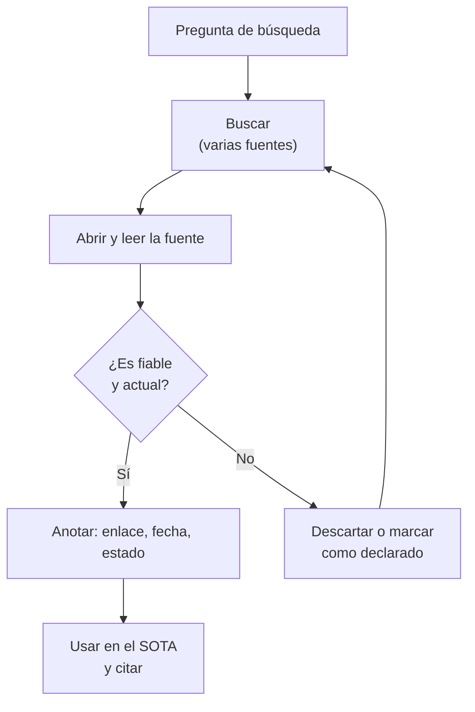
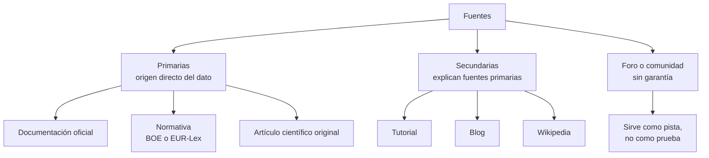
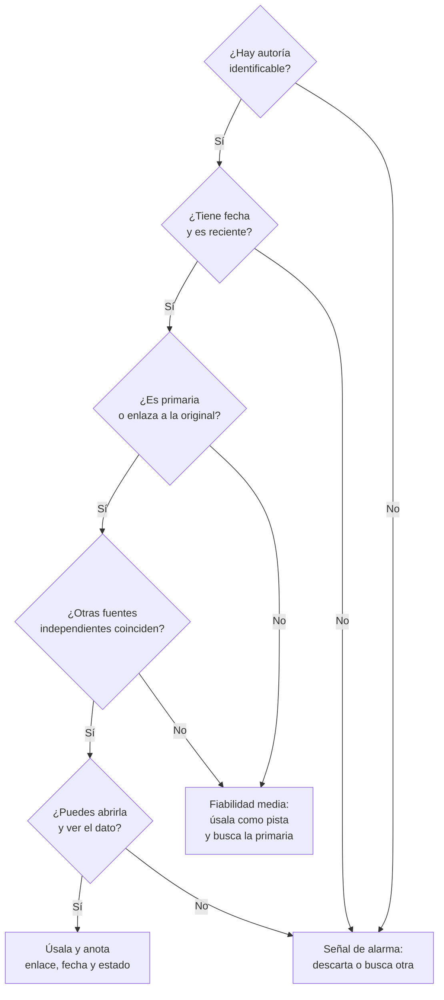
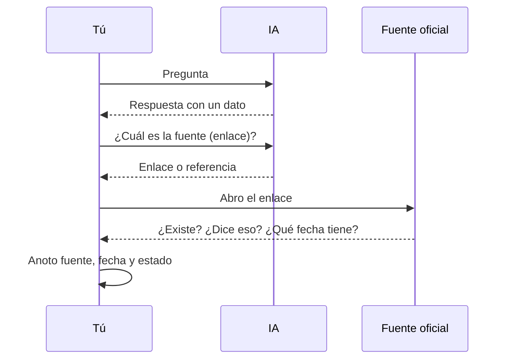

# 08 · Estado del arte (SOTA) y fuentes: buscar, evaluar y contrastar

**Tiempo estimado:** 20 min de lectura + 25 min de tarea (ruta Esencial 🟢: ≈ 10 min de lectura + 25 de tarea = ≈ 35 min en total). Son estimaciones propias (propuesta, sin medir). · **[Fase](glosario.md#fase):** 0-1 (hasta [H1](glosario.md#hito-h1-h2-h3), 26-nov-2026)

← Anterior: [07 · IA y LLM](07-ia-y-llm.md) · Siguiente: [09 · OpenCode, skills y agentes](09-opencode-skills-agentes.md)

> **Antes de leer:** tener hecho el [capítulo 01](01-git-y-github.md) (Git instalado y autenticado, sabes abrir un Pull Request) · términos dudosos en el [glosario](glosario.md).

## En 5 minutos

- El **estado del arte** (en inglés *state of the art*, **[SOTA](glosario.md#sota)**) es lo que ya existe y es lo más avanzado o más usado hoy para resolver un problema. Antes de construir algo, miras qué hay.
- Tu proyecto lo documenta en [`plantilla-proyecto/docs/01b-sota.md`](../../../plantilla-proyecto/docs/01b-sota.md). Es obligatorio y se entrega en H1 (26-nov-2026).
- Una afirmación vale lo que vale su **fuente**. La regla del proyecto es: **fuente + fecha + estado** (`verificado` / `declarado` / `no leído`).
- Las IA pueden **inventar fuentes, enlaces y datos**. Contrasta también lo que te digan: pide la fuente, **ábrela, léela y mira la fecha**.

## Lo imprescindible (para esta semana)

1. Cada dato que uses lleva **enlace + fecha de consulta + estado**.
2. «Verificado» = **lo has abierto y leído tú**. Si no lo has abierto, es `declarado` (te lo dijo alguien o una IA, sin enlace) o `no leído` (tienes el enlace, sin abrir): [ver la diferencia](glosario.md#verificado--declarado--no-leído).
3. Prefiere **[fuentes primarias y oficiales](glosario.md#fuente-primaria--secundaria--oficial)** a blogs y foros.
4. Si no puedes comprobar algo, **dilo** («no verificado»). Eso es buena práctica, no un fallo.
5. **Fuente independiente:** la que no depende de la misma organización ni copia a otra (dos páginas de la misma empresa cuentan como una).

**Ruta Esencial 🟢:** lee «En 5 minutos», «Lo imprescindible», la sección 5 y el «Ejemplo trabajado», y haz los pasos 🟢 de la tarea (≈ 10 min de lectura + 25 de tarea). Las secciones con 🟡 se pueden dejar para otra semana.

---

## 1. Qué es el SOTA y por qué importa 🟡

*Ampliable: puedes saltarla esta semana.*

Según Wikipedia, el estado del arte es «el nivel más alto de desarrollo general» de un dispositivo, técnica o campo científico en un momento dado (fuente en «Para saber más»). En desarrollo de software, traducido a tu proyecto: **qué soluciones, herramientas y modelos de negocio existen ya para tu problema**.

Para qué sirve:

- **No reinventar** algo que ya existe, **elegir tecnología con argumentos** y **encontrar tu hueco**.
- **Reducir riesgos**: una librería abandonada o una licencia incompatible se descubren aquí.

Cada decisión del proyecto debe poder apoyarse en una fuente con fecha.

### Relación con la plantilla `01b-sota.md`

La plantilla ([`01b-sota.md`](../../../plantilla-proyecto/docs/01b-sota.md)) te pide, entre otras cosas:

| Apartado de la plantilla | Qué haces |
|---|---|
| 1. Problema y preguntas de búsqueda | Escribes tu problema en una frase y 3-5 preguntas, con **dónde y cuándo** buscaste. |
| 2. Soluciones existentes | Tabla de 5-8 soluciones con enlace y fecha de acceso. |
| 4. Herramientas y tecnologías | Comparas 2-3 opciones con los mismos criterios. |
| 7. Fuentes y calidad | Al menos 2 fuentes **independientes**, con fecha y fiabilidad. |
| 8. Límites | Qué no pudiste comprobar. |

Esta guía te enseña el método para rellenarlos bien.

**Cómo leerlo:** sigue las flechas desde arriba. Si la fuente no es fiable o actual, la descartas (o la marcas como `declarado`) y vuelves a buscar otra; si lo es, anotas enlace, fecha y estado y ya puedes citarla.

## 2. Tipos de fuentes

| Término | Qué significa | Ejemplo |
|---|---|---|
| **Fuente primaria** | Origen directo del dato: lo crea quien lo produce, en su momento. | La documentación oficial de una herramienta, un artículo científico original, el texto de una ley. |
| **Fuente secundaria** | Explica o analiza fuentes primarias. | Un tutorial, un artículo de blog, una entrada de Wikipedia. |
| **Documentación oficial** | La que publica el propio proyecto o empresa. | La web de documentación de un lenguaje o framework. |
| **Normativa** | Texto legal publicado en un boletín oficial. | El BOE (*Boletín Oficial del Estado*, España) o EUR-Lex (el portal oficial de la legislación de la UE). |
| **Foro / comunidad** | Respuestas de otras personas, sin garantía. | Preguntas y respuestas en foros técnicos. |
| **Fecha de consulta** | El día que **tú** abriste la fuente. | `2026-11-07` |

La distinción primaria/secundaria sigue la definición general de Wikipedia (fuente en «Para saber más»).

Este diagrama agrupa los tipos de fuente de la tabla según su relación con el dato original.

**Cómo leerlo:** cuanto más cerca del origen del dato, mejor para citar. Las secundarias te ayudan a entender y las de foro solo te dan una pista: después busca la primaria. Para **qué norma dice algo**, usa el texto oficial, no un resumen.

## 3. Cómo evaluar la fiabilidad 🟡

*Ampliable: puedes saltarla esta semana.*

Estos criterios son una **propuesta de trabajo nuestra** (no una norma). Para cada fuente, pregúntate:

| Criterio | Pregunta | Señal buena | Señal de alarma |
|---|---|---|---|
| **Autoría** | ¿Quién lo dice? | Organismo, equipo o persona identificables. | Sin autor, sin organización. |
| **Fecha** | ¿Cuándo se publicó o actualizó? | Reciente respecto a lo que cambia (versiones, precios, leyes). | Sin fecha, o muy antigua para un tema que cambia rápido. |
| **Origen** | ¿Es primaria? | Enlaza a la fuente original. | Solo repite lo que dicen otros. |
| **Intención** | ¿Qué busca quien lo publica? | Informar. | Vender, captar clics, publicidad encubierta. |
| **Contraste** | ¿Lo dicen otras fuentes independientes? | Sí, con coincidencia. | Solo aparece en un sitio. |
| **Comprobable** | ¿Puedes abrirla y ver el dato? | Enlace que funciona y dice lo que se afirma. | Enlace roto o que dice otra cosa. |

Resultado en tu tabla de fuentes: fiabilidad **alta / media / baja** y **por qué** (una frase).

Este diagrama ordena las preguntas de la tabla como un árbol de decisión (propuesta nuestra) para decidir si te fías de una fuente.

**Cómo leerlo:** empieza arriba y baja por los «Sí». Un «No» en autoría, fecha o «¿puedes abrirla?» es una señal de alarma: **descarta** la fuente o márcala como `declarado` o «no verificado». Un «No» en «primaria» o «coinciden» no la descarta: es **fiabilidad media** (así se usa, p. ej., Wikipedia, que es secundaria): úsala como pista y busca la primaria o un contraste. La intención de quien publica también cuenta y no cabe en el árbol: revísala aparte con la tabla.

## 4. Por qué contrastar también lo que dice una IA 🟡

*Ampliable: puedes saltarla esta semana.*

La guía [07](07-ia-y-llm.md) explica que un LLM **predice texto plausible**. De ahí vienen los fallos típicos:

| Fallo | Qué es | Ejemplo ficticio |
|---|---|---|
| **[Alucinación](glosario.md#alucinación)** | Respuesta que suena bien pero es falsa. Un estudio de revisión (Ji *et al.*, 2022; *et al.* = «y otros», los demás autores) la describe como la tendencia de los modelos a generar texto que no era el pretendido, es decir, sin base (en arXiv, repositorio público de artículos científicos, número 2202.03629; fuente en «Para saber más»). | «La versión 9 del framework Z añadió la función `autoSave()`.» (no existe) |
| **Fuente inventada** | Cita un artículo, autor o enlace que no existe. | «Según Autor-Ejemplo (2021), "Guía de bases de datos", p. 34.» |
| **Dato desactualizado o mezclado** | Era cierto cuando se entrenó el modelo, o mezcla datos ciertos y falsos. | Fecha correcta, herramienta equivocada. |
| **Seguridad aparente** | Tono firme aunque no tenga base. | «Es imposible que falle.» |

Por eso, la regla es la misma para un blog, un foro o una IA: **hasta que lo abres y lo lees en una fuente fiable, no está verificado**.

## 5. El método práctico: fuente + fecha + estado

Regla del proyecto (la fijamos en este curso; no es un estándar externo): todo dato que uses lleva tres cosas.

| Elemento | Qué poner |
|---|---|
| **Fuente** | Enlace directo al sitio donde está el dato. |
| **Fecha** | Día en que lo consultaste (`AAAA-MM-DD`). |
| **Estado** | `verificado` (lo he abierto y leído yo) · `declarado` (lo afirma alguien, p. ej. una IA o un compañero, y no lo he comprobado) · `no leído` (tengo el enlace pero no lo he abierto). |

**Regla de una línea:** te lo dijo alguien o una IA y no tienes enlace = `declarado`; tienes el enlace pero no lo has abierto = `no leído`. Ejemplos: la IA dice «Java 21» sin enlace → `declarado`; guardas `https://ejemplo.org/docs/requisitos` para mirarlo luego → `no leído`.

### Cómo citar (formato propuesto)

Dentro del texto o en una tabla de fuentes (columnas: fuente, tipo, fecha de consulta, estado, fiabilidad).

Frase de ejemplo: «La herramienta X exige la versión 17 de Java o superior (docs oficiales, `https://ejemplo.org/docs/requisitos`, consultada el 2026-11-07, verificado).»

### Cómo comprobar un dato que te da una IA

**Cómo leerlo:** de arriba abajo: preguntas a la IA, le pides la fuente, **abres tú el enlace** en la web oficial y solo entonces anotas fuente, fecha y estado. La comprobación la haces tú, no la IA.

Pasos:

1. **Pide la fuente** (enlace o título exacto).
2. **Ábrela.** Si no existe, no abre o no trata el tema: la IA ha inventado la referencia.
3. **Léela** hasta encontrar el dato. No vale con el titular (en un artículo científico basta el resumen si el dato está en él).
4. **Mira la fecha** de la página y si el dato sigue vigente.
5. **Busca una segunda fuente independiente** para lo importante.
6. **Anota** fuente, fecha y estado. Si no pudiste comprobarlo: «no verificado».

### Señales de alarma

- El enlace no existe, o lleva a una página que no habla de eso.
- Cita un libro, artículo o autor que no encuentras en ningún sitio.
- Cifras muy exactas sin fuente (precios, porcentajes, cuotas de mercado).
- Dice «siempre», «nunca», «imposible», «el estándar actual» sin más.
- Describe una versión o función que no aparece en la documentación oficial.
- Es demasiado perfecto: cuadra con lo que querías oír.

## Ejemplo trabajado (ficticio)

Respuesta de IA inventada para un proyecto-demo de gestión de tareas. Fíjate en cómo se anota cada afirmación:

> «Las aplicaciones de tareas más usadas son TareaFácil y PlanIt. TareaFácil cuesta 4,99 € al mes (fuente: `https://tareafacil-ejemplo.invalid/precios`). Según un estudio de la Universidad de Ejemplo (2023), el 82 % de los equipos pequeños usa una. TareaFácil está escrita en Java 21.»

| Afirmación | Qué hago | Anotación |
|---|---|---|
| Existen TareaFácil y PlanIt | Busco cada nombre en un buscador y en la web oficial. | `declarado` (no hay enlace) hasta abrir sus webs. |
| Precio 4,99 €/mes | Abro el enlace que da la IA. El dominio `.invalid` está reservado y **nunca se abre** (lo dice un estándar de internet); es una forma segura de crear enlaces falsos de ejemplo. | Fuente inventada → descartar; busco la página de precios real y anoto fecha. |
| Estudio de 2023, 82 % | Busco el título y la universidad. No aparece nada. | `declarado`, sin fuente → no lo uso o lo marco «no verificado». |
| Escrita en Java 21 | Busco en la documentación o repositorio oficial. | Solo `verificado` si lo veo allí con fecha. |

Resultado: de cuatro datos, **ninguno** pasa de `declarado` hasta abrir fuentes reales. En la entrada de [`declaracion-uso-ia.md`](../../../plantilla-proyecto/docs/declaracion-uso-ia.md) escribes que la IA dio una respuesta con una fuente inventada.

**Contrastar** = comprobar un dato con otra fuente independiente. Los estados `verificado`, `declarado` y `no leído` están en el [glosario común](glosario.md#verificado--declarado--no-leído).

## Errores frecuentes

- Marcar `verificado` un dato que solo has visto en el texto de una IA.
- Usar solo blogs cuando existe documentación oficial.
- Dos fuentes que en realidad son la misma (una copia a la otra).
- Esconder lo que no pudiste comprobar en vez de ponerlo en «Límites».

## Si te atascas

1. **Prueba 10 minutos solo:** reformula la búsqueda, añade el nombre de la herramienta y «documentation», prueba la web oficial.
2. **Pregunta bien:** qué quieres comprobar, dónde buscaste, qué encontraste y qué fecha tiene.
3. **Anótalo** en `docs/registro-tutoria.md` como bloqueo.
4. Si no encuentras la fuente, **marca «no verificado»** y sigue.
5. **Pide ayuda por correo:** si tras 10 minutos sigues bloqueado/a, escribe al [tutor](glosario.md#tutor) con la consulta ya preparada (qué intentaste, qué esperaba, qué pasó). Cómo hacerlo y en qué plazo te responde, en [contacto y ayuda](../contacto-y-ayuda.md).

## Autoevaluación

1. ¿Qué tres elementos lleva cada dato en este proyecto?
2. ¿Qué diferencia hay entre `declarado` y `verificado`?
3. Una IA te da un enlace. ¿Qué haces antes de citarlo?
4. ¿Por qué una página de Wikipedia o un blog es fuente secundaria y no primaria?
5. Nombra dos señales de alarma en una respuesta de IA.
6. Aplica: (a) una IA te dice «Python 4 salió en 2024» y no da enlace; (b) guardaste el enlace de la documentación oficial para leerlo mañana. ¿Qué estado anotas en cada caso?

**Respuestas**

1. Fuente (enlace), fecha de consulta y estado.
2. `verificado` = lo he abierto y leído yo; `declarado` = lo afirma alguien y no lo he comprobado.
3. Abrirlo, leerlo, comprobar que dice el dato y mirar la fecha; buscar una segunda fuente para lo importante.
4. Porque explican o comentan fuentes originales, no son el origen del dato.
5. Por ejemplo: enlace inexistente, cita sin autor encontrable, cifras exactas sin fuente, «siempre/nunca».
6. (a) `declarado`: te lo dijo la IA y no hay enlace; (b) `no leído`: tienes el enlace pero no lo has abierto.

## Tarea y checklist

### Tarea: Comprobar una respuesta de IA ficticia con la regla fuente + fecha + estado
**Fase:** 0-1  ·  **Tiempo estimado:** 25 min (estimación propia)  ·  **Entrega:** la fecha la indica el [tutor](glosario.md#tutor) en la sesión (en todo caso, antes de H1, 26-nov-2026); anótala aquí: ______
**Objetivo:** tener una tabla de comprobación con fuentes reales abiertas y estados honestos.
**Antes de empezar:** [07 · IA y LLM](07-ia-y-llm.md); [01 · Git y GitHub](01-git-y-github.md) (Pasos 2 a 6: rama, [commit](glosario.md#commit), `push` y [Pull Request](glosario.md#pull-request-pr) o PR) y [02 · Markdown](02-documentar-markdown-mermaid.md) (para escribir el fichero y la tabla). No necesitas cuenta de IA.
**Dónde:** en tu **repo de práctica** (el de la guía 01; ver [repo de práctica frente a repo del proyecto](glosario.md#repo-de-práctica-frente-a-repo-del-proyecto)). Si no tiene carpeta `docs/`, créala.
**Ruta 🟢:** los pasos marcados 🟢. El 🔵 puedes hacerlo la semana siguiente.

### El material (ficticio)

> «Git se creó en 2005 por Linus Torvalds para gestionar el código del kernel de Linux. GitHub fue fundado en 2008 y es propiedad de Google. El comando `git undo` deshace el último commit. Más información en `https://git-guia-oficial-inventada.invalid/historia`.»

(El *kernel* es el núcleo de un sistema operativo; un *commit*, una foto guardada de tus cambios.) El material mezcla afirmaciones que habrá que **contrastar**: no te digo cuáles son ciertas, tu tarea es averiguarlo con fuentes reales.

### Pasos

- [ ] 0. 🟢 **Prepara tu rama** (guía 01, Pasos 2 y 3): `git switch main`, `git pull`, `git switch -c docs/comprobacion-fuentes` — *hecho cuando:* estás en la rama nueva — *evidencia:* la rama — **Comprobar:** `git branch --show-current` muestra `docs/comprobacion-fuentes`.
- [ ] 1. 🟢 Crea `docs/comprobacion-fuentes.md` y copia el texto — *hecho cuando:* el fichero existe — *evidencia:* el fichero — **Comprobar:** `ls docs/comprobacion-fuentes.md` lo muestra y `git status` lo marca como nuevo.
- [ ] 2. 🟢 Separa el texto en afirmaciones comprobables y numéralas — *hecho cuando:* tienes una lista numerada — *evidencia:* la lista (hay más de tres) — **Comprobar:** en el fichero hay una lista numerada con más de 3 afirmaciones.
- [ ] 3. 🟢 Para cada afirmación, busca y **abre** una fuente oficial: la web de Git ([git-scm.com](https://git-scm.com/)) para lo de Git; para «GitHub, 2008, propiedad de Google», la página «About» o la documentación oficial de GitHub (y, si ahí no aparece, di que no lo has podido comprobar). **Excepción:** el enlace `.invalid` del material **no se puede abrir, y esa es la pista de «fuente inventada»**: no necesita enlace abierto; anota «no se abre → fuente inventada» y su estado — *hecho cuando:* cada afirmación, salvo la del enlace `.invalid`, tiene un enlace que has abierto — *evidencia:* enlace y fecha en la tabla — **Comprobar:** esos enlaces se abren (no dan 404) y tienen fecha.
- [ ] 4. 🟢 Rellena la tabla `afirmación | fuente | fecha | estado | veredicto (cierta / falsa / no comprobada)` — *hecho cuando:* todas las filas están completas — *evidencia:* la tabla — **Comprobar:** ninguna celda queda vacía (en la fila del enlace `.invalid`, fuente = «no se abre»).
- [ ] 5. 🔵 Crea en ese mismo fichero un apartado `## Señales` con 3 líneas sobre las **señales de alarma** que viste (incluido el enlace) — *hecho cuando:* el apartado existe con 3 líneas — *evidencia:* el apartado — **Comprobar:** el fichero tiene un título `## Señales` seguido de 3 líneas.
- [ ] 6. 🟢 Anota el tiempo y el uso de IA en un comentario de tu PR (el repo de práctica no tiene `registro-tutoria.md`; ver guía 01). Si usaste IA, anótalo en `docs/declaracion-uso-ia.md` de tu repo de proyecto (fecha, herramienta, qué pediste, qué aceptaste o cambiaste, dónde; p. ej. «2026-11-10, asistente X, resumen del SOTA, cambié dos frases, `docs/01b-sota.md`») — *hecho cuando:* anotado — *evidencia:* el comentario — **Comprobar:** explícalo en 2 frases en tu PR.
- [ ] 7. 🟢 **Commit y push** (guía 01, Pasos 4 y 5): `git add docs/comprobacion-fuentes.md`, `git commit -m "docs: comprobación de fuentes"`, `git push -u origin docs/comprobacion-fuentes` — *hecho cuando:* la rama está en GitHub — **Comprobar:** la rama aparece en GitHub.
- [ ] 8. 🟢 **Abre el PR** (guía 01, Paso 6) con la lista de comprobación del PR ([plantilla de PR](../../../plantilla-proyecto/.github/pull_request_template.md)). Es tu primer PR, así que sigue la [vía A](glosario.md#vía-a-y-vía-b) (label `necesita-tutor`) — *hecho cuando:* el PR está abierto — **Comprobar:** el PR aparece en la pestaña *Pull requests* con la label.

### Progreso
Llevo **0 de 9** pasos. Me falta: el paso 0.

### Antes de entregar
- [ ] Sin claves ni datos personales
- [ ] Uso de IA declarado (comentario del PR y, si procede, `docs/declaracion-uso-ia.md`)

### Si me atasco
Lo he intentado 10 min · lo anoto como bloqueo (en un comentario del PR si usas el repo de práctica, o en `registro-tutoria.md`) · pregunto con: qué intenté, qué esperaba, qué pasó. · cómo escribir al tutor: [contacto y ayuda](../contacto-y-ayuda.md)

## Para saber más

Consulta: 2026-11-07.

| Fuente | Qué se usó | Estado |
|---|---|---|
| [Wikipedia, «State of the art»](https://en.wikipedia.org/wiki/State_of_the_art) (secundaria) | Definición de SOTA | verificado |
| [Wikipedia, «Primary source»](https://en.wikipedia.org/wiki/Primary_source) (secundaria) | Definiciones de fuente primaria y secundaria | verificado |
| [Ji *et al.*, «Survey of Hallucination in Natural Language Generation»](https://arxiv.org/abs/2202.03629) (primaria) | Alucinación en generación de texto | verificado (el dato está en el resumen; el artículo completo no se leyó) |
| Plantilla [`01b-sota.md`](../../../plantilla-proyecto/docs/01b-sota.md) | Estructura del SOTA | verificado |
| Criterios de fiabilidad (autoría, fecha, origen…) | Propuesta nuestra; no es una norma ni un estándar externo | propuesta nuestra |

Anterior: [07 · IA y LLM](07-ia-y-llm.md) · Siguiente: [09 · OpenCode, skills y agentes](09-opencode-skills-agentes.md)
