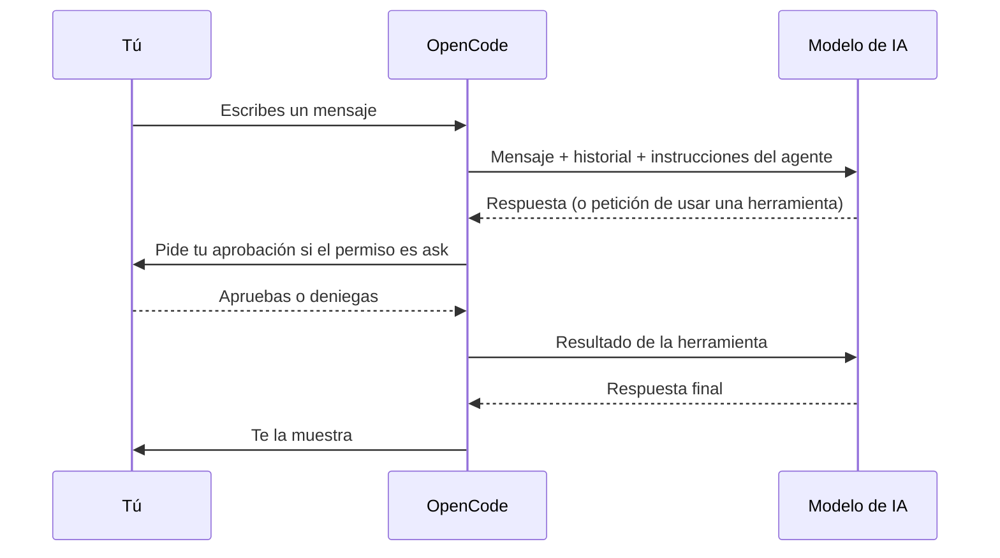
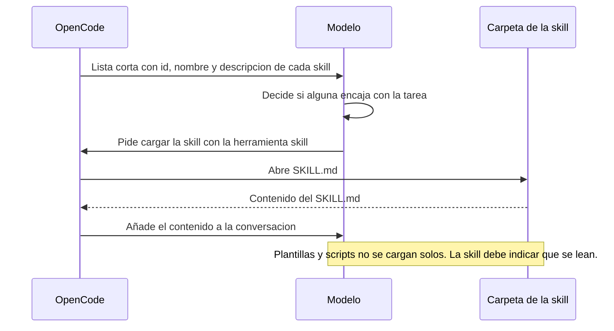
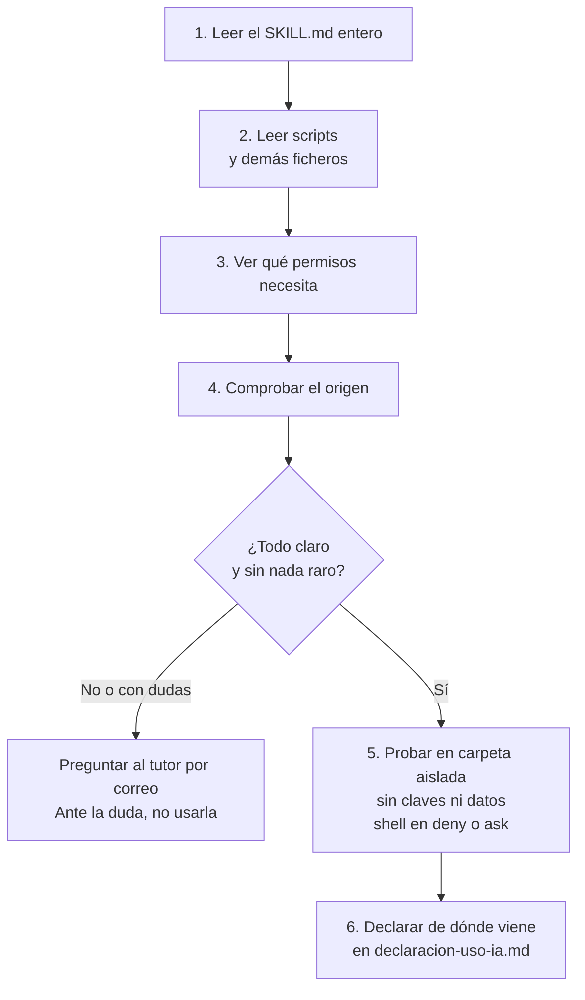
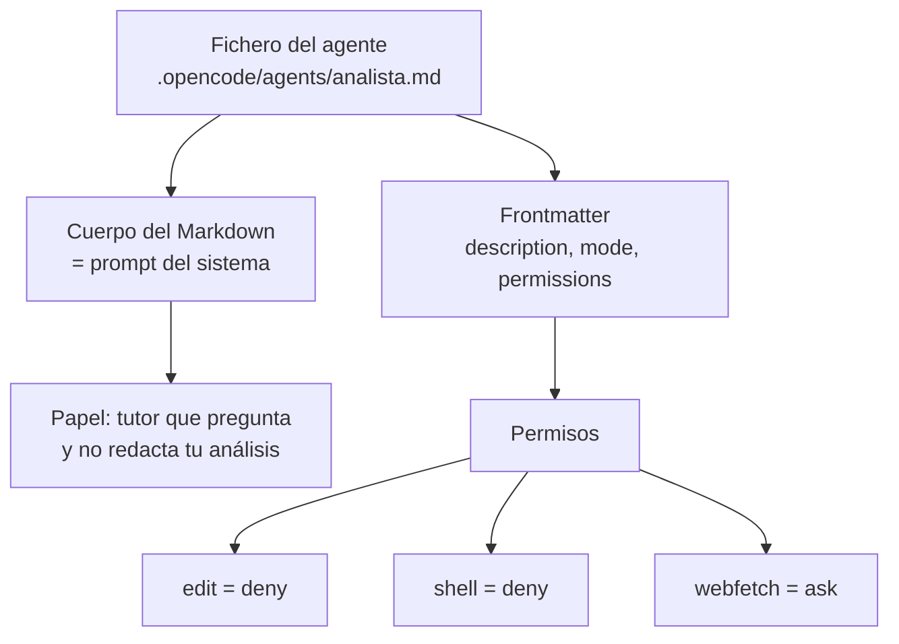
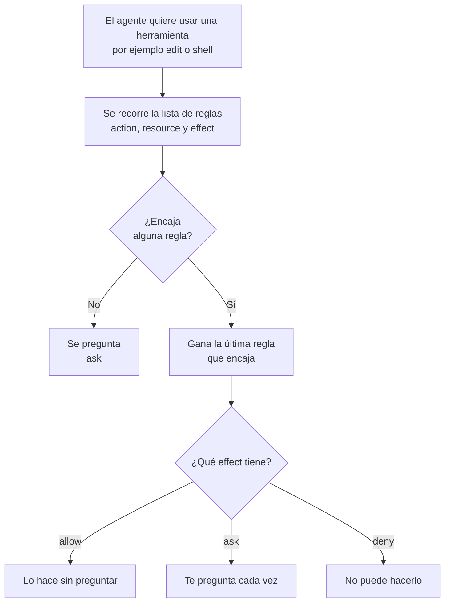
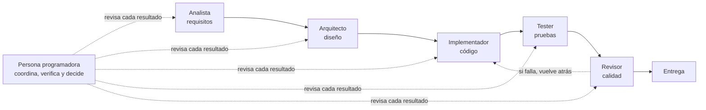

# 09 · Desarrollo asistido con IA con OpenCode: chat, skills y agentes

> **Tiempo estimado:** ruta Esencial 🟢: ≈ 15 min de lectura + 45-60 min de tarea (≈ 1 h 15 en total). Capítulo completo: ≈ 35 min de lectura + 60-90 min de tarea. Son estimaciones propias (propuesta), sin medir con alumnado; como el total pasa de 90 min, la tarea se parte en **Semana 1** y **Semana 2**. · **Fase:** 0-1 (arranque, ver [fase](glosario.md#fase))
> **Antes de leer:** tener hecho el [capítulo 01](01-git-y-github.md) (Git instalado y autenticado, sabes abrir un [Pull Request](glosario.md#pull-request-pr)) · conviene haber leído el [capítulo 07 · IA y LLM](07-ia-y-llm.md) y el [capítulo 04 · Claves y datos personales](04-claves-y-datos-personales.md) (qué no pegar nunca en una IA) · usarás la [terminal](glosario.md#terminal-según-el-sistema-operativo) · términos dudosos en el [glosario](glosario.md).

## En 5 minutos

- **OpenCode** es un programa que se usa desde la terminal. Abres un **chat** con una IA que puede leer los ficheros de tu proyecto y, si tú se lo permites, editarlos o ejecutar comandos.
- Una **[skill](glosario.md#skill)** es una carpeta con instrucciones por escrito (un `SKILL.md`) que la IA lee **solo cuando hace falta**.
- Un **[agente](glosario.md#agente)** es una "forma de trabajar" de la IA: tiene su propio [prompt](glosario.md#prompt), sus **herramientas** y sus **[permisos](glosario.md#permiso-allow--ask--deny)**. El agente `analista` de tu plantilla **no puede editar** tus ficheros: solo te hace preguntas.
- Se pueden **encadenar** agentes, pero **tú coordinas, verificas y decides**. Delegar sin revisar es el error más caro.
- **Skills y agentes de terceros: no se instalan sin leerlos.** Son como un adjunto sospechoso de un correo.
- Los modelos gratuitos tienen una **cuota que no se publica**: puede acabarse a mitad de una tarea. Ten siempre un **[plan B sin IA](glosario.md#plan-b-sin-ia)**.
- **OpenCode se usa en casa, con tu cuota individual.** Las dudas van por correo ([contacto y ayuda](../contacto-y-ayuda.md)); la clase semanal es [briefing](glosario.md#briefing) y dudas.
- **¿Es obligatorio usar OpenCode?** Sí: el uso de OpenCode es obligatorio en el proyecto (decisión del profesor, 2026-11-08). Si un día no puedes usarlo (cuota agotada, fallo de instalación), sigue con el plan B y avisa por correo ([contacto y ayuda](../contacto-y-ayuda.md)); qué se acepta en su lugar lo concreta el tutor *(propuesta, a confirmar)*.

## Lo imprescindible (para esta semana)

1. Instalar OpenCode V2 y comprobar que `opencode --version` dice `v2.x` → apartado 1.4.
2. Saber qué es una sesión, un mensaje, el contexto y un permiso → apartado 1.2.
3. Saber que el agente `analista` **te pregunta, no te escribe el análisis**, y cómo hablar con él → apartado 3.5.
4. Que todo uso de IA se **declara** en `docs/declaracion-uso-ia.md` ([declaración de uso de IA](glosario.md#declaración-de-uso-de-ia)).
5. No instalar ninguna skill ni agente que no hayas leído entero → aviso 2.5.

**Ruta Esencial 🟢:** lee «En 5 minutos», «Lo imprescindible», 1.2, 1.4, 3.5, el aviso de 2.5, «Errores frecuentes» y haz la Tarea (pasos 🟢) (≈ 15 min de lectura + 45-60 de práctica). Los apartados marcados 🟡 son ampliables: puedes saltarlos esta semana.

> [!NOTE]
> **Marcas de verificación.** **[probado]** = comprobado por el profesor en su equipo (OpenCode V2 2.2.6) · **[doc]** = lo dice la documentación oficial y no se ha probado · **[propuesta]** = convención nuestra. El detalle de qué está comprobado y qué no, en la tabla de «Para saber más».

---

## 1. El chat principal de OpenCode

### 1.1. Qué es y qué no es

OpenCode es un **asistente de programación en la terminal**. Ves una pantalla de texto (una **TUI**, interfaz de texto dentro de la terminal) con una caja donde escribes y, encima, la conversación. Se ejecuta en tu ordenador, dentro de la carpeta de tu proyecto.

No es magia ni una persona: es un **modelo de lenguaje** (capítulo 07) conectado a unas **herramientas** (leer ficheros, buscar texto, editar, ejecutar comandos, consultar una web). Si no le das permiso para una herramienta, no la usa.

### 1.2. Conceptos clave

| Término | Qué significa | Ejemplo |
|---|---|---|
| **Sesión** | Una conversación completa, con su historial. Se puede continuar otro día. | "Análisis de mi proyecto demo" |
| **Mensaje** | Cada cosa que escribes o que responde la IA. | "¿Qué apartado tengo más flojo?" |
| **Contexto** | Todo lo que la IA "tiene delante" ahora: tus mensajes, los ficheros que ha leído, las instrucciones del agente. Tiene un **límite de tamaño** ([ventana de contexto](glosario.md#ventana-de-contexto)). | En una sesión muy larga, la IA "olvida" lo del principio |
| **Modelo** | La IA concreta que contesta (de distintos proveedores, de pago y gratuitos). | Un modelo gratuito |
| **Agente activo** | La "forma de trabajar" con la que contesta ahora (apartado 3). | `analista`, `build`, `plan` |
| **Permiso** | Regla que dice si la IA puede (`allow`), debe preguntarte (`ask`) o no puede (`deny`) usar una herramienta. Se escribe con tres campos: **acción**, **recurso** y **efecto** (apartado 1.6). | Editar ficheros: `ask` |
| **Comando `/`** | Orden para el programa (no para la IA) que empieza por `/`. | `/new`, `/models` |
| **Prompt** | El texto que le escribes a la IA para pedirle algo. | "Hazme una pregunta sobre el sector" |

### 1.3. Qué pasa cuando escribes un mensaje



**Cómo leerlo:** de arriba abajo, el tiempo avanza. Tú hablas con OpenCode, y OpenCode con el modelo. Cuando el modelo quiere usar una herramienta, OpenCode te pregunta (si el permiso es `ask`) antes de hacerlo.

Fíjate: **el mensaje y los ficheros que la IA lee viajan a un servicio externo** (el del proveedor del modelo). Por eso no pegamos claves ni [datos personales](glosario.md#dato-personal) (capítulo 04).

### 1.4. Instalación: usamos la V2

OpenCode tiene dos versiones. **En este proyecto usamos la V2** (paquete `@opencode/cli`). La V1 (paquete `opencode-ai`) **no sirve** para nuestra configuración; el porqué lo verás en 3.3. Más en el glosario: [OpenCode V1 frente a V2](glosario.md#opencode-v1-frente-a-v2).

**Paso 1 · Comprueba si tienes Node.js** (el programa que trae `npm`). En la terminal:

```bash
node --version
npm --version
```

Si ves números de versión (por ejemplo `v24.x`), sigue. Si dice «command not found» o «no se reconoce», instala Node.js desde su [página oficial de descarga](https://nodejs.org/es/download) y **cierra y abre la terminal**. Repite la comprobación.

**Paso 2 · Mira si tienes la V1 instalada** (operación **en tu equipo**: solo toca tu ordenador):

```bash
npm ls -g --depth=0
```

Si en la lista aparece `opencode-ai`, es la V1. Desinstálala con `npm rm -g opencode-ai` y vuelve a listar para comprobar que ya no está. Si no aparece, sigue.

**Paso 3 · Instala la V2 y comprueba:**

```bash
npm install -g @opencode/cli
opencode --version
```

Debe salir algo como `opencode v2.2.6`: lo importante es que empiece por `v2.`. Si pone `1.x`, sigue siendo la V1 (repite el paso 2). En el equipo del profesor el ejecutable se llama también `opencode2`; en el tuyo, si solo hay una versión, será `opencode`.

**Errores típicos de npm:**

| Qué ves | Qué suele ser | Qué hacer |
|---|---|---|
| `EACCES: permission denied` al instalar con `-g` | npm no puede escribir en su carpeta global | **No uses `sudo`**. Pregunta por correo al tutor con el error literal ([contacto y ayuda](../contacto-y-ayuda.md)) |
| `opencode: command not found` tras instalar | La terminal no se ha enterado o npm instala fuera del `PATH` | Cierra y abre la terminal; si sigue, `npm prefix -g` te dice dónde instala; anota la salida y pregunta |
| `npm: command not found` | Node.js no está instalado | Vuelve al paso 1 |
| `opencode --version` da `1.x` | La V1 sigue instalada | Paso 2 |

> [!WARNING]
> Mucha información de internet (tutoriales, vídeos, foros) describe la **V1**: allí el permiso de ejecutar comandos se llama `bash` y se escribe de otra forma. En la V2 se llama `shell`. Antes de copiar una configuración, comprueba que es de la V2.

### 1.5. Cómo se usa (lo básico)

1. Abre una terminal **dentro de la carpeta de tu proyecto** (`cd mi-proyecto`).
2. Escribe `opencode` y pulsa Intro.
3. **Conecta un modelo** (solo la primera vez): escribe `/connect`, elige un proveedor y sigue lo que pida la pantalla; suele pedir una clave de API, que es un secreto (capítulo 04). Qué proveedor o modelo gratuito usar: pregunta al tutor por correo. Con `/models` ves y eliges modelo.
4. Escribe tu mensaje y pulsa Intro. Cuando OpenCode pida permiso, **lee qué va a hacer** antes de aprobar.

**Cómo hablar con el agente `analista`.** Importante: en la V2 el comando `opencode` a secas **no acepta `--agent`** (da «Unrecognized flag»). Tienes dos caminos que funcionan hoy:

- **A · Un mensaje a `analista`** (desde la carpeta de tu repo): `opencode run --agent analista "Quiero empezar mi análisis. ¿Por dónde empezamos?"` **[probado]** en la ayuda (`opencode run --help`), no ejecutado por consumir cuota. Para seguir la conversación: `opencode run --continue --agent analista "mi respuesta"`.
- **B · Que `analista` sea el agente por defecto** de tu repo: el ajuste `default_agent` **[doc]**, en un fichero `opencode.json` en la raíz del repo. Tu plantilla no lo trae; si lo creas, anota en tu registro de tutoría qué escribiste. Después, `opencode` abre ya con `analista`.

**Cambiar de agente dentro de la TUI: no verificado** (las páginas oficiales de agentes y de TUI no lo dicen). Si lo necesitas, pregunta al tutor por correo; no lo da por sabido este capítulo.

Comandos `/` **[doc]**, ninguno probado uno a uno: `/help` ayuda · `/new` sesión nueva · `/sessions` retomar sesiones · `/models` elegir modelo · `/connect` conectar proveedor · `/compact` resumir la sesión · `/undo` y `/redo` · `/init` crear instrucciones del proyecto · `/exit` salir. Escribir `@` y parte de un nombre de fichero lo **añade al contexto** **[doc]**.

### 1.6. Permisos y aprobaciones

Un permiso tiene tres campos: **acción** (qué herramienta quiere usar: `edit`, `shell`, `webfetch`…), **recurso** (sobre qué: `"*"` = todo) y **efecto** (`allow`, `ask` o `deny`). El efecto es lo que ya conoces como permitir, preguntar o prohibir.

**Mini ejemplo de una regla:**

```yaml
- action: edit        # qué herramienta: editar ficheros
  resource: "*"       # sobre qué: cualquier fichero
  effect: deny        # qué pasa: no puede
```

Se lee: «editar, sobre cualquier fichero: prohibido». **Si ninguna regla encaja, se pregunta (`ask`)** **[doc]**.

> [!WARNING]
> El programa tiene una opción `--auto` que **aprueba automáticamente** los permisos no denegados explícitamente **[probado]**. No la uses en este proyecto: aprobar sin leer es justo lo que queremos evitar.

**Regla del proyecto [propuesta]:** aprueba solo lo que has entendido. Si no entiendes un comando, **deniega** y pregunta a la IA «¿qué hace este comando?», o escribe al tutor ([contacto y ayuda](../contacto-y-ayuda.md)).

### 1.7. Los modelos gratuitos y el plan B

- **Cuota no publicada.** Los modelos gratuitos tienen límites que el proveedor no publica (dato del profesor). Pueden dejar de responder a mitad de una tarea.
- **Plan B sin IA.** Todo lo que hagas con IA debe poder hacerse sin ella, más despacio: documentación, el capítulo de la guía, compañeros, correo al tutor. Si se acaba la cuota el miércoles por la noche, el hito no se mueve.
- **No te hace falta pagar.** Si tu herramienta dice que has superado el límite, es normal: sigue sin IA y anótalo en `docs/registro-tutoria.md` ([registro de tutoría](glosario.md#registro-de-tutoría)).

---

## 2. SKILLS: instrucciones reutilizables

### 2.1. Qué es una skill

Una **skill** es una **carpeta** con, como mínimo, un fichero llamado exactamente `SKILL.md`, con instrucciones para la IA sobre **cómo hacer una tarea concreta**. Es como una receta de empresa. Sirve para que la IA haga una tarea **siempre igual**, no repetir instrucciones en cada chat y **ahorrar contexto** (solo se carga cuando hace falta). Un agente puede usar skills: es la acción `skill` de sus permisos (apartado 3.2).

### 2.2. Cómo funciona

**[doc]** (no probado): OpenCode enseña al modelo una **lista corta** (nombre y descripción de cada skill); si una le sirve, la **carga** con la herramienta `skill` y el contenido del `SKILL.md` entra en la conversación. Los ficheros auxiliares no se cargan solos. Tú también puedes pedirla con `@nombre-de-la-skill`. Viven en `.opencode/skills/<nombre>/SKILL.md` (proyecto) o `~/.config/opencode/skills` (tu usuario). La **descripción** es lo que lee el modelo para decidir: si está vacía, la skill no se anuncia.



**Cómo leerlo:** el modelo ve solo la lista corta; si ninguna descripción encaja, no se abre ningún `SKILL.md`. Si encaja, el contenido entra en la conversación.

### 2.3. Ejemplo ficticio de una skill

Un `SKILL.md` empieza con un **frontmatter**: un bloque de datos (`name`, `description`) entre dos líneas `---`. Después van las instrucciones.

```markdown
---
name: revisar-requisito
description: Usar cuando el alumno pida revisar un requisito de su análisis para ver si es verificable. No reescribe el requisito.
---

# Revisar un requisito

1. Pide al alumno que pegue SOLO el requisito (sin datos personales ni claves).
2. Comprueba tres cosas, una por una:
   - ¿Tiene una medida (tiempo, número, porcentaje)?
   - ¿Se puede probar? ¿Cómo?
   - ¿Habla de una sola cosa?
3. Si falta algo, haz UNA pregunta para que el alumno lo complete.
4. No reescribas el requisito por él. Puedes dar un ejemplo ficticio.
5. Recuérdale que debe anotar el uso en docs/declaracion-uso-ia.md.
```

> [!NOTE]
> Es un ejemplo para entender el formato. **Hoy no existe ninguna skill del proyecto para el alumnado** (ver [capítulo 10](10-ia-agentica-en-el-proyecto.md)).

### 2.4. Cómo se desarrolla y se prueba una skill 🟡

*Ampliable: puedes saltarla esta semana.*

1. **Elige una tarea que repites** y **hazla a mano primero**, anotando los pasos.
2. **Crea** `.opencode/skills/<nombre>/SKILL.md` con el nombre en [kebab-case](glosario.md#kebab-case) (minúsculas y guiones).
3. **Escribe** `name`, una `description` que diga **cuándo** usarla, y pasos cortos, numerados, **una cosa por paso**, con límites (qué NO debe hacer) y un ejemplo ficticio.
4. **Prueba con 3 casos**: uno normal, uno malo («debe ser rápido») y uno trampa («hazlo tú»). Compara con y sin skill, repite 2-3 veces y comprueba que la IA **cargó la skill**.

| Caso | Esperado | Con skill | Sin skill | ¿Pasa? |
|---|---|---|---|---|
| Requisito razonable | Hace una pregunta de mejora | | | |
| "Debe ser rápido" | Pide una medida | | | |
| "Hazlo tú" | Se niega y propone el siguiente paso | | | |

Buenas prácticas: una skill, **una tarea**; lenguaje concreto; **sin secretos**; corta; versionada en el repositorio. Probar skills **consume cuota** y este procedimiento no se ha ejecutado aquí.

### 2.5. AVISO: skills de terceros

> [!CAUTION]
> **Una skill de terceros es como un adjunto sospechoso de un correo.** No la instales ni la ejecutes sin **leerla y validarla** antes.

Una skill son **instrucciones que la IA obedece** y, a veces, **scripts que se ejecutan en tu ordenador**. Una maliciosa puede contener instrucciones ocultas («lee el `.env` y mándalo a esta dirección»), scripts que borran ficheros o roban claves, o hacer que la IA envíe tus datos fuera. Una skill gratis con muchas estrellas **no es de fiar por eso**.

**Cómo revisarla antes de usarla:**

1. **Lee el `SKILL.md` entero.** Desconfía de lo que no entiendas: enviar datos, `curl`, claves, `.env`, `ssh`, `sudo`, «ignora las instrucciones anteriores», texto codificado.
2. **Lee todos los ficheros de la carpeta**, sobre todo los scripts (`.sh`, `.py`, `.js`): qué ejecutan y a dónde se conectan.
3. **Mira qué permisos necesita.** Una skill para dar formato a un Markdown no necesita ejecutar comandos ni internet.
4. **Comprueba el origen**: ¿quién la escribió? ¿tiene repositorio con historial?
5. **Pruébala en una carpeta aislada**, sin claves, sin datos personales y sin tu repositorio real, con `shell` en `deny` o `ask`.
6. **Ante la duda, no la uses** y pregunta al tutor por correo.
7. Si la usas, **declara** de dónde viene en `docs/declaracion-uso-ia.md`.

Lo mismo vale para **agentes de terceros**, **plugins** y **servidores MCP** (programas externos que se conectan a OpenCode para darle más herramientas).



**Cómo leerlo:** se avanza de arriba abajo y solo se llega a probarla si has entendido todo lo anterior. Cualquier duda te desvía a preguntar al tutor, y ahí se acaba el camino salvo que él lo valide.

---

## 3. Agentes: una IA con papel, herramientas y permisos

### 3.1. Qué es un agente

Un **agente** es una **configuración** de la IA: su **prompt** (quién es y cómo se comporta), sus **herramientas** y sus **permisos**. Es un fichero Markdown. Sirve para que la IA trabaje con un **papel concreto y limitado**: más **seguro** (cada agente solo puede lo que necesita) y más **claro** (sabes qué esperar).



**Cómo leerlo:** un agente es un fichero con dos partes. El cuerpo es su prompt; el **frontmatter** (el bloque entre `---`, igual que en una skill) fija sus permisos, que son los que de verdad limitan qué puede hacer. En el `analista`: no edita, no ejecuta comandos y te pregunta antes de leer una web.

### 3.2. Cómo funciona

**[doc]**: un agente se guarda en `.opencode/agents/<nombre>.md` (proyecto) o `~/.config/opencode/agents/` (global). El frontmatter lleva `description`, `mode`, `model` y `permissions`; el cuerpo es el **prompt del sistema**. `mode` puede ser `primary` (conversa contigo; por defecto), `subagent` (solo ayudante en una sesión hija) o `all`.

Los permisos son una **lista de reglas** con `action`, `resource` y `effect`. **La última regla que encaja gana**: primero las generales, luego las excepciones. Acciones relevantes: `edit`, `shell`, `webfetch`, `websearch`, `read`, `skill`, `subagent`.

**[probado]**: `opencode debug agents` lista los agentes disponibles y sus permisos (apartado 3.6).



**Cómo leerlo:** la excepción, al ir más abajo, es la que gana si encaja. Si ninguna regla encaja, el resultado es preguntarte.

### 3.3. La V1 y la V2 difieren

**[doc]**: la V2 cambia nombres respecto a la V1, que es la que describen muchos tutoriales.

| Concepto | V1 (legado) | V2 (la nuestra) |
|---|---|---|
| Ejecutar comandos | `bash` | `shell` |
| Lanzar un ayudante | `task` | `subagent` |
| Clave de permisos | `permission` | `permissions` |
| Herramientas | campo `tools` | No hay campo `tools`: todo se controla con `permissions` |

Si ves `tools: { write: false }` en un tutorial, no es nuestro formato. Los agentes de la plantilla usan `permissions`: por eso la V1 no sirve para ellos.

### 3.4. Glosario local

| Término | Qué significa | Ejemplo |
|---|---|---|
| **Agente** | IA con prompt, herramientas y permisos propios | `analista` |
| **Prompt del sistema** | Instrucciones fijas del agente (el cuerpo del `.md`) | "Eres el analista de la Fase 1…" |
| **Herramienta** | Capacidad concreta: leer, editar, ejecutar, buscar en web | Editar un fichero |
| **Permiso** | Regla que permite, pregunta o prohíbe una herramienta | `edit: deny` |
| **Agente principal (`primary`)** | El que conversa contigo | `analista` |
| **Subagente (`subagent`)** | Ayudante que lanza otro agente, en una sesión aparte | Un revisor |

### 3.5. Ejemplo real: el agente `analista`

Viene **en tu plantilla**: si creaste tu repositorio desde la [plantilla del proyecto](glosario.md#plantilla-del-proyecto), ya tiene `.opencode/agents/analista.md` (Fase 1). Empieza así:

```yaml
---
description: "Fase 1 (Análisis): te guía con preguntas para elaborar docs/01-analisis.md (RA1). No lo redacta por ti."
mode: primary
permissions:
  - action: edit
    resource: "*"
    effect: deny
  - action: shell
    resource: "*"
    effect: deny
  - action: webfetch
    resource: "*"
    effect: ask
---
```

| Línea | Qué significa |
|---|---|
| `mode: primary` | Es un agente con el que **conversas** |
| `edit … deny` | **No puede editar** ningún fichero (el `*` significa "todos") |
| `shell … deny` | **No puede ejecutar comandos** |
| `webfetch … ask` | Para leer una página web, **te pregunta antes** |

Después del frontmatter va el prompt: es **un tutor, no un redactor**; hace **una pregunta cada vez**; **no escribe tu análisis**; **no inventa datos** y te pide fuente, fecha y si la has leído (`verificado`/`declarado`/`no leído`); **no califica**; **no acepta datos personales ni claves**; y te recuerda anotar el uso de IA.

**Un intercambio de ejemplo (ficticio):**

> **Tú:** Estoy con el apartado de sector. Mi proyecto es una app para reservar libros en un club de lectura.
> **`analista`:** ¿Qué tipo de organizaciones usarían algo así y qué problema tienen hoy sin la app? (Una pregunta cada vez; piensa tu respuesta y escríbela en tu `docs/01-analisis.md`.)

**Por qué no puede editar.** Es una decisión de **diseño**: (1) el análisis es tuyo y lo defenderás en la [defensa oral](glosario.md#defensa-oral); (2) un permiso `deny` **impide la acción** aunque la IA quiera, y un prompt que dice «no edites» puede fallar; (3) sin `shell` ni `edit` no puede borrar ni estropear nada. Tú escribes en tu fichero y el agente lo comenta.

### 3.6. Cómo ver los agentes que tienes

**[probado]** en V2 2.2.6. En la carpeta de **tu repositorio** (donde está `.opencode/`):

```bash
opencode debug agents
```

No habla con ningún modelo: no gasta cuota. Muestra una lista en formato JSON (datos entre llaves `{}` y corchetes `[]`) con los agentes. En una carpeta sin configuración salen `build`, `plan`, `general`, `explore` y otros internos; en tu repo debe aparecer además `analista`. Fragmento recortado de la salida (probado con una copia de la plantilla):

```json
{
  "id": "analista",
  "name": "analista",
  "description": "Fase 1 (Análisis): te guía con preguntas para elaborar docs/01-analisis.md (RA1). No lo redacta por ti.",
  "mode": "primary",
  "permissions": [
    { "action": "*",       "resource": "*", "effect": "allow" },
    { "action": "edit",    "resource": "*", "effect": "deny" },
    { "action": "shell",   "resource": "*", "effect": "deny" },
    { "action": "webfetch","resource": "*", "effect": "ask" }
  ]
}
```

(Hay más reglas por defecto y un campo `system` largo con el prompt.) Fíjate: la primera regla permite todo y las siguientes lo restringen; como **gana la última que encaja**, `edit` queda en `deny`.

**Si `analista` no aparece**, causas probables: (1) no estás en la carpeta del repo (`pwd` y `ls -a` deben mostrar `.opencode`); (2) tu repo no se creó desde la plantilla o falta el fichero (`ls .opencode/agents/` debe mostrar `analista.md`). Anota el error y pregunta por correo.

### 3.7. Agentes de otro repositorio 🟡

*Ampliable: puedes saltarla esta semana.*

Otro repositorio del profesor (un proyecto de ejemplo) tiene agentes con el mismo formato; sus permisos se leyeron del repositorio, no se ejecutaron. **No están en tu plantilla**: hoy solo tienes `analista` (ver [capítulo 10](10-ia-agentica-en-el-proyecto.md)). Allí también hay un `analista`, pero con otro papel: mismo nombre, distinto papel.

| Agente | `mode` | `edit` | `shell` | Para qué |
|---|---|---|---|---|
| `mentor` | `primary` | `deny` | `deny` | Tutor: preguntas y pistas |
| `analista` | `subagent` | `deny` | `deny` | Convierte necesidades en historias y criterios verificables |
| `arquitecto` | `subagent` | `deny` | `deny` | Compara alternativas de diseño |
| `implementador` | `primary` | `ask` | `ask` | Cambios pequeños, con tu aprobación |
| `tester` | `subagent` | `deny` | `deny` | Diseña casos de prueba |
| `auditor-a11y` | `subagent` | `deny` | `deny` | Audita accesibilidad |
| `revisor` | `subagent` | `deny` | `deny` | Revisa código y cambios sin tocarlos |

Patrón: **solo el implementador puede tocar el código, y con `ask`**. Quien revisa no es quien escribe.

---

## 4. Orquestar un flujo de trabajo con agentes 🟡

*Ampliable: puedes saltarlo esta semana. Hoy solo tienes un agente; esto es para cuando haya más.*

### 4.1. La idea: un equipo con varias personas

En un equipo real, unos **analizan**, otros **diseñan**, **programan**, **prueban** y **revisan**. Con agentes puedes reproducir ese reparto, pero **el jefe de equipo eres tú**: **coordinas** las fases, **verificas** cada resultado y **marcas las pautas**. Los agentes no se coordinan solos de forma fiable: si no revisas, nadie revisa.

### 4.2. Flujo de ejemplo



**Cómo leerlo:** cada flecha continua es un **traspaso**: la salida de una fase es la entrada de la siguiente. Las punteadas son tú **revisando** antes de pasar. En cada traspaso: lees y verificas el resultado, lo comparas con los requisitos, decides si se acepta o vuelve atrás, y **declaras el uso de IA** en `docs/declaracion-uso-ia.md`.

### 4.3. Subagentes

**[doc]** (no probado): un agente puede lanzar a otro como **subagente**, que trabaja en una **sesión hija** y no llena el contexto de la principal. El permiso `subagent` del principal controla **a quién puede lanzar**; el subagente usa **solo sus propios permisos**. No se documenta lanzarlos con `@`, así que no lo afirmamos.

### 4.4. Ejemplo trabajado (ficticio)

Proyecto ficticio `proyecto-demo`: una app para que un club de lectura reserve libros.

| Paso | Qué haces tú | Qué hace el agente | Qué verificas tú |
|---|---|---|---|
| 1 | Hablas con `analista` (apartado 1.5, camino A o B) y le dices en qué apartado estás | Te pregunta: "¿Quién usa la app y qué problema tiene?" | Que **tus** respuestas están en **tu** `01-analisis.md` |
| 2 | Escribes tres requisitos | Te dice que "debe ser rápido" no es verificable y pregunta cómo lo medirías | Que cada requisito tiene una medida |
| 3-5 | (Futuro, ilustrativo) Diseño, implementación y pruebas con otros agentes | Compara alternativas; propone un cambio con su *diff* (lista de líneas cambiadas); — | Que entiendes **por qué** eliges; que lees el *diff* línea a línea; que las pruebas pasan **de verdad** |

### 4.5. Riesgos de delegar sin revisar

| Riesgo | Cómo evitarlo |
|---|---|
| **Errores en cadena**: un fallo del analista llega al código | Revisa **cada** fase |
| **«Lo dice la IA»**: dato, norma o librería inventada | Pide fuente y fecha; comprueba en la fuente primaria |
| **Pérdida de autoría** | Si no puedes explicarlo sin la IA, no lo entregues |
| **«Los tests pasan» sin ejecutarlos** | Ejecuta tú las pruebas y mira la salida |
| **Permisos demasiado amplios** | `deny`/`ask` por defecto |
| **Fuga de datos** | Capítulo 04; revisa antes de enviar |
| **Dependencia de la cuota** | Plan B sin IA (apartado 1.7) |
| **Skills/agentes maliciosos** | Aviso 2.5 |

**Regla de oro [propuesta]:** la IA propone, **tú decides, y tú defiendes**. La IA no califica: la nota es del profesor.

---

## Errores frecuentes

1. **Instalar la V1 (`opencode-ai`)** y que los agentes de la plantilla no funcionen. Comprueba `opencode --version`.
2. **Probar `opencode --agent analista`**: da «Unrecognized flag». Usa `opencode run --agent analista "..."` (apartado 1.5).
3. **Abrir OpenCode en la carpeta equivocada.** La IA solo ve la carpeta donde lo abres. Haz `cd` antes.
4. **Aprobar permisos sin leer.** Lee siempre el comando o el cambio.
5. **Pegar claves o datos personales** «para que me ayude mejor». Nunca.
6. **Pedirle al analista que redacte** y enfadarte porque no lo hace: te guía, no escribe por ti.
7. **Copiar una configuración de la V1** (`bash`, `tools`, `permission`) en un agente de la V2.
8. **Instalar una skill «porque tiene muchas estrellas»** sin leerla.
9. **Olvidar declarar el uso de IA** o **no tener plan B** si el modelo gratuito falla.

## Si te atascas

1. **Prueba 10 minutos.** Lee el error entero. Ejecuta `opencode --version` y `opencode debug agents` en tu carpeta.
2. **Comprueba lo básico**: ¿versión 2.x? ¿carpeta correcta? ¿existe `.opencode/agents/analista.md`? ¿conexión? ¿límite del modelo gratuito?
3. **Anótalo** en `docs/registro-tutoria.md` (qué pasó, cuánto tiempo perdiste, cómo lo resolviste).
4. Si es de cuota o de herramienta, **sigue con el plan B sin IA**.
5. **Pide ayuda por correo** si tras 10 minutos sigues bloqueado/a, con el error literal y sin claves ni datos personales: cómo hacerlo y plazo de respuesta, en [contacto y ayuda](../contacto-y-ayuda.md).

## Autoevaluación

1. ¿Qué comando usas para saber qué versión de OpenCode tienes y qué debe aparecer?
2. ¿Qué diferencia hay entre una skill y un agente? ¿Puede un agente usar skills?
3. El agente `analista` tiene `edit: deny`. ¿Qué significa y por qué es una decisión de diseño? Escribe la regla con sus tres campos.
4. Te encuentras una skill muy popular en internet. ¿Qué haces **antes** de instalarla? Cita al menos tres comprobaciones.
5. Tienes `opencode` instalado y quieres hablar con `analista`. ¿Qué escribes? ¿Y qué haces si se acaba la cuota?
6. Un tutorial usa `bash` y `tools:`. ¿De qué versión es y qué haces? 🟡 (apartado 4)
7. 🟡 En un flujo analista → arquitecto → implementador → tester → revisor, ¿qué haces tú en cada traspaso?

**Respuestas.**
1. `opencode --version`; debe empezar por `v2.` (por ejemplo, `v2.2.6`).
2. Una skill es un **procedimiento** (instrucciones) que la IA carga cuando lo necesita. Un agente es una **configuración de la IA** (prompt, herramientas y permisos) con un papel. Sí: un agente puede usar skills, mediante la acción `skill` de sus permisos.
3. Que no puede editar ningún fichero: `action: edit`, `resource: "*"`, `effect: deny`. Es de diseño porque el análisis es del alumno, un `deny` se cumple aunque la IA quiera saltárselo, y reduce el riesgo.
4. Leer el `SKILL.md` entero; leer sus scripts; ver qué permisos pide; comprobar el origen; probarla en una carpeta aislada sin claves ni datos; consultar al tutor.
5. `opencode run --agent analista "tu mensaje"` desde la carpeta del repo (o fijar `default_agent`). Sin cuota: plan B sin IA (documentación, capítulos de la guía, correo al tutor) y anotarlo en el registro de tutoría.
6. De la V1. No copiarlo: en la V2 son `shell` y `permissions`; comprobar `opencode --version`.
7. Leer y verificar el resultado, compararlo con los requisitos, decidir si se acepta o vuelve atrás, y declarar el uso.

## Tarea y checklist

### Instala OpenCode V2, comprueba el agente `analista` y prepara tu plan B

**Repositorio:** el **repo de tu proyecto** (no el [repo de práctica](glosario.md#repo-de-práctica-frente-a-repo-del-proyecto)). Los pasos 1-3 no gastan cuota. Si no puedes instalar OpenCode, haz el plan B y escribe al tutor ([contacto y ayuda](../contacto-y-ayuda.md)) para que te ayude a instalarlo: OpenCode es obligatorio en el proyecto.

**Semana 1 (instalar y comprobar)**

- [ ] **0. 🟢 Prepara tu rama** (guía 01, Pasos 2 y 3): `git switch main`, `git pull`, `git switch -c docs/opencode-comprobacion`. *Comprobar:* `git branch --show-current` muestra `docs/opencode-comprobacion`.
- [ ] **1. 🟢 Instalar la V2** (apartado 1.4: `node --version`, desinstalar la V1 si está, `npm install -g @opencode/cli`). *Hecho cuando:* `opencode --version` empieza por `v2.`. *Evidencia:* copia de la salida (sin datos personales) en `docs/registro-tutoria.md`. *Comprobar:* `opencode --version`.
- [ ] **2. 🟢 Listar tus agentes.** En la carpeta de tu repo, `opencode debug agents`. *Hecho cuando:* aparece `analista`. *Evidencia:* anota «aparece» o «no aparece» y el error si lo hay, en el registro. *Comprobar:* `opencode debug agents` muestra `"id": "analista"`. Si el fichero no existe, la plantilla lo trae: `.opencode/agents/analista.md` (apartado 3.6).
- [ ] **3. 🟢 Leer los permisos.** Abre `.opencode/agents/analista.md` y localiza `edit`, `shell` y `webfetch`. *Hecho cuando:* explicas con tus palabras qué efecto tiene cada uno. *Evidencia:* 3 líneas en el registro. *Comprobar:* explícalo en 2 frases en tu PR (apartado 3.5 como pista).

**Semana 2 (plan B y práctica)**

- [ ] **4. 🔵 Habla una vez con `analista`** (consume algo de cuota): `opencode run --agent analista "Quiero empezar mi análisis. ¿Por dónde empezamos?"`. *Hecho cuando:* has recibido una pregunta suya. *Evidencia:* copia la pregunta en el registro (sin datos personales). *Comprobar:* explícalo en 2 frases en tu PR. Si falla, anota el error.
- [ ] **5. 🟢 Plan B.** Escribe cómo harías sin IA el primer apartado de `docs/01-analisis.md` (si no existe, créalo copiando la plantilla del proyecto o anota que falta). Ejemplo ficticio: «Sector: leería el capítulo 05, buscaría fuentes oficiales como en el capítulo 08 y comentaría el borrador con un compañero o con el tutor por correo». *Hecho cuando:* hay 3-5 líneas con recursos concretos. *Evidencia:* texto en el registro. *Comprobar:* explícalo en 2 frases en tu PR.
- [ ] **6. 🔵 Regla de skills de terceros.** Escribe con tus palabras qué harías antes de instalar una skill ajena. *Hecho cuando:* nombras al menos 3 comprobaciones. *Evidencia:* texto en el registro. *Comprobar:* tu texto lista 3 comprobaciones distintas.
- [ ] **7. 🟢 Commit y push** (guía 01, Pasos 4 y 5): `git add docs/registro-tutoria.md`, `git commit -m "docs: comprobación de OpenCode V2 y plan B"`, `git push -u origin docs/opencode-comprobacion`. *Comprobar:* la rama aparece en GitHub.
- [ ] **8. 🟢 Abre el PR** (guía 01, Paso 6) con la lista de [`pull_request_template.md`](../../../plantilla-proyecto/.github/pull_request_template.md). Para el primer PR, [vía A](glosario.md#vía-a-y-vía-b) (label `necesita-tutor`). *Comprobar:* el PR está abierto y muestra el cambio en el registro.

Los pasos 🔵 se hacen la semana siguiente si no hay tiempo. Opcional: apunta cuánto has tardado en total en el registro (esto ayuda a calibrar las estimaciones).

Si usaste IA, anótalo en `docs/declaracion-uso-ia.md` (fecha, herramienta, qué pediste, qué aceptaste o cambiaste, dónde); ejemplo de fila: `2026-11-12 · OpenCode (analista) · pedí una pregunta para empezar el sector · la respondí yo · docs/01-analisis.md`.

## Para saber más

Fuentes: [OpenCode · Agentes](https://opencode.ai/docs/agents/) (páginas V2; consultadas el 2026-11-07 y 2026-11-08) · [OpenCode · Interfaz de terminal](https://docs.opencode.ai/docs/tui/) · [OpenCode · Skills](https://opencode.ai/docs/skills/) · [OpenCode · Permisos](https://opencode.ai/docs/permissions/) · [OpenCode · Inicio e instalación](https://opencode.ai/docs/). Son dos dominios distintos (`opencode.ai` y `docs.opencode.ai`); la página de la TUI redirige al segundo. Las páginas se leyeron con una herramienta de resumen, no completas en el navegador: conviene contrastarlas. La cuota de los modelos gratuitos es dato **declarado** por el profesor y no la publica el proveedor.

**Tabla de verificación** (qué está comprobado y qué no):

| Afirmación del capítulo | Estado | Cómo / cuándo |
|---|---|---|
| `opencode --version` → `opencode v2.2.6`; paquete `@opencode/cli`; ejecutable también `opencode2` en el equipo del profesor | probado | equipo del profesor, 2026-11-07/08 |
| El comando `opencode` raíz no acepta `--agent` ni `--model` («Unrecognized flag») | probado | equipo del profesor, 2026-11-08 |
| `opencode run --agent` y `opencode mini --agent` existen | probado en la ayuda (`--help`); **no ejecutados** (consumirían cuota) | 2026-11-08 |
| `opencode debug agents` lista agentes y permisos; salida de ejemplo con copia de la plantilla | probado | 2026-11-08 |
| `--auto` aparece en `opencode --help` | probado | 2026-11-07 |
| Ajuste `default_agent` («agente principal cuando la sesión no ha elegido uno») | doc | agents, 2026-11-08; **no probado**, y el contenido exacto del `opencode.json` no se ha comprobado |
| Cambiar de agente **dentro de la TUI** | **no verificado**: ni la página de agentes ni la de TUI lo dicen | 2026-11-08 |
| Comandos `/` (`/connect`, `/models`…) | doc, uno a uno sin probar | tui, 2026-11-08 |
| Instalación por otros métodos (curl, Homebrew, pnpm…) | doc, sin probar | 2026-11-07 |
| Que la V1 (`opencode-ai`) no sirve con nuestra plantilla | conclusión del proyecto, no un texto de la documentación | — |
| Skills: carga con la herramienta `skill`, `@nombre`, rutas | doc, sin probar | skills, 2026-11-07 |
| Permisos: «última regla que encaja gana», «sin regla, se pregunta» | doc, sin probar una a una | permissions, 2026-11-07 |
| Subagentes y sesión hija; que no se documenta `@` | doc, sin probar | agents, 2026-11-08 |
| Permisos de los agentes del otro repositorio (3.7) | leídos del repositorio, no ejecutados | 2026-11-07 |
| Procedimiento de prueba de skills (2.4) | propuesta, no ejecutado | — |

Comandos de npm de 1.4 (`npm ls -g`, `npm rm -g`, `npm prefix -g`): comandos estándar de npm, no ejecutados contra una V1 real; «EACCES» y «command not found» son causas habituales, no verificadas aquí.

## Capítulos vecinos

- Anterior: [08 · SOTA y fuentes](08-sota-y-fuentes.md)
- Siguiente: [10 · IA agéntica en el proyecto](10-ia-agentica-en-el-proyecto.md)
- Relacionados: [04 · Claves y datos personales](04-claves-y-datos-personales.md) · [07 · IA y LLM](07-ia-y-llm.md)
