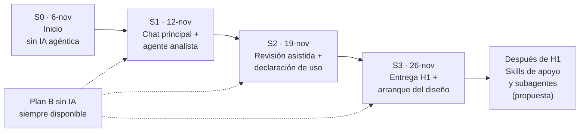
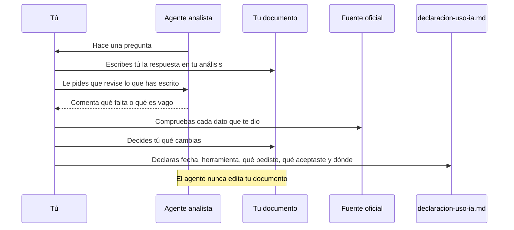

# 10 · La IA agéntica en nuestro proyecto: incorporación progresiva

> **Tiempo estimado:** 20 min de lectura + 40 min de tarea (ruta Esencial 🟢: 35 min en total) · **Fase:** [0-1](glosario.md#fase) (arranque). Estimaciones propias, sin medir.
> **Antes de leer:** tener hecho el [capítulo 01](01-git-y-github.md) (Git instalado y autenticado, sabes abrir un Pull Request) · leer [07 · IA y LLM](07-ia-y-llm.md) y [09 · OpenCode, skills y agentes](09-opencode-skills-agentes.md) · términos dudosos en el [glosario](glosario.md).

> [!NOTE]
> **Cómo se trabaja.** OpenCode se usa **en casa, con tu cuota individual** (dato del tutor, el profesor del módulo; la cuota gratuita no está publicada y puede agotarse). S1-S3 marcan **cuándo toca cada pieza**. La clase de 1 h es el [briefing](glosario.md#briefing) (qué llevamos al día) y dudas; lo demás, por correo ([contacto y ayuda](../contacto-y-ayuda.md)). Si te quedas sin IA, sigues con la documentación (plan B).

## En 5 minutos

- La IA agéntica se **incorpora poco a poco**: entiendes cada pieza antes de usar la siguiente.
- **Hoy solo existe una cosa:** el chat principal de OpenCode (versión 2, «V2»; ver [glosario](glosario.md#opencode-v1-frente-a-v2)) y **un agente**, `analista`, que te guía en la Fase 1 con preguntas. **No puede editar tus ficheros ni ejecutar comandos**, y para leer una web te pide permiso a ti.
- Todo lo demás (skills de apoyo, subagentes, arquitecto) son **propuestas futuras**: aún no existen.
- Reglas fijas: **declaras** el uso de IA ([declaración](glosario.md#declaración-de-uso-de-ia)), **sin datos personales ni claves**, **la IA no califica**, tienes un [plan B sin IA](glosario.md#plan-b-sin-ia), y **tú decides y defiendes**.

## Lo imprescindible (para esta semana)

1. El uso de OpenCode **es obligatorio** en el proyecto (decisión del profesor, 2026-11-08). Si un día no puedes usarlo (cuota, instalación), sigue con el plan B y avisa por correo *(propuesta, a confirmar)*.
2. Empieza **solo** con el agente `analista` (capítulo 09, apartado 3.5).
3. Cada uso se anota en `docs/declaracion-uso-ia.md`.
4. Nunca pegues claves ni datos personales.
5. Los modelos gratuitos tienen una **cuota no publicada**: ten siempre un plan B.

**Ruta Esencial 🟢:** lee «En 5 minutos», «Lo imprescindible», los apartados 1, 3 y 5 y haz los pasos 0, 1, 3, 4, 6 y 7 de la tarea (≈ 35 min).

---

## 1. Qué existe hoy y qué es propuesta

Esta tabla es lo más importante del capítulo.

| Pieza | Estado | Dónde está |
|---|---|---|
| Chat principal de OpenCode (V2) | **Existe** (herramienta externa que instalas tú) | Capítulo 09, apartado 1 |
| Agente `analista` (Fase 1) | **Existe hoy** | `plantilla-proyecto/.opencode/agents/analista.md` |
| Plantilla de declaración de uso de IA | **Existe** | `docs/declaracion-uso-ia.md` |
| Agente iniciador | **No existe aún** (propuesta) | — |
| Agente arquitecto genérico (para el diseño) | **No existe aún** (propuesta) | — |
| Agente planificador | **No existe aún** (propuesta) | — |
| Skills de apoyo para el alumnado | **No existen aún** (propuesta) | — |
| Flujos con subagentes | **No existen aún** (propuesta) | — |

> [!WARNING]
> Si alguien (un compañero, un vídeo, una IA) te habla del «agente arquitecto del proyecto» o del «planificador», **todavía no existen en la plantilla**. Si los necesitas antes, pregunta al tutor ([contacto y ayuda](../contacto-y-ayuda.md)); no los descargues sin validarlos (capítulo 09, apartado 2.5).

## 2. Por qué progresivo 🟡

*Ampliable: puedes saltarla esta semana.*

Como al aprender a conducir: primero el coche parado, luego una calle tranquila, luego más tráfico. Con la IA agéntica igual:

- Con muchos agentes a la vez, **no sabes qué hizo cada uno**.
- Si delegas pronto, **pierdes la autoría** (y lo defiendes tú, no la IA).
- Cada pieza trae un **riesgo nuevo** (permisos, fugas de datos, errores en cadena): conócelos de uno en uno.

Es el arranque del curso: ritmo lento, mucha ayuda y autonomía que sube después.

## 3. Plan por sesiones (calendario provisional)

Las fechas son una **propuesta** del tutor y pueden cambiar según cómo avance el grupo; los hitos oficiales están en [fases-del-proyecto.md](../../fases-del-proyecto.md) ([H1](glosario.md#hito-h1-h2-h3), 26-nov). S0 ya se celebró; S1-S3 son propuesta.

**Cómo leerlo:** las flechas continuas son el orden de las sesiones, de S0 a «Después de H1». Las discontinuas indican que el plan B sin IA vale en cualquier sesión.

### Tabla sesión → agente → qué se aprende → qué se declara

| Sesión | Agente o pieza | Qué se aprende | Qué se declara |
|---|---|---|---|
| **S0** (celebrada) | Ninguno obligatorio | Contexto del proyecto, GitHub (capítulo 01) | Nada |
| **S1** (propuesta) | Chat principal + `analista` **(existe)** | Instalar la V2 (ver [glosario](glosario.md#opencode-v1-frente-a-v2)), abrir una sesión, qué es un permiso, leer un agente | Cada consulta, con las 5 columnas de la declaración |
| **S2** (propuesta) | `analista` **(existe)** en modo revisión | Pedir que **comente** lo que **tú** has escrito; contrastar con una fuente; decir "no" a lo inventado | Igual, más qué comprobaste y en qué fuente |
| **S3** (propuesta) | Skills de apoyo **(no existen aún)** | Qué es una skill y cómo se prueba; revisar skills de terceros antes de usarlas | Skill usada, origen y resultado de tu prueba |
| **Después de H1** (propuesta) | Subagentes y arquitecto **(no existen aún)** | Coordinar fases, verificar cada resultado, defender el diseño | Qué delegaste, verificaste y rechazaste |

> [!NOTE]
> S3 y «Después de H1» son **hipótesis**: no dependas de ellas.

## 4. Detalle de cada paso 🟡

*Ampliable: puedes saltarla esta semana; cada paso se detalla cuando toca.*

Reparto de responsabilidades en una sesión con `analista`, la única pieza que existe hoy.

**Cómo leerlo:** el agente pregunta y comenta; las flechas que escriben, comprueban y declaran salen siempre de ti.

### S1 · Chat principal y agente `analista` (sesión propuesta; la pieza existe)

**Qué haces:** instalas **en casa** la V2 (capítulo 09, apartado 1.4), abres el agente `analista` en tu repositorio y trabajas con él **el apartado de la Fase 1 en el que estés**.

**Cómo es una buena sesión:** el agente hace **una pregunta cada vez**; tú respondes y **escribes tú** en `docs/01-analisis.md`. Al final te dice qué parte del análisis avanza y cuál es el siguiente paso pequeño.

**Ejemplo ficticio** (proyecto `proyecto-demo`, un club de lectura):

> **Tú:** Estoy en el apartado de requisitos.
> **Analista:** ¿Cuál es el requisito que tienes más claro? Escríbelo tal como está en tu documento.
> **Tú:** "La web debe ser rápida."
> **Analista:** ¿Cómo comprobarías que es rápida? ¿Con qué medida y en qué situación?
> **Tú:** Que la página de inicio cargue en menos de 2 segundos.
> *(Tú corriges tu documento. El agente no lo ha editado.)*

**Qué NO hace el agente:** escribirte el análisis, inventar datos, calificarte ni aceptar datos personales o claves.

### S2 · Revisión asistida y declaración de uso (sesión propuesta; la pieza existe)

**Qué haces:** pides al `analista` que **revise** lo que has escrito (qué falta, qué es vago, qué no es verificable). **Tú decides** qué cambias.

**Hábito clave:** cada dato del agente (norma, ayuda, cifra) lo **compruebas en la fuente oficial** y anotas `verificado` / `declarado` / `no leído`.

**Declaración:** ejemplo ficticio de fila en `docs/declaracion-uso-ia.md`:

| Fecha | Herramienta | Qué pedí | Qué acepté o cambié | Dónde |
|---|---|---|---|---|
| 2026-11-19 | OpenCode V2, agente `analista` | Revisar el apartado de requisitos | Cambié 2 requisitos vagos por otros con medida; rechacé una sugerencia que no entendí | `docs/01-analisis.md` (apartado de requisitos) |

### S3 · Skills de apoyo (propuesta)

**Qué haces:** aprendes qué es una skill y cómo se prueba (capítulo 09, apartados 2.4-2.5) y, si el tutor prepara alguna, la **lees entera** antes de usarla. **No instalas** skills de internet: se consultan al tutor y se **validan** antes.

### Después de H1 · Subagentes y arquitecto (propuesta)

**Qué haces:** probar un flujo de dos o tres fases (analista → arquitecto → planificador), con **tú coordinando y verificando** cada traspaso (capítulo 09, apartado 4). **Condición:** que exista un arquitecto **validado** y que los pasos anteriores hayan ido bien; si no, seguimos con el chat principal.

## 5. Reglas del proyecto

Si alguna difiere de [`metodologia.md`](../../metodologia.md), manda `metodologia.md`.

1. **Declara siempre el uso** en `docs/declaracion-uso-ia.md`.
2. **Sin datos personales ni claves**, ni tuyos ni de terceros ni de una empresa real. Si dudas, no lo pegues (capítulo 04).
3. **La IA no califica.** La nota y las decisiones de evaluación son del tutor.
4. **Plan B sin IA.** Ten claro cómo harías cada tarea sin IA: un fallo de cuota no justifica un retraso.
5. **Modelos gratuitos: cuota no publicada.** Pueden fallar, limitarse o cambiar sin aviso.
6. **Tú decides y defiendes.** En la [defensa oral](glosario.md#defensa-oral) tendrás que explicar tu proyecto sin la IA. Si no sabes explicar una decisión, no la aceptes.
7. **Comprueba lo que te diga** (datos, normas, versiones, comandos) con la fuente oficial: una IA puede equivocarse con total seguridad.
8. **Nada de skills ni agentes de terceros sin validar** (capítulo 09, apartado 2.5).

## Errores frecuentes

1. **Usar la IA para escribir el análisis** en vez de para que te pregunte.
2. **No declarar** «porque fue pequeño». Se declara todo.
3. **Dar por bueno un dato** de la IA sin fuente.
4. **Bajarte agentes o skills de internet** «porque seguro que sirven».
5. **Quedarte parado** porque se acabó la cuota. Hay plan B.
6. **Pegar datos** (un correo, un cliente real, una clave) «solo esta vez».

## Si te atascas

1. **Prueba 10 minutos** siguiendo el capítulo 09 (versión, carpeta, agente cargado).
2. **Pregunta bien:** qué sesión eres (S1/S2/S3), qué querías hacer, qué pasó y qué probaste, sin datos personales ni claves.
3. **Anótalo** en `docs/registro-tutoria.md`, con el tiempo dedicado.
4. Sigue con el **plan B sin IA** y, si tras 10 minutos sigues bloqueado/a, escribe al tutor con la consulta preparada: cómo hacerlo, en [contacto y ayuda](../contacto-y-ayuda.md).

## Autoevaluación

1. ¿Qué agente existe hoy en la plantilla para la Fase 1 y qué no puede hacer?
2. Nombra dos piezas que **no** existen aún y están solo propuestas.
3. ¿Qué cinco datos anotas en cada fila de `docs/declaracion-uso-ia.md`?
4. ¿Por qué debes tener un plan B sin IA?
5. ¿Quién califica tu trabajo? ¿Y quién lo defiende?

**Respuestas.**
1. `analista`. No puede editar tus ficheros ni ejecutar comandos, y para leer una web te pide permiso a ti.
2. Por ejemplo, el agente arquitecto genérico, el planificador, el iniciador, las skills de apoyo o los flujos con subagentes.
3. Fecha, herramienta, qué pediste, qué aceptaste o cambiaste y dónde (fichero o [PR](glosario.md#pull-request-pr)).
4. Porque los modelos gratuitos tienen una cuota no publicada y pueden dejar de funcionar.
5. Califica el tutor. La defiendes tú, en la defensa oral.

## Tarea y checklist

### Prepara S1 sin consumir cuota

**Tarea (≈ 40 min en casa):** trabajas en el **repo de tu proyecto** (el creado desde la plantilla, no el de práctica) y dejas todo en `docs/registro-tutoria.md`. Empieza cada anotación con «Cap. 10 ·». 🟢 = esencial; 🔵 = puede esperar a la semana siguiente.

- [ ] **0. 🟢 Prepara tu rama** (guía 01, Pasos 2 y 3): `git switch main`, `git pull`, `git switch -c docs/ia-agentica`.
  **Comprobar:** `git branch --show-current` muestra `docs/ia-agentica`.
- [ ] **1. 🟢 Revisar qué existe.** Relee la tabla del apartado 1 y escribe en el registro 2 frases: qué existe hoy y qué es solo propuesta.
  *Hecho cuando:* las dos frases están en el registro. **Comprobar:** `grep -n "Cap. 10" docs/registro-tutoria.md` muestra tus líneas.
- [ ] **2. 🔵 Tener la V2 lista (solo si no lo hiciste en el capítulo 09).** Necesitas Node.js; ejecuta `npm install -g @opencode/cli` (detalle en el [capítulo 09, apartado 1.4](09-opencode-skills-agentes.md#14-instalación-usamos-la-v2)).
  *Hecho cuando:* ya lo tenías del 09: no repitas la evidencia. **Comprobar:** `opencode --version` empieza por `v2.`.
- [ ] **3. 🟢 Ensayar la declaración (simulacro).** Abre `docs/declaracion-uso-ia.md` de tu repo y lee sus columnas: Fecha · Herramienta · Qué pedí · Qué acepté o cambié · Dónde (fichero o PR). Es un **simulacro**: aún no has usado IA (y el repo de práctica no tiene declaración), así que la real no debe llevar filas inventadas. Escribe la fila de ensayo en el **registro**, marcada «SIMULACRO».
  *Hecho cuando:* la fila tiene las 5 columnas. **Comprobar:** `grep -n "SIMULACRO" docs/registro-tutoria.md` muestra la fila.
- [ ] **4. 🟢 Plan B.** Escribe en el registro cómo harías sin IA el primer apartado de tu análisis (3-5 líneas con recursos concretos).
  *Hecho cuando:* cada recurso nombrado existe (capítulo, fichero o enlace). **Comprobar:** abre cada uno y comprueba que existe.
- [ ] **5. 🔵 Preparar una pregunta.** Anota en el registro una duda sobre tu proyecto, sin nombres ni claves, para el briefing de S1 o para el correo.
  *Hecho cuando:* la duda está escrita. **Comprobar:** explica en tu PR de qué trata en una frase.
- [ ] **6. 🟢 Commit y push** (guía 01, Pasos 4 y 5): `git add docs/registro-tutoria.md`, `git commit -m "docs: registro del capítulo 10"`, `git push -u origin docs/ia-agentica`.
  **Comprobar:** la rama aparece en GitHub.
- [ ] **7. 🟢 Abre el PR** (guía 01, Paso 6) con la [lista de comprobación del PR](../../../plantilla-proyecto/.github/pull_request_template.md). Si es tu primer PR, vía A: label `necesita-tutor`.

*Uso de IA:* si usaste IA, anótalo en `docs/declaracion-uso-ia.md` (fecha, herramienta, qué pediste, qué aceptaste o cambiaste, dónde); hay una fila de ejemplo en el apartado 4 (S2).

## Para saber más

Consultadas el **2026-11-07**.

| Fuente | Dónde | Estado |
|---|---|---|
| Plan y reglas de IA del proyecto | [`docs/metodologia.md`](../../metodologia.md) (apartado de IA) | leído solo en parte (la inicial); el apartado de IA no está contrastado, así que si hay diferencia manda `metodologia.md` |
| Fases e hitos | [`docs/fases-del-proyecto.md`](../../fases-del-proyecto.md) | verificado (ruta local) |
| Agente de la plantilla | `plantilla-proyecto/.opencode/agents/analista.md` | verificado (leído) |
| OpenCode · Agentes | https://opencode.ai/docs/agents/ | verificado (2026-11-07), parcial |
| OpenCode · Skills | https://opencode.ai/docs/skills/ | verificado (2026-11-07), parcial |
| Cuota de modelos gratuitos | — | declarado (tutor); no publicada |

## Capítulos vecinos

- Anterior: [09 · OpenCode, skills y agentes](09-opencode-skills-agentes.md)
- Relacionados: [04 · Claves y datos personales](04-claves-y-datos-personales.md) · [07 · IA y LLM](07-ia-y-llm.md)
