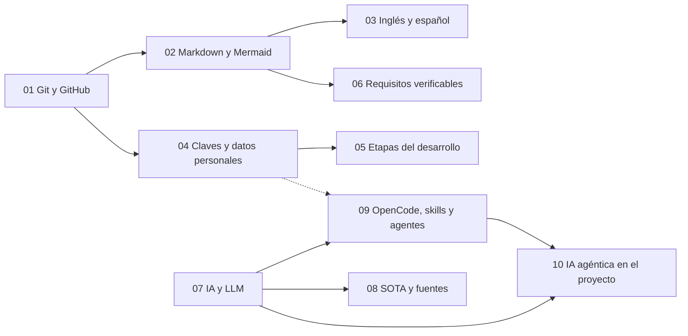

# 00 · Fundamentos del proyecto

Diez capítulos para que tengas las bases con las que vamos a trabajar el proyecto: Git y GitHub, documentar, proteger datos, entender las etapas, trabajar con requisitos, y usar la IA con criterio. **No hace falta leerlo todo de golpe.** Cada capítulo empieza con *En 5 minutos* y *Lo imprescindible*: empieza por ahí y vuelve a leer el resto cuando lo necesites.

## Qué vas a encontrar

| Cap. | Tema | Para qué te sirve |
|---|---|---|
| [01](01-git-y-github.md) | Git y GitHub: ramas, commits, Pull Request y merge | Hacer tu primer Pull Request y trabajar como en un proyecto real |
| [02](02-documentar-markdown-mermaid.md) | Documentar con Markdown y Mermaid | Escribir tu documentación y tus diagramas en GitHub |
| [03](03-documentar-en-ingles-y-espanol.md) | Documentar en inglés y en español | Entender por qué y cómo vamos a tener las dos lenguas |
| [04](04-claves-y-datos-personales.md) | Claves y datos personales (RGPD, LOPDGDD, AEPD) | No subir nunca lo que no se debe a un repositorio |
| [05](05-etapas-de-desarrollo.md) | Etapas del desarrollo de software | Saber en qué fase estás y qué te falta |
| [06](06-requisitos-verificables.md) | Requisitos verificables | Escribir requisitos que se puedan comprobar (RA1, 1f) |
| [07](07-ia-y-llm.md) | La IA y los LLM | Saber qué es y qué no es una IA generativa |
| [08](08-sota-y-fuentes.md) | SOTA y contraste de fuentes | No fiarte de nada sin fuente, tampoco de la IA |
| [09](09-opencode-skills-agentes.md) | OpenCode, skills y agentes | Usar la herramienta de IA del proyecto |
| [10](10-ia-agentica-en-el-proyecto.md) | La IA agéntica en nuestro proyecto | Qué usamos, cuándo y cómo se declara |
| [Glosario](glosario.md) | Glosario común | Consultar siglas y términos (PR, RA1, token, `.env`…) sin perderte |

Este diagrama es el mapa de capítulos: cada flecha indica «lee esto antes que esto», según el apartado *Antes de empezar* o *Antes de leer esto* de cada capítulo.

**Cómo leerlo:** hay dos ramas. La de Git (01 a 06) empieza en el 01 y de ahí salen 02 y 04. La de IA (07 a 10) empieza en el 07 y llega al 10 pasando por el 09. La flecha punteada del 04 al 09 indica que el 09 recomienda conocer antes qué no pegar en una herramienta de IA.

## Cómo usar estos capítulos

**No son un plan de lectura.** Lo que tienes que hacer cada semana está en la hoja de tu hito: [Hito H1](../../hitos/H1.md). Cada paso de la hoja te enlaza al apartado exacto que necesitas de aquí.

Cada capítulo empieza con *En 5 minutos* y *Lo imprescindible*: con eso basta para empezar. Vuelve al resto cuando lo necesites. Al final de cada capítulo hay una tarea con checklist para comprobar qué llevas hecho.

**Si quieres más:** hay [retos de ampliación](ampliaciones.md) opcionales. **Ayudar a un compañero** (explicarle algo que ya sabes) es una de las mejores formas de aprender.

**Si vas justo/a de tiempo:** díselo al tutor por correo ([contacto y ayuda](../contacto-y-ayuda.md)) o en la clase del jueves: se ajusta contigo, no pasa nada por pedir ayuda.

## Reglas que valen para todos los capítulos

- La IA se puede usar y **se declara** en `docs/declaracion-uso-ia.md`. La IA no califica. El proyecto lo defiendes tú.
- **Nunca** claves ni datos personales en el repositorio ni en un chat de IA.
- Todo dato externo lleva **fuente, fecha y estado**: `verificado` (lo has abierto y leído), `declarado` o `no leído`.
- Si te atascas más de 10 minutos, anótalo como bloqueo en `docs/registro-tutoria.md` y, si no sales, escribe por correo ([contacto y ayuda](../contacto-y-ayuda.md)): no es una nota negativa, es para ayudarte.
- Si la IA o la cuota fallan, sigue trabajando sin ella.
