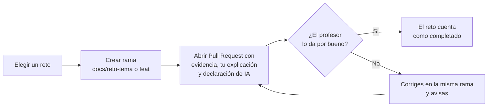

# Retos de ampliación (opcionales) · bloque H1 (sesiones 0-3)

Estos retos son para quien **ya tiene hecho lo esencial de su hito** y quiere ir más lejos o adelantar trabajo. **Son opcionales**: no cambian las fechas de nadie, no hacerlos nunca te resta y, por ahora, no suman a la nota. Se liberan por bloques de hito; aquí están los de H1 (hasta el 26-nov).

**Cómo se hace un reto**
1. Trabaja en una **rama** (`docs/reto-<tema>` o `feat/...`) y abre un **Pull Request**, como en cualquier tarea.
2. **Declara el uso de IA** en `docs/declaracion-uso-ia.md` y no pegues claves ni datos personales.
3. Escribe en el PR **2-5 líneas con lo que has aprendido y por qué** (así se ve tu esfuerzo y tu autoría).
4. Anota el tiempo real en `docs/registro-tutoria.md`. Si un reto te lleva más de 1 h y estás atascado/a, paras, lo anotas como bloqueo y escribes por correo (ver [contacto y ayuda](../contacto-y-ayuda.md)).
5. Cada dato externo, con **fuente, fecha y estado** (`verificado` / `declarado` / `no leído`).
6. No instales herramientas ni extensiones de terceros sin **leer antes qué hacen** (mismo cuidado que con las skills, capítulo 09).

Este diagrama muestra el recorrido de un reto desde que lo eliges hasta que cuenta.

**Cómo leerlo:** un reto solo cuenta cuando su Pull Request reúne las tres cosas que pide (evidencia, tu explicación y tu declaración de IA) y el profesor lo da por bueno. Si no, el diagrama vuelve al PR; esa vuelta es una propuesta de funcionamiento, no una regla escrita arriba.

**Qué son:** cada reto **mejora un entregable de la fase en la que estamos** (ahora, Fase 1 · Análisis, hasta H1). No son ejercicios sueltos: lo que hagas aquí entra en **tu** proyecto y lo ves reflejado en tu `docs/01-analisis.md` o en tu `docs/01b-sota.md`.

| Reto | Mejora de tu proyecto | Criterio (RA1) | Semana | Tiempo estimado | Prerrequisito |
|---|---|---|---|---|---|
| [H1-1](#reto-h1-1--valida-tu-necesidad-con-una-persona-real) | `00-documentoInicio.md` §4 y `01-analisis.md` §2 (necesidades) | 1c, 1d | Hasta el 12-nov | 45-60 min | Tienes idea y `00-documentoInicio.md` rellenado |
| [H1-2](#reto-h1-2--requisitos-verificables-y-trazabilidad-de-tu-proyecto) | `01-analisis.md` §4 (requisitos y trazabilidad) | 1f | 12 a 19-nov | 45-60 min | Capítulo 06 leído y 3 requisitos esenciales hechos |
| [H1-3](#reto-h1-3--estado-del-arte-y-fuentes-de-tu-proyecto) | `01b-sota.md` y `01-analisis.md` §1-2 | 1a, 1b, 1d | 19 a 26-nov | 45-60 min | Capítulo 08 leído |

---

## Reto H1-1 · Valida tu necesidad con una persona real

**Mejora:** la necesidad de tu proyecto pasa de «creo que» a «lo he comprobado con alguien». Entra en `00-documentoInicio.md` §4 y `01-analisis.md` §2.
**Importante:** **no anotes nombres ni datos personales** de la persona con quien hables; descríbela por su rol («encargada de una tienda», «alumno de 1.º»).
- [ ] 1. Escribe **5 preguntas abiertas** para quien tiene el problema. — *hecho cuando:* están en tu PR. — *evidencia:* fichero o texto del PR. — **Comprobar:** Las 5 preguntas se pueden contar al abrir el fichero o la descripción del PR.
- [ ] 2. Habla con **1 o 2 personas** reales (o contrasta con una empresa de las que ya conoces). — *hecho cuando:* tienes un resumen por rol, sin nombres. — **Comprobar:** El resumen describe a cada persona solo por su rol; relee y comprueba que no hay nombres.
- [ ] 3. Saca **3 necesidades** y ordénalas con un criterio que expliques (frecuencia, coste, urgencia…). — *evidencia:* tabla en `01-analisis.md` §2. — **Comprobar:** La tabla de `01-analisis.md` §2 tiene 3 filas ordenadas y el criterio está escrito.
- [ ] 4. Cita cada necesidad con **fuente, fecha y estado** (`verificado` si hablaste tú; `declarado` si lo dice otra persona). — **Comprobar:** Cada necesidad tiene escritas fuente, fecha y estado.
- [ ] 5. En el PR, escribe **2-5 líneas**: ¿qué ha cambiado de tu idea después de hablar con alguien? — **Comprobar:** La descripción del PR contiene esas líneas.

## Reto H1-2 · Requisitos verificables y trazabilidad de tu proyecto

**Mejora:** `01-analisis.md` §4 (CE 1f). Parte del [capítulo 06](06-requisitos-verificables.md): lo esencial es tener 3 requisitos verificables; aquí los llevas más lejos.
- [ ] 1. Llega a **6 requisitos o más** (RF, RNF y restricciones), cada uno con **medida o prueba**. — *evidencia:* tabla de la §4. — **Comprobar:** La tabla de la §4 tiene 6 o más filas y ninguna tiene vacía la medida o prueba.
- [ ] 2. Escribe **3 criterios de aceptación** en formato Dado / Cuando / Entonces para tus requisitos funcionales. — **Comprobar:** Se leen 3 criterios con las palabras Dado, Cuando y Entonces.
- [ ] 3. Completa la **matriz de trazabilidad** objetivo → requisito → prueba para todos. — *hecho cuando:* no queda ningún requisito sin prueba (o está marcado «pendiente» con motivo). — **Comprobar:** Ningún requisito de la matriz tiene la celda de prueba vacía.
- [ ] 4. Repasa los requisitos con la lista del capítulo 06 y corrige los que no se pueden comprobar. — **Comprobar:** explícalo en 2 frases en tu PR (qué requisito corregiste y por qué)
- [ ] 5. En el PR, **2-5 líneas**: ¿qué requisito te costó más hacer verificable y por qué? — **Comprobar:** La descripción del PR contiene esas líneas.

## Reto H1-3 · Estado del arte y fuentes de tu proyecto

**Mejora:** `01b-sota.md` y los apartados de sector y oportunidades de `01-analisis.md` (CE 1a, 1b y 1d). Parte del [capítulo 08](08-sota-y-fuentes.md).
- [ ] 1. Reúne **5 fuentes** sobre tu sector o tu tipo de solución, cada una con **URL, fecha de consulta y estado**. — *evidencia:* `01b-sota.md`. — **Comprobar:** `01b-sota.md` tiene 5 filas con URL, fecha y estado.
- [ ] 2. Compara **3 soluciones o empresas existentes** (qué hacen, qué les falta) en una tabla. — *hecho cuando:* puedes decir en qué se diferencia tu proyecto. — **Comprobar:** La tabla tiene 3 filas y una columna de qué les falta.
- [ ] 3. **Rastrea una cifra** hasta su fuente primaria (o concluye «no se puede rastrear» y dilo). — *hecho cuando:* el enlace está en el documento. — **Comprobar:** El enlace se abre y en esa página se lee la cifra (o está escrito «no se puede rastrear»).
- [ ] 4. Mejora un apartado de `01-analisis.md` con un **dato cuantitativo con fuente**. — **Comprobar:** El apartado incluye una cifra seguida de su fuente.
- [ ] 5. En el PR, **2-5 líneas**: ¿qué fuente descartaste y por qué? — **Comprobar:** La descripción del PR contiene esas líneas.

---

## Adelantar el trabajo de tu proyecto

Si vas sobrado/a, puedes adelantar partes de tu proyecto. Reglas:
- **Los hitos no se mueven** (H1 26-nov, H2 21-ene, H3 7-may). Adelantar no cambia las fechas de nadie.
- Trabaja siempre en **rama y Pull Request**. Para que el tutor lo vea, marca en el registro de tutoría qué has adelantado.
- Adelanta lo que **tiene sentido**: borradores de `01b-sota.md`, apartados de `01-analisis.md` o el esqueleto de `02-diseno.md`. No saltes pasos de revisión.
- **Calidad antes que cantidad**: un apartado bien hecho vale más que tres a medias.
- Todo lo de siempre: sin claves ni datos personales, fuente + fecha + estado, uso de IA declarado.
- El trabajo adelantado también es **evidencia de esfuerzo**, pero los puntos extra solo los dan los retos (regla de arriba).
