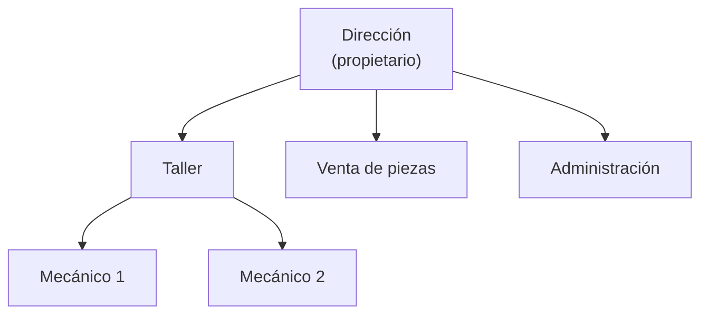

# Cómo hacer el sector y las empresas (H1-A)

Para: `01-analisis.md` §1 · Tiempo orientativo: 150 min

## Qué te piden

- **CE 1a:** ordenar empresas del sector en grupos, según cómo están organizadas y qué producto o servicio venden.
- **CE 1b:** describir una **empresa tipo** (una empresa representativa del sector, la que mejor resume a las demás) con su estructura y las funciones de cada departamento.

**Hecho** es: una tabla con 5 o más empresas, un organigrama Mermaid de la empresa tipo y una frase por departamento con lo que hace.

Dos palabras que usarás:

- **Organigrama:** dibujo de quién depende de quién dentro de una empresa.
- **Sector:** el conjunto de empresas que se dedican a lo mismo. El tuyo es el del negocio al que ayuda tu proyecto (talleres, clínicas, tiendas…), no «la informática» en general.

## Dónde buscar

Usa solo información pública de empresas. Nada de datos de personas concretas (nombres de empleados, teléfonos móviles, correos personales).

- **Directorio Central de Empresas (DIRCE), del INE** (Instituto Nacional de Estadística): cuenta empresas por actividad y tamaño. Entra en [ine.es](https://www.ine.es) y busca «DIRCE».
- **CNAE** (Clasificación Nacional de Actividades Económicas): código de 4 dígitos que clasifica cada actividad económica. Búscalo en [ine.es](https://www.ine.es) con «CNAE 2009» y localiza el de tu sector. Te sirve para buscar en otros sitios.
- **Cifras PYME**, del Ministerio de Industria: informes por tamaño y actividad. Entra en [ipyme.org](https://www.ipyme.org).
- **Datos abiertos:** [datos.gob.es](https://datos.gob.es) tiene listados oficiales de establecimientos de algunos sectores (por ejemplo, registros de talleres o comercios de tu comunidad).
- **Asociaciones y federaciones del sector:** su web suele describir los tipos de socios.
- **Webs de las propias empresas:** apartados «Quiénes somos», «Servicios» y «Equipo».
- **Mapas:** un buscador de mapas te da empresas reales de tu zona para tener ejemplos.

Reglas de fuentes:

- Cada dato lleva **enlace y fecha de acceso**.
- Si usas IA para buscar empresas o cifras, **abre cada fuente** y comprueba que existe y dice eso. La IA puede inventar empresas. Decláralo en `docs/declaracion-uso-ia.md`.

## Pasos

1. **Delimita tu sector** en una frase y apunta su código CNAE.
2. **Reúne 5 o más empresas** reales (o tipos reales de empresa) de ese sector. Busca que sean distintas entre sí: pequeña y grande, local y de cadena…
3. **Elige 2 o 3 características organizativas** para comparar. Por ejemplo: tamaño (microempresa, pequeña, mediana), forma jurídica (autónomo, sociedad limitada o S. L., sociedad anónima o S. A.…), ámbito (local, regional, nacional), si tiene una sola sede o varias.
4. **Anota qué producto o servicio vende** cada una, en pocas palabras.
5. **Rellena la tabla** con enlace y fecha de acceso por fila.
6. **Agrupa:** mira qué filas se parecen y ponles nombre al grupo («microtaller de barrio», «cadena»…).
7. **Elige la empresa tipo:** la del grupo que más se parece a quien usaría tu proyecto. Explica en una frase por qué.
8. **Dibuja su organigrama** en Mermaid. Si no encuentras uno público, deduce uno razonable a partir de su web y dilo.
9. **Escribe una frase por departamento:** qué hace y con qué otros departamentos habla.

## Ejemplo resuelto

Proyecto ficticio común: **Taller Rueda Libre**, un pequeño taller de reparación de bicicletas que quiere una app web para gestionar citas y piezas. Todo lo que sigue es **ficticio**: las empresas no existen y las cifras son inventadas para el ejemplo.

Sector: reparación y venta de bicicletas. CNAE: el alumno lo localizaría en el INE (aquí no se indica código para no dar un dato falso).

| Empresa (ficticia) | Tamaño | Forma | Ámbito | Servicio | Fuente y fecha | Estado |
|---|---|---|---|---|---|---|
| Bicis del Barrio | 2 personas | Autónomo | Local, 1 sede | Reparación sin venta | web ficticia, acceso 10-11-2026 | `leído` |
| Taller Pedal Sur | 4 personas | S. L. | Local, 1 sede | Reparación y venta de piezas | web ficticia, acceso 10-11-2026 | `leído` |
| Ciclos Mediterráneo | 25 personas | S. L. | Regional, 3 sedes | Venta, reparación y alquiler | web ficticia, acceso 10-11-2026 | `leído` |
| BiciRed | 120 personas | S. A. | Nacional, cadena | Venta y servicio posventa | web ficticia, acceso 10-11-2026 | `leído` |
| Movilidad Urbana Coop. | 8 personas | Cooperativa | Regional, 2 sedes | Alquiler y reparación | web ficticia, acceso 10-11-2026 | `leído` |

Grupos: **microtalleres** (Bicis del Barrio, Taller Pedal Sur), **tiendas regionales** (Ciclos Mediterráneo, Movilidad Urbana) y **cadena** (BiciRed).

**Empresa tipo:** Taller Pedal Sur, porque tiene el tamaño del cliente de Rueda Libre y mezcla reparación con venta de piezas.

**Cómo leerlo:** cada caja es un departamento o puesto y cada flecha va de quien manda a quien depende de él. Aquí Dirección está arriba y de ella cuelgan Taller, Venta de piezas y Administración.

Funciones (ficticias):

- **Dirección:** decide precios y compras, y atiende las reclamaciones.
- **Taller:** recibe las bicis, diagnostica, repara y avisa al cliente de que está lista.
- **Venta de piezas:** controla el almacén, pide piezas a proveedores y las cobra.
- **Administración:** gestiona facturas, cobros, impuestos y nóminas.

## Hecho cuando

- [ ] Hay 5 o más empresas en una tabla, con tamaño, forma o ámbito y qué venden (1a).
- [ ] Cada fila tiene enlace, fecha de acceso y una columna «Estado» con `leído` o `sin leer` (1a).
- [ ] Las empresas están agrupadas con un nombre por grupo (1a).
- [ ] Digo cuál es la empresa tipo y por qué (1b).
- [ ] El organigrama es un bloque Mermaid que GitHub dibuja sin error y tiene una caja por departamento (1b).
- [ ] Cada departamento del organigrama tiene una frase de funciones (1b).
- [ ] No hay nombres de personas ni datos de contacto personales.

## 3 errores típicos

1. **Elegir el sector equivocado:** poner «software» cuando tu proyecto sirve a un taller. El sector es el del cliente al que ayudas.
2. **Cinco empresas iguales:** si las cinco son microtalleres, no hay clasificación. Busca variedad de tamaño o ámbito.
3. **Organigrama sin funciones, o funciones sin organigrama:** piden las dos cosas. Un dibujo sin texto no cumple, ni un texto sin dibujo.

¿Atascado más de 10 minutos? Escribe → [cómo pedir ayuda](../contacto-y-ayuda.md)
