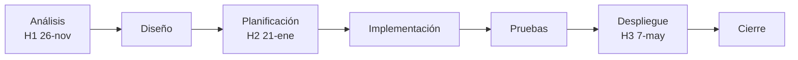

# Cómo hacer los objetivos y el guion de trabajo (H1-D)

Para: `01-analisis.md` §4 (matriz de trazabilidad) y §7 (guion de trabajo) · Tiempo orientativo: 90 min

## Qué te piden

- **Objetivos (para la matriz de §4):** unas pocas metas de tu proyecto, medibles, a las que luego atarás los requisitos.
- **CE 1i:** un **guion de trabajo**: el plan de qué harás, en qué orden y con qué fechas, hasta el final del curso.

**Hecho** es: de 2 a 4 objetivos numerados (`OBJ-01`…) y una tabla con las fases, las fechas, las tareas principales y quién interviene.

Tres palabras que usarás:

- **Objetivo:** lo que quieres que consiga tu proyecto, dicho de forma que se pueda comprobar si se logró.
- **Guion de trabajo:** tu plan por fases y fechas. No es el diseño técnico ni el calendario detallado: eso llega en H2.
- **Responsable:** quién se ocupa de cada cosa. Tu proyecto es individual, así que casi siempre eres **tú**; apunta también quién más interviene (el tutor aprueba, el cliente o la persona usuaria valida).

## Dónde buscar

- Las fases y las fechas están en [fases-del-proyecto.md](../../fases-del-proyecto.md). Cópialas de ahí.
- Las tareas de cada fase salen de lo que ya has escrito: tus requisitos (apartado 4) y las plantillas de cada fase en [`plantilla-proyecto/docs/`](../../../plantilla-proyecto/docs/).
- Si quieres verlo en tablero, créalo en GitHub Projects y enlázalo desde el guion.

## Pasos

### Objetivos

1. **Mira la necesidad** que elegiste en el paso 3 de la hoja y pregúntate: «¿cómo sabré que mi proyecto ha servido?».
2. **Escribe de 2 a 4 objetivos** con esta forma: **verbo + qué + para quién + cómo se medirá**.
3. **Numéralos** `OBJ-01`, `OBJ-02`… Los usarás en la primera columna de la matriz de trazabilidad del apartado 4.
4. **Comprueba** que cada objetivo se puede medir con un número, un sí/no o una prueba. «Mejorar la gestión» no se puede medir.

### Guion de trabajo

5. **Copia las fases** del curso con sus fechas (análisis, diseño, planificación, implementación, pruebas, despliegue y seguimiento/cierre) y los tres hitos.
6. **Añade 1 a 3 tareas principales por fase.** No hace falta más detalle ahora.
7. **Pon un responsable** en cada tarea y una fecha de fin.
8. **Enlaza el tablero** de GitHub Projects si lo tienes.

## Ejemplo resuelto

Proyecto ficticio común: **Taller Rueda Libre**, un taller de bicicletas que quiere una app web para gestionar citas y piezas. Todo es **ficticio**.

**Objetivos:**

| ID | Objetivo | Cómo se mide |
|---|---|---|
| OBJ-01 | Permitir al taller gestionar sus citas sin llamadas | Un cliente pide cita en la web y el taller la ve en su agenda (prueba de aceptación) |
| OBJ-02 | Saber en todo momento qué piezas quedan en el almacén | El stock se actualiza al registrar una venta o una reparación |
| OBJ-03 | Reducir los pedidos repetidos a proveedores | Cero pedidos duplicados en un mes de uso de prueba |

**Guion de trabajo (parte):**

| Fase | Fechas | Tareas principales | Responsable | Hito |
|---|---|---|---|---|
| Análisis | hasta el 26-nov | Estudio del sector, requisitos, obligaciones y ayudas | Yo | **H1 26-nov** |
| Diseño | 26-nov a 10-dic | Viabilidad, alcance, arquitectura y datos | Yo; el tutor revisa el 10-dic | |
| Planificación | 10-dic a 21-ene | Cronograma, riesgos y presupuesto | Yo | **H2 21-ene** |
| Implementación | 21-ene a 31-mar | Citas, piezas y primera versión mínima funcional | Yo; el taller valida | |
| Pruebas | 1-abr a 23-abr | Plan de pruebas y corrección de fallos | Yo | |
| Despliegue | 26-abr a 7-may | Puesta en marcha y guía de despliegue | Yo | **H3 7-may** |
| Cierre | hasta el 18-jun | Memoria y defensa | Yo; el tutor evalúa | |

**Cómo leerlo:** va de izquierda a derecha; cada caja es una fase y los hitos marcan cuándo entregas.

## Hecho cuando

- [ ] Hay de 2 a 4 objetivos con ID `OBJ-xx` (1f).
- [ ] Cada objetivo tiene una columna «Cómo se mide» con un número, un sí/no o una prueba (1f).
- [ ] Cada objetivo aparece en la primera columna de la matriz de trazabilidad (1f).
- [ ] El guion tiene las 7 fases, con fecha y los tres hitos (1i).
- [ ] Cada fase tiene de 1 a 3 tareas y cada tarea, un responsable (1i).

## 3 errores típicos

1. **Objetivos que no se pueden medir:** «hacer una buena app» no sirve. Di qué ocurrirá y cómo se comprobará.
2. **Guion demasiado detallado:** no escribas 40 tareas. El detalle llega en H2; ahora basta lo principal.
3. **Inventar fechas distintas a las del curso:** las fases y los hitos son los de [fases-del-proyecto.md](../../fases-del-proyecto.md).

¿Atascado más de 10 minutos? Escribe → [cómo pedir ayuda](../contacto-y-ayuda.md)
