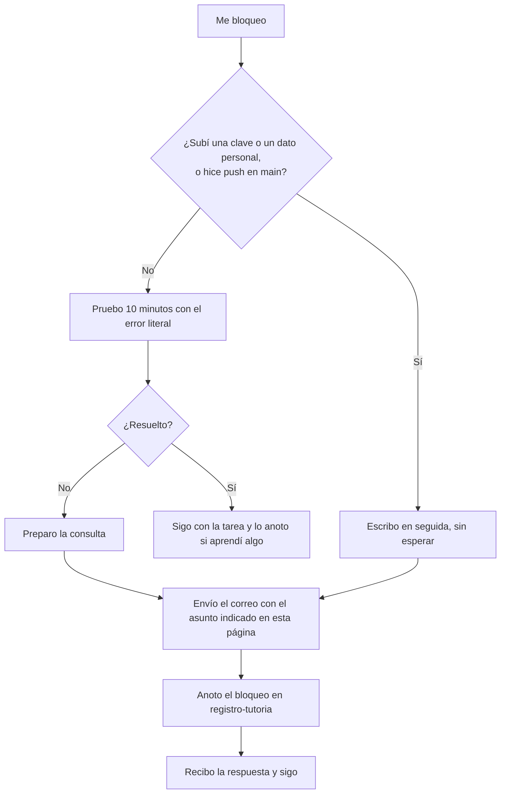

# Cómo pedir ayuda

**Tiempo estimado:** 10 min de lectura + 15 min de tarea (ruta Esencial 🟢: 20 min en total; estimación propia, sin medir) · **Fase:** transversal (todas; ver [Fase](00-fundamentos/glosario.md#fase) y [`docs/fases-del-proyecto.md`](../fases-del-proyecto.md))

> **Antes de leer:** para la tarea, tener hecho el [capítulo 01](00-fundamentos/01-git-y-github.md) (Git instalado y autenticado, sabes abrir un Pull Request) · términos dudosos en el [glosario](00-fundamentos/glosario.md).

Esta página es la **fuente única** del canal de ayuda: el resto de guías enlazan aquí en lugar de repetir el correo. Si algo cambia (correo, plazo), se cambia solo aquí.

## En 5 minutos

- Trabajas **en casa**. La clase es **1 hora a la semana**: sirve de [**briefing**](00-fundamentos/glosario.md#briefing) (qué llevamos al día) y para resolver **dudas**.
- El resto se coordina **por correo**. Correo del tutor: **pablomdg@educastur.org** (correo institucional público de docente). El [tutor](00-fundamentos/glosario.md#tutor) es el profesor del módulo.
- El [**Pull Request**](00-fundamentos/glosario.md#pull-request-pr) (PR) es el sitio donde **compartes tu trabajo** para que se revise. El **correo** es para **dudas y avisos**. No mezcles: no pidas por correo que revise un cambio que no está en un PR.
- Antes de escribir, **prueba 10 minutos** por tu cuenta, con el error literal delante.
- **Desde qué dirección escribir:** desde tu correo de uso habitual; no hace falta ninguno especial.
- Cada consulta se **anota como bloqueo** en `docs/registro-tutoria.md` (ver §4).

## Lo imprescindible (esta semana)

1. Guarda el correo del tutor: `pablomdg@educastur.org`.
2. Usa el asunto `[Proyecto DAW] <fase> · <resumen en pocas palabras>`. `<fase>` es la fase del curso en que estás, por ejemplo `Fase 1` (la lista, con fechas, está en [`docs/fases-del-proyecto.md`](../fases-del-proyecto.md); la «Fase 0» fue la sesión de inicio del 6-nov).
3. En el cuerpo, los cinco apartados de la §3 y el enlace a tu repo o PR.
4. **Nunca** envíes claves, tokens, datos personales de terceros ni capturas que los muestren.

**Ruta Esencial 🟢:** lee «En 5 minutos», «Lo imprescindible», las secciones 2 y 3 y haz los pasos 1-2 de la tarea (≈ 20 min).

## 1. Cómo trabajamos

| Qué | Dónde | Para qué |
|---|---|---|
| Trabajo diario | En casa, en tu ordenador | Avanzar con las guías y tu proyecto |
| Clase semanal (1 h) | En el aula | Briefing: qué llevamos al día, y dudas |
| Compartir trabajo | **Pull Request** en GitHub | Que el tutor lo revise (ver [`docs/metodologia.md`](../metodologia.md) §4.2 bis) |
| Dudas y avisos | **Correo** | Preguntar cuando te bloqueas o avisar de un problema |
| Asistente de IA | [OpenCode](00-fundamentos/glosario.md#opencode-v1-frente-a-v2): programa de terminal con un agente de IA (tu cuota individual; [capítulo 09](00-fundamentos/09-opencode-skills-agentes.md)) | Ayuda de apoyo; se declara en `docs/declaracion-uso-ia.md` |

No hay nadie al lado mientras trabajas: usa primero los «Comprobar» y «Si te atascas» de cada guía.

**Cómo leerlo:** empieza en «Me bloqueo». Si has subido una clave o un dato personal, o has hecho push en `main`, sigue la ruta «escribir en seguida». Si no, solo escribes si a los 10 minutos no se ha resuelto. Anotar el bloqueo se hace siempre que escribes.

## 2. Cuándo escribir

Escribe cuando:

- Llevas **unos 10 minutos** intentándolo y sigues igual.
- Tienes a mano el **error literal** (copiado, no resumido), si lo hay, y has releído «Si te atascas» de la guía.

Escribe **en seguida**, sin esperar los 10 minutos, si:

- Has subido por error una **clave o un dato personal** (no lo borres tú: avisa al tutor por correo, con el asunto de siempre y sin pegar la clave ni el dato; ver [04 · Claves y datos personales](00-fundamentos/04-claves-y-datos-personales.md)).
- Has hecho [commit](00-fundamentos/glosario.md#commit) o [push](00-fundamentos/glosario.md#push) en [`main`](00-fundamentos/glosario.md#main) por equivocación (tu trabajo no se sube nunca directamente a `main`).

## 3. Cómo escribir el correo

**Asunto:** `[Proyecto DAW] <fase> · <resumen en pocas palabras>`

**Cuerpo mínimo (los cinco apartados):**

1. **Qué intenté** (el comando o la acción exacta).
2. **Qué esperaba** que pasara.
3. **Qué pasó** (pega el **error literal**; si no hay mensaje de error, describe lo que ves).
4. **Qué ya probé** (para no repetirte lo que ya hiciste).
5. **Enlace** a tu repositorio o a tu PR.

Cierra con una **firma**: tu nombre y el nombre de tu repo. Tu nombre propio sí puede ir; lo de abajo no va nunca.

### Qué NO enviar nunca

- Claves, contraseñas, tokens (aunque sea «solo para que lo veas»).
- Datos personales de terceros (nombres, correos, teléfonos, DNI).
- Capturas de pantalla donde se vea alguno de esos datos. Mejor copia el texto del error y revisa que no los lleva.

### Ejemplo bien escrito, con error (ficticio)

> **Asunto:** [Proyecto DAW] Fase 0 · git push rechazado en rama docs/anade-readme
>
> Hola:
>
> **Qué intenté:** `git push -u origin docs/anade-readme` en el repo de mi proyecto.
> **Qué esperaba:** que la rama apareciera en GitHub.
> **Qué pasó:** `remote: Permission denied` y `fatal: unable to access 'https://github.com/ana-ejemplo/proyecto-demo.git/': The requested URL returned error: 403`.
> **Qué ya probé:** repetí `gh auth login` (el programa de GitHub que inicia sesión desde la terminal; ver el Paso 0c del [capítulo 01](00-fundamentos/01-git-y-github.md)) y `git remote -v` (la URL es la de mi repo). Sigue igual tras 15 minutos.
> **Repo:** https://github.com/ana-ejemplo/proyecto-demo
>
> Gracias. Lo he anotado como bloqueo en mi registro de tutoría.
>
> Ana Ejemplo · repo `proyecto-demo`

### Ejemplo bien escrito, sin mensaje de error (ficticio)

> **Asunto:** [Proyecto DAW] Fase 1 · duda: ¿mi requisito RF3 es verificable?
>
> Hola:
>
> **Qué intenté:** redactar el requisito RF3 de `docs/01-analisis.md` siguiendo la guía 06.
> **Qué esperaba:** poder comprobarlo con una prueba clara.
> **Qué pasó:** no hay error; me parece vago («la web debe ser rápida») y no sé cómo medirlo.
> **Qué ya probé:** releí la guía y lo reescribí dos veces; sigo sin saber qué número poner.
> **Enlace:** https://github.com/ana-ejemplo/proyecto-demo/pull/2
>
> Gracias.
>
> Ana Ejemplo · repo `proyecto-demo`

### Ejemplo mal escrito (ficticio)

> **Asunto:** ayuda
>
> No me funciona git, ¿me lo miras? Te adjunto una captura con mi contraseña por si hace falta.

**Qué falla:** el asunto no dice fase ni problema; no hay comando ni error literal; no dice qué se probó; no hay enlace al repo; no hay firma; y envía una **contraseña**, que no se manda nunca.

## 4. Anota la consulta como bloqueo

Cada consulta se anota en `docs/registro-tutoria.md`, que está en **el repo de tu proyecto** (el que creaste desde la plantilla; el [repo de práctica](00-fundamentos/glosario.md#repo-de-práctica-frente-a-repo-del-proyecto) no lo lleva). Plantilla: [`registro-tutoria.md`](../../plantilla-proyecto/docs/registro-tutoria.md). Apunta qué te bloqueó, cuánto tiempo, qué probaste y cómo se resolvió. Se anota **siempre** que escribes; el paso 3 de la tarea es opcional solo porque es una fila de práctica.

## 5. Plazo de respuesta

Hay dos plazos, según dónde preguntes. Esta es la única tabla del curso con los dos:

| Qué envías | Responde en | Cuenta |
|---|---|---|
| Un **correo** con una duda | **72 horas** | Fines de semana y festivos incluidos |
| Un **Pull Request** que necesita aprobación del tutor (`necesita-tutor`) | **48 horas lectivas** | Solo días de clase |

Si pasan 72 horas sin respuesta a un correo, **reenvíalo**.

Mientras tanto, no te quedes parado: avanza con otra tarea de tu checklist que no dependa del bloqueo.

## Glosario

**Bloqueo:** no puedes avanzar tras intentarlo (p. ej. `git push` rechazado). **Error literal:** el texto exacto del error, copiado tal cual. Briefing, PR, commit, push, `main` y fase: en el [glosario común](00-fundamentos/glosario.md).

## Errores frecuentes

- **Escribir sin error literal** («no me va»): cópialo (si no hay, describe lo que ves, como en el segundo ejemplo).
- **Pedir revisión por correo** en vez de abrir el PR.
- **No anotar el bloqueo:** se pierde la evidencia de cómo lo resolviste.

## Si te atascas

Si no sabes ni cómo plantear la consulta, escribe igualmente con lo que tengas y di que no sabes más. Es preferible a quedarte parado.

## Autoevaluación

1. ¿Cuánto tiempo pruebas por tu cuenta antes de escribir?
2. ¿Qué cinco cosas lleva el cuerpo mínimo del correo?
3. ¿Qué cosas no se envían nunca?
4. ¿Dónde compartes tu trabajo para que lo revisen y para qué sirve el correo?
5. ¿Qué debes hacer además de enviar el correo?
6. ¿En qué dos casos escribes sin esperar los 10 minutos?
7. Este correo tiene fallos: *Asunto: «Duda». Cuerpo: «No me sale el push, mira mi token: ghp_xxxx, a ver si lo ves».* ¿Cuáles son?

Respuestas

1. Unos 10 minutos, con el error literal a mano.
2. Qué intenté, qué esperaba, qué pasó (error literal), qué ya probé y enlace al repo o PR.
3. Claves, tokens, datos personales de terceros y capturas que los muestren.
4. En un Pull Request; el correo es para dudas y avisos.
5. Anotar la consulta como bloqueo en `docs/registro-tutoria.md`.
6. Si has subido una clave o un dato personal, o has hecho commit o push en `main` por equivocación.
7. Asunto sin fase ni resumen; sin error literal, sin qué intentó ni qué probó; sin enlace al repo; sin firma; y manda un token, que no se envía nunca (además, hay que avisar de que se ha subido o compartido una clave).

## Tarea y checklist

### Tarea: Prepara tu primera consulta (en simulacro)
**Fase:** 0 · **Tiempo estimado:** 15 min · **Entrega:** antes del briefing de la semana en que el tutor te la pida (fechas de las sesiones en [`docs/fases-del-proyecto.md`](../fases-del-proyecto.md))
**Objetivo:** tener lista una plantilla de consulta para usarla cuando la necesites.
**Dónde trabajas:** en el **repo de tu proyecto** (el de la plantilla; ya lo creaste en la Fase 0), en todos los pasos.
**Antes de empezar:** haber leído esta página y tener hecho el [capítulo 01](00-fundamentos/01-git-y-github.md) (Git instalado, `gh auth login` hecho y saber abrir un PR).

### Pasos (🟢 = esencial · 🔵 = al día)
- [ ] 0. 🟢 Prepara tu rama (capítulo 01, Pasos 2 y 3): `git switch main`, `git pull --no-rebase`, `git switch -c docs/ayuda-borrador` — *Comprobar:* `git branch --show-current` muestra `docs/ayuda-borrador`
- [ ] 1. 🟢 Guarda el contacto del tutor en tu agenda — *hecho cuando:* puedes escribir el correo sin buscarlo — *evidencia:* se lo dices al tutor en clase (no hay evidencia en el repo)
- [ ] 2. 🟢 Crea en el repo de tu proyecto el fichero `docs/ayuda-borrador.md` con el asunto y los cinco apartados del cuerpo, rellenados con un problema ficticio y con firma — *hecho cuando:* el fichero existe en tu rama y tiene el asunto con `[Proyecto DAW] <fase> · …` y los cinco apartados (qué intenté, qué esperaba, qué pasó, qué ya probé, enlace) — *evidencia:* enlace al fichero en tu PR (paso 4)
- [ ] 3. 🔵 Abre en el repo de tu proyecto `docs/registro-tutoria.md` (viene de la plantilla; si no lo tienes, cópialo de [`registro-tutoria.md`](../../plantilla-proyecto/docs/registro-tutoria.md)), localiza dónde se anota un bloqueo y añade una fila de prueba — *hecho cuando:* la fila aparece en el fichero — *evidencia:* commit con ese cambio
- [ ] 4. 🟢 Commit, push y PR (capítulo 01, Pasos 4, 5 y 6): `git add docs/ayuda-borrador.md` (y el registro, si hiciste el paso 3), `git commit -m "docs: añade borrador de consulta de ayuda"`, `git push -u origin docs/ayuda-borrador`; en GitHub, **Compare & pull request** con la lista de comprobación de [`pull_request_template.md`](../../plantilla-proyecto/.github/pull_request_template.md) y, si es tu primer PR, la label `necesita-tutor` ([vía A](00-fundamentos/glosario.md#vía-a-y-vía-b)) — *Comprobar:* la rama aparece en GitHub y el PR está abierto — *evidencia:* enlace al PR

### Progreso
Llevo **0 de 5** pasos. Me falta: el paso 0.

### Antes de entregar
- [ ] Sin claves ni datos personales
- [ ] Si usaste IA, anótalo en `docs/declaracion-uso-ia.md` (fecha, herramienta, qué pediste, qué aceptaste o cambiaste, dónde)
- [ ] Horas anotadas en `docs/registro-tutoria.md` (cuánto tiempo dedicaste a esta tarea)

## Capítulos vecinos

- Índice de la guía: [`README.md`](README.md)
- Git y GitHub: [01 · Git y GitHub](00-fundamentos/01-git-y-github.md)

