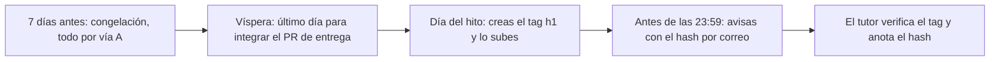

# Entrega de hito: integrar el PR, poner el tag y avisar

**Tiempo estimado:** 15 min de lectura + 30 min de tarea (ruta Esencial 🟢: unos 45 min en total; estimación propia, sin medir) · **Fase:** transversal (cada hito; ver [Fase](00-fundamentos/glosario.md#fase) y [`docs/fases-del-proyecto.md`](../fases-del-proyecto.md))

> **Antes de leer:** tener hecho el [capítulo 01](00-fundamentos/01-git-y-github.md) (Git instalado y autenticado, sabes abrir un Pull Request) · términos dudosos en el [glosario](00-fundamentos/glosario.md).

Las reglas salen de [`docs/metodologia.md`](../metodologia.md) §4.2 y §4.2 bis; aquí no se cambian. Practicas primero en un repo de práctica.

## En 5 minutos

- Un [**hito**](00-fundamentos/glosario.md#hito-h1-h2-h3) es una entrega con fecha: **H1 26-nov, H2 21-ene, H3 7-may** (provisionales; la fuente única es [`docs/fases-del-proyecto.md`](../fases-del-proyecto.md)).
- La versión que se evalúa es la que marca el **tag** `h1`, `h2` o `h3` en `main`. Un tag es un nombre fijo para un commit (no es una [label](00-fundamentos/glosario.md#tag-de-git-frente-a-label-de-github) de GitHub).
- El **PR de entrega** es el [Pull Request](00-fundamentos/glosario.md#pull-request-pr) con el que integras en `main` lo que quieres que se evalúe (por [vía A](00-fundamentos/glosario.md#vía-a-y-vía-b); se abre como en el [Paso 6 del capítulo 01](00-fundamentos/01-git-y-github.md)). No es un PR especial: es el último del hito.
- Orden: **PR de entrega integrado → tag → aviso con el [hash](00-fundamentos/glosario.md#hash-de-commit)**. Corte: **23:59 del día del hito**.
- **Nunca muevas ni borres un tag.** Si te equivocas, escribe al tutor.

## Lo imprescindible (esta semana)

1. Durante los **7 días antes** del hito (para H1, desde el 19-nov) todos tus PR van por [vía A](00-fundamentos/glosario.md#vía-a-y-vía-b) (`necesita-tutor`): no integras hasta que el [tutor](00-fundamentos/glosario.md#tutor) lo apruebe.
2. Integra el **PR de entrega** como tarde la **víspera** del hito (H1: 25-nov). Ábrelo con margen (H1: recomendado el 23-nov): el tutor responde a un PR de vía A en un máximo de **48 horas lectivas**.
3. Comprueba que **no queda abierta ninguna corrección `gravedad:bloqueante`** (cómo, en la sección 1). Si queda alguna, **no pongas el tag**: resuélvela o escribe al tutor.
4. Con el PR integrado, crea el tag, súbelo, compruébalo y **avisa por correo** con el hash corto.
5. **El día real:** si falla la autenticación al subir (`403`, `Permission denied`), repite el Paso 0c del [capítulo 01](00-fundamentos/01-git-y-github.md) y escribe **ya**; envía el hash del *commit* (`git log -1 --format=%h h1`), no el del tag. Ante cualquier bloqueo, escribe **3 días antes del corte** (H1: 23-nov): un correo tarda hasta **72 horas naturales**.

**Ruta Esencial 🟢:** lee «En 5 minutos», «Lo imprescindible», las secciones 1 y 2 y haz los pasos 0-8 de la tarea (≈ 45 min).

## 1. Qué pasa y cuándo



**Cómo leerlo:** va de izquierda a derecha. Para H1: 19-nov (congelación), 25-nov (último día para integrar), 26-nov (tag y aviso antes de las 23:59). Fechas provisionales.

- **Congelación de hito** (metodología §4.2 bis): 7 días antes, todos los PR por vía A y ninguna corrección `gravedad:bloqueante` abierta cuando pones el tag.
- **Dónde se comprueba:** una corrección del tutor es un [Issue](00-fundamentos/glosario.md#issue) con la label `gravedad:bloqueante`. En tu repo, pestaña **Issues**, filtro **Label** → `gravedad:bloqueante` y estado *Open*: debe salir **0**. Con `gh` (solo lectura): `gh issue list --label gravedad:bloqueante --state open`.
- **Sin tag al corte:** se evalúa el último commit de `main` anterior. Pon el tag igualmente: así **tú** eliges la versión.
- **Por qué avisar con el hash:** el tutor lo anota y la evidencia no depende de que el tag no se mueva.
- **Dos plazos:** 48 horas lectivas = respuesta del tutor a un **PR de vía A** (metodología §4.2 bis; cuenta para abrir el PR de entrega); 72 horas naturales = respuesta a un **correo** (cuenta para tus dudas).

## 2. Poner el tag: qué es y qué comandos

Un **tag anotado** guarda, además del nombre, quién lo creó, cuándo y un mensaje: usamos `-a` (y `-m` para el mensaje, sin editor).

| Para qué | Comando | Qué verás |
|---|---|---|
| Crear (tras integrar el PR, en `main` al día) | `git tag -a h1 -m "Entrega H1"` | Nada si va bien |
| Subir (Git **no** sube los tags solo) | `git push origin h1` | `* [new tag]  h1 -> h1` |
| Ver tus tags (solo lectura) | `git tag -l` | `h1` |
| Ver a qué commit apunta (solo lectura) | `git show h1 --no-patch` | Líneas `tag h1`, `Tagger`, `Date`, el mensaje y `commit <hash largo>` |
| Ver que está en GitHub (solo lectura) | `git ls-remote --tags origin h1 'h1^{}'` | Dos líneas: `refs/tags/h1` y `refs/tags/h1^{}` |
| Sacar el hash corto del commit etiquetado | `git log -1 --format=%h h1` | Siete caracteres, p. ej. `ada5718` |

Un [**hash de commit**](00-fundamentos/glosario.md#hash-de-commit) identifica un commit (40 caracteres; el corto, 7). `git ls-remote` da **dos** hashes por tag anotado (ejemplo con `h0-prueba`):

```text
5fa99b7a6464602128f1744db48420d619e14d7f	refs/tags/h0-prueba
ada5718175a47a9192e3e7b2b1fbbbda4fc0b560	refs/tags/h0-prueba^{}
```

**Cómo leerlo:** la primera línea es el *tag*; la segunda, con `^{}`, el *commit*. **Envía el del commit**: sus 7 primeros caracteres (`ada5718`) son los de `git log -1 --format=%h h0-prueba`.

**Antes de crear el tag**, comprueba que estás en `main` y al día: `git switch main`, `git pull` (si avisa de ramas divergentes, mira el [capítulo 01](00-fundamentos/01-git-y-github.md)) y `git status` dice `nothing to commit`.

### El aviso

Correo al tutor (dirección en [Cómo pedir ayuda](contacto-y-ayuda.md); no la copies aquí). Ejemplo con datos ficticios:

```text
Asunto: [Proyecto DAW] H1 · entrega

Hash del commit etiquetado: ada5718
Repositorio: https://github.com/ana-ejemplo/proyecto-demo
PR de entrega: https://github.com/ana-ejemplo/proyecto-demo/pull/12
```

### Nunca muevas ni borres un tag

No uses `git tag -f`, `git tag -d` ni `git push --force` sobre `h1`, `h2` o `h3`. Es la idea de «no reescribir la historia» (metodología §4.2, ver [`force push`](00-fundamentos/glosario.md#force-push)); el tutor se fía del tag y del hash avisado. **Si te equivocas, escribe al tutor** sin tocar nada más.

> [!WARNING]
> Borrar un tag solo se hace en el **repo de práctica** y solo con el tag de ensayo `h0-prueba` (tarea, paso 7). En el repo de tu proyecto, **jamás**.

## 3. Errores frecuentes

1. **`h1` ya existe** al crearlo: `fatal: ... ya existe` / `already exists`. No uses `-f`. Escribe al tutor.
2. **Creas el tag y no lo subes.** `git tag -l` lo muestra, pero `git ls-remote --tags origin` no: falta `git push origin h1`.
3. **Pones el tag antes de integrar el PR de entrega.** Apunta a un commit viejo. No lo muevas: escribe al tutor.

## Si te atascas

Prueba 10 minutos con el error literal delante; si sigue, escribe según [Cómo pedir ayuda](contacto-y-ayuda.md) y anota el bloqueo en `docs/registro-tutoria.md` (en el repo de práctica, en un comentario del PR). Antelación: punto 5 de «Lo imprescindible».

## Uso de IA

Puedes pedirle que explique un error, pero no que ponga el tag por ti ni uses sus comandos con `-f`, `-d` o `--force`. Anótalo en `docs/declaracion-uso-ia.md` (fecha, herramienta, qué pediste, qué aceptaste, dónde).

## Autoevaluación

<details><summary>Respuestas (piénsalas antes)</summary>

1. ¿Qué dos cosas deben cumplirse antes de crear `h1`? *(PR de entrega integrado; ninguna `gravedad:bloqueante` abierta.)*
2. ¿Qué evalúa el tutor si no pones el tag? *(El último commit de `main` anterior al corte.)*
3. Te equivocas de commit al etiquetar. ¿Qué haces? *(Escribes al tutor, sin `-f`, `-d` ni `--force`.)*
4. Con la salida de `ls-remote` de la sección 2, ¿qué hash envías? *(`ada5718`: los 7 primeros de la línea `^{}`, la del commit; coincide con `%h`.)*
5. ¿Cuántos días antes del corte escribes si no logras autenticarte? *(Al menos 3.)*

</details>

## Tarea y checklist

### Tarea: Haz un simulacro de entrega de hito en un repositorio de práctica
**Fase:** transversal  ·  **Tiempo estimado:** 30 min si no te atascas (🟢: pasos 0-8; el 9 es 🔵)  ·  **Entrega:** antes del primer hito
**Objetivo:** integrar un PR de entrega, crear y comprobar un tag anotado y redactar el aviso.
**Antes de empezar:** [capítulo 01](00-fundamentos/01-git-y-github.md) hecho; tienes un [repo de práctica](00-fundamentos/glosario.md#repo-de-práctica-frente-a-repo-del-proyecto) (`practica-git`) clonado, con `main` con al menos un commit.

> Trabajas en el repo de **práctica**. Allí no hay tutor y integras tú el PR; en el real esperas su aprobación. El tag de ensayo es `h0-prueba`, para no confundirlo con `h1`.

### Pasos
- [ ] 0. 🟢 Prepara tu rama (guía 01, Pasos 2 y 3): `git switch main`, `git pull`, `git switch -c docs/simulacro-entrega` — *hecho cuando:* `git branch --show-current` muestra esa rama — *evidencia:* esa salida.
- [ ] 1. 🟢 Commit y push (guía 01, Pasos 4 y 5): añade una línea a `README.md`, `git add README.md`, `git commit -m "docs: simulacro de entrega"`, `git push -u origin docs/simulacro-entrega` — *hecho cuando:* la rama aparece en GitHub — *evidencia:* el último mensaje de `git push`.
- [ ] 2. 🟢 Abre el PR de entrega (guía 01, Paso 6; sin label ni aviso, no hay tutor) e intégralo con **Create a merge commit** — *hecho cuando:* el PR muestra **Merged** — *evidencia:* el número del PR. *Comprobar:* `git switch main`, `git pull` y `git log --oneline -3` muestra tu commit.
- [ ] 3. 🟢 Comprueba que no hay bloqueantes: pestaña **Issues** del repo de práctica, filtro **Label** `gravedad:bloqueante` (o `gh issue list --label gravedad:bloqueante --state open`) — *hecho cuando:* sale 0 resultados — *evidencia:* «0 abiertas». Si saliera alguna, en el repo real no pondrías el tag.
- [ ] 4. 🟢 Crea el tag anotado y súbelo: `git tag -a h0-prueba -m "Simulacro de entrega"` y `git push origin h0-prueba` — *hecho cuando:* Git responde `[new tag] h0-prueba -> h0-prueba` — *evidencia:* esa salida. *Comprobar:* `git tag -l` lista `h0-prueba`.
- [ ] 5. 🟢 Mira a qué commit apunta: `git show h0-prueba --no-patch` — *hecho cuando:* ves `Tagger`, tu mensaje y `commit` con un hash largo — *evidencia:* esa salida (sin correo personal). *Comprobar:* en GitHub, **Releases → Tags** aparece `h0-prueba`.
- [ ] 6. 🟢 Compara los dos hashes: `git ls-remote --tags origin h0-prueba 'h0-prueba^{}'` y `git log -1 --format=%h h0-prueba` — *hecho cuando:* los 7 primeros caracteres del hash de la línea `^{}` (40) son iguales al `%h` (7) y el de la otra línea es distinto — *evidencia:* ese hash corto (ejemplo en la sección 2).
- [ ] 7. 🟢 Borra **solo el tag de ensayo** (**solo en el repo de práctica**; nunca en el de tu proyecto): `git tag -d h0-prueba` y `git push origin --delete h0-prueba` — *hecho cuando:* `git ls-remote --tags origin` ya no muestra `h0-prueba` — *evidencia:* esa salida. *Comprobar:* `git tag -l` no lo lista.
- [ ] 8. 🟢 Redacta (sin enviarlo) el aviso con el formato de «El aviso» y pégalo en un comentario del PR del paso 2 — *hecho cuando:* lleva asunto, hash del paso 6, enlace al repo y al PR — *evidencia:* el comentario.
- [ ] 9. 🔵 Repite el tag con el nombre `h0-prueba2` dos veces seguidas (sin `-f`) — *hecho cuando:* ves el error «ya existe» — *evidencia:* esa salida.

### Progreso
Llevo **0 de 10** pasos. Ruta 🟢: pasos 0 a 8. Me falta: paso 0.

### Antes de entregar
- [ ] Sin claves ni datos personales; uso de IA y horas anotados (en práctica, en un comentario del PR)
- [ ] Sé que en el repo de mi proyecto no se borra ni se mueve ningún tag

## Para saber más

- [Git: `git tag`](https://git-scm.com/docs/git-tag)
- [Pro Git: Tagging](https://git-scm.com/book/en/v2/Git-Basics-Tagging)
- [Git: `git ls-remote`](https://git-scm.com/docs/git-ls-remote)
- [GitHub: ver releases y tags](https://docs.github.com/en/repositories/releasing-projects-on-github/viewing-your-repositorys-releases-and-tags)
