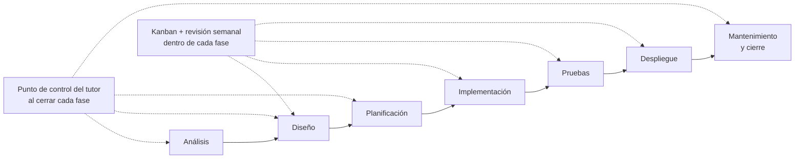
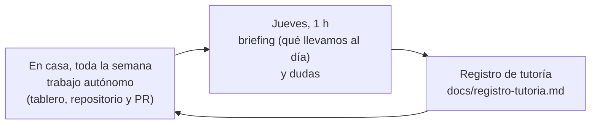

# Metodología del proyecto

Esta es la **metodología de referencia** de tu proyecto y de **toda la documentación** que entregas. Es **híbrida**: las **fases del ciclo de vida** ordenan el proyecto y los entregables, y dentro de cada fase trabajas de forma **iterativa con Kanban** y revisión semanal.

> [!NOTE]
> Es la metodología propuesta para el curso 2026-27 y puede ajustarse tras la primera evaluación. Las fechas concretas están en [fases-del-proyecto.md](fases-del-proyecto.md).

---

## 1. Por qué híbrida

- **Fases del ciclo de vida** (análisis, diseño, planificación, implementación, pruebas, despliegue y mantenimiento): marcan el orden, los **entregables** (H1, H2, H3) y los **puntos de control del tutor**. Encajan con lo que piden los criterios de evaluación: presupuesto, cronograma, riesgos, indicadores y pliego de condiciones.
- **Kanban + ritmo semanal**: dentro de cada fase trabajas en tareas pequeñas, visibles y con límite de trabajo en curso. Así el cambio se gestiona sin romper el plan, como pasa en un proyecto real.
- **Elementos de Scrum adaptados a un proyecto individual**: *backlog*, historias de usuario, «definición de hecho» y una revisión breve cada semana. **No** se usan sprints formales ni roles (no hay *product owner* ni *scrum master*).



## 2. Marco de referencia de la documentación

Como marco general de procesos de ciclo de vida del software se toma **ISO/IEC/IEEE 12207** (*Systems and software engineering — Software life cycle processes*). Se usa **solo como referencia**: no se exige cumplimiento formal ni certificación. La correspondencia con las fases del curso es **didáctica** (criterio del profesor).

La documentación se redacta con **plantillas propias en Markdown**, con diagramas en **Mermaid** (y el modelo **C4** para la arquitectura). No se usan capturas de diagramas.

## 3. Fases, entregables y evidencias

| Fase | Entregable / documento | Hito | RA | Punto de control del tutor |
|---|---|---|---|---|
| Análisis | `docs/00-documentoInicio.md`, `docs/01-analisis.md` (sector, necesidad, requisitos, obligaciones, ayudas, guion de trabajo) y `docs/01b-sota.md` en versión breve | **H1** | RA1 | Aprobación de la propuesta |
| Diseño | `docs/02-diseno.md`: viabilidad, fases, objetivos y alcance, recursos, presupuesto, arquitectura (C4), datos, interfaz, calidad | Avance, luego **H2** | RA2 | Revisión del diseño antes de implementar |
| Planificación | `docs/03-planificacion.md`: cronograma, recursos, permisos y protección de datos, riesgos, valoración económica, documentación de implementación | **H2** | RA3 | Revisión del plan |
| Implementación | Código en el repositorio, con ramas, commits y README | Seguimiento continuo | — | Revisión semanal del repositorio |
| Pruebas | Plan y resultados de pruebas; verificación de los indicadores de calidad | **H3** | RA4 | Revisión de resultados |
| Despliegue | Puesta en marcha en un entorno real o simulado y guía de despliegue | Seguimiento continuo | — | Revisión de la puesta en marcha |
| Mantenimiento y cierre | `docs/04-seguimiento-y-control.md`: indicadores, incidencias, cambios, evaluación por usuarios; `docs/memoria.md` | **H3** y defensa | RA4 | Revisión de incidencias y cambios |

La implementación, las pruebas y el despliegue se **controlan** en el 0616 pero se **evalúan** en los módulos de 2.º que los trabajan.

## 4. Cómo se trabaja en GitHub

### 4.1. Tablero Kanban (GitHub Projects)

Columnas: **Backlog → Por hacer → En curso → En revisión → Hecho**.

- **Límite de trabajo en curso: 2 tareas**. Si hay más, se termina antes de empezar.
- Cada tarea es un **Issue** con: qué se hace, por qué y **definición de hecho** (cuándo se considera terminada).
- Las historias de usuario se escriben así: *«Como [persona usuaria], quiero [algo] para [beneficio]»*.
- Etiquetas sugeridas: `fase:analisis`, `fase:diseno`, `fase:planificacion`, `fase:implementacion`, `fase:pruebas`, `fase:despliegue`, `fase:mantenimiento`, y `tipo:incidencia`, `tipo:cambio` o `tipo:correccion-tutor`.
- **Estimación (desde H2):** cada tarea lleva una etiqueta de horas estimadas (`est:1h`, `est:2h`, `est:4h`, `est:8h`); si una tarea pasa de 8 h, se divide. Al cerrarla puedes anotar las horas reales. Estimar bien es parte de lo que se evalúa en la planificación (CE 3f) y sirve para saber si tu plan se cumple.
- Etiquetas de revisión: `necesita-tutor` (el cambio requiere revisión **antes** de integrarlo, ver § 4.2 bis) y, en las correcciones del tutor, `gravedad:bloqueante` o `gravedad:mejora`.

### 4.2. Ramas, commits y PR

- `main` contiene **solo la versión que se puede entregar**. No se hace commit directo en `main`.
- Ramas `<tipo>/<kebab-case>`: `feat/login`, `fix/error-pago`, `docs/plan-de-riesgos`. Las **correcciones que pide el tutor** usan el prefijo `tutor/` y el número del Issue: `tutor/12-validar-formulario`.
- **Conventional Commits**: `feat:`, `fix:`, `docs:`, `chore:`, `test:`, `refactor:`. Las correcciones del tutor llevan el ámbito `tutor`: `fix(tutor): valida el formulario vacío`.
- **No reescribas la historia**: sin `force push` ni borrar commits. El seguimiento semanal se hace sobre tu historial y tiene que contar cómo has ido avanzando. Al integrar un PR, usa **«Create a merge commit»** (no «Squash») para conservar tus commits.
- Se integra en `main` con **Pull Request**, con esta lista de comprobación: ✔ definición de hecho cumplida · ✔ documentación actualizada · ✔ sin claves ni datos personales · ✔ pruebas pasan.
- En cada hito se crea una **etiqueta** (`tag`) en `main`: `h1`, `h2`, `h3`. Es la versión que se evalúa.

### 4.2 bis. Quién revisa qué y cuándo (tutoría por Pull Request)

El seguimiento es **semanal, telemático y paso a paso**: el tutor revisa la evolución de tu repositorio cada semana, y el Pull Request es el sitio donde se revisa y se comenta (cómo pedir ayuda: [contacto y ayuda](guiaProyecto/contacto-y-ayuda.md)). Como un ritmo semanal no admite esperar una aprobación para cada cambio, hay **dos vías**:

| Vía | Qué cambios | Cuándo revisa el tutor |
|---|---|---|
| **A · Revisión previa** (`necesita-tutor`) | Hitos y preparación de un hito, seguridad, credenciales, datos personales, despliegue, configuración del repositorio y tu primer PR | **Antes** de integrar. No integras hasta que el tutor lo apruebe. Respuesta en un máximo de **48 horas lectivas** |
| **B · Revisión posterior** | El resto de los cambios | **Después**, en la revisión semanal. Integras tú cuando se cumpla la lista de comprobación y las pruebas pasen |

- Cada alumno/a es **propietario de su repositorio** (el proyecto es suyo) y **invita al tutor como colaborador** con permiso de escritura.
- Todo cambio llega a `main` mediante **Pull Request**; nada se hace directamente en `main`.
- Ante la duda, **marca `necesita-tutor`**. Es mejor preguntar antes que corregir después.
- **Congelación de hito:** durante los **7 días** anteriores a la entrega de un hito, todos los PR siguen la vía A, y no puede quedar ninguna corrección `gravedad:bloqueante` abierta cuando se pone la etiqueta del hito (`h1`, `h2`, `h3`).

**Correcciones que pide el tutor.** En la revisión semanal, si un cambio ya integrado necesita corrección:

1. El tutor abre un **Issue `tipo:correccion-tutor`** (plantilla `correccion-tutor.md`) con qué corregir, dónde, por qué, cómo se comprobará y la gravedad.
2. Tú creas una rama `tutor/<n>-descripcion` y abres un PR con `Closes #n`, commits `fix(tutor): ...` y una nota sobre cómo has comprobado el arreglo.
3. En la siguiente revisión, el tutor **comprueba la corrección** y cierra el Issue.

Plazos: una corrección **`gravedad:bloqueante`** se resuelve antes de seguir con lo que depende de ella y, como máximo, antes de la siguiente revisión semanal; una `gravedad:mejora`, antes del siguiente hito. Las correcciones del tutor tienen **prioridad** sobre una tarea nueva y no cuentan para el límite de 2 tareas en curso.

- La revisión queda en el historial (Issue, PR y comentarios): es la **evidencia de la tutoría continua** y de la autoría, y permite ver cuántas correcciones se piden y cómo se resuelven.
- **Protección de `main` y `CODEOWNERS`:** el fichero `CODEOWNERS` pide la revisión del tutor **solo en las rutas sensibles** (configuración, despliegue y lo que añadas tú, como la autenticación). La revisión obligatoria solo se puede imponer en repositorios **públicos** o con plan **GitHub Pro**. Si el repositorio es privado y gratuito, el flujo es el mismo pero se basa en la norma. El propietario del repositorio podría saltarse la regla, pero el historial lo deja a la vista y cuenta para la evaluación.
- **Privacidad:** usa el correo `noreply` de GitHub en los commits y no publiques datos personales ni confidenciales de empresas.

### 4.3. Gestión del cambio y de las incidencias

- Un **cambio** (en requisitos, alcance o plan) se abre como Issue `tipo:cambio`, con motivo, impacto (tiempo, coste, calidad) y decisión. Se resuelve antes de modificar el plan.
- Una **incidencia** se abre como Issue `tipo:incidencia`, con descripción, causa y solución. Ambos registros alimentan `docs/04-seguimiento-y-control.md` (RA4).
- Las decisiones de arquitectura importantes se anotan en `docs/decisiones/` (una por fichero: contexto, decisión y consecuencias).

## 5. Ritmo semanal



La **clase del jueves (1 h) es de briefing y dudas**: qué llevamos al día, bloqueos y siguiente paso. El trabajo, incluida la implementación, **se hace en casa**; la ayuda entre sesiones se coordina **por correo** y la revisión se hace en el **Pull Request** (propuesta, a confirmar). El canal y el protocolo están en [contacto y ayuda](guiaProyecto/contacto-y-ayuda.md).

Cada semana: (1) actualizas el tablero y el repositorio, (2) dejas una entrada en `docs/registro-tutoria.md` con **horas dedicadas, acuerdos, avances, bloqueos y siguiente paso**, y (3) el profesor lo revisa y comenta, también en las semanas sin sesión y durante la formación en empresa.

### 5.1. Seguimiento del cumplimiento de los plazos y de la carga de trabajo

Durante el curso llevo la **evolución del cumplimiento de los plazos de creación del proyecto**: si el trabajo planificado (el del módulo y el tuyo) se va cumpliendo semana a semana y hito a hito. Sirve para **ayudarte a tiempo** y para comprobar si la planificación del módulo es realista. **No es una nota** ni se compara a unas personas con otras: cada proyecto se mide contra su propio plan.

| Qué miro | Detalle |
|---|---|
| Tu repositorio | Actividad (commits, Pull Requests, Issues), estado del tablero y correcciones abiertas |
| Tu registro de tutoría | Lo que anotas cada semana, incluidas las horas que **tú declaras** |
| Tus entregas | Fecha y estado frente a los hitos H1, H2 y H3 |

- **Qué no miro:** tiempo de conexión, tu equipo, tus mensajes privados ni «detectores de IA». Las horas las declaras tú.
- **Quién lo ve:** solo el tutor. Lo anota con un código, no con tu nombre.
- **Para qué se usa:** para hablar contigo si algo se retrasa o el plan no cuadra. Una señal de alerta lleva a una conversación, nunca a una decisión automática. La nota sale de los criterios de evaluación y del criterio del profesor.
- **Cuánto tiempo se conserva:** hasta el final del curso; después se borra el detalle individual.
- **Si quieres saber qué he anotado sobre ti,** pídemelo.

## 6. Estructura del repositorio de tu proyecto

```text
tu-proyecto/
├── README.md                  ← qué es, cómo se ejecuta y estado
├── docs/
│   ├── 00-documentoInicio.md  ← qué quieres hacer (se aprueba el 12-nov)
│   ├── 01-analisis.md
│   ├── 02-diseno.md
│   ├── 03-planificacion.md
│   ├── 04-seguimiento-y-control.md
│   ├── memoria.md
│   ├── registro-tutoria.md
│   ├── declaracion-uso-ia.md  ← qué herramienta, qué pediste, qué aceptaste o cambiaste
│   └── decisiones/            ← decisiones de arquitectura
├── src/                       ← código
└── tests/                     ← pruebas
```

## Línea base: la sesión de inicio

La **Fase 0 · Inicio del proyecto** (6-nov, 2 h) deja montado, antes de analizar: el repositorio con esta estructura, el `.gitignore`, el acceso del tutor, el tablero Kanban con su primer Issue, el primer Pull Request integrado en `main` y la primera entrada del registro de tutoría. Se detalla en [fases-del-proyecto.md](fases-del-proyecto.md).

## 7. Uso de IA

Se permite y **se declara** en `docs/declaracion-uso-ia.md`. La IA no califica. La autoría se comprueba en la **defensa oral**. Nunca introduzcas claves ni datos personales en una herramienta de IA.

## 8. Qué NO es esta metodología

- No es Scrum completo: no hay sprints formales, roles ni ceremonias.
- No exige documentación pesada ni un estándar con cumplimiento formal.
- No sustituye a lo que pida la rúbrica de cada entregable.
