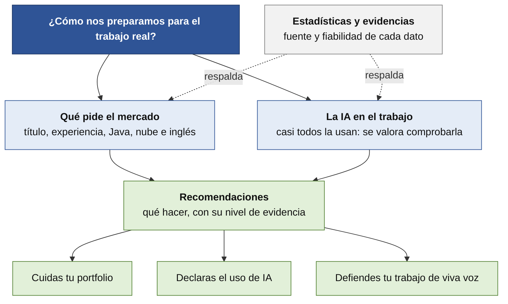

# Realidad laboral

Qué pide el mercado laboral a un desarrollador, qué dicen los datos sobre los titulados de DAW y cómo entra la inteligencia artificial en el trabajo. **Con evidencias**, para que decidas con información y no con rumores.

> [!NOTE]
> **Borrador para revisar.** Datos de noviembre de 2026. Mezclamos estadísticas oficiales, informes de empresas del sector, encuestas y ofertas reales. **Ninguna fuente es perfecta**: en cada documento te decimos **cuánto fiarte** y **qué no demuestra**.

## Por dónde empezar

| Si quieres saber… | Lee |
|---|---|
| **Qué piden las empresas** y cómo se entra | [Qué pide el mercado laboral](mercado-laboral-2026.md) |
| **De dónde sale cada dato**, con fuente, fiabilidad y glosario | [Estadísticas y evidencias](estadisticas-y-evidencias.md) |
| **Cómo entra la IA en el trabajo** del desarrollador | [La IA en el trabajo del desarrollador](ia-en-el-mercado.md) |
| **Cómo afecta la IA a lo que aprendes** | [IA y aprendizaje](ia-y-aprendizaje.md) |
| **Qué hacer para mejorar tus opciones de ser contratado** | [Recomendaciones](recomendaciones.md) |
| **Un resumen de una página** para imprimir | [Póster: 8 claves](poster-8-claves.md) ([PDF](poster/poster-8-claves.pdf)) |
| **Qué más puedes hacer** (opcional) | [Formación complementaria](../formacionComplementaria/README.md) |

## Siete ideas que salen de los datos

1. **Tu título se pide:** el 74-78 % de las vacantes de desarrollo de InfoJobs piden FP.
2. **Las ofertas piden experiencia:** la mayoría, de 1 a 4 años. **Entrar es la parte difícil.**
3. **El empleo del título es estable:** en Informática, el 79,5 % de los afiliados tiene contrato indefinido el primer año.
4. **Se repiten Java, Python, JavaScript/TypeScript y nube.**
5. **Piden más que código:** resolver problemas, inglés, equipo y visión de negocio.
6. **La IA se usa en casi todas partes, y lo que se valora es comprobar lo que produce.**
7. **Hay menos plazas de entrada y más competencia.** Las fuentes coinciden; **no prueban que la IA sea la causa**.

## Cómo encaja con tu proyecto

La metodología del proyecto intenta parecerse a cómo se trabaja en una empresa: **fases, Kanban, revisión semanal, Git y pull requests, y una IA permitida pero declarada, con defensa oral**. Estos documentos sirven para comprobar si esa forma de trabajar encaja con lo que se pide fuera del aula. Mira la [metodología, apartado «Uso de IA»](../metodologia.md).

| Qué pide el curso | Qué dicen los datos |
|---|---|
| **Un proyecto real** y formación en empresa | Es lo que los seniors ponen primero: proyectos reales (70 %) y prácticas (56 %) |
| **Git y pull requests** desde el primer día | Git y GitHub aparecen con frecuencia en las ofertas y son el flujo sobre el que trabajan también los asistentes de IA |
| **Declarar el uso de IA** | Casi todos la usan; lo que se valora es comprobar lo que produce |
| **Defensa oral** | Los seniors critican la dependencia excesiva de la IA (64 %) y la depuración débil (50 %): defender tu código es el ensayo de una entrevista técnica |

## Lo que no sabemos todavía

- **Cuántas vacantes de desarrollo hay en Asturias** y cuántas son para quien empieza. La mejor fuente son **las empresas de tus prácticas**.
- **Cuántos titulados de tu ciclo trabajan de desarrollo** al cabo de un año.
- **Si la bajada de plazas de entrada es temporal o estructural**, y cuánto se debe a la IA.
