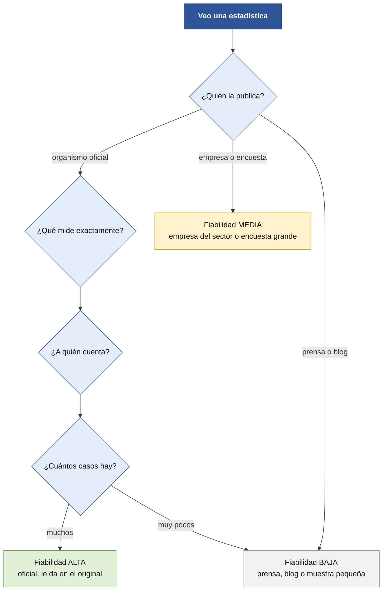
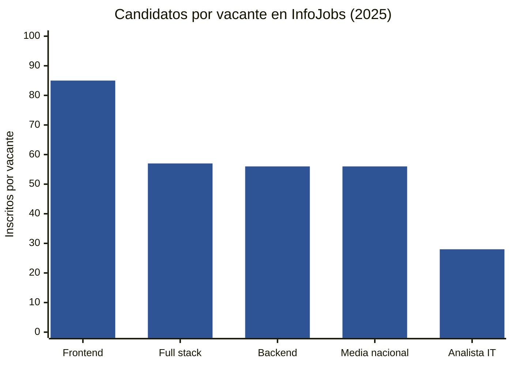
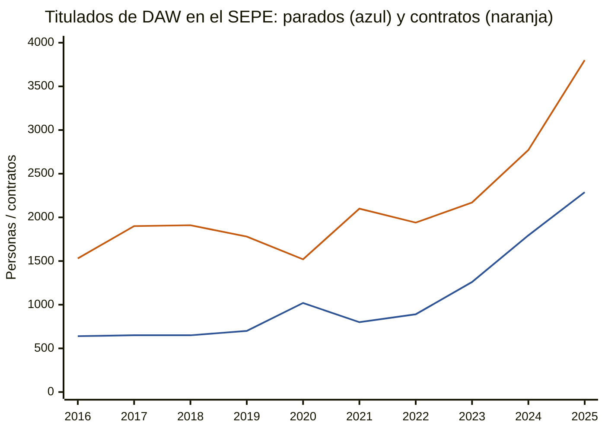

# Estadísticas y evidencias

El «libro de datos» que respalda [qué pide el mercado laboral](mercado-laboral-2026.md). Cada dato indica **de dónde sale, qué mide y cuánto fiarse**.

> [!NOTE]
> **Borrador para revisar.** Datos de noviembre de 2026. Cuando una cifra es un **cálculo nuestro**, lo decimos. Cuando algo **no hemos podido comprobar**, también.

## Cómo leer una estadística (cinco reglas)

1. **Mira quién la publica.** Un organismo oficial (INE, Ministerio, SEPE) no es lo mismo que una empresa que vende empleo o formación.
2. **Mira qué mide.** *Vacantes publicadas* no es *puestos de trabajo*; *afiliación* no es *salario*; *salario ofertado* no es *salario cobrado*.
3. **Mira a quién cuenta.** El SEPE solo cuenta a quien se inscribe como demandante. InfoJobs solo cuenta lo que se publica en InfoJobs.
4. **Mira el tamaño.** 77 personas son una muestra pequeña: un cambio de pocas personas altera mucho los porcentajes.
5. **Correlación no es causa.** Que dos cosas ocurran a la vez no demuestra que una cause la otra.

## Fiabilidad

| Nivel | Qué significa |
|---|---|
| **Alta** | Estadística oficial o informe con metodología publicada, **leído en el original** |
| **Media** | Informe de una empresa del sector o encuesta grande, con **sesgos conocidos** |
| **Baja** | Prensa, blog o resumen de segunda mano; o **muestra pequeña** |

**Un camino rápido para valorar un dato:**

## A. Qué piden las vacantes

*Fuente:* informe **InfoJobs-Esade, «Estado del mercado laboral en España 2025»** (marzo de 2026). Datos de vacantes publicadas en InfoJobs durante 2025. **Fiabilidad: alta** para esa plataforma (no es todo el mercado). Versión digital: mercado-laboral.infojobs.net.

| Puesto | Vacantes | Indefinido | Piden FP | Salario ofertado | Inscritos por vacante | Experiencia (dos franjas principales) |
|---|---|---|---|---|---|---|
| Desarrollador/a backend | 6.482 | 94 % | 76 % | 37.870 € | 56 | 48 % 3-4 años · 30 % 1-2 años |
| Frontend engineer | 4.997 | 87 % | 78 % | 36.098 € | 85 | 46 % · 33 % |
| Full stack engineer | 5.033 | 84 % | 74 % | 38.493 € | 57 | 45 % · 28 % |
| Analista IT | 6.523 | 92 % | 74 % | 38.164 € | 28 | 52 % · 31 % |

- **Teletrabajo:** lo ofrecen el **90 %** de las vacantes de backend, el **89 %** de analista IT y el **79 %** de frontend.
- **Sector Informática y telecomunicaciones:** **98.128** vacantes en 2024 → **76.858** en 2025 (**−21,7 %**, cálculo nuestro); inscritos por vacante **39 → 51**. Salario ofertado medio del sector: **35.031 €** (+2 %).
- **Si piden FP, el salario ofertado en IT es de 33.684 €**; si piden universidad, **41.827 €**.
- Las vacantes que piden FP son **las que más candidatos reciben** (74 inscritos por vacante de media).
- **Asturias (todos los sectores):** 64.161 vacantes (+6 %), **57** inscritos por vacante (media nacional, 56) y salario ofertado medio de **27.619 €**.

**Competencia por vacante:**

**Límites:** el informe da dos recuentos distintos para algunos puestos (por ejemplo, backend: 6.184 y 6.482) según la tabla; usamos la ficha del puesto. Las vacantes de IT de InfoJobs **no son todo el mercado**: Adecco, con otro método, habla de un **aumento del 1,8 %** de las ofertas tecnológicas en 2025 y **+4,5 %** de afiliación en el sector TIC. **Miden cosas distintas.**

## B. Tecnologías

| Dato | Cifra | Fuente | Fiabilidad |
|---|---|---|---|
| Ofertas digitales analizadas (2.º trimestre de 2025) | 57.670; **desarrollador de software**, el perfil más pedido (**9.487**) | Fundación Telefónica, Mapa del Empleo (ofertas de InfoJobs, Tecnoempleo, Buscojobs y ticjob) | Media |
| Competencias más pedidas | **Nube 7.020 · Java 6.320 · JavaScript 3.975** | Ídem | Media |
| Ofertas de informática en Tecnoempleo (nov. 2026) | **2.177**; **Java 1.347 · Python 1.190** | Tecnoempleo, informe mensual | Media |
| Junior mejor pagados en software | **Frontend avanzado** y **backend en Python** | Adecco, guía salarial TIC 2026 (nota de prensa) | Media |

## C. Los titulados de DAW

### C.1 Ministerio de Educación y FP (*Estadística de inserción laboral 2025*)

**Fiabilidad: alta.** Cohorte de graduados **2020-2021**. Mide la **afiliación a la Seguridad Social**. «Primer año» = marzo siguiente a la titulación (~9 meses). **Quien sigue estudiando cuenta como no afiliado.** Excluye a quien trabaja fuera de España.

| Ciclo | Afiliación media 1.er año | 3.er año |
|---|---|---|
| **DAW** | **70,4 %** | **78,0 %** |
| DAM | 68,8 % | 78,6 % |
| Familia Informática y Comunicaciones | 65,8 % | 76,8 % |
| Total Grado Superior | 51,1 % | 63,5 % |
| Grado Superior **dual** | 63,2 % | 72,1 % |

**Afiliación media, primer año y tercero** (primera barra: primer año; segunda: tercer año):

```mermaid
%%{init: {'themeVariables': {'xyChart': {'plotColorPalette': '#2F5496, #C55A11'}}}}%%
xychart-beta
    title "Afiliación media (%) de los graduados de FP de Grado Superior"
    x-axis ["DAW", "DAM", "Informática (familia)", "Total Grado Superior"]
    y-axis "Afiliación media (%)" 0 --> 100
    bar [70.4, 68.8, 65.8, 51.1]
    bar [78.0, 78.6, 76.8, 63.5]
```

**Calidad del empleo, Informática y Comunicaciones (Grado Superior):**

| Indicador | 1.er año | 2.º año | 3.er año |
|---|---|---|---|
| Afiliados por cuenta ajena con **contrato indefinido** | **79,5 %** | 93,0 % | **95,6 %** |
| Total Grado Superior | 56,3 % | 78,8 % | 82,4 % |
| Afiliados **por cuenta propia** | 1,5 % | 1,8 % | 2,2 % |

- En el 2.º año, el **56,3 %** de los afiliados de Informática está en los **grupos de cotización más altos** (técnicos superiores), frente al 21,1 % del total.
- El **38,7 %** trabaja en empresas de **250 o más empleados**.
- **Asturias (Grado Superior, todas las familias, cohorte 2021-2022):** afiliación del 52,6 % el primer año (total 54,1 %). **No hay desglose de Informática para Asturias** en el informe.

### C.2 SEPE: ficha del título de DAW (2025)

**Fiabilidad: alta**, con las limitaciones de la regla 3: **solo cuenta a quien se inscribe como demandante** y **cuenta contratos, no personas**.

| Dato | Cifra |
|---|---|
| Demandantes registrados / parados | 3.346 / 2.288 (+27,5 % de parados en el año) |
| Parados que buscan su primer empleo | 452 (≈ 20 %) |
| Contratos / personas | **3.800 / 2.777** |
| Indefinidos / temporales | 1.767 (46,5 %) / 2.033 |
| Jornada completa / parcial | 2.550 / 958 |
| Contratos por edad | 18-24: 1.303 · 25-29: 1.024 · 30-39: 1.053 |

**Ocupaciones con más contratos:**

| Ocupación | Contratos | % |
|---|---|---|
| Programadores informáticos | 434 | 11,4 |
| Analistas, programadores y diseñadores web y multimedia | 223 | 5,9 |
| Peones de industrias manufactureras | 199 | 5,2 |
| Técnicos en operaciones de sistemas informáticos | 198 | 5,2 |
| Camareros asalariados | 169 | 4,5 |

**Programación + análisis web = 657 contratos (17,3 %, cálculo nuestro).** La **actividad económica** «programación, consultoría y otras actividades informáticas» concentra el **20,7 %**.

**Evolución (lectura de los gráficos oficiales; el valor de 2025 es exacto, los anteriores aproximados):**

| Año | Parados (31-dic) | Contratos |
|---|---|---|
| 2016 | ~640 | ~1.530 |
| 2020 | ~1.020 | ~1.520 |
| 2023 | ~1.260 | ~2.170 |
| 2025 | **2.288** | **3.800** |

**Evolución de parados y contratos** (valores aproximados leídos de los gráficos oficiales; exactos en 2024 y 2025):

**Por comunidades** (parados · contratos): Asturias **77 · 89**; Cantabria 24 · 38; Castilla y León 95 · 167; Galicia 115 · 296; País Vasco 122 · 333; Cataluña 117 · 150; Madrid 379 · 780.

## D. Entrada y empleo junior

| Fuente | Dato | Fiabilidad |
|---|---|---|
| **InfoJobs-Esade** | Los puestos junior de IT «han retrocedido con el auge de los LLM»; aumenta la competencia | Media (interpretación de los autores, sin análisis causal propio) |
| **Adecco** | «Disminuye la demanda de perfiles generalistas y de entrada» | Media |
| **Indeed, *Tech Talent Report 2025*** (EE. UU.) | Ofertas tecnológicas **−36 %** frente a 2020; senior **−19 %**, junior y estándar **−34 %** (julio de 2025) | Media-alta; solo EE. UU. |
| **Hosseini y Lichtinger (Harvard)**, EE. UU. | Empleo junior en empresas que adoptan IA generativa: **−7,7 %** a seis trimestres frente a las que no; por **contratar menos**, no por despedir. «Evidencia temprana» | Alta como estudio; EE. UU.; causalidad abierta |
| **Mismo estudio, citando a otros** | Hay trabajos que hallan que la IA **complementa al menos experimentado** (más productividad en desarrolladores novatos) y otros que **no ven diferencias** | Media |
| **DigitalES** (vía prensa) | Ofertas para programadores junior **−33 %** y senior **+13 %** en el primer trimestre de 2026 | **Baja**: no hemos leído el informe ni su método |
| **Tecnoempleo** | 86 resultados para «junior» en toda España; unas **5** ofertas vigentes de desarrollo web o backend | Media; no es todo el mercado |

## E. Salarios

| Fuente | Dato | Qué es | Fiabilidad |
|---|---|---|---|
| **Manfred, guía 2026** | **Menos de 2 años:** backend, frontend y fullstack **20.000-30.000 €**; 2-5 años: 31.000-40.000 € | Datos de más de 120.000 profesionales de su comunidad; mezcla con datos de otros países | Media |
| **Manfred** | Contratar presencialmente sube el salario **al menos un 20 %** frente al remoto | Ídem | Media |
| **Ofertas junior de Tecnoempleo** | **18.000-27.000 €** (C#/.NET en Pontevedra) y **21.000-27.000 €** (automatización con IA) | Salario **anunciado** | Media-baja (pocas ofertas) |
| **InfoJobs-Esade** | **36.000-38.500 €** de media ofertada en estos puestos | **Todos los niveles** | Alta para la plataforma |
| **Adecco** | Senior Tech Lead/arquitecto: **75.000-100.000 €**; consultor de IA junior en CRM, más de **50.000 €** | Rangos de la consultora | Media |

**Lo que no hay:** una cifra **oficial** de salario junior. El Ministerio publica **bases de cotización** de todo el Grado Superior (19.625 € el primer año), no de Informática.

## F. Empresas e IA (INE)

*Fuente:* **INE**, encuesta sobre el uso de TIC en las empresas, primer trimestre de 2026. **Fiabilidad: alta.** Empresas de **10 o más empleados**, por **sede social** (no por dónde trabaja el desarrollador).

| Dato | España | **Asturias** | Madrid | Cataluña | País Vasco |
|---|---|---|---|---|---|
| Emplean **IA** | 33,6 % | **30,7 %** | 40,1 % | 40,5 % | 28,7 % |
| Pagan **nube** | 39,4 % | **25,9 %** | 48,0 % | 48,7 % | 38,7 % |
| **Analítica** de datos | 34,3 % | **26,6 %** | 37,9 % | 40,0 % | 37,1 % |
| Tienen **web** | 82,9 % | **90,6 %** | 85,4 % | 88,2 % | 83,7 % |
| Permiten **teletrabajo** | 37,7 % | 34,2 % | 52,5 % | 45,0 % | 38,4 % |

**Asturias frente a España** (primera barra: España; segunda: Asturias):

```mermaid
%%{init: {'themeVariables': {'xyChart': {'plotColorPalette': '#2F5496, #C55A11'}}}}%%
xychart-beta
    title "Empresas de 10 o más empleados (%): España (azul) y Asturias (naranja), 2026"
    x-axis ["Usan IA", "Pagan nube", "Analítica de datos", "Tienen web"]
    y-axis "% de empresas" 0 --> 100
    bar [33.6, 39.4, 34.3, 82.9]
    bar [30.7, 25.9, 26.6, 90.6]
```

- **Solo el 15,4 %** de las empresas tiene **especialistas TIC propios**.
- Empresas de **menos de 10 empleados** con Internet: el 21,4 % usa IA.

## G. Cómo se usa la IA en el desarrollo

| Fuente | Dato | Fiabilidad |
|---|---|---|
| **Stack Overflow 2025** | **84 %** usa o planea usar IA; **51 %** de los profesionales, a diario; **55,5 %** de quienes llevan 1-5 años; **39,5 %** de quienes aprenden a programar | Alta (encuesta grande) |
| **Stack Overflow 2025** | **46 %** desconfía de su exactitud y **33 %** confía; **66 %** se queja de soluciones «casi correctas»; **45 %** dice que depurar código de IA lleva más tiempo | Alta |
| **DORA 2025 (Google)** | **90 %** de adopción; mediana de **2 horas al día**; más del 80 % dice que mejoró su productividad; la IA «amplifica» lo bueno y lo malo de cada equipo | Media-alta (encuesta de ~5.000 profesionales) |
| **BairesDev, *Dev Barometer*** (1.569 desarrolladores) | Los seniors critican a los junior: **dependencia excesiva de la IA (64 %)**, **depuración débil (50 %)**, dificultad para descomponer problemas (49 %). Solo el **16 %** de los junior entiende del todo el código con IA que entrega, según los seniors | Media (la hace una empresa que vende talento) |
| **METR, 2025** | 16 desarrolladores veteranos tardaron un **19 % más** con IA y creían ir un **20 % más rápido** | Media (muestra pequeña; su actualización de 2026 es discutida) |

## H. Ofertas que hemos leído (muestra)

Leímos listados de LinkedIn de **siete comunidades españolas** (Asturias, Castilla y León, Cantabria, Galicia, País Vasco, Madrid y Cataluña), de **cinco ciudades europeas** y de **EE. UU.** (las 60 primeras ofertas visibles de cada una).

| Zona | «Junior» o equivalente | «Senior» en el título | Nota |
|---|---|---|---|
| **Asturias** (17 ofertas) | 0 (un «Associate Software Engineer» en Langreo) | 2 | Fullstack Java en Gijón y Oviedo, .NET, puestos de IA |
| Madrid (60) | 1 | ~11 | Java + Angular domina |
| Barcelona (60) | 1 | **30** | Mucho producto y empresas internacionales; inglés alto |
| Berlín (60) | 2 | ~35 | |
| París (60) | 0 | ~30 (incluye «confirmé») | |
| EE. UU. | ~12 de nivel I o «new grad» | ~6 | **Niveles numerados** (I, II, III) en vez de junior/senior |

**Límites:** es una **muestra no aleatoria** (LinkedIn muestra las 60 primeras). El **nivel** solo se ve cuando el **título** lo dice: muchas ofertas no lo indican, así que los recuentos son **mínimos**. **No leímos las descripciones completas**, salvo la de Indra.

## I. Qué hay que tener en cuenta de lo que NO sabemos

- **No hay cifra oficial de salario junior**, ni de cuántas vacantes de desarrollo hay **en Asturias**.
- **No hay datos de cuántos titulados de DAW salen cada año** para poder interpretar el SEPE.
- Casi todos los estudios sobre **IA y empleo junior** son de **EE. UU.**
- Algunas cifras vienen de **empresas que venden empleo o formación**: son útiles, pero no neutrales.

## Glosario

| Término | Qué significa |
|---|---|
| **Vacante** | Una oferta de empleo publicada |
| **Inscritos por vacante** | Cuántas personas se apuntan a cada oferta (una medida de **competencia**) |
| **Afiliación** | Estar **dado de alta en la Seguridad Social** (trabajando) |
| **Afiliación media** | El promedio diario de afiliados durante el periodo |
| **Contrato indefinido** | Sin fecha de fin |
| **Cuenta ajena / cuenta propia** | Empleado por otra persona o empresa / autónomo |
| **Demandante de empleo** | Persona inscrita como en búsqueda de empleo en el servicio público |
| **Salario bruto** | Antes de impuestos y cotizaciones |
| **Salario ofertado** | El que **anuncia** la empresa en la oferta |
| **Índice** (por ejemplo, el de Indeed) | Un valor de referencia (100 = febrero de 2020) para ver si algo sube o baja |
| **LLM** | Modelo de lenguaje grande, el tipo de IA detrás de los asistentes de código |

## Fuentes consultadas

- **InfoJobs-Esade**, *Estado del mercado laboral en España 2025* (marzo de 2026).
- **Ministerio de Educación, FP y Deportes**, *Estadística de inserción laboral de las personas graduadas en FP 2025*.
- **SEPE**, ficha del título de Técnico Superior en DAW, 2025.
- **INE**, *Encuesta sobre el uso de TIC y del comercio electrónico en las empresas*, primer trimestre de 2026.
- **IDEPA**, empleo del sector TIC en Asturias (con datos del INE).
- **Adecco**, notas de prensa de la guía salarial TIC 2026 y de la guía Microsoft EMEA 2026.
- **Fundación Telefónica**, Mapa del Empleo (nota del 2.º trimestre de 2025).
- **Tecnoempleo**, informe de empleo informático de noviembre de 2026.
- **Manfred**, guía salarial tech 2026.
- **Indeed**, *Tech Talent Report 2025* y análisis de Indeed Hiring Lab (julio de 2026).
- **Hosseini y Lichtinger**, *Generative AI as Seniority-Biased Technological Change* (Harvard, octubre de 2025).
- **Stack Overflow**, *Developer Survey 2025*; **DORA 2025**; **BairesDev**, *Dev Barometer Q2 2026*; **METR**, estudio de julio de 2025.
