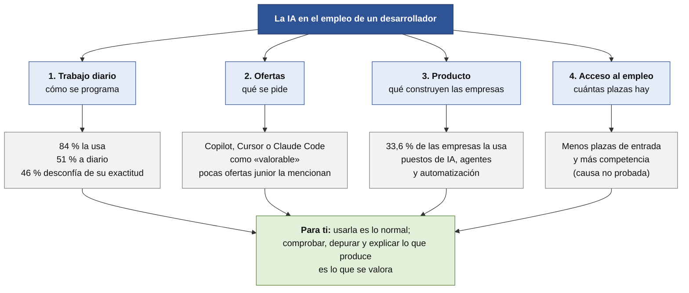
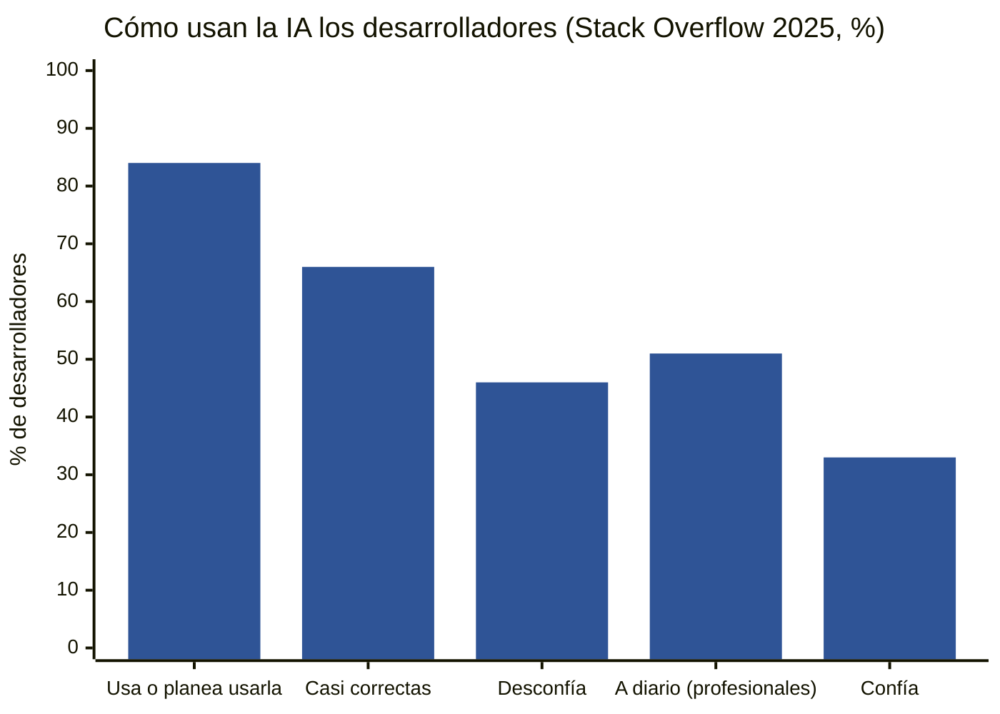
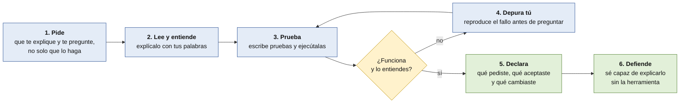

# La IA en el trabajo del desarrollador

Qué papel tiene la inteligencia artificial en el empleo de un desarrollador, y **qué significa para ti**. Este documento trata de **trabajo y mercado**. Para cómo afecta a **lo que aprendes**, mira [IA y aprendizaje](ia-y-aprendizaje.md).

> [!NOTE]
> **Borrador para revisar.** Datos de noviembre de 2026. La IA cambia rápido; varias fuentes son de 2025. Las cifras de uso son sólidas; las de **empleo e impacto** son **más discutidas**, y te lo decimos en cada caso.

## En una página

1. **Casi todo el mundo la usa.** El **84 %** de los desarrolladores la usa o planea usarla y el **51 %** de los profesionales, a diario.
2. **Pero casi nadie se fía del todo.** El **46 %** desconfía de su exactitud (el **33 %** confía) y el **66 %** se queja de soluciones «casi correctas».
3. **Las empresas esperan que la uses como «copiloto».** Adecco: el profesional «**valida y refina** lo que la tecnología genera».
4. **Los seniors critican a los junior que dependen de ella:** dependencia excesiva (**64 %**), depuración débil (**50 %**).
5. **Usar IA no te distingue.** Como casi todos la usan, **lo que cuenta es saber comprobar, depurar y explicar**.
6. **También hay trabajo nuevo con IA:** puestos de IA, agentes, automatización… incluso para perfiles de entrada.
7. **Menos plazas de entrada: la causa no está probada.**

## 1. Dónde entra la IA

## 2. En el trabajo diario

*Fuente:* Stack Overflow, *Developer Survey 2025* (alta fiabilidad, encuesta grande).

| Dato | Cifra |
|---|---|
| Usa o planea usar IA | **84 %** (76 % el año anterior) |
| Profesionales que la usan **a diario** | **51 %** |
| Quienes llevan **1-5 años** (carrera temprana) | **55,5 %** a diario, **el grupo que más** |
| Quienes **aprenden** a programar | 39,5 % a diario |
| **Desconfían** de su exactitud / **confían** | 46 % / 33 % (solo el 3 % «confía mucho») |
| Principal queja | Soluciones **«casi correctas, pero no del todo»**: **66 %** |
| **Depurar** código de IA lleva más tiempo | **45 %** |
| Se sienten **menos seguros** de su capacidad de resolver problemas | **20 %** |

**Cómo se ve en cifras:**

**DORA 2025** (Google, casi 5.000 profesionales): **90 %** de adopción, mediana de **2 horas al día**, más del 80 % cree que mejoró su productividad. La IA actúa como **«espejo y multiplicador»**: mejora a los equipos que ya funcionan y **deja al descubierto** las debilidades de los que no.

**Productividad: sensación frente a medición.** Un estudio de METR (2025) con **16 desarrolladores veteranos** en sus propios proyectos encontró que tardaron un **19 % más** con IA aunque **creían ir un 20 % más rápido**. Es una muestra pequeña, de principios de 2025, y su actualización de 2026 es discutida; **no lo usamos como cifra actual**, sino para recordar que **sentirse rápido no es serlo**.

## 3. En lo que se espera de ti

| Fuente | Qué dice |
|---|---|
| **Adecco** (guía salarial TIC 2026) | «La IA como copiloto, no como sustituto […] **el profesional valida y refina lo que la tecnología genera**.» Y: «Ya no basta con escribir código eficiente» |
| **BairesDev** (1.059 junior y 510 seniors) | **Habilidad más importante para que contraten a un junior:** resolver problemas (~50 %), frente a **dominio de IA y *prompting* (18 %)** y **escribir código desde cero (5 %)** |
| **BairesDev** (los seniors) | **Debilidades de los junior:** dependencia excesiva de la IA sin entender (**64 %**), depuración débil (**50 %**), dificultad para descomponer problemas (**49 %**). Solo el **16 %** de los junior entiende del todo el código con IA que entrega |
| **Los propios junior** | El **85 %** dice que la IA mejoró su comprensión; el **24 %** se siente menos seguro programando sin ella |

**Cómo leerlo:** hay una **brecha entre lo que creen los junior y lo que ven los seniors**. Usar IA es lo normal; **demostrar que entiendes y puedes arreglar lo que ella produce** es lo que se valora. *(La encuesta es de una empresa que vende talento; la muestra es grande, pero no es una fuente neutral.)*

## 4. En las ofertas

- **Muchas ofertas junior de desarrollo no la mencionan.** La oferta completa que leímos (Indra, junior front-end) **no cita la IA**.
- **Aparece como «valorable»** en algunas (GitHub Copilot, Cursor, Claude Code), sobre todo en **senior**, en **empresas de producto** y en **puestos de IA**. Alguna empresa la ofrece **como herramienta del puesto** (suscripción incluida). *(Según listados y resúmenes; no hemos leído las descripciones completas.)*
- **Hay puestos que la nombran en el título**: «Full-Stack AI-Augmented», «Agentic Coding», «AI Finance Agent»… Es un **mercado en crecimiento**: las ofertas que piden competencias de IA subieron un **64 %** en el primer trimestre de 2026 respecto al año anterior (**dato de prensa sobre un informe de DigitalES**, sin método publicado).
- **Más salario por IA, también en entrada:** Adecco cita que un **consultor de IA junior en CRM supera los 50.000 €** (un caso concreto de una plataforma, no la media) y que los junior mejor pagados en software son **frontend avanzado y backend en Python**.

## 5. En lo que construyen las empresas

*Fuente:* INE, primer trimestre de 2026 (empresas de 10 o más empleados). **Alta fiabilidad.**

| | España | **Asturias** |
|---|---|---|
| Empresas que emplean **IA** | **33,6 %** | **30,7 %** |
| Pagan **servicios de nube** | 39,4 % | **25,9 %** |
| Hacen **analítica de datos** | 34,3 % | 26,6 % |
| Tienen **especialistas TIC propios** | **15,4 %** | — |

**Interpretación nuestra:** las empresas están adoptando IA (un año antes, el 21,1 %, según un resumen de la nota del INE de 2025), pero **la mayoría no tiene un equipo de TI propio**: depende de consultoras y proveedores. Quien sepa **integrar IA, nube y datos en aplicaciones web** tiene un hueco, aunque **no sabemos cuántas plazas reales** hay en Asturias.

## 6. En el acceso al empleo

| Fuente | Qué dice |
|---|---|
| **InfoJobs-Esade** | Los puestos junior de IT «han retrocedido con el auge de los LLM», porque sus tareas son «las más fácilmente sustituibles» |
| **Adecco** | «Disminuye la demanda de perfiles generalistas y de entrada» |
| **Harvard** (EE. UU.) | En empresas que adoptan IA generativa, el empleo junior baja un **7,7 %** a seis trimestres frente a las que no, **por contratar menos**. Los autores hablan de «evidencia temprana». Describen la **depuración de código** como una tarea de entrada «rutinaria» muy expuesta a la IA |
| **El mismo estudio, citando a otros** | Algunos trabajos hallan que la IA **ayuda más al menos experimentado**; otros **no ven diferencias** |
| **Indeed** (EE. UU.) | Las ofertas junior bajan más que las senior (**−34 %** frente a **−19 %**) |

> [!WARNING]
> **Esto no demuestra que la IA te quite el trabajo.** Las fuentes coinciden en que **hay menos plazas de entrada**, pero **la causa no está probada** y casi todos los estudios son de EE. UU. Otros factores (el ciclo económico, los despidos de las grandes tecnológicas) también influyen.

**Una lectura útil (nuestra, no un dato):** el estudio de Harvard describe como **expuesto a la IA** justo el tipo de tarea que hace un junior (depurar código). Eso hace que **saber depurar y entender lo que se programa sea más valioso, no menos**.

## 7. Qué significa para ti

**Un ciclo de uso responsable de la IA** (el que defiende tu proyecto: permitida, declarada y defendida):

| Qué | Por qué |
|---|---|
| **Usa la IA, pero declárala.** | En el proyecto se permite y se declara. Es una práctica profesional |
| **Entiende todo lo que aceptas.** | Es lo que los seniors dicen que falla (64 %) |
| **Cuando algo falle, depura tú primero.** | La depuración débil es la segunda crítica (50 %) y la tarea más expuesta |
| **Escribe pruebas.** | Es la forma de comprobar lo que produce la IA |
| **Pídele que te explique y te pregunte, no solo que te lo dé hecho.** | Los estudios de aprendizaje lo respaldan: [IA y aprendizaje](ia-y-aprendizaje.md) |
| **Prepárate para defenderlo.** | La defensa oral es el ensayo de una entrevista técnica |
| **Practica sin asistente de vez en cuando.** | Algunas empresas **prohíben la IA en las entrevistas técnicas** y otras la permiten; no sabemos cuál te tocará (**evidencia débil**, de blogs) |

## Qué no sabemos todavía

- **Cuántas ofertas de Asturias piden IA** de verdad: no leímos las descripciones completas.
- **Si la bajada de plazas de entrada se debe a la IA**, a la economía o a ambas.
- **Qué política de IA tendrá la empresa donde hagas las prácticas.** Pregúntalo.
- **Efecto de las herramientas en junior españoles:** los estudios son de EE. UU. o de muestras pequeñas.

Más contexto: [qué pide el mercado](mercado-laboral-2026.md) · [estadísticas y evidencias](estadisticas-y-evidencias.md).
