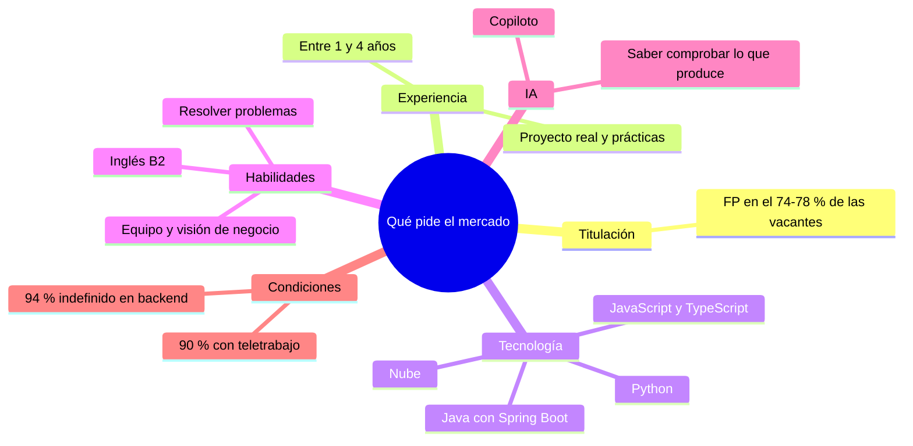
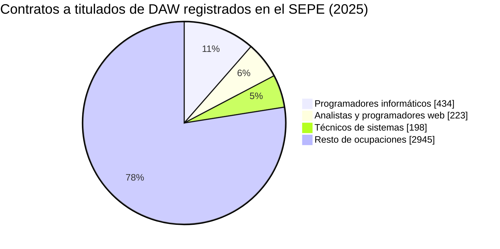
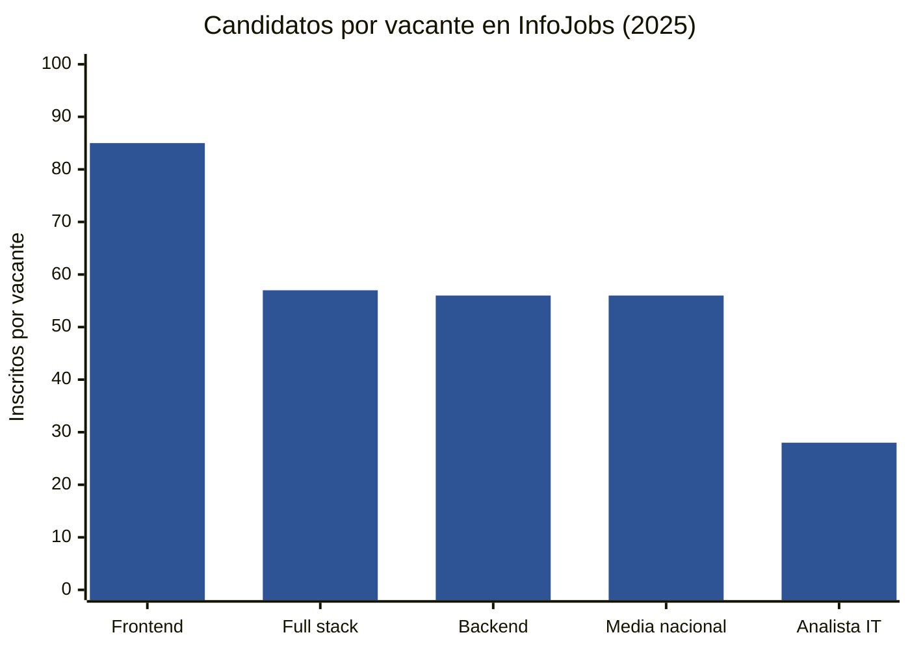
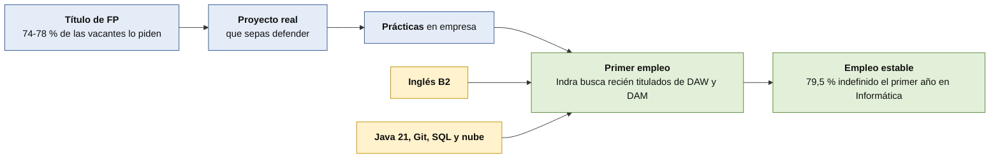

# Qué pide el mercado laboral a un desarrollador DAW

Este documento explica **qué buscan las empresas** cuando contratan a alguien que acaba un ciclo como el tuyo, y **qué dicen los datos** sobre las oportunidades reales. Todo lo que afirmamos tiene una **evidencia** detrás, con su fuente en [estadísticas y evidencias](estadisticas-y-evidencias.md).

> [!NOTE]
> **Borrador para revisar.** Datos de noviembre de 2026. Son estudios, estadísticas oficiales y ofertas reales, pero **ninguno es perfecto**. Al final de cada bloque te decimos **qué no demuestran**. No son una promesa ni una amenaza: son información para decidir mejor.

## En una página

1. **Tu título se pide.** El **74-78 %** de las vacantes de backend, frontend y fullstack de InfoJobs piden **Formación Profesional**.
2. **Los puestos suelen pedir experiencia.** La mayoría de esas vacantes pide **entre 1 y 4 años**. Entrar es la parte difícil.
3. **Una vez dentro, el empleo es estable.** Entre los titulados de Informática, el **79,5 %** de los afiliados tiene contrato indefinido el primer año y el **95,6 %** al tercero.
4. **La tecnología que más se repite:** **Java** (la de tu ciclo), **Python**, **JavaScript/TypeScript** y **nube**.
5. **Piden más que código:** resolver problemas, inglés, trabajar en equipo y entender el negocio.
6. **La IA ya forma parte del trabajo.** Pero lo que se valora es **saber comprobar** lo que produce, no solo usarla.
7. **Hay menos plazas de entrada que antes y más competencia.** Las fuentes coinciden en la dirección; **no prueban que la causa sea la IA**.

**Así se resume lo que piden las ofertas:**

## 1. Qué piden las ofertas

### 1.1 Titulación: la FP cuenta

| Puesto (InfoJobs, 2025) | Vacantes | Piden FP |
|---|---|---|
| Desarrollador/a **backend** | 6.482 | **76 %** |
| **Frontend** engineer | 4.997 | **78 %** |
| **Full stack** engineer | 5.033 | **74 %** |
| Analista IT | 6.523 | 74 % |

*Fuente:* informe InfoJobs-Esade, marzo de 2026. **Fiabilidad: alta** (datos de la plataforma, no de todo el mercado).

El mismo informe dice textualmente que «tres de cada cuatro vacantes para analista IT o para desarrollador/a backend requieren titulación de FP». **Tu título es una puerta, no un obstáculo.**

**Una oferta real, leída entera** (Indra, desarrollador/a junior front-end): pide estar **recién titulado en el CFGS de DAW o DAM**, o en un grado universitario de informática, con **menos de 2 años de experiencia**, **inglés B2** y conocimientos de **HTML, CSS, JavaScript, Angular, React y TypeScript**. *(Es una sola oferta, de una empresa grande.)*

### 1.2 Experiencia: lo más difícil

| Puesto | Piden 3-4 años | Piden 1-2 años |
|---|---|---|
| Backend | 48 % | 30 % |
| Frontend | 46 % | 33 % |
| Full stack | 45 % | 28 % |

*Fuente:* InfoJobs-Esade. Son **las dos franjas que muestra el informe**; el resto (sin experiencia, más de 4 años) no se detalla.

En Tecnoempleo (noviembre de 2026), de **2.177** ofertas de informática, solo **46** (≈2 %) piden «sin experiencia» o «menos de un año», y 153 piden un año.

**Qué significa:** muchas ofertas buscan a alguien con recorrido. Por eso **el proyecto y la formación en empresa** valen tanto: son la experiencia que puedes enseñar cuando todavía no tienes empleo anterior. Los seniors lo confirman: para considerar listo a un junior, el **70 %** pone en cabeza la **experiencia en proyectos reales** y el **56 %** las **prácticas en empresa** (encuesta de BairesDev, 1.569 desarrolladores; *es una empresa que vende talento, no una fuente neutral*).

### 1.3 Tecnologías: qué se repite

| Dato | Cifra | Fuente |
|---|---|---|
| Competencia más pedida en ofertas digitales | **Nube**: 7.020 ofertas | Fundación Telefónica, 2.º trimestre de 2025 |
| Después | **Java**: 6.320 · **JavaScript**: 3.975 | Ídem |
| Ofertas de informática que piden **Java** / **Python** | **1.347** / **1.190** (de 2.177) | Tecnoempleo, noviembre de 2026 |
| Junior mejor pagados en software | **Frontend avanzado** y **backend en Python** | Adecco, guía salarial TIC 2026 |

**Lectura:** lo que aprendes en el ciclo (**Java**) es **lo más pedido en backend**. A la vez, **nube** y **Python** aparecen con mucha fuerza, y en frontend se repiten **Angular o React con TypeScript**. Que algo aparezca mucho **no garantiza** que haya plazas para ti, pero indica por dónde mirar.

### 1.4 Habilidades: más que programar

- **Resolver problemas** es lo que más citan los junior para ser contratados (**~50 %**), frente a «dominar herramientas de IA» (**18 %**) y «escribir código desde cero» (**5 %**). *(BairesDev.)*
- Adecco dice que «**ya no basta con escribir código eficiente**»: se pide **visión de negocio**, pensamiento crítico, comunicación y aprendizaje autónomo.
- **Inglés:** B2 en la oferta completa que leímos; aparece en muchas más.
- **Visión de negocio:** Adecco la llama «soft skill crítica»: entender el modelo de negocio y **traducir necesidades técnicas en soluciones**. Tu proyecto ya la trabaja (análisis del sector, presupuesto, riesgos); hay [formación gratuita opcional](../formacionComplementaria/negocio-y-producto.md) para reforzarla.

### 1.5 Condiciones

| Dato | Cifra | Fuente |
|---|---|---|
| Vacantes de **backend** que ofrecen **teletrabajo** | **90 %** (frontend 79 %) | InfoJobs-Esade |
| Vacantes de backend con contrato **indefinido** | **94 %** (frontend 87 %; full stack 84 %) | InfoJobs-Esade |
| Salario **ofertado** medio (todos los niveles) | **36.000-38.500 €** | InfoJobs-Esade |
| Salario junior (menos de 2 años) | **20.000-30.000 €** | Manfred, guía 2026 |
| **Dónde** están las ofertas | **Madrid y Barcelona**: más del **62 %** de las ofertas tecnológicas | Adecco |

> [!NOTE]
> **Salario ofertado no es salario cobrado.** Es lo que anuncian las empresas, y la media mezcla perfiles junior y senior. Para un primer empleo, **20.000-30.000 € brutos** es el rango más razonable que hemos encontrado. **No hay una cifra oficial** de salario junior.

**Qué no demuestran estos datos:** que haya vacantes en tu ciudad. La concentración en Madrid y Barcelona y el **teletrabajo** (90 % en backend) hacen que **el mercado accesible sea más amplio que el local**, pero también más competido.

## 2. Qué dicen los datos sobre los titulados de DAW

### 2.1 Empleo del título (Ministerio de Educación y FP)

| Indicador | DAW | Total Grado Superior |
|---|---|---|
| Afiliación media **el primer año** | **70,4 %** | 51,1 % |
| Afiliación media al **tercer año** | **78,0 %** | 63,5 % |

*Fuente:* Estadística de inserción laboral de graduados de FP 2025, cohorte 2020-2021, **dato oficial** del Ministerio. Mide el porcentaje que está **dado de alta en la Seguridad Social**; «primer año» es **marzo siguiente a la titulación (unos 9 meses después)**. Quien sigue estudiando cuenta como no afiliado. **Fiabilidad: alta.**

**Calidad del empleo en la familia de Informática (Grado Superior):**

| | 1.er año | 3.er año |
|---|---|---|
| **Contrato indefinido** (sobre afiliados por cuenta ajena) | **79,5 %** | **95,6 %** |
| Total de Grado Superior | 56,3 % | 82,4 % |

Y la **FP dual** sube la afiliación de Grado Superior (**63,2 %** frente a **51,1 %** el primer año; son grupos distintos, no prueba de causa).

### 2.2 Qué pasa con los titulados que se registran como demandantes de empleo (SEPE, 2025)

| Dato | Cifra |
|---|---|
| Personas con el título de DAW **registradas como demandantes** | 3.346 (2.288 en paro; 452 buscan su primer empleo) |
| Contratos a personas con ese título | **3.800** (para 2.777 personas) |
| Contratos indefinidos / temporales | 1.767 / 2.033 |
| Contratos en **programación y análisis web** | **657** (el **17,3 %**) |
| Otros contratos más frecuentes | Peones de industria (199), técnicos de sistemas (198), camareros (169)… |

*Fuente:* ficha del título de DAW del Servicio Público de Empleo Estatal. **Fiabilidad: alta**, pero **mide solo a quien se inscribe** como demandante, no a todos los graduados, y **cuenta contratos, no personas** (una persona puede tener varios, y los temporales en otros sectores cuentan igual).

**Cómo se reparten esos contratos** (SEPE, 2025). Léelo con las salvedades de abajo:

**Cómo leer esto sin asustarte:**

- **No significa que el 83 % «trabaje de otra cosa».** Incluye **contratos temporales** de quien busca empleo y **solo a quien se registra**.
- **Sí muestra** que una parte de los titulados pasa por empleos que **no son de desarrollo** mientras busca el primero.
- Los dos datos son **ciertos a la vez**: los **graduados en general** se afilian mucho (Ministerio) y los **registrados como parados** son más (SEPE). Miden **poblaciones distintas**.
- Entre 2016 y 2025, los parados registrados con este título pasaron de unos **640 a 2.288** y los contratos de unos **1.530 a 3.800** (lectura de gráficos). **Cada año hay más personas con el título**, así que no se puede separar «más titulados» de «peor mercado» sin saber cuántos se gradúan.

### 2.3 Y en Asturias

| Dato (SEPE, 2025) | Asturias |
|---|---|
| Titulados de DAW **parados** | 77 |
| **Contratos** a titulados de DAW | 89 |

Son **cifras pequeñas**: un cambio de unas pocas personas altera mucho los porcentajes. **No saques conclusiones.**

## 3. La parte difícil: entrar como junior

Varias fuentes señalan lo mismo:

| Fuente | Qué dice |
|---|---|
| **InfoJobs-Esade** | Las vacantes de **Informática y telecomunicaciones** en InfoJobs pasaron de **98.128 a 76.858** (**−21,7 %**) y los **inscritos por vacante subieron de 39 a 51**. Añade que los puestos junior de IT han retrocedido con el auge de los modelos de lenguaje |
| **Adecco** | «**Disminuye la demanda de perfiles generalistas y de entrada**», mientras sube la presión sobre senior y especialistas |
| **Indeed** (EE. UU.) | Las ofertas tecnológicas están un **36 %** por debajo de 2020: **−19 %** las senior frente a **−34 %** las junior |
| **Harvard** (EE. UU.) | En empresas que adoptan IA generativa, el **empleo junior baja un 7,7 %** en seis trimestres frente a las que no, sobre todo por **contratar menos** |
| **Tecnoempleo** | De 86 resultados para «junior» en toda España, solo unos **5** son ofertas vigentes de desarrollo web o backend |
| **Nuestra muestra de LinkedIn** | En unas 330 ofertas de siete comunidades, solo unas 5 llevan «junior» en el título; en Barcelona, la mitad de las 60 primeras decían «senior» |

**Cuánta competencia hay por vacante** (InfoJobs, 2025):

**Qué significa:** **entrar es más competitivo que mantenerse**. Con tantos candidatos por vacante (56 de media en backend; **85** en frontend), **lo que te diferencia no es solo el título**: es un **proyecto real, bien explicado y defendido**.

**Lo que estos datos NO prueban:**

- **Que la IA sea la causa.** InfoJobs y Adecco lo plantean como interpretación; **Harvard lo llama «evidencia temprana»** y es de EE. UU.
- **Que no haya empleo para quien acaba DAW.** Las propias fuentes de empleo del título dicen lo contrario (apartado 2.1).
- **Que no se contrate a juniors.** Empresas como Indra buscan **recién titulados de DAW y DAM**.
- Los estudios **no coinciden del todo**: hay trabajos que encuentran que la IA **ayuda más al menos experimentado**, y otros que **no hallan efecto sistemático**.

## 4. Cómo se entra (según los datos)

**Las empresas que más contratan a quien empieza** son **consultoras y grandes empresas** (en nuestras capturas: Indra, GMV, NTT DATA, Sopra Steria, Capgemini, Econocom, Seresco…). **Solo el 15,4 %** de las empresas españolas de 10 o más empleados tiene **especialistas TIC propios** (INE), así que **muchas compran el desarrollo fuera**.

## 5. Lo que hay en Asturias (según las ofertas que vimos)

| Dato | Cifra | Fuente |
|---|---|---|
| Empresas con **web** | **90,6 %**, la cifra más alta de España | INE, primer trimestre de 2026 |
| Empresas con **IA** | 30,7 % (media nacional, 33,6 %) | INE |
| Empresas que pagan **servicios de nube** | **25,9 %** (media nacional, 39,4 %) | INE |
| Empresas con **analítica de datos** | 26,6 % (media nacional, 34,3 %) | INE |
| Empleo del **sector TIC** asturiano | **9.417** personas en 2024, máximo histórico (+2,48 %) | IDEPA, con datos del INE |

**Interpretación nuestra (no un dato):** las empresas asturianas ya tienen escaparate digital, pero **van por detrás en nube y datos**. Es una zona donde podría haber hueco, aunque **no sabemos cuántas vacantes reales hay**. Las ofertas locales que vimos eran de **Seresco, Econocom, Mecalux, Altia, Capgemini, NTT DATA y T-Systems**.

## 6. Mitos y realidades

| «Dicen que…» | Qué muestran los datos |
|---|---|
| «La IA ya te quita el trabajo.» | **Ninguna fuente lo prueba.** Hay menos plazas de entrada y las fuentes apuntan a la IA como posible factor, pero **con causalidad discutida** |
| «Sin experiencia no te contratan.» | **Muchas ofertas piden 1-4 años**, pero **hay empresas que buscan recién titulados de DAW/DAM** |
| «Necesitas un máster o un bootcamp.» | Las vacantes piden **FP** en el 74-78 %. **Ninguno de los cinco programas privados que revisamos publicaba datos verificables de empleo** |
| «Un certificado te da el trabajo.» | **Ninguna oferta que leímos exigía una certificación.** Valen como **evidencia**, no como requisito |
| «Todos los titulados trabajan de lo suyo.» | **No**: solo el **17 %** de los contratos de titulados registrados en el SEPE son de programación o análisis web (con las salvedades del apartado 2.2) |
| «El que sabe usar IA ya tiene ventaja.» | **Casi todos la usan** (84 % la usa o planea usarla; 51 % a diario). **Lo que se valora es comprobar lo que produce** |

## 7. Qué hacer con esto desde el proyecto

El detalle, con la evidencia de cada una, está en [recomendaciones](recomendaciones.md). Estas son **sugerencias**, no obligaciones:

1. **Cuida tu proyecto como portfolio.** Repositorio ordenado, README claro, despliegue, documentación y **declaración de uso de IA**. Es lo que los seniors ponen primero (70 %).
2. **Aprende a explicar lo que hay en tu repositorio.** La **defensa oral** es el ensayo de una entrevista técnica.
3. **Aprovecha las prácticas.** Pregunta qué tecnologías usan, qué piden a un junior y qué certificaciones valoran. **Es el dato que más nos falta para Asturias.**
4. **Refuerza lo que más se pide**: Java 21, Git, SQL, **nube** e **inglés**. Hay una [ruta opcional](../formacionComplementaria/README.md) para eso.
5. **Practica a depurar sin ayuda.** Los seniors critican **dependencia excesiva de la IA (64 %)** y **depuración débil (50 %)** en los junior.
6. **Piensa en más de un camino:** consultoras, producto, empresas locales, remoto, o seguir con la **especialización en IA y Big Data** de FP.

## Qué no sabemos todavía

- **Cuántas vacantes de desarrollo hay en Asturias** y cuántas son para quien empieza. No hay una estadística: lo más fiable es **preguntar a las empresas de las prácticas**.
- **Cuántos titulados de tu ciclo trabajan de desarrollo** al cabo de un año.
- **Si la bajada de ofertas junior es temporal o estructural**, y qué parte se debe a la IA.
- **Datos oficiales de salario junior** en España.

Más contexto: [estadísticas y evidencias](estadisticas-y-evidencias.md) · [la IA en el trabajo del desarrollador](ia-en-el-mercado.md) · [IA y aprendizaje](ia-y-aprendizaje.md) · [formación complementaria opcional](../formacionComplementaria/README.md).
