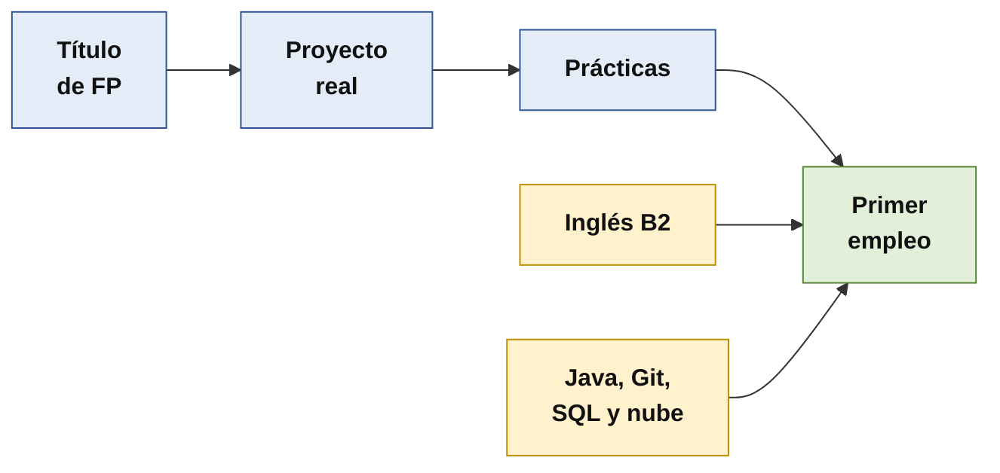

# Póster: 8 claves para mejorar tus opciones de que te contraten

Versión de **una página** para imprimir y repartir: [poster/poster-8-claves.pdf](poster/poster-8-claves.pdf) (A4). El código fuente editable está en [poster/poster-8-claves.html](poster/poster-8-claves.html). Esta es la versión en texto.

> [!NOTE]
> **Borrador para revisar.** Datos de noviembre de 2026. **Ninguna recomendación garantiza un empleo**: son lo que piden las ofertas, las empresas y los seniors. Todo el detalle y la evidencia de cada clave están en [recomendaciones](recomendaciones.md) y en [estadísticas y evidencias](estadisticas-y-evidencias.md).

## Cuatro cifras

| | |
|---|---|
| **74-78 %** | de las vacantes de desarrollo piden **FP** |
| **1-4 años** | de experiencia piden la mayoría de esas vacantes |
| **56-85** | candidatos por vacante (backend; frontend) |
| **79,5 %** | de los titulados de Informática, con contrato indefinido el primer año |

## Las 8 claves

| | Clave | Qué hacer | Evidencia |
|---|---|---|---|
| 1 | **Un proyecto que puedas defender** | Repositorio ordenado, README claro, versión desplegada, historial de *issues* y *pull requests* | El 70 % de los seniors pone en cabeza los proyectos reales |
| 2 | **Aprovecha las prácticas** | Pide tareas reales y opinión sobre tu trabajo; pregunta qué piden a un junior | 56 % valora las prácticas; Indra busca recién titulados de DAW y DAM |
| 3 | **Java 21, Spring Boot y SQL** | Haz tu proyecto con lo que ves en DWES: API REST, SQL y pruebas | 6.320 ofertas con Java (Telefónica); 1.347 en Tecnoempleo |
| 4 | **Comprueba, prueba y depura** | Escribe pruebas, usa el depurador, explica lo que aceptas; practica sin asistente | Seniors: dependencia de la IA 64 %, depuración débil 50 % |
| 5 | **IA como copiloto, y declarada** | Pídele que te explique y te pregunte; revisa, prueba y anota qué pediste, aceptaste y cambiaste | El 84 % la usa: se valora saber comprobarla |
| 6 | **Inglés B2** | Lee documentación en inglés; escribe tu README (o un resumen) en inglés | Único requisito explícito de la oferta completa que leímos (Indra) |
| 7 | **Trabaja como un equipo** | Ramas, commits con sentido, *pull requests* y tablero; nunca subas claves ni datos personales | Git y GitHub aparecen con frecuencia en las ofertas |
| 8 | **Prepara la entrevista** | Explica tu proyecto en 5 minutos; responde sobre cualquier parte del código | Entrevista técnica y pruebas de inglés (oferta de Indra) |

## Cómo se entra

También ayudan la **nube**, **TypeScript** y la **visión de negocio**. Busca con criterio: **candidaturas dirigidas** y **teletrabajo** (90 % en backend).

## Qué NO hacer

- Delegar el proyecto en la IA **sin entenderlo**.
- Pagar un bootcamp o un máster **creyendo que garantiza empleo**: ninguno de los que revisamos publicaba datos verificables.
- Acumular certificaciones: **ninguna oferta leída las exigía**.
- Postularte a todo, o exagerar tu currículo.
- Subir al repositorio claves, cupones de examen o datos personales.

## Fuentes

InfoJobs-Esade 2025; Ministerio de Educación y FP (inserción laboral); SEPE; INE; Adecco; Fundación Telefónica; Tecnoempleo; BairesDev *Dev Barometer* y Stack Overflow 2025 (encuestas de empresas del sector, no neutrales).
