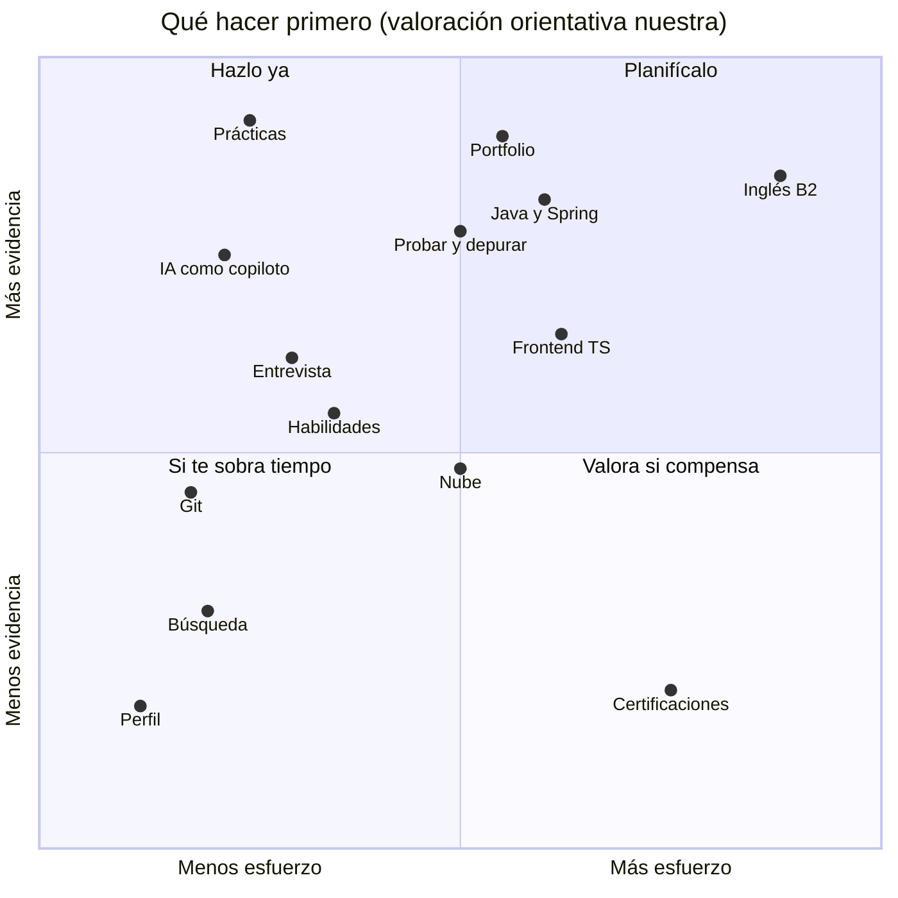

# Qué hacer para mejorar tus opciones de ser contratado

Recomendaciones **basadas en la evidencia** que hemos reunido sobre lo que pide el mercado. Cada una dice **qué dato la respalda**, **cómo hacerla desde el proyecto** y **cuánta evidencia hay detrás**.

> [!WARNING]
> **Ninguna de estas recomendaciones garantiza un empleo.** No existe un estudio que demuestre que hacer X multiplique tus probabilidades de que te contraten. Lo que hacemos es **seguir lo que piden las ofertas, lo que dicen las empresas y lo que critican los seniors**, y convertirlo en acciones concretas. Datos de noviembre de 2026.

## Cómo leer el nivel de evidencia

| Etiqueta | Significa |
|---|---|
| **Directa** | **Un dato pide o mide exactamente eso** (una oferta lo exige, una estadística lo cuantifica) |
| **Indirecta** | Los datos **apuntan** en esa dirección, pero no miden el efecto sobre ser contratado |
| **Inferencia** | Es **una conclusión nuestra** a partir de varios datos; razonable, pero no medida |

**Por dónde empezar**, según la evidencia de cada recomendación y el esfuerzo que cuesta. Es una **valoración orientativa nuestra**, no una medición:

## Las ocho que más importan

Ordenadas por la fuerza de la evidencia y por lo que pesan en lo que piden las empresas.

### 1. Haz de tu proyecto un portfolio que puedas defender

| | |
|---|---|
| **Evidencia** | **Directa.** Para considerar listo a un junior, los seniors ponen en cabeza la **experiencia en proyectos reales (70 %)**. Los puestos reciben **56-85 candidatos por vacante**: hace falta algo que te distinga. (BairesDev; InfoJobs-Esade) |
| **Qué hacer** | Un repositorio **ordenado**: README (qué problema resuelve, cómo arrancarlo, tecnologías), **enlace a una versión desplegada**, memoria y decisiones, **historial de *issues* y *pull requests*** y declaración de uso de IA. Mira la [lista de comprobación](#lista-de-comprobación-de-tu-repositorio) |
| **Dónde en el proyecto** | Todo el curso, y especialmente la **Fase 6** (despliegue) y la **defensa** |

### 2. Aprovecha la formación en empresa como tu primera experiencia

| | |
|---|---|
| **Evidencia** | **Directa.** Las ofertas piden **1-4 años**; los seniors valoran las **prácticas (56 %)**. Hay empresas que contratan a **recién titulados de DAW** (una oferta de Indra lo pide expresamente: CFGS DAM/DAW, menos de 2 años) |
| **Qué hacer** | Pide **tareas reales** y no solo de apoyo; pide **opinión sobre tu trabajo** cada pocas semanas; **pregunta qué tecnologías usan, qué piden a un junior y cómo es su proceso de selección**; **guarda lo que hagas** (sin datos confidenciales de la empresa). Deja una **buena impresión**: es la candidatura más barata que tendrás |
| **Dónde en el proyecto** | Del **3 de marzo al 19 de mayo**. Anota las preguntas en tu registro de tutoría |
| **Aviso** | Si la empresa te dice que **no se puede publicar** lo que haces, respeta esa decisión |

### 3. Domina Java 21, Spring Boot y SQL

| | |
|---|---|
| **Evidencia** | **Directa.** **Java** es una de las competencias más pedidas (**6.320** ofertas en Telefónica; **1.347** en Tecnoempleo) y **Java con Spring Boot** domina el backend en las ofertas que vimos, también las de nivel de entrada (por ejemplo, un «Programador/a Junior Java + Spring Boot» y un «Programador Junior Java/Fullstack») |
| **Qué hacer** | **Haz tu proyecto en Java 21 con Spring Boot**, que ves en **Desarrollo web en entorno servidor (DWES)**. Construye una **API REST**, accede a los datos con **SQL**, protege los accesos y **escribe pruebas**. **Practica SQL**: consultas, uniones, índices. Si puedes, **despliégalo** y documenta cómo |
| **Dónde en el proyecto** | Fase 4 (implementación) y los módulos de servidor y bases de datos |
| **Por qué es buena noticia** | Lo que das en clase **coincide con lo que más piden las ofertas de backend**. Tu ventaja será **demostrar que lo dominas con un proyecto completo** |

### 4. Aprende a comprobar, probar y depurar lo que programas (sin que lo haga la IA)

| | |
|---|---|
| **Evidencia** | **Directa.** Los seniors señalan como debilidades de los junior la **dependencia excesiva de la IA (64 %)**, la **depuración débil (50 %)** y la **dificultad para descomponer problemas (49 %)**. Según ellos, solo el **16 %** de los junior **entiende del todo el código con IA que entrega**. Entre los desarrolladores, el **66 %** dice que la IA da soluciones «casi correctas» y el **45 %** que depurar su código lleva **más** tiempo (BairesDev; Stack Overflow) |
| **Qué hacer** | **Escribe pruebas automáticas** (en Java, con JUnit) para lo importante. **Depura con el depurador del IDE**, no a base de preguntar. **Reproduce el fallo antes de arreglarlo.** Antes de aceptar código de una IA, **explícalo con tus palabras**. **Resuelve algunos problemas sin asistente** para comprobar que sabes |
| **Dónde en el proyecto** | **Fase 5** (pruebas) y la **defensa oral** |
| **Por qué importa** | El estudio de Harvard describe **depurar** como tarea de entrada «rutinaria» expuesta a la IA. Si sabes **entender y arreglar**, aportas **lo que la IA no resuelve sola** |

### 5. Usa la IA como copiloto, no como sustituto, y decláralo

| | |
|---|---|
| **Evidencia** | **Directa.** Adecco: «la IA como copiloto, no como sustituto […] el profesional **valida y refina** lo que la tecnología genera». El **84 %** de los desarrolladores la usa o planea usarla; **usar IA no te distingue**, **saber comprobarla sí** |
| **Qué hacer** | **Pídele que te explique y te pregunte**, no solo que te dé el código hecho. **Revisa y prueba** lo que acepta. **Anota** en tu declaración **qué pediste, qué aceptaste y qué cambiaste**. **Nunca** pegues claves ni datos personales. Mira [IA y aprendizaje](ia-y-aprendizaje.md) |
| **Dónde en el proyecto** | Todo el curso; la **declaración de uso de IA** es parte del repositorio |
| **Qué decir en una entrevista** | «Usé IA para X; la comprobé con pruebas y cambié Y porque Z» es una respuesta mucho mejor que «lo hizo la IA» |

### 6. Sube tu inglés al nivel B2

| | |
|---|---|
| **Evidencia** | **Directa.** La **única oferta que leímos completa** (Indra) pide **inglés B2** y la entrevista incluye pruebas de inglés «si es necesario». El inglés aparece en otras ofertas (por ejemplo, «inglés C1» en una de Python en Madrid). |
| **Qué hacer** | **Lee documentación técnica en inglés** a diario. **Escribe el README y los *commits* en inglés** (o una versión en inglés). **Practica hablar** explicando tu proyecto. Si quieres un certificado: Cambridge B2 o la prueba B2 de la Escuela Oficial de Idiomas |
| **Dónde en el proyecto** | El módulo de **Inglés profesional** y tu **documentación** (Fase 7) |
| **Matiz** | Es la que **más tarda**: empieza ya, a ritmo suave |

### 7. Aprende a funcionar como en un equipo de empresa (Git, revisión y trabajo por tareas)

| | |
|---|---|
| **Evidencia** | **Indirecta.** Git y GitHub aparecen con frecuencia en las ofertas (Tecnoempleo lista cientos de ofertas con «github»; *dato visto en el título de su listado, no leído*). Los **agentes de IA** trabajan sobre *issues* y *pull requests* |
| **Qué hacer** | Trabaja **siempre en ramas**, con **commits pequeños y con sentido**, **pull requests** con descripción, y **un tablero** de tareas. **Lee y comenta** el código de otros si puedes. **No subas secretos** al repositorio |
| **Dónde en el proyecto** | **Ya lo haces desde el primer día.** Cuídalo: es parte de tu portfolio |

### 8. Prepárate para la entrevista técnica (y la defensa es tu ensayo)

| | |
|---|---|
| **Evidencia** | **Directa e indirecta.** La entrevista de Indra incluye **revisión del perfil, llamada breve, entrevista técnica, pruebas de inglés y entrevista con selección**. Las **políticas de IA en entrevistas son dispares** (algunas empresas la permiten y otras no; evidencia débil, de blogs) |
| **Qué hacer** | **Practica explicar tu proyecto en 5 minutos** y **responder preguntas sobre cualquier parte del código**. **Resuelve problemas básicos sin ayuda** (algoritmos simples, consultas SQL, depurar un fallo). Prepara **ejemplos de problemas que resolviste** y **qué aprendiste** |
| **Dónde en el proyecto** | La **defensa oral** (20 y 27-may). Pide a un compañero que te haga preguntas |

## Las seis que ayudan mucho

### 9. Nube: despliega tu proyecto en algún servicio

| | |
|---|---|
| **Evidencia** | **Directa en demanda; indirecta en contratación.** **Nube** es la competencia más pedida en ofertas digitales (**7.020**). En Asturias solo el **25,9 %** de las empresas de 10 o más empleados paga nube (media nacional, **39,4 %**) |
| **Qué hacer** | **Despliega tu proyecto en un servicio de nube con nivel gratuito** y documenta **cómo lo hiciste y cuánto cuesta**. Aprende los conceptos (contenedores, redes, almacenamiento, seguridad básica). Opcional: **Oracle OCI Foundations** (gratis) o **AWS Cloud Practitioner** (100 USD) |
| **Dónde en el proyecto** | **Fase 6** (despliegue) |

### 10. Frontend moderno: JavaScript y TypeScript

| | |
|---|---|
| **Evidencia** | **Directa.** Indra pide **HTML, CSS, JavaScript, Angular, React y TypeScript**. **JavaScript**: 3.975 ofertas. **Frontend avanzado** es de los junior mejor pagados (Adecco). Ojo: el **frontend es lo más competido** (**85** inscritos por vacante) |
| **Qué hacer** | **Usa TypeScript** en el frontend de tu proyecto y **un framework** (Angular o React). **Haz que sea accesible y que se vea bien en móvil** |
| **Matiz** | Es **lo que más se delega a la IA** (JavaScript/TypeScript y HTML/CSS suman el 59 % de las consultas de programación analizadas en un estudio de Anthropic de 2025, con Claude.ai y Claude Code). **Tu valor no está en generar pantallas**, sino en **comprobarlas, hacerlas accesibles y mantenerlas** |

### 11. Desarrolla las habilidades que no son código

| | |
|---|---|
| **Evidencia** | **Directa.** **Resolver problemas** es lo que más citan los junior (**~50 %**) y Adecco pide **visión de negocio, pensamiento crítico, comunicación y aprendizaje autónomo**. Las competencias personales aparecen en el **41 %** de las ofertas (DigitalES, **vía prensa**; fiabilidad baja) |
| **Qué hacer** | **Explica el *porqué* de tus decisiones** (por qué esta tecnología, qué alternativas descartaste). Aprovecha **el análisis del sector, el presupuesto y los riesgos** del proyecto: es **visión de negocio ya hecha**. **Practica explicar algo técnico a alguien que no sabe**. Pide y da *feedback* |
| **Dónde en el proyecto** | **RA1 a RA3** (análisis, diseño, planificación) |
| **Formación gratuita opcional** | Modelos de negocio, análisis de requisitos y diseño centrado en el usuario: [visión de negocio y análisis empresarial](../formacionComplementaria/negocio-y-producto.md) |

### 12. Busca bien: candidaturas dirigidas y en más de un sitio

| | |
|---|---|
| **Evidencia** | **Indirecta.** Hay **56 candidatos por vacante** de media y **85** en frontend. Indeed señala que los candidatos con menos experiencia **se postulan a puestos que no encajan**, lo que **sobrecarga a los reclutadores** y lleva a **filtros automáticos**. **El 90 % de las vacantes de backend ofrece teletrabajo** y **Madrid y Barcelona concentran más del 62 %** de las ofertas |
| **Qué hacer** | **Adapta tu currículo a cada oferta** (palabras clave de la oferta, tu proyecto relacionado). **No te postules a todo**: elige donde **cumples lo esencial**. **Mira varios portales** (LinkedIn, Tecnoempleo, InfoJobs, Indeed) y las **webs de empleo de las empresas**. **No descartes el teletrabajo ni otras ciudades** |
| **Ejemplos de dónde miran los junior** | En noviembre de 2026 vimos ofertas de entrada o junior en **Indra, GMV, NTT DATA, Capgemini (puesto «Associate» en Langreo), sg tech (Java + Spring Boot, Madrid), Second Window (Java/fullstack, remoto)** y otras. **Pueden haber cerrado: compruébalo** |
| **Matiz** | Son **empresas que publicaron en ese momento**, no una recomendación ni una garantía |

### 13. Cuida tu presencia profesional

| | |
|---|---|
| **Evidencia** | **Inferencia.** No tenemos datos de cuánto pesa un perfil o un currículo, pero **las ofertas se publican en estos portales** y los reclutadores **filtran** a mano o con herramientas |
| **Qué hacer** | **Un perfil de GitHub con tu proyecto fijado** y un README claro. **Un perfil de LinkedIn** con tu título, el proyecto, las prácticas y las tecnologías. **Un currículo de una página.** **Describe con precisión**: nombre exacto de cada certificación y quién la emite (**no «certificado de Harvard»** si es un certificado gratuito de CS50). **Nada que no puedas defender** en una entrevista |
| **Aviso** | **Revisa lo que publicas**: no incluyas datos personales que no quieras exponer ni información confidencial de la empresa de prácticas |

### 14. Mantén el aprendizaje continuo con un plan realista

| | |
|---|---|
| **Evidencia** | **Indirecta.** Adecco habla de **upskilling y reskilling** como motor de salario; los seniors critican la **dependencia sin comprensión**. Más IA en el trabajo significa **más cambio de herramientas** |
| **Qué hacer** | **Elige una cosa a la vez**: por ejemplo, nube **o** pruebas **o** inglés. **Anota lo que aprendes** y dónde lo aplicas. Mira la [formación complementaria opcional](../formacionComplementaria/README.md) y su [itinerario](../formacionComplementaria/itinerario.md) |

## Para después: opcionales

| Recomendación | Evidencia | Nota |
|---|---|---|
| **Seguridad básica** (cuentas, datos, OWASP Top 10) | **Indirecta.** Las vacantes de consultor de seguridad casi se duplicaron respecto a 2024 (InfoJobs-Esade); Adecco la sitúa entre los perfiles con prima salarial | Úsala como **criterio de calidad** de tu proyecto: no secretos en el repositorio, validación de entradas, contraseñas bien guardadas |
| **Una funcionalidad de IA en tu proyecto** (por ejemplo, llamar a un modelo con control de coste y privacidad) | **Indirecta.** El **33,6 %** de las empresas usa IA (30,7 % en Asturias); hay ofertas de IA incluso de entrada | Hazlo **solo si encaja** en tu proyecto. **Cuida privacidad, coste y errores**; y **decláralo** |
| **Una certificación** | **Ninguna oferta que leímos la exigía** | Prioriza **inglés**, **Git** y **nube**. Mira [certificaciones](../formacionComplementaria/certificaciones.md). **No pagues por miedo a quedarte atrás** |
| **El curso oficial de IA y Big Data de FP** (600 horas, acceso con DAW) | **Indirecta.** Hay demanda de perfiles de IA y prima salarial; **no tenemos datos de empleo de este curso** | **Confirma si se imparte en Asturias** |
| **CS50 SQL y CS50 Cybersecurity** (Harvard, gratuitos) | **Indirecta** | Calcula **10-20 horas semanales**; mira [CS50](../formacionComplementaria/cs50-harvard.md) |

## Lo que NO te recomendamos

| No lo hagas | Por qué |
|---|---|
| **Delegar el proyecto en la IA** y no entender el código | Es **la crítica principal de los seniors** (64 %) y **se nota en la defensa y en una entrevista** |
| **Pagar un bootcamp o un máster creyendo que garantiza empleo** | Los cinco programas privados que revisamos **no publicaban datos verificables de empleo**; las vacantes piden **FP**, no esos títulos |
| **Acumular certificaciones sin una oferta concreta** | **Ninguna oferta que leímos las exigía** |
| **Postularte a todo** | Aumenta la competencia y **no mejora tu perfil** |
| **Exagerar tu currículo** | Una entrevista técnica lo descubre y **se pierde la confianza** |
| **Subir al repositorio claves, cupones de examen o datos personales** | Es un problema de **seguridad** y de privacidad |
| **Dejar el inglés «para más adelante»** | Es lo que más tarda y lo único **explícito** en la oferta completa que leímos |

## Lista de comprobación de tu repositorio

Antes de enseñar tu proyecto a una empresa:

- [ ] **README** claro: qué hace, a quién sirve, cómo arrancarlo, tecnologías (**en inglés** o con resumen en inglés).
- [ ] **Enlace a una versión desplegada** que funcione.
- [ ] **Capturas o un vídeo corto** de la aplicación.
- [ ] **Diagrama de arquitectura** (el proyecto usa Mermaid y el modelo C4).
- [ ] **Pruebas automáticas** y cómo ejecutarlas.
- [ ] **Historial limpio**: ramas, commits con mensaje convencional, *issues* y *pull requests* revisados.
- [ ] **Decisiones técnicas** explicadas (por qué esta tecnología).
- [ ] **Declaración de uso de IA** al día.
- [ ] **Sin secretos**: ni claves, ni contraseñas, ni cupones de examen, ni datos personales.
- [ ] **Seguridad básica** revisada (entradas validadas, contraseñas cifradas).
- [ ] **Accesibilidad** comprobada.
- [ ] **Licencia y datos de contacto** que tú elijas publicar.

## Un calendario resumido

| Cuándo | Prioridad |
|---|---|
| **Hasta H2 (noviembre-enero)** | Cuida el análisis y el diseño del proyecto (portfolio, visión de negocio). Empieza el **inglés** a ritmo suave |
| **Implementación (febrero-marzo)** | **Java 21, SQL, pruebas y depuración**; frontend con TypeScript; **Git** impecable. **Despliega pronto** |
| **Formación en empresa (marzo-mayo)** | Aprovecha las **prácticas**: pregunta, aprende y **deja buena impresión** |
| **Despliegue y defensa (abril-mayo)** | **Nube**, portfolio y **ensayo de la entrevista** |
| **Después (junio en adelante)** | **Candidaturas dirigidas**, perfil profesional, y si quieres **una certificación** o formación opcional |

## Qué no sabemos todavía

- **Qué prioriza cada empresa asturiana** al contratar a un junior: lo más fiable es **preguntarlo en las prácticas**.
- **Cuánto pesa cada recomendación** en una decisión real de contratación: **no hay estudios**.
- **Si las tareas de entrada seguirán disminuyendo**: depende de factores que no controlas.

Más contexto: [qué pide el mercado](mercado-laboral-2026.md) · [estadísticas y evidencias](estadisticas-y-evidencias.md) · [la IA en el trabajo](ia-en-el-mercado.md) · [formación complementaria](../formacionComplementaria/README.md).
