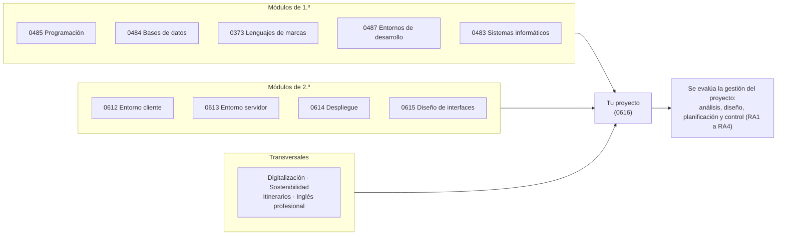

# Relación del proyecto con los módulos del ciclo

> **Estado:** propuesta del tutor, 6-nov-2026. Lo que viene de la norma está citado y se marca **(norma)**. Lo que es una propuesta de trabajo se marca **(propuesta)** y necesita el acuerdo del equipo docente antes de darse por válido.

El proyecto no es un módulo más: es el sitio donde se **junta lo aprendido en todos los demás**. Este documento explica cómo se relaciona con cada módulo del currículo, qué pide la norma y qué hemos decidido nosotros.

## 1. Idea en una imagen

## 2. Qué dice la norma

| Qué | Fuente | |
|---|---|---|
| El proyecto «tendrá carácter **integrador de las competencias adquiridas**» y es **uno** durante el ciclo | RD 659/2023, art. 96.3; Circular 2026-27, 6.3.1.b | norma |
| El seguimiento y la tutorización son **individuales y colectivos** y se hacen **de forma simultánea al resto de módulos** | RD 659/2023, art. 96.3; Circular, 6.3.2 | norma |
| El **equipo docente** fija «uno o varios retos, proyectos o problemas» del sector, que «activan de manera transversal los resultados de aprendizaje de los módulos profesionales […] de cada curso» | Circular, 6.3.4 | norma |
| Se desarrolla durante **los dos cursos** | Circular, 6.3.5 | norma |
| El módulo «se relaciona con la **totalidad de los objetivos generales** del ciclo y las competencias profesionales, personales y sociales del título» y «complementa» a los demás en las funciones de **análisis del contexto, diseño del proyecto y organización de la ejecución** | RD 686/2010, módulo 0616 (orientaciones pedagógicas) | norma |
| Los **contenidos básicos** del proyecto y de los módulos son **orientativos** | RD 500/2024, art. cuarto.Uno (se aplica al RD 686/2010 y a los demás títulos que lista su art. primero) | norma |
| Se **califica al final de 2.º**; la evaluación final de 1.º es parcial | Circular, 6.4.1 y 6.4.2 | norma |

**Lo que la norma no dice** y que por tanto decide el equipo docente:

- Qué módulos quedan vinculados al proyecto y con qué peso.
- Si una misma entrega puede servir como evidencia en otro módulo.
- Si el proyecto tiene que llevar código funcional y de cuánto.

## 3. Los módulos del currículo

Datos del Decreto 103/2025 (Asturias), con las horas de cada curso.

| Código | Módulo | Curso | Horas | ECTS | Papel en el proyecto |
|---|---|---|---|---|---|
| 0373 | Lenguajes de marcas y sistemas de gestión de información | 1.º | 120 | 7 | Técnico |
| 0483 | Sistemas informáticos | 1.º | 151 | 11 | Técnico |
| 0484 | Bases de datos | 1.º | 181 | 12 | Técnico |
| 0485 | Programación | 1.º | 211 | 15 | Técnico |
| 0487 | Entornos de desarrollo | 1.º | 90 | 6 | Técnico |
| 0179 | Inglés profesional | 1.º | 66 | 5 | Transversal |
| 1665 | Digitalización aplicada a los sectores productivos | 1.º | 30 | 3 | Transversal |
| 1708 | Sostenibilidad aplicada al sistema productivo | 1.º | 30 | 3 | Transversal |
| 1709 | Itinerario personal para la empleabilidad I | 1.º | 96 | 5 | Transversal |
| 0612 | Desarrollo web en entorno cliente | 2.º | 221 | 10 | Técnico |
| 0613 | Desarrollo web en entorno servidor | 2.º | 221 | 13 | Técnico |
| 0614 | Despliegue de aplicaciones web | 2.º | 162 | 5 | Técnico |
| 0615 | Diseño de interfaces web | 2.º | 195 | 10 | Técnico |
| 1710 | Itinerario personal para la empleabilidad II | 2.º | 88 | 5 | Transversal |
| PA03XX | Módulo optativo | 2.º | 88 | 5 | Según el módulo que se oferte |
| **0616** | **Proyecto intermodular** | **1.º y 2.º** | **25 + 25** | **5 (una vez)** | **Integra todos** |

## 4. Qué aporta cada módulo al proyecto

Los resultados de aprendizaje (RA) están **resumidos** y se citan por su número; el texto oficial está en el RD 405/2023 (módulos técnicos) y en el RD 659/2023, anexos V, VII, VIII y X (transversales). Las competencias del título que cada módulo declara son las de su propio apartado «contribuye a alcanzar…» del RD 405/2023 (leyenda en el [anexo](#anexo-competencias-del-título)).

### 4.1 Módulos técnicos

| Módulo | RA que el proyecto activa | Competencias que declara el módulo | Qué enseñas en tu proyecto | Fases |
|---|---|---|---|---|
| **0485** Programación | RA2 y RA4 (clases y POO), RA5 (entrada y salida), RA6 (tipos avanzados), RA8 (persistencia), RA9 (datos) | e, f, j | La lógica del dominio: estructura del código, modelo de clases y manejo de datos | 4 |
| **0484** Bases de datos | RA2 (crear BD), RA3 y RA4 (consultar y modificar), RA5 (procedimientos), RA6 (modelo relacional desde el E/R), RA7 (no relacional) | d, e, p | El modelo de datos (E/R y relacional), el script de creación y las consultas | 2, 4 |
| **0373** Lenguajes de marcas | RA2 (marcas para la web), RA3 (script de cliente sobre documentos), RA4 a RA6 (formatos de intercambio) | e, f, h, p | Estructura de los documentos y formatos de intercambio (JSON o XML) entre cliente y servidor | 2, 4 |
| **0487** Entornos de desarrollo | RA1 (fases del desarrollo), RA3 (pruebas), RA5 y RA6 (diagramas de clases y de comportamiento) | d, e, i, j, r, t, v, w | Los diagramas del diseño y el plan de pruebas | 2, 3, 5 |
| **0483** Sistemas informáticos | RA1 (evaluar sistemas), RA2 (instalar), RA7 (documentación) | a, b, o, q | El entorno donde corre y los recursos materiales necesarios | 2, 3, 6 |
| **0612** Entorno cliente | RA5 (eventos), RA6 (DOM), RA7 (comunicación asíncrona) | e, k, m, n, p, r | El código del navegador | 4 |
| **0613** Entorno servidor | RA1 (arquitectura y tecnologías), RA5 (separar presentación y lógica), RA6 (acceso a datos seguro), RA7 (servicios web), RA8 y RA9 (frameworks) | c, d, f, g, h, j, k, l, m, n, ñ, q | La arquitectura y el código del servidor | 2, 4 |
| **0614** Despliegue | RA1 (arquitecturas), RA2 y RA3 (servidores), RA5 (verificar), RA6 (documentación, control de versiones e integración continua) | a, b, c, j, n, ñ, q | La puesta en marcha y la guía de despliegue | 5, 6, 7 |
| **0615** Diseño de interfaces | RA1 (planificar la interfaz), RA2 (estilos), RA5 (accesibilidad), RA6 (usabilidad) | e, g, h, i, m, n, u | El prototipo, la guía de estilo y la verificación de accesibilidad y usabilidad | 2, 4, 5 |

### 4.2 Módulos transversales

| Módulo | RA que el proyecto activa | Qué enseñas en tu proyecto | Fases |
|---|---|---|---|
| **Digitalización** (1665) | RA1 (digitalización en el sector), RA5 (datos y ciberseguridad), RA6 (proyecto de transformación digital de una empresa) | La necesidad real, el análisis del sector y la protección de datos | 1, 2 |
| **Sostenibilidad** (1708) | RA3 (criterios de sostenibilidad en el trabajo), RA6 (plan de sostenibilidad de una empresa) | El impacto del proyecto en la viabilidad | 1, 2 |
| **Itinerario I** (1709) | RA1 (sector productivo y puestos de trabajo), RA2 (prevención de riesgos), RA3 (condiciones laborales) | Obligaciones laborales y de prevención de riesgos del proyecto | 1, 3 |
| **Itinerario II** (1710) | RA4 (idea de emprendimiento validada), RA5 (proyecto emprendedor) | Oportunidad de negocio, presupuesto y financiación | 1, 2 |
| **Inglés profesional** (0179) | RA4 (redactar documentos e informes) | Documentación o resumen técnico en inglés | 1, 7 |
| **Optativo** | No consta cuál se ofrece | No se puede valorar | — |

> [!NOTE]
> La asignación de RA y fases de los apartados 4.1 y 4.2 es una **propuesta (propuesta)**. La norma solo dice que el proyecto activa los RA de los módulos de cada curso; no dice cuáles. Las competencias de la tabla 4.1 sí son literales del RD 405/2023.

## 5. En qué fase usas cada módulo

● uso principal · ○ apoyo. **(propuesta)**

| Módulo | F1 Análisis | F2 Diseño | F3 Planificación | F4 Implementación | F5 Pruebas | F6 Despliegue | F7 Control y cierre |
|---|---|---|---|---|---|---|---|
| 0485 Programación | | ○ | | ● | ○ | | |
| 0484 Bases de datos | | ● | | ● | ○ | | |
| 0373 Lenguajes de marcas | | ○ | | ○ | | | |
| 0487 Entornos de desarrollo | | ● | ○ | | ● | | |
| 0483 Sistemas informáticos | | ○ | ○ | | | ○ | |
| 0612 Entorno cliente | | ○ | | ● | ○ | | |
| 0613 Entorno servidor | | ● | | ● | ○ | | |
| 0614 Despliegue | | ○ | ○ | | ○ | ● | ○ |
| 0615 Diseño de interfaces | | ● | | ● | ● | | |
| Digitalización | ● | ○ | | | | | |
| Sostenibilidad | ○ | ○ | | | | | |
| Itinerarios I y II | ● | ○ | ○ | | | | |
| Inglés profesional | ○ | | | | | | ○ |

## 6. Dónde se apoya cada criterio del 0616

Los 33 criterios del 0616 evalúan la **gestión** del proyecto (análisis, diseño, planificación y control). Para hacerlos bien necesitas lo aprendido en otros módulos. Ejemplos **(propuesta)**:

| Criterio del 0616 | Se apoya en |
|---|---|
| RA1 c, d, e: necesidades y oportunidades del sector | Digitalización, Itinerario I |
| RA1 g: obligaciones fiscales, laborales y de prevención de riesgos | Itinerarios I y II |
| RA1 h: ayudas y subvenciones | Itinerario II |
| RA2 b: viabilidad técnica | 0613, 0614, 0615, 0483 |
| RA2 f, g: presupuesto y financiación | Itinerario II, 0483 |
| RA2 h: documentación de diseño | 0487 (diagramas), 0484 (modelo de datos) |
| RA2 i: aspectos de calidad | 0615 (accesibilidad, usabilidad), 0487 (pruebas) |
| RA3 e: riesgos y prevención | Itinerario I |
| RA3 h: documentación para implementar | 0614 (control de versiones y documentación) |
| RA4 b: indicadores de calidad | 0487 (pruebas), 0615 (accesibilidad y usabilidad) |
| RA4 c, d: incidencias y cambios | 0614 (control de versiones, integración continua) |

## 7. Reglas de integración

1. **Mínimo de integración (propuesta, ya en el documento de inicio).** Tu proyecto usa de forma real al menos **tres** de los cuatro módulos técnicos de 2.º (0612, 0613, 0614, 0615). Lo declaras en el apartado 8 de `docs/00-documentoInicio.md`.
2. **Los de 1.º se suponen (propuesta).** Datos (0484) y lógica (0485) aparecen en casi cualquier aplicación; no hace falta declararlos, pero sí poder explicarlos en la defensa.
3. **El proyecto no sustituye a los módulos (norma).** Cada módulo evalúa sus propios RA. El 0616 evalúa los suyos (RA1 a RA4).
4. **Una entrega puede servir en dos módulos, pero cada módulo evalúa lo suyo (propuesta).** Por ejemplo, el modelo de datos puede ser evidencia en el 0484 y en el CE 2.h del 0616, con criterios distintos en cada uno.
5. **La trazabilidad la haces tú (propuesta).** En la memoria, una tabla corta: módulo → qué hiciste → dónde está en el repositorio.

## 8. Qué hay que acordar con el equipo docente

Para que esto deje de ser una propuesta, hace falta cerrar con quien imparte cada módulo, antes del **21-ene (H2)**, que es cuando empieza la implementación:

- ¿Qué RA de 0612, 0613, 0614 y 0615 activa el proyecto? (Circular 6.3.4 pide que lo fije el equipo docente).
- ¿Se acepta el código del proyecto como evidencia en esos módulos? ¿Con qué peso?
- ¿Qué parte de los módulos de 1.º se espera ver en el proyecto?
- ¿Cómo se coordinan los plazos? Las entregas H1, H2 y H3 no deberían coincidir con exámenes de otros módulos.
- ¿Quién tutoriza el código, y cuántas horas? No lo fija la norma.

## 9. Fuentes y lo que no se ha verificado

| Fuente | Qué se ha usado |
|---|---|
| RD 686/2010 | Orientaciones pedagógicas y RA/CE del 0616 |
| RD 405/2023 | RA, «contribuye a alcanzar…» y competencias de los módulos técnicos, redactados de nuevo |
| RD 500/2024 | Renombre a «Proyecto intermodular», contenidos orientativos |
| RD 659/2023 | Arts. 96 a 101 y anexos V, VII, VIII y X (módulos transversales) |
| Decreto 103/2025 | Módulos, curso, horas y ECTS |
| Circular 2026-27, Anexo II | Apartados 6.3 y 6.4 |

**Sin verificar:**

- El módulo optativo (PA03XX): no consta cuál ofrece el centro.
- Los contenidos de cada módulo en la programación del centro: aquí solo se usan los RA y competencias de la norma.
- Los textos de los RA de los módulos transversales están resumidos; hay que contrastarlos con el anexo V, VII, VIII y X del RD 659/2023 antes de citarlos en una programación.
- La numeración de los RA de Itinerario I y II sigue el orden del anexo V; no se ha comprobado que el RD los numere de nuevo en el segundo módulo.

## Anexo: competencias del título

Según el RD 405/2023 (art. 5 del RD 686/2010 redactado de nuevo).

| | Competencia (resumida) | | Competencia (resumida) |
|---|---|---|---|
| a | Configurar y explotar sistemas informáticos | m | Completar planes de pruebas |
| b | Seguridad en sistemas, servicios y aplicaciones | n | Documentación y control de versiones |
| c | Gestionar servidores para el despliegue | ñ | Desplegar y distribuir aplicaciones web |
| d | Gestionar bases de datos | o | Mantenimiento de recursos |
| e | Aplicaciones web con acceso a bases de datos | p | Adaptarse y aprender a lo largo de la vida |
| f | Integrar contenidos y acceso a datos | q | Resolver problemas con iniciativa y autonomía |
| g | Interfaces con lenguajes de marcas y estándares | r | Organizar y coordinar equipos |
| h | Componentes multimedia | s | Comunicación eficaz |
| i | Integrar multimedia, accesibilidad y usabilidad | t | Entornos seguros y prevención de riesgos |
| j | Componentes en el entorno servidor | u | Calidad, accesibilidad universal y diseño para todos |
| k | Servicios web | v | Gestión básica de una pequeña empresa |
| l | Integrar servicios y contenidos distribuidos | w | Derechos y obligaciones profesionales |
